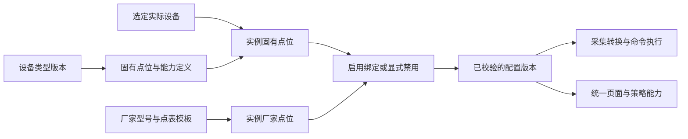

# EMS 设备模型与点表绑定设计

> 版本：1.0｜更新日期：2026-09-14｜状态：目标设计，待实现。
> 本文定义设备类型、固有点位、厂家点表、设备实例绑定及导入配置流程。整体架构见 [EMS 系统架构设计](EMS架构设计.md)，键格式见 [Redis 键设计](rtdb/Redis键设计.md)，协议执行见 [数据采集架构](collect/data_collect_architecture.md)。文中的设备目录是 EMS 项目抽象，厂家 A/B 的地址与编码均为示例，不是现场设备参数或行业强制标准。

## 1. 目标与核心约定

EMS 面对 PCS、BMS、电表、消防、空调、环控、保护装置和其他设备，使用统一的设备业务模型。用户导入点表前必须选定实际设备，导入后把厂家点位绑定到该设备的固有点位；同厂家、同型号、同协议版本的设备可以复用已验证模板。

例如，PCS 类型预置开机、关机、故障复位、有功设定、无功设定和功率反馈等固有点位。型号不支持某项时允许显式禁用，并记录原因。预置目录表示 EMS 能表达的业务含义，不表示每台 PCS 必然支持全部功能。

| 层次 | 解决的问题 | 示例 |
| --- | --- | --- |
| 设备类型与固有点位 | EMS 如何理解数据、调用设备 | PCS 的 `active_power`、`start`、`set_active_power` |
| 厂家型号与点表模板 | 厂家协议如何表达数据和指令 | 寄存器地址、数据类型、字节序、倍率、状态码、开关机写入值 |
| 实际设备与绑定配置 | 某台现场设备如何接入该模型 | ess000001 下 pcs01，绑定实际通道、从站地址、固有点位与厂家点位 |

前端和策略使用稳定的固有点位 code、单位和控制能力；采集进程依据生效配置解析厂家地址。厂商原始点位保留，支持诊断、专有数据展示和后续补充映射，不要求把所有导入行都塞进固有目录。



## 2. 设备类型、型号与实例

### 2.1 类型目录

| type_code | 类型 | 固有模型的关注范围 |
| --- | --- | --- |
| `pcs` | 储能变流器 | 运行与控制权状态、有功/无功、交流/直流侧量、启停与设定 |
| `bms` | 电池管理系统 | SOC/SOH、电池电压电流、温度、电芯极值、充放电许可和限值、告警 |
| `meter` | 电表 | 功率、电量、电压、电流、频率、功率因数和质量 |
| `fire` | 消防设备 | 火警、故障、探测状态、介质/压力等型号支持的监视量 |
| `hvac` | 空调/温控设备 | 运行模式、温度、设定值、故障和启停 |
| `environment` | 环控设备 | 温湿度、水浸、门禁、烟感及环境联动状态 |
| `protection` | 保护装置 | 保护动作、闭锁、开关位置、故障与事件 |
| `generic` | 通用其他设备 | 通用在线/运行/故障状态，用户自定义的业务点位和能力 |

类型描述业务角色，协议描述通信方式，两者独立。例如使用同一种通信协议的电表与空调不会共享一个设备类型。一个网关采集多种设备时，网关是通信来源，下面各资产仍按各自业务类型配置。

### 2.2 实例与子设备

实例至少包含稳定 device_id、asset_id、设备 code、类型版本、厂家、型号、固件版本、协议版本、所属 station/unit、父资产及通道绑定。设备 code 和层级遵守已有全局单元 code 与同父节点唯一规则，编号直接接名称，如 pcs01、bms01、rack01。

BMS 管理的 Rack、Pack、Cell 可以只有资产节点，没有独立通信设备实例。导入时选择 BMS 这一实际通信设备，再把不同范围的厂家点位映射到对应 Rack/Pack/Cell 资产的固有点位；绑定保存来源 device_id 与目标 asset_id。批量展开前预览每行目标，禁止靠重名自动跨节点绑定。

一个资产的固有点位通常取自其对应设备；跨资产取值只能通过显式的管理/服务关系配置并校验 station 及权限。共享电表、公共消防、保护装置归 station 或其公共资产节点，多个单元通过关系引用同一权威数据。

型号模板只包含可复用点表与绑定规则，不携带实际 IP、串口、从站地址、设备 ID 或登录凭据。实例固定引用某一模板版本，更新模板不会自动改写已投运设备。

## 3. 固有点位与能力模型

### 3.1 固有点位定义

固有点位也称标准点位：由设备类型预置、含义固定、面向 EMS 业务的逻辑槽位。每个定义包含：

| 字段 | 说明 |
| --- | --- |
| `standard_code / name / description` | 稳定英文 code、显示名称、精确业务含义 |
| `kind` | telemetry 遥测、status 状态、event 事件、command 命令 |
| `value_type / unit` | 类型与标准工程单位；无单位明确为 null |
| `enum_definition / quality_rule` | 标准枚举、异常码、无效值与新鲜度要求 |
| `access` | read、event 或 command；读数与命令分别建点 |
| `semantic_constraints` | 符号、量程、计量方向、瞬时/累计等含义 |
| `dependency_tags` | 哪些监视、调度或控制能力依赖本点 |
| `verification_policy` | 命令需要的反馈点、判据、超时与是否允许仅协议确认 |
| `definition_version` | 定义版本，已发布语义不原地改变 |

固定 code 用于语义契约，不能把厂家的寄存器名直接改成标准 code。相同语义跨类型可以复用 code，例如有功功率 `active_power`；不同含义必须分开，例如实际有功、设定目标和设备设定值回显。

### 3.2 PCS 首期固有点位

以下是建议的首期目录，支持按现场补充版本。每个实例都显示完整目录，并允许把不支持或不使用的项目设为禁用。

| standard_code | 显示名称 | 种类 / 单位 | 绑定说明 |
| --- | --- | --- | --- |
| `run_state` | 运行状态 | status / 枚举 | 例如 stopped、starting、running、stopping、fault、unknown；厂家状态显式映射 |
| `control_mode` | 本地/远程控制状态 | status / 枚举 | 不把无法读取的状态假定为远程 |
| `fault_active` | 故障总状态 | status / bool | 缺失或质量无效不等于无故障 |
| `fault_code` | 当前厂家故障原码 | status / string | 保留枚举原码或位图的规范化文本；不将多个故障位误当成互斥枚举 |
| `fault_event` | 故障变化事件 | event | 将发生/恢复及标准分类作为事件字段，允许一个位图产生多条故障事件 |
| `active_power` | 实际有功功率 | telemetry / kW | 沿用整体架构：放电向交流侧送电为正，充电为负 |
| `reactive_power` | 实际无功功率 | telemetry / kvar | 本项目以 PCS 向交流侧注入无功为正，吸收为负；绑定时明确转换 |
| `active_power_setpoint` | 设备有功设定值回显 | telemetry / kW | 独立于实际有功；仅在设备可读取时绑定 |
| `reactive_power_setpoint` | 设备无功设定值回显 | telemetry / kvar | 独立于实际无功 |
| `dc_voltage / dc_current` | 直流电压/电流 | telemetry / V、A | 说明测量端与电流方向 |
| `ac_voltage_a/b/c` | 交流各相相电压 | telemetry / V | 每相独立点，定义为相对中性点的电压 |
| `ac_voltage_ab/bc/ca` | 交流线电压 | telemetry / V | 每对相独立点，与相电压分开绑定；不直接互换 |
| `ac_current_a/b/c` | 交流各相电流 | telemetry / A | 每相独立点 |
| `frequency` | 交流频率 | telemetry / Hz | 标明测量侧 |
| `max_charge_power / max_discharge_power` | 当前充/放电功率上限 | telemetry / kW | 两个非负幅值，不能直接以额定值充当动态上限 |
| `start` | 开机 | command / 无参数 | 绑定写入目标、固定值和启动反馈 |
| `stop` | 关机 | command / 无参数 | 绑定写入目标、固定值和停止反馈 |
| `fault_reset` | 故障复位 | command / 无参数 | 明确触发/脉冲方式、允许条件与反馈；不自动清除保护事件记录 |
| `set_active_power` | 有功设定 | command / kW | 输入是标准有符号功率，绑定目标及编码转换 |
| `set_reactive_power` | 无功设定 | command / kvar | 输入方向与 reactive_power 保持一致 |

表内斜杠是目录压缩表示，例如 `ac_voltage_a/b/c` 展开为 ac_voltage_a、ac_voltage_b、ac_voltage_c 三个定义，不写入实际 code。start 和 stop 分别建点，即使厂家使用同一个寄存器不同值实现，也不要合成含义不明的“开关”数值点。

### 3.3 其他类型的首期目录

| 类型 | 建议预置读取/事件点 | 可选命令点 |
| --- | --- | --- |
| BMS | `soc`（%）、`soh`（%）、`pack_voltage`（V）、`pack_current`（A）、`max_charge_current`、`max_discharge_current`（A）、`charge_allowed`、`discharge_allowed`、`cell_voltage_min/max`（V）、`cell_temperature_min/max`（℃）、极值所在节点、`contactor_state`、`fault_active` | 厂家与现场明确支持时配置 `fault_reset`、接触器控制等独立能力；默认不启用 |
| 电表 | `active_power`（kW）、`reactive_power`（kvar）、`energy_import`、`energy_export`（kWh）、各相电压电流、`frequency`（Hz）、`power_factor` | 无默认控制；校时、清零等仅作为显式扩展，不混入普通读取 |
| 消防 | `fire_alarm`、`fault_active`、`smoke_alarm`、`temperature_alarm`、`discharge_state`，压力/浓度等型号支持量 | 不预置通用可执行灭火启动；确有远控要求时单独定义授权、联锁、反馈和验收配置 |
| 空调 | `run_state`、`mode`、`return_air_temperature`、`supply_air_temperature`、`temperature_setpoint`、`fault_active` | `start`、`stop`、`set_mode`、`set_temperature` |
| 环控 | `ambient_temperature`、`humidity`、`water_leak`、`door_open`、`smoke_alarm`、`fault_active` | 按实际执行器扩展风机/除湿等能力，不把传感器事件自动转成控制 |
| 保护装置 | `trip_active`、`lockout_active`、`breaker_position`、`fault_active`、带时标动作事件 | 复归或分合闸仅在实际支持且单独配置控制条件时启用；快速保护仍由装置执行 |
| 通用其他设备 | `run_state`、`fault_active` 可选，加自定义 telemetry/status/event 定义 | 自定义命令需声明参数、写路由、条件及反馈 |

没有设备通信点支持的“在线状态”由采集连接和数据新鲜度计算，作为 EMS 运行状态，不要求用户导入一个厂家在线寄存器。不同设备的电流、无功、电量方向必须在定义及绑定中写明；PCC 电表和 PCS 的物理参考方向不同，不能只因单位相同就直接相加。

### 3.4 点位启用与功能可用性

实例固有点位的配置状态为以下三种，另行保存运行质量：

| 配置状态 | 含义 | 发布规则 |
| --- | --- | --- |
| `unconfigured` | 尚未决定绑定还是禁用 | 可保存草稿；投运发布前必须处理 |
| `enabled` | 已配置有效绑定，准备参与运行 | 发布前通过类型、路由、转换、依赖和冲突校验 |
| `disabled` | 型号不支持或现场不使用 | 填写 reason，例如 unsupported、not_used、maintenance；保留定义和旧绑定审计 |

运行中“离线、陈旧、无效”是 quality/availability，不能将 enabled 自动变成 disabled。禁用标准点停止该点的投影或命令入口，但不自动停采其来源厂家点；来源若仍被其他绑定、历史或诊断使用，应继续采集。

在实例上计算能力，例如 `monitor_power`、`read_soc`、`start_stop`、`set_active_power`、`set_reactive_power`。能力定义列出必需标准点、条件、允许反馈等级；一个点被禁用或不满足质量要求时，依赖它的能力返回不可用及具体原因。PCS 的 start_stop 能力依赖 start、stop 和相应反馈条件，不用设备类型名称代替能力判定。

发布提供“仅监视”“参与有功调度”“参与无功调节”等功能选择。用户可禁用任何不支持的点，但不能同时启用依赖该点的功能。例如没有 set_reactive_power 时可正常监视和有功调度；没有有功反馈或充放电约束输入时，有功调度是否可用取决于已配置、可验证的替代来源，不能默认补零或填无限大。

禁用命令必须在配置生效后由 Go、策略和采集共同拒绝；旧版本排队命令执行前重新校验。已发到设备的动作不能靠禁用撤回，需要记录在途状态并按反馈处理。

## 4. 厂家点表与绑定规则

### 4.1 厂家点位

厂家点位是一次协议读、写或事件解析的定义，至少包含原始行标识、厂家名称、厂家点名、所属范围、协议、地址/对象标识、读写权限、编码类型、字节/字序、位段、原始无效码、解码倍率、工程单位、轮询/事件属性及来源文件摘要。

协议字段按协议分别建结构：Modbus 地址空间/功能/寄存器偏移，IEC 104 类型与信息体地址等不能混成一个没有类型的 address 字符串。导入需明确地址是文档编号还是协议偏移，保留原文与规范化结果供核对，不靠猜测地址基准。具体编码能力受实际协议插件支持范围约束。

厂家点模板与设备实例点分开：模板定义“相对设备的地址”，实例通过 device_channel_binding 解析到实际连接、从站/对象地址。读通道、写通道及反馈通道可以不同。BMS 多节点点表展开后，为每个相对节点和点位分配唯一 template_key，不能让不同 Cell 的同名电压行共用一个厂家点身份。

### 4.2 读取绑定

标准读取点绑定厂家点来源，并声明转换。处理链为：

```text
协议字节 → 厂家点解码（字节序、符号、位段、倍率、无效码）
         → 厂家工程值 → 标准映射（单位、方向、枚举）
         → 标准逻辑点的值、质量、时间、来源与配置版本
```

两层倍率不得重复应用。数值转换首期支持受控线性变换 `standard = vendor_value × scale + offset`、枚举映射、布尔/位判断；聚合、复杂公式放到版本化派生点模块，导入不执行任意脚本。

未识别的枚举映射为 unknown 并保留原值；位图按各位含义输出独立状态或事件，fault_code 保留原码文本，不把一组故障压成互斥单值。无效码在工程换算前识别，质量和时间随来源传递；一个输入映射到多个标准点时可复用采样，避免重复协议读。事件型标准点保留来源事件身份和时标，按其业务归属进入可靠事件链路；告警生命周期仍由策略判定并发布告警流，不将事件序列当成一个实时数值覆盖。

一个标准读取点同一时刻只有一个权威来源。主备源使用明确优先级、来源代次和切换规则，不允许两个绑定同时覆盖同一个 Redis 标准点。首期普通绑定为一对一或同一来源的一对多；多输入合成必须声明为 derived，校验依赖图无环和时间对齐。

### 4.3 命令绑定

命令绑定与读取绑定分开，定义写目标、入参编码和可验证结果：

| 项目 | 规则 |
| --- | --- |
| 固定动作 | start/stop/reset 等映射为固定原始写入值或已支持的协议动作 |
| 数值设定 | 统一工程单位输入，经过方向/倍率转换、量程与精度校验后编码；不直接复用未经验证的读取反函数 |
| 枚举设定 | 每个可选值明确映射，未知值拒绝执行 |
| 写路由 | 指定厂家点、device_channel_binding、access 与实际协议支持，不能写到只读通道 |
| 前置条件 | 控制权、运行模式、有效版本、质量、允许充放电、现场约束等按能力检查 |
| 反馈 | 分开配置协议 ACK、设定值回显、实际状态/物理量判据、超时和允许误差 |
| 重复处理 | 沿用 command_id 幂等与未知状态处理；脉冲、复位等不能超时后盲目重发 |

不同命令可以使用同一厂家写寄存器，例如 start 写 1、stop 写 2，配置须声明为同一互斥执行资源。设备内的冲突控制由策略和采集路由串行处理；禁止未声明的重叠位写、读改写竞争或控制参数之间互相覆盖。

首期支持单目标固定值写、数值/枚举写和驱动已实现的动作。需要“切模式 → 写设定 → 使能”、选定后执行或脉冲恢复等多步骤的型号，只有对应受控序列/驱动完成实现与验证后才允许绑定发布；不把任意命令数组当作已支持流程，也不宣称多次协议写具有数据库事务原子性。

## 5. PCS 两厂家绑定示例

以下地址仅为演示，假定厂家点已按各自文档完成协议偏移、类型与权限校验。

| EMS 固有点 | 厂家 A 点表 | 厂家 B 点表 | EMS 看到的结果 |
| --- | --- | --- | --- |
| `active_power` | A功率，原始整数 × 0.1 kW，放电为正 | B交流功率，解码单位 W，充电为正 | A 保持工程值；B 乘 -0.001，均得到放电为正的 kW |
| `run_state` | A状态：0停机/1运行/2故障 | B状态：10停机/20运行/99故障 | 统一为 stopped/running/fault，其他码为 unknown |
| `start` | A启停字：写 1 | B运行命令：写 0x55 | 前端均显示“开机”，策略调用 start |
| `stop` | A启停字：写 2 | B运行命令：写 0xAA | 前端均显示“关机”，策略调用 stop |
| `fault_reset` | A复位字：写 1，具体动作由驱动配置验证 | 无对应功能 | A 可绑定；B 标记 disabled / unsupported |
| `set_active_power` | A有功目标：每单位 0.1 kW、放电为正 | B有功目标：W、充电为正 | 输入 +50 kW，A 编码 500，B 编码 -50000，均须验证目标有符号类型/量程 |
| `set_reactive_power` | A无功目标：0.1 kvar | 无对应功能 | B 禁用无功调节能力，可继续其他已满足条件的功能 |

用户在绑定页为每个固有点选择“启用并绑定”或“禁用”。系统可根据模板给出候选映射，但不因“点名相近”自动认定控制含义，尤其不能把实际功率读数绑定成有功设定命令。

开机以新收到的 run_state=running 等配置条件验证；有功设定的设备回显只证明目标已接收，实际功率验证另检查 active_power 的新样本及误差/稳定窗口。真实功率受设备和现场约束影响，不将所有偏差都解释成通信写失败。

## 6. 导入与配置页面流程

### 6.1 选择设备后导入

1. **选择实际设备**：在 station → unit → 设备/子设备树中选择目标，展示类型、code、厂家型号、当前生效版本。不存在设备时先新建设备，再进入导入；禁止未选设备直接导入到全局运行点库。
2. **选择模板或文件**：匹配类型、厂家、型号、固件/协议版本；支持约定的 CSV/XLSX 列映射。记录文件摘要和导入模式，解析只生成草稿，不执行文件宏、公式或发起设备控制。
3. **预览厂家点表**：展示识别后的名称、读写属性、地址、类型、单位、倍率、枚举及目标节点。错误精确到行/列；地址基准或字节序缺失不得推测后发布。
4. **绑定实际通道**：把模板的逻辑通道角色映射到该设备已配置的 telemetry/control/both 绑定，校验从站地址、设备能力和共享资源。
5. **映射固有点位**：按遥测、状态、事件、命令分组。每行显示标准含义、标准单位、启用状态、厂家来源、转换、反馈与校验结果；可搜索厂家点位，枚举/位定义及控制反馈可展开编辑。
6. **处理未配置项**：将未支持项显式禁用并填原因；厂商额外点可选择保留采集、仅诊断、归档或暂不采集。展示各业务功能能否启用及缺失依赖。
7. **验证与差异预览**：列出新增、修改、禁用、删除、类型/单位变化、控制路由变化及受影响策略。提供离线样本解码和命令编码预览；导入和离线校验绝不实际写设备。
8. **保存与发布**：可先保存草稿；全部投运规则通过后发布不可变配置版本。页面分别展示已保存、已发布、采集已应用、策略已应用，具备功能启用所需一致版本后才开放相关控制。

页面示意列：`固有点名称 | 标准code | 种类/单位 | 启用/禁用 | 厂家点 | 转换/写入值 | 反馈 | 校验结果`。命令入口展示当前可用原因，例如“无功设定：型号不支持”“有功调度：充电限值输入陈旧”，不能仅显示一个无法解释的灰色按钮。

### 6.2 重复导入、模板复用和回滚

- 导入任务绑定 device_id、基础 config_version、文件 checksum 和幂等 request_id。重复请求返回同一任务结果，不能生成重复厂家点和审计。
- 支持追加与替换草稿两种模式；替换前显示删除和绑定失效列表，不直接清空当前生效配置。
- 同文件行号或显示名称不能作为长期点位身份；通过稳定厂家点 ID/模板键识别，识别不确定时让用户在差异页选择对应关系。
- 重新导入不改变标准 point_id。厂家地址改变更新来源绑定；标准语义、单位定义的改变需要新定义版本与历史兼容方案，不借改名复用不同含义的 point_id。
- 保存为型号模板时去除实例连接与身份信息，发布不可变模板版本。同型号批量应用先列出目标设备、局部覆盖、缺失通道及各实例差异，逐实例生成配置版本与结果。
- 实例覆盖显式记录，模板升级不静默覆盖。回滚以历史配置生成一个新的递增版本；涉及控制路由时处理在途命令，不能简单把 Redis active 指针倒退。

## 7. 数据库逻辑设计

复用整体架构的 station、asset_node、device、device_channel_binding、point、config_version、outbox。下面细化点位模型；实际 DDL 和版本迁移在实现阶段确定。

| 实体 | 关键字段 | 约束/作用 |
| --- | --- | --- |
| `device_type_version` | type_version_id、type_code、version、status | `(type_code, version)` 唯一，已发布不可变 |
| `standard_point_definition` | definition_id、type_version_id、standard_code、kind、value_type、unit、constraints | `(type_version_id, standard_code)` 唯一 |
| `capability_definition` | capability_id、type_version_id、code、required_points、conditions、verification_policy | 定义功能依赖，不以是否有某个寄存器直接推断 |
| `device_model_version` | model_version_id、manufacturer、model、firmware_range、protocol_version、type_version_id | 标识精确兼容范围，不仅按厂家名称匹配 |
| `point_template_version` | template_version_id、model_version_id、version、checksum、status | 点表与绑定建议的不可变版本 |
| `vendor_point_definition` | vendor_definition_id、template_version_id、template_key、protocol_spec、decode_spec、access、scope_path | 模板内厂家点唯一，scope_path 为相对子节点路径 |
| `template_standard_binding` | template_version_id、definition_id、target_scope_path、source_template_key、state、mapping、feedback | 复用绑定建议，禁用项含 reason，不保存现场连接 |
| `point_import_job / point_import_row` | job_id、device_id、base_version、file_checksum、request_id、row_no、normalized_data、errors | 暂存与可追溯行错误；任务状态不等同配置发布状态 |
| `device_vendor_point` | vendor_point_id、source_device_id、template_key、import_job_id | 实例厂家点稳定身份，同设备内模板键唯一 |
| `vendor_point_route_version` | config_version、vendor_point_id、device_channel_binding_id、protocol_spec、decode_spec、access | 厂家点到实际通道的版本化协议路由，可分别有读/写角色 |
| `point` | point_id、asset_id、code、origin、definition_id、kind | EMS 逻辑点稳定身份；origin 为 standard/vendor/derived，`(asset_id, code)` 唯一 |
| `device_standard_point_version` | config_version、point_id、state、disabled_reason、definition_version | 固有点实例状态；配置版本内每点唯一，enabled 必须有有效绑定 |
| `point_binding` | config_version、point_id、vendor_point_id、binding_role、mapping、source_priority、source_epoch | 逻辑点与厂家来源关联，角色为 read/write/feedback；主备权威选择明确 |
| `command_profile_version` | config_version、command_point_id、write_binding_id、encoder、preconditions、feedback_point_ids、verification_policy、conflict_resource | 命令执行与验证配置，禁止未经支持的任意脚本 |
| `device_config_version` | device_id、config_version、type_version_id、template_version_id、overrides、status | 串联实例配置；对应 unit/station 发布版本包含全部设备配置引用 |

standard 类型 point 的 code 等于 standard_code，实例创建时按类型目录生成；它可以是 command，不因此产生一个实时测量值。vendor 扩展点使用 `vendor_` 前缀，derived 扩展点使用 `derived_` 前缀，并仍检查资产内唯一性；固有定义禁止占用这两个扩展前缀。模板中的标准绑定是建议，运行只读取编译后固定的实例绑定版本。

point_binding 表示逻辑点到厂家点的映射；实际协议地址和通道落在 vendor_point_route_version。命令的反馈引用已定义的读取逻辑点，通过该点的读取绑定获取值，避免另外维护一份不一致的反馈地址。原有直接在 point_binding 保存协议地址的代码需迁移，不能让新旧模型同时作为运行配置权威。

Go 通过 GORM、C++ 通过公共 ormpp API 访问同一结构，每个进程使用自己的连接或连接池。保存实例点位状态、绑定、版本引用和 outbox 在一个业务事务内完成，使用期望版本避免多人覆盖。大型导入的逐行解析/校验在事务外进行，最终提交只发布校验通过的不可变配置引用。

## 8. 运行时数据与控制路径

### 8.1 采集与标准化

采集进程加载本实例涉及的完整配置版本，先按厂家路由生成读任务，再把解码结果映射到逻辑点。厂家点读取可以合并或复用，但每个标准输出都携带自己的 point_id、event_id、来源时间、质量和 config_version；一条源样本生成多个标准事件时，重试须保留各自稳定 event_id，不在重发时重新生成。

原始字节与厂家工程值按诊断/留存配置保存；默认不为每个模板字段都新增一份实时与历史数据。选择发布的 vendor 扩展点和 standard 点使用不同 point_id/code，容量测算计入两者。旧版本补传根据事件保存的版本解释，不能用最新倍率、位定义或绑定重新解释旧事件。

标准测点键遵守已有格式：

```text
ems:rt:point:{ess000001}:pcs01:active_power
ems:rt:point:{ess000001}:pcs01:run_state
ems:rt:point:{ess000001}:battery01:rack01:soc
ems:rt:point:{station:station001}:meter01:energy_import
ems:rt:point:{ess000001}:pcs01:vendor_dc_bus_voltage
```

标准 point_code 稳定，厂家变更通过配置绑定处理，前端无需切换厂家字段名。disabled/unconfigured 点通过配置元数据展示，不生成默认零值；旧缓存可按版本清理或留作最后值，但读取端必须校验启用状态与版本，不能把旧值继续作为调度有效输入。

### 8.2 命令

```text
Vue 提交设备 + 固有命令code + 标准单位参数
→ Go 鉴权/启用状态校验，GORM 持久保存意图与 outbox
→ 存储发布意图 → 策略按能力、模式、实时约束与配置版本仲裁
→ 策略通过公共 ormpp API 保存命令与 outbox → 存储发布执行命令
→ 采集校验当前绑定版本、命令有效期、所有权、执行条件
→ 编码与通道事务调度 → 协议执行 → 反馈验证 → 回执与持久审计
```

start、stop、set_active_power 等是命令入口，不向 `ems:rt:point:` 写一个数值就触发设备动作。命令结果沿用 command_id 状态记录，实际反馈从独立 run_state、active_power 等标准读取点获得。控制请求不能携带任意寄存器地址、函数名或厂家写入值来绕过已发布绑定。

## 9. 后端接口与模块分工

以下 API 为设计示例，分页、鉴权、幂等键和版本冲突响应按 Go Web 规范实现。

| 接口 | 用途 |
| --- | --- |
| `GET /api/v1/device-types/{type_code}/standard-points` | 查询指定类型版本的固有目录与能力依赖 |
| `GET /api/v1/devices/{device_id}/standard-points` | 查询实例绑定、禁用原因、运行质量和功能可用性 |
| `POST /api/v1/devices/{device_id}/point-imports` | 创建绑定到实际设备的点表导入草稿 |
| `GET /api/v1/devices/{device_id}/point-imports/{job_id}` | 查询导入进度、逐行错误与差异 |
| `PUT /api/v1/devices/{device_id}/point-drafts/{draft_id}/bindings` | 保存标准绑定、禁用项、转换与反馈，携带期望草稿版本 |
| `POST /api/v1/devices/{device_id}/point-drafts/{draft_id}/validate` | 返回结构、语义、协议和功能依赖校验结果 |
| `POST /api/v1/devices/{device_id}/point-drafts/{draft_id}/publish` | 发布不可变实例配置并触发所属作用域版本更新 |
| `POST /api/v1/point-templates` | 将审核后的实例规则保存为不含现场连接的型号模板版本 |
| `POST /api/v1/control-intents` | 提交标准命令意图，复用既有控制闭环 |

Go 负责导入、编辑、类型目录、模板管理、校验编排与权限；C++ 公共模块提供版本模型、数据库 API 和确定性转换契约。采集负责协议解码、标准投影、执行前校验和写入/反馈；策略只消费标准语义及能力状态；存储负责配置分发、事件归档与历史。Go/C++ 以共同输入输出样例验证转换一致性，不各自猜测单位、枚举和版本规则。

## 10. 实施顺序与验收

首期先完成设备类型目录和 PCS 固有点位、厂家点导入草稿、标准绑定、禁用及能力依赖、单目标命令映射与回读。再扩展 BMS/电表及其他类型、型号模板复用、BMS 子节点批量映射和受控复杂动作。各阶段只开放驱动实际支持的配置选项。

验收至少覆盖：

- 先选设备再导入，同名厂商点、多通道、共享总线与子设备映射不会绑定到错误实例；通用其他设备可扩展目录。
- 两个厂家 PCS 的功率倍率、方向、状态码和启停写入值不同，标准页面和策略输入仍一致；+50 kW 示例编码和反馈结果可核对。
- 不支持复位/无功设定时可显式禁用；未配置项不能悄悄当作禁用，禁用点不输出零值，相关功能准确显示不可用原因。
- 只读点误绑控制、单位不兼容、枚举漏映射、无效码、溢出/精度损失、重叠写、旧配置命令和未经支持的多步动作被拒绝。
- 相同写寄存器的 start/stop 正确串行，反馈陈旧不能判成功，协议确认、目标回显和实际状态验证分别记录。
- 重新导入、文件重复提交、多人编辑、模板升级、实例覆盖和回滚均可追溯；稳定标准点 ID 和历史解释保持正确。
- 发布部分失败、采集/策略版本不一致、进程重启、数据库/Redis 中断恢复时，不激活半套绑定，不重复执行控制。

本文完成设计与文档关联，不代表导入页面、数据库表、转换库、协议驱动或现场控制已实现或通过验收。
