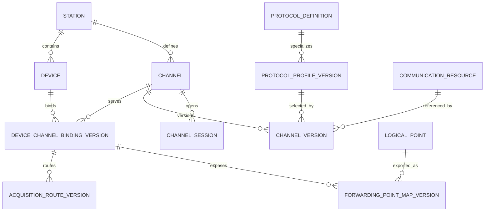
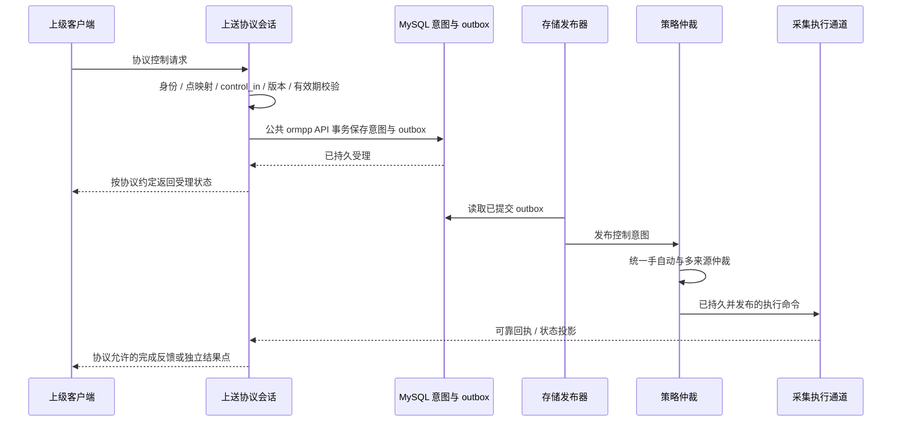

# 设备、通道与协议设计

> 版本：1.0｜日期：2026-09-19｜状态：目标设计，面向重新实现。
> 本文是设备通信关联、采集/上送通道、协议角色、点位路由和运行会话的统一契约。实现语言为 C++17，不以旧代码接口为约束。

## 1. 核心结论

**设备表示业务对象，通道表示 EMS 管理的通信配置，协议定义报文与交互规则。设备通过绑定关联通道，通道固定引用一个协议配置版本，运行时创建相应协议角色的实例与会话。**

一个 PCS 可以经 Modbus 客户端通道被采集，同时经 IEC 104 服务端通道上送给调度中心。它仍是同一个设备，不因为多了一条上送路径就复制设备、测点或历史身份。


这里的“采集”与“上送”描述**主要业务用途**；客户端/服务端描述**本端协议角色**，两者必须分别建模。IEC 104 服务端可以主动上送遥测，Modbus 服务端通常等待客户端读取；两者都可以实现上送业务。不能把“主动发数据”统一判定为客户端。

本文与其他设计的边界：

| 文档 | 唯一负责的内容 |
| --- | --- |
| [设备模型与点表绑定](device-model.md) | 设备类型、固有点位、厂家点表、业务能力和标准转换 |
| 本文 | 通道用途/协议角色、设备绑定、资源与会话、采集/上送地址、控制入口 |
| [采集与上送进程](../processes/collector/index.md) | 进程内模块、线程、队列、生命周期和故障隔离 |
| [公共实时访问接口](../common/realtime/access-design.md) | 共享内存/Redis 等状态访问，与工业协议传输解耦 |
| [策略进程](../processes/strategy/index.md) | 所有控制来源的统一仲裁，不由服务端回调直接操作现场设备 |

## 2. 四个维度必须分开

### 2.1 用途、角色、连接模式和操作权限

| 维度 | 字段与取值 | 解决的问题 |
| --- | --- | --- |
| 通道用途 | `purpose = acquisition / forwarding` | 主要用于接入现场状态，还是向外部系统提供 EMS 状态 |
| EMS 协议角色 | `local_role = client / server / publisher / subscriber` | EMS 在该协议中承担哪个角色；不是对端角色 |
| 连接模式 | `connection_mode = connect / listen / serial / link_layer` | 主动建 TCP 连接、监听连接、独占串口或使用链路层通信 |
| 绑定操作 | `operations` 集合 | 该设备在此通道上允许接收遥测、执行已仲裁控制、上送遥测、接收外部控制等哪些操作 |

`telemetry/control/both` 是采集绑定的操作组合，**不再使用含糊的 role 同时表达采控用途和客户端/服务端**。新契约明确为：

| 展示选项 | purpose | operations |
| --- | --- | --- |
| 采集专用 | acquisition | `telemetry_in` |
| 控制专用 | acquisition | `control_out`，可配置控制验证所需读取 |
| 采控共用 | acquisition | `telemetry_in + control_out` |
| 只读上送 | forwarding | `telemetry_out` |
| 上送并接受控制 | forwarding | `telemetry_out + control_in`，控制需经策略仲裁 |

一个通道配置在一个版本内只承担一种 purpose 和一种 local_role。需要南向采集与北向上送时建两条通道，通过标准点关联，不把一条连接自动变成双向协议代理。各维度独立定义不表示所有组合合法，必须通过协议能力矩阵校验。

### 2.2 协议角色矩阵

| 协议配置标识 | EMS 采集的常见配置 | EMS 上送的常见配置 | 首期边界 |
| --- | --- | --- | --- |
| `modbus_tcp` | acquisition + client + connect | forwarding + server + listen | 读/写功能码和数据类型按驱动能力开放 |
| `modbus_rtu` | acquisition + client + serial | forwarding + server + serial | RTU client 对应总线主站，server 对应从站；从站上送由外部主站轮询取得 |
| `iec104` | acquisition + client + connect | forwarding + server + listen | 明确 ASDU 类型、总召、时标、遥控/遥调及冗余范围 |
| `iec61850_mms` | acquisition + client + connect | forwarding + server + listen | 明确模型、读服务、报告和控制模型；能力以完成验收的实现为准 |
| `iec61850_goose` | acquisition + subscriber + link_layer | forwarding + publisher + link_layer | 扩展预留，独立能力验收；不是 MMS client/server 的一个开关 |
| `iec61850_sv` | acquisition + subscriber + link_layer | forwarding + publisher + link_layer | 扩展预留，高频采样需单独性能与时钟设计 |

Modbus 应用的 client/server 与串行总线角色见 [Modbus 官方规范入口](https://www.modbus.org/modbus-specifications)。IEC 104 客户端建连、服务端接入及监视/控制报文的交互可参照 [lib60870 官方开发文档](https://github.com/mz-automation/lib60870/blob/master/user_guide.adoc)。IEC 61850 的 client/server 与 publisher/subscriber 接口划分见 [libIEC61850 官方 API](https://support.mz-automation.de/doc/libiec61850/c/latest/)。本表是 EMS 的配置和验收边界，不表示所列全部能力已经实现，也不限定将来只能使用这些协议库。

例如第三方协议可能采用 acquisition + server 接收设备主动连接，未来通过能力矩阵新增该组合即可；首期不支持的组合必须拒绝发布。UI 中选择“IEC61850”后还必须选择 MMS/GOOSE/SV 配置类型，不能只保存一个没有具体服务含义的大类名称。

## 3. 对象模型与依赖关系

### 3.1 对象定义

| 对象 | 关键内容 | 不应包含的内容 |
| --- | --- | --- |
| `Device` 设备 | 业务身份、资产归属、类型/型号、能力 | 单一 `channel_id`、唯一 protocol 字段、服务器 socket |
| `Channel` 通道 | 稳定 channel_id、station、code、显示名称 | 厂家点的每个寄存器地址、设备类型固有含义 |
| `ChannelVersion` | 指定版本的 purpose、local_role、启用/分片、协议配置、资源、连接模式、限额、对端策略 | 可变的运行连接句柄 |
| `ProtocolDefinition` | 协议标识、配置 schema、支持角色/传输/服务、插件 ABI 要求 | 某个现场设备的 IP 和凭据 |
| `ProtocolProfileVersion` | 不可变的协议参数、版本/方言、允许的服务、模型文件引用 | 当前在线状态、裸私钥 |
| `CommunicationResource` | 主机/网络命名空间内的串口、监听端点或逻辑连接资源 | 业务设备树归属 |
| `DeviceChannelBindingVersion` | 设备与通道的关联、operations、协议设备地址、启用、主备关系 | 另一份设备身份或测点当前值 |
| `AcquisitionRouteVersion` | 厂家点 → 采集绑定 → 协议点地址/解码 | 北向出口地址 |
| `ForwardingPointMapVersion` | 标准 point_id/command_point_id → 上送绑定 → 对外协议点地址/编码 | 直接转发南向原始地址的隐式规则 |
| `ChannelSession` | 运行时连接、peer、会话代次、协议状态、队列与诊断 | 持久设备身份、固定一设备一 session 的假设 |
| `PeerPolicy` | 对端身份、可见点范围、控制范围、最大会话数、认证引用 | 仅靠 UI 隐藏实现权限 |

设备型号可以引用某个厂家协议/模板版本作为兼容条件，但这不等于设备只有一个协议。最终每条通信路径的协议来自绑定所指向通道的固定 profile 版本。

### 3.2 基数关系



图中历史版本可以多次引用同一资源；不表示同一时刻允许多个 I/O 所有者。活动版本的独占约束由发布校验和运行时资源协调同时保证。

- **设备 : 通道 = 多对多**：一台设备可绑定采集、控制和多条上送通道；一个通道可承载多设备。
- **一个活动通道版本 : 一个协议 profile 版本**：Modbus 与 IEC 104 必须建不同通道；配置版本切换不能在同一会话中途替换解释规则。
- **协议定义 : 通道 = 一对多**：同一驱动可实例化多个客户端/服务端，但其可变运行状态必须按通道、会话隔离。
- **通道 : 会话 = 一对多**：服务端监听器可以接入多个上级连接；客户端也可能有受支持的主备会话。会话上下线不创建或删除业务设备。
- **资源 : 活动 I/O 所有者 = 一对一**：一个串口或冲突的监听地址仅一个所有者。多台设备共享 RS485 应绑定同一串口通道，不创建多个通道争用同一串口。
- **逻辑点 : 上送映射 = 一对多**：同一功率值可以经 IEC 104 和 Modbus 两套地址提供，采样和历史身份不变。

设备绑定原则上 station 一致。站级上送通道可显式关联本 station 多个单元的设备、站级公共设备和聚合点，不能把上级调度系统伪造成本地 PCS 的子设备。对端系统作为 peer 管理；station/unit 聚合点允许通过显式 `asset_scope` 导出，不强制创建“虚拟设备”才能上送。

客户端连接相同 remote endpoint 不必然表示同一独占资源：设备明确支持多连接时，采集和控制可以持有不同逻辑连接资源。资源判定还要包含主机/网络命名空间、传输类型、方向和物理总线；串口别名必须归一，服务端通配监听地址与具体地址的端口冲突也需检查。独立 TCP 连接不能绕开设备级控制互斥。

### 3.3 依赖方向

```text
设备类型/标准点定义 ──> 设备实例/逻辑点
协议定义 ──> 协议配置版本 ──> 通道版本 <── 通信资源
设备实例 + 通道版本 ──> 设备通道绑定版本
厂家点 + acquisition 绑定 ──> 采集路由 ──> 标准点读取绑定
标准点/命令点 + forwarding 绑定 ──> 上送映射
以上版本引用 + peer 权限 + 资源检查 ──> 完整发布快照 ──> 运行会话
```

`ForwardingPointMapVersion` 依赖标准逻辑点，不依赖厂家寄存器。更换 PCS 厂家只需调整南向路由与标准绑定，北向地址可保持不变。改变北向点表也不需要重新采集设备。发布时校验引用无悬空、全部版本兼容，禁止拼接几个正在编辑的草稿启动通道。

## 4. 参数放在哪一层

| 参数 | 所属位置 | 示例 |
| --- | --- | --- |
| station/unit、PCS/BMS、电表类型 | 设备/资产模型 | pcs01 属于 ess000001 |
| 主动连接地址、监听地址、串口参数 | 通道版本的 transport/resource 配置 | 远端 IP/端口、bind 地址、串口波特率 |
| IEC 104 t0/t1/t2/t3、k/w、地址长度；Modbus 协议超时 | 协议 profile 版本 | 按双方约定验证，不使用无类型扩展字段代替 schema |
| MMS 模型文件、支持的报告/控制服务 | 协议 profile + 模型版本引用 | SCL 文件摘要、模型版本、能力范围 |
| Modbus Unit ID、IEC 104 CA、IED/LD 范围 | 设备通道绑定/对外模型的设备地址 | 一条连接承载多个协议逻辑设备 |
| Modbus 区域/偏移/字序、104 IOA/type、61850 对象引用/FC | 采集路由或上送点映射 | 相同设备在不同通道可有不同地址 |
| 倍率、单位、枚举、质量转换 | 对应方向的点映射 | 南向解码与北向编码分开定义 |
| 对端身份、访问范围、控制权限 | PeerPolicy 和会话认证 | 一个客户端可只读，另一个可提交授权范围内的意图 |

协议设备地址与业务设备并非总是一一对应：一个 IEC 104 公共地址可能汇集多个设备的数据。此时多个设备绑定可以共享 CA，但其完整点地址必须不冲突。Modbus TCP 网关中 Unit ID 通常用于路由，不可假设永远等于 TCP 连接编号。

## 5. 采集通道设计

### 5.1 建连、设备绑定与点路由

采集通道启动后由协议实例建立/接入会话，按照绑定解析协议设备地址，再按照采集路由访问厂家点。读取结果经过标准映射后写入公共实时状态，并按需要进入有界内存缓冲与事件通道；未发布样本的恢复边界遵循公共模块设计，不承诺跨重启补传。

```text
采集通道 modbus01：modbus_tcp / client / connect
  endpoint = 192.168.1.20:502（示例网关）
  ├─ pcs01 绑定：Unit ID=1，telemetry_in + control_out
  │    ├─ 功率厂家点：holding / offset=100 / int32 / 字序配置
  │    └─ 功率设定厂家点：holding / offset=200 / int32
  └─ meter01 绑定：Unit ID=2，telemetry_in
       └─ 功率厂家点：input / offset=20 / float32
```

所有地址为设计示例，不可直接作为现场配置。不同 Unit ID 不因 offset 相同而冲突。支持共享地址别名时必须显式声明为同一物理来源，并复用读取结果，不能让两个独立设备争用同一控制目标。

IEC 104 接入在连接与数据传输就绪后处理总召/自发遥测；MMS 接入按 profile 执行初值读取、报告控制块配置及报告恢复。轮询、报告和自发事件是不同调度模式，禁止要求所有协议都实现同一个固定周期 `read_all()`。

### 5.2 控制与反馈

只有声明 `control_out` 且通过当前版本校验的绑定可承接策略下发的执行命令。只读采集通道不因底层协议支持写功能码就自动开放写权限。

控制与采集共享串口/会话时，在协议事务边界调度；独立控制通道可以并行建连，但设备级冲突资源仍须串行。反馈点可以经另一条采集通道读取，必须匹配目标设备、配置版本、发送后的新样本和质量，不把协议确认直接等同设备动作成功。

## 6. 上送通道设计

### 6.1 数据出口与读请求

上送通道读取已发布标准逻辑点，经上送映射转换为对外协议模型。它不为了响应一次上级读取而临时触发一轮现场轮询，也不绕过统一数据访问层直接读取某个 Redis 原始键。

| 服务端协议 | 主要出口行为 | 映射内容 |
| --- | --- | --- |
| IEC 104 | 就绪后的总召应答、周期/变化上送等已启用服务 | CA、IOA、ASDU 类型、时标、质量与量纲 |
| Modbus TCP/RTU | 从已维护的寄存器/线圈映像响应主站请求 | Unit ID、地址空间、偏移、宽度、符号、字节/字序 |
| IEC 61850 MMS | 按模型提供读取、报告及受支持控制服务 | IED/LD/LN/DO/DA、FC、DataSet、报告和控制模型 |

出口通常需要一个进程内不可变版本的数据映像，用于短时间响应协议回调。映像是标准状态的投影，携带数据时间、质量与配置版本；超时必须呈现失效，不能永久返回“看起来正常”的最后值。Modbus 缺少统一测点质量/时间字段时，应在对外点表明确配置质量寄存器和时间寄存器，或定义该型号的异常响应策略，不能悄悄丢失质量信息。

一次 Modbus 多寄存器响应必须从同一映像版本编码，避免一个 32/64 位值由两个不同样本拼接。IEC 104 总召过程可以冻结出口映像或明确“各点最新”策略，但必须在对外契约中约定；这不等于公共实时库支持全站原子快照。IEC 61850 模型更新涉及对象引用/数据集变化时，按协议能力重建模型与会话，不在回调执行中修改底层对象结构。

### 6.2 多设备、多上级和队列

一条北向通道可映射 pcs01、bms01、meter01 等多个设备的标准点，也可映射站级聚合点。每条通道首期只有一份确定的出口地址模型；每个 peer 在模型中取得自己的可见子集。若上级要求不同地址模型，首期使用不同通道/监听端点，不按来源 IP 临时重解释同一地址。

每个运行 session 有独立协议状态、发送窗口和有界队列。慢客户端不得阻塞采集或其他客户端：最新遥测可按明确策略合并中间值，需保序的事件/告警从可靠记录恢复；超出窗口时返回失效/断开/请求重新总召，不能将全部数据统一静默丢弃。是否支持跨断线事件补送由协议 profile 和持久出口事件机制声明，不能把 Pub/Sub 当作事件唯一来源。

监听就绪、客户端已连接、协议数据传输就绪、某设备样本新鲜分别展示。多个上级可以同时看数据，但能提交控制的 peer 集合和当前控制权必须显式配置；socket 连接成功不能自动获得设备控制权。

### 6.3 外部控制的闭环



北向协议接入与南向采集可以同处 `ems-collector` 进程，但不能因此直接调用另一个通道的写句柄。北向协议回调只解析请求，交给独立的有界意图受理队列，数据库工作不阻塞协议事件循环；对端要求的协议时限内无法完成受理时返回协议允许的拒绝/忙状态。

受理队列和持久意图都携带原请求截止时间，提交前与仲裁时再次校验，禁止排队过期后仍执行。若提交结果或响应是否到达已无法确定，则记录“受理结果未知”并按协议约定提供查询/关联结果，不能将响应失败宣称为确定未受理；已持久意图的取消也要经过显式状态转换。

`external_request_id → intent_id → command_id` 保留全链路关联。协议没有可跨重连使用的唯一请求 ID 时，不能声称靠连接序号实现恰好一次；需结合受支持的选择/执行状态、有限去重窗口、结果查询以及不确定状态处理。脉冲、复位等动作在不确定时不自动重试。

Modbus 正常写响应通常不能表达完整异步设备执行状态。首期若需要可控上送，必须与上级约定“写入表示持久受理”的命令邮箱/状态寄存器契约，包含请求标识、结果状态和关联结果；否则该映射只开放只读，不能用普通写寄存器应答谎报现场执行完成。104/MMS 的选择、执行、确认和结束也必须分别映射其协议语义，不能统一在入队后立即回成功。

## 7. 持久模型与地址唯一性

### 7.1 逻辑表

以下是目标逻辑结构，字段类型和索引在 DDL 阶段固定；所有发布引用均带版本。

| 表 | 关键字段 | 核心约束 |
| --- | --- | --- |
| `protocol_definition` | protocol_id、schema_version、supported_roles、transports、capabilities、plugin_abi | 按驱动能力注册；不能由普通配置任意宣称支持 |
| `protocol_profile_version` | profile_id、version、protocol_id、protocol_revision、typed_parameters、model_artifact_id | 不可变；凭据通过 secret_ref 引用 |
| `communication_resource` | resource_id、station_id、host_scope、resource_type、canonical_endpoint | 规范化同一物理资源；别名不能绕开独占检查 |
| `channel` | channel_id、station_id、code、display_name | `(station_id, code)` 唯一，稳定 ID |
| `channel_version` | channel_id、config_version、purpose、local_role、connection_mode、profile_ref、resource_id、owner_shard、limits、enabled | 活动版本组合必须被协议能力矩阵支持 |
| `device_channel_binding_version` | binding_id、config_version、device_id、channel_id、operations、device_address、source_group、priority、enabled | 设备/通道同 station；采集与上送权限不可混用 |
| `vendor_point_route_version` | vendor_point_id、config_version、binding_id、protocol_point_address、decode_spec | 只引用 acquisition 绑定；沿用设备点表模型 |
| `forwarding_point_map_version` | map_id、config_version、binding_id 或 asset_scope_ref、point_id、direction、protocol_point_address、encode_spec、quality_spec | 只引用 forwarding 通道；遥测点与命令点分别校验 |
| `channel_peer_policy_version` | channel_id、config_version、peer_id、identity_ref、visible_scope、control_scope、limits | 拒绝未授权 peer，控制权限默认关闭 |

同一设备/通道可以存在多个有明确地址或用途的绑定，唯一约束以规范化绑定身份为准，不能仅依靠 `(device_id, channel_id)` 吞掉多逻辑地址需求。source_group 只用于来源选择，不意味着可并发更新一个权威标准点。

配置快照固定所有 profile、模型文件摘要、通道、绑定、采集路由和上送映射。服务端跨多个 unit 使用 station 级配置清单固定各 unit 的目标版本；发布成功和各进程实际应用成功分开展示，不能把跨根引用当作数据库外的原子切换。

### 7.2 地址冲突校验

| 协议 | 校验的地址空间 | 允许与禁止 |
| --- | --- | --- |
| Modbus | 通道出口模型 + Unit ID + 地址空间 + 覆盖区间 | input/holding 属不同空间；同空间多寄存器区间检查重叠，命令写区不得与测量投影冲突 |
| IEC 104 | 通道出口模型 + CA + IOA + 明确的数据/控制命名约定 | 首期同一模型内 `(CA, IOA)` 唯一，类型匹配为额外约束，不靠不同 Type ID 隐式复用地址 |
| IEC 61850 MMS | 通道模型 + 完整对象引用 + FC | 必须存在于固定模型且类型/访问/控制模式匹配；数据集与报告引用不能悬空 |
| GOOSE/SV 扩展 | 对应 profile 定义的完整发布/订阅身份 | 不能直接套用 MMS 对象或 TCP endpoint 唯一性 |

共享来源别名、位字段共享、读写重叠或协议允许的特殊复用必须显式建模并由专用规则验收；首期默认拒绝未声明冲突。点表文档的 `40001` 编号和 PDU 的零基偏移分开保存，导入要求明确地址基准。

## 8. 配置工作流

建议在设备页和通道页提供两个互通的入口，保存同一套关系。

1. **先建协议通道**：选择 station、用途、EMS 角色、协议/版本，再填写连接模式、资源和协议参数。UI 按能力矩阵过滤无效组合。
2. **关联设备或资产**：从设备页选择已有通道，或从通道页批量关联设备；明确 operations、协议设备地址、来源组和启用状态。
3. **配置点映射**：采集通道导入厂家点并绑定标准点；上送通道选择已有标准点/命令点并生成对外地址，不能把南向厂家点表直接当北向点表发布。
4. **配置对端与控制**：服务端设置监听/会话限额、peer 身份、可见点和 control_in；显示控制最终仍由策略仲裁。
5. **完整校验与预览**：展示设备—绑定—通道—协议—点地址关系图，检查地址冲突、资源冲突、缺少能力、单位/质量映射、命令反馈和模型文件。
6. **发布版本**：同一 MySQL 事务保存不可变引用与 outbox，由存储发布；通信进程构造完整新运行配置，反馈已应用/失败。
7. **观察与回滚**：展示配置已保存/已发布/实例已应用、通道监听/会话/设备质量、版本差异；失败时保留上一完整版本或进入明确停用状态。

协议/角色/监听端点或模型结构变化需要排空受影响事务并重建会话；仅修改显示名称不重连。上送映射变更时不能在一条协议响应中混合新旧模型；南向改路由期间禁止旧配置命令迟到执行。删除被点表、命令反馈或上送引用的绑定时，拒绝删除并列出依赖，或在同一发布版本内完成明确解绑，不能级联静默删业务点。

## 9. C++17 运行设计

### 9.1 分离配置、驱动与会话

公共模型采用强类型枚举与 `std::variant` 表达协议地址，避免一个 `std::string address` 混装所有协议。以下为可独立编译的类型草案，实际协议参数和错误类型由公共契约补齐。

```cpp
#include <cstdint>
#include <string>
#include <variant>
#include <vector>

namespace ems::communication {
enum class Purpose { Acquisition, Forwarding };
enum class ProtocolRole { Client, Server, Publisher, Subscriber };
enum class ConnectionMode { Connect, Listen, Serial, LinkLayer };
enum class Operation { TelemetryIn, ControlOut, TelemetryOut, ControlIn };
enum class ModbusSpace { Coil, DiscreteInput, HoldingRegister, InputRegister };

struct ModbusDeviceAddress { std::uint8_t unit_id; };
struct Iec104DeviceAddress { std::uint16_t common_address; };
struct MmsDeviceAddress { std::string ied_name; std::string logical_device; };
using DeviceAddress = std::variant<
    ModbusDeviceAddress, Iec104DeviceAddress, MmsDeviceAddress>;

struct ModbusPointAddress {
    ModbusSpace space;
    std::uint16_t offset;
    std::uint16_t width;
};
struct Iec104PointAddress {
    std::uint32_t ioa; // 数值上限按 profile 校验，不代表允许 32 位线格式
    std::uint8_t type_id;
};
struct MmsPointAddress {
    std::string object_reference;
    std::string functional_constraint;
};
using PointAddress = std::variant<
    ModbusPointAddress, Iec104PointAddress, MmsPointAddress>;

struct ChannelVersion {
    std::string channel_id;
    std::uint64_t config_version;
    Purpose purpose;
    ProtocolRole local_role;
    ConnectionMode connection_mode;
    std::string protocol_profile_id;
    std::uint64_t protocol_profile_version;
    std::string resource_id;
};
struct DeviceChannelBindingVersion {
    std::string binding_id;
    std::string device_id;
    std::string channel_id;
    std::uint64_t config_version;
    std::vector<Operation> operations;
    DeviceAddress device_address;
};
} // namespace ems::communication
```

variant 类型只能消除一部分误用，发布验证器还必须校验“Modbus profile 配 Modbus 地址”等组合及协议地址范围。GOOSE/SV 在专门设计与实现时新增对应类型，不能用字符串临时绕过不支持的能力。

驱动工厂按 `protocol_id + local_role + transport + plugin_abi_version` 选择实现；同一个协议包可以导出多个角色工厂。`IProtocolDriver` 负责能力与配置校验，`IChannelRuntime` 负责本通道生命周期，`ISession` 负责某条连接的协议状态；采集和上送使用各自角色接口，不强迫服务端实现无意义的主动轮询函数。

公开 SDK 与协议实现采用 PIMPL，第三方依赖和平台句柄隐藏在 Impl 内。动态库边界使用版本化 C ABI、不透明句柄和长度明确的缓冲区，STL/异常不跨库传递。按需加载、别名复用、安全卸载与三平台部署统一见 [通讯协议动态库设计](../processes/collector/protocol-design.md)。采集进程内的模型对象不等于可以直接跨进程或写进共享内存的布局。

### 9.2 线程与生命周期

- 阻塞串行/轮询通道：独占资源工作线程，采集与控制按事务边界调度。
- IEC 104/MMS 等异步通道：事件循环驱动；客户端/服务端会话在所属执行上下文串行修改状态。
- 北向 listener：一个监听器管理多个 session，每个 session 有独立状态和限额；不是每个设备开一个监听端口，也不要求每个连接无限新建线程。
- 配置加载、数据库受理、历史归档和状态投影使用独立有界队列，禁止在网络回调内执行无限等待。
- 停止顺序：拒绝新任务/新会话 → 停止订阅与定时任务 → 排空或明确终止在途事务 → 保留未决命令状态 → 销毁 session → 释放资源 → 卸载插件。

恢复先检查生效配置、peer 身份、来源/控制权，再读取初值或完成总召/报告恢复。会话重新建立不表示数据已经新鲜；北向断线不停止南向采样，南向断线也不把北向监听状态直接标为关闭。

## 10. 端到端示例

下例展示“一台 PCS 采集一次、通过两个协议上送”，所有编号均为示意。

| 层 | 配置 |
| --- | --- |
| 设备 | `ess000001/pcs01`，标准点 active_power，命令点 set_active_power |
| 南向通道 | `pcsread01`：acquisition / modbus_tcp / client / connect |
| 南向绑定 | pcs01 → pcsread01，Unit ID=1，telemetry_in + control_out |
| 南向映射 | holding 偏移 100 → active_power；偏移 200 ← set_active_power，分别定义倍率/字序 |
| 北向通道 A | `dispatch10401`：forwarding / iec104 / server / listen |
| 北向绑定 A | pcs01 → dispatch10401，CA=1，telemetry_out；control_in 须单独启用 |
| 北向映射 A | active_power → CA=1/IOA=1001；控制点采用另一 IOA 并经过仲裁 |
| 北向通道 B | `monitorbus01`：forwarding / modbus_tcp / server / listen |
| 北向绑定 B | pcs01 → monitorbus01，Unit ID=1，telemetry_out，只读 |
| 北向映射 B | active_power → input 偏移 0..1；另配质量/时间寄存器 |

标准 active_power 使用 [实时访问接口](../common/realtime/access-design.md) 读取，底层选择共享内存或 Redis 对两条北向通道不可见。北向 A/B 不能再次生成同一点的权威采样；若上送需要派生量，应由明确所有者生成独立 derived 点，再映射出去。

## 11. 故障与验收

| 验收场景 | 预期结果 |
| --- | --- |
| 一个设备绑定多个采集/上送通道 | 点/设备稳定 ID 不复制，方向和权限正确 |
| 多设备共享 Modbus 串口或 104 连接 | 只有一个资源所有者，按设备/点地址正确分流 |
| 上送服务端接入多个 peer | 每个 session 状态和队列独立，可见点与控制范围生效 |
| 不支持的协议/角色/连接组合 | 保存草稿可提示，发布必须拒绝，不能运行时猜测 |
| 设备/通道跨 station、悬空 profile、地址重叠、模型不匹配 | 校验精确指出绑定/点位，无部分配置激活 |
| 更换厂家或南向协议 | 标准点和北向地址可保持不变，转换结果与质量一致 |
| 北向迟缓或断线 | 南向采集不被阻塞，队列有界，恢复策略明确 |
| 南向离线但北向保持连接 | 输出带失效质量/状态的最后值，不伪造正常新样本 |
| 外部控制越权、冲突、过期或重复 | 持久意图/仲裁/MySQL 执行状态检查生效，不绕过策略直写 |
| Modbus 写应答和实际设备动作 | 受理、协议确认、最终反馈可区分，不误报完成 |
| 配置切换与卸载 | 在途事务不混版本，无悬空回调/重复控制/双资源所有者 |
| 协议模型独立测试 | 104、MMS、Modbus 客户端与服务端分别验证；不以一端能连通代替全部能力通过 |

实施顺序建议为：冻结模型和验证规则 → Modbus TCP 采集与只读上送闭环 → IEC 104 双角色及控制意图接入 → MMS 模型/报告/控制能力 → 按现场需求扩展 GOOSE/SV。具体排期按项目优先级确定，未完成验证的能力不出现在可发布配置选项中。
