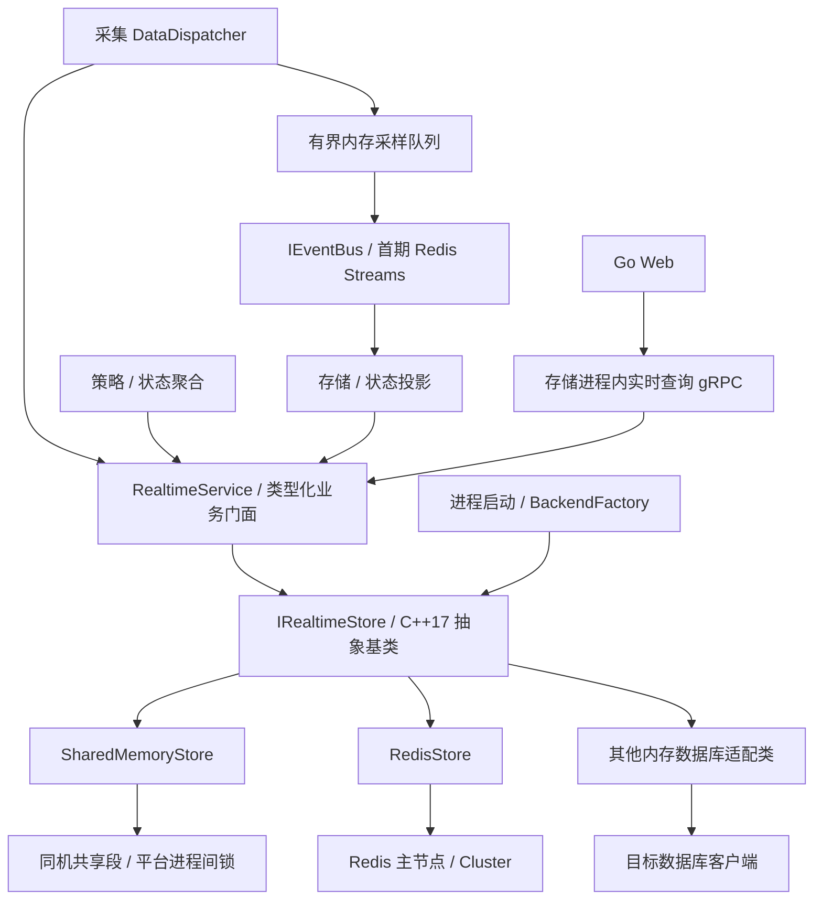
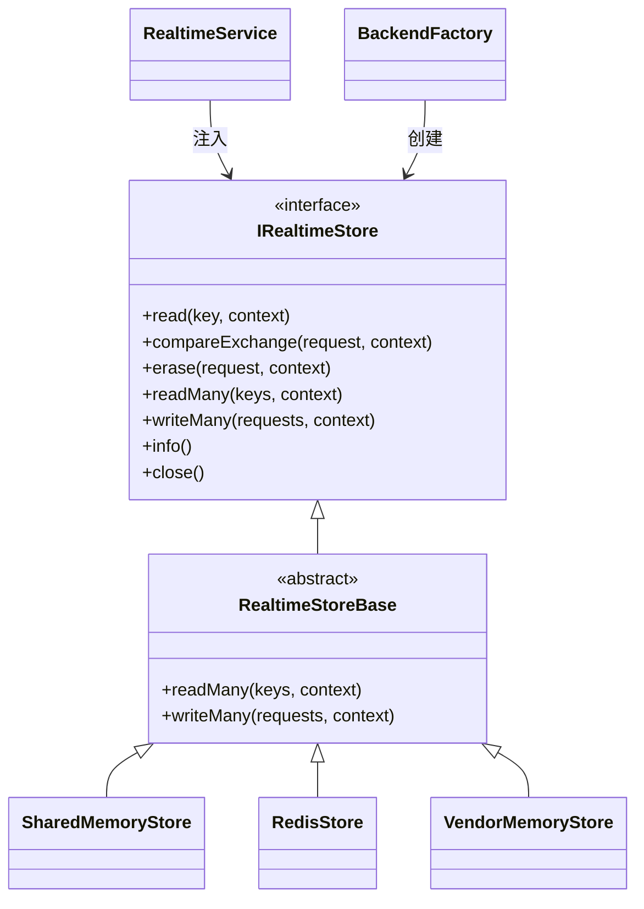

# 公共实时数据访问接口设计（C++17）

> 版本：1.2｜日期：2026-09-19｜状态：目标设计，待实现与验收。
> 适用范围：EMS 采集、策略、存储进程复用的公共实时数据访问库。
> 核心决策：通过抽象基类 `IRealtimeStore` 定义统一契约，由共享内存、Redis 和其他内存数据库派生类实现；业务层通过依赖注入使用接口。

## 1. 设计结论与范围

公共接口应描述“读取完整运行状态、按版本更新状态”，不直接暴露 Redis Hash 命令或共享内存地址。后端切换改变数据访问实现，业务身份、值类型、质量、来源控制和错误处理保持一致。

本设计采用两层接口：

- **业务门面 `RealtimeService`**：面向测点、设备、通道与控制状态，负责类型转换、配置校验、来源代次和序号检查、新鲜度计算。
- **抽象存储 `IRealtimeStore`**：面向逻辑记录，提供单记录完整读取、条件替换、条件删除与逐项批量结果。`SharedMemoryStore`、`RedisStore` 以及新增后端均实现这一契约。

Redis 继续作为默认部署后端；共享内存成为同机部署的可选权威实时状态后端。每个逻辑作用域在一个部署代次内只配置一个权威后端，禁止两个后端同时独立受理权威写入。切换通过受控迁移完成，不因 Redis 连接失败就自动切到空共享内存。

| 数据或职责 | 是否属于本接口 | 原因及协作方式 |
| --- | --- | --- |
| 测点最新值、质量、时间、来源 | 是 | 统一为完整记录，更新必须保持字段一致 |
| 设备、单元、station、通道运行状态 | 是 | 使用不同记录种类，明确各自写角色 |
| 命令执行状态的查询投影 | 是 | 仅为持久事件的状态投影；写投影不能触发设备动作 |
| 配置版本及点表的权威管理 | 否 | 继续由 MySQL/GORM/公共 ormpp API 管理；版本快照由独立配置仓储提供 |
| 历史采样、告警、命令和回执传递 | 否 | 独立 `IEventBus`，首期使用 Redis Streams；保持 ACK、去重与已投递事件恢复 |
| 历史查询及审计 | 否 | TDengine/MySQL 和既有服务 API |
| 分布式租约、设备控制权仲裁 | 否 | 由现有控制权协调职责负责；实时库校验已安装的来源授权，不代替选主 |

“共享内存模式”指实时状态访问方式改变，不表示整套 EMS 已经无 Redis 依赖。若还要替换 Redis Streams 或 Redis 配置快照，需要分别实现满足其契约的事件后端、配置仓储，不能用一个共享内存环形队列代替可靠消息系统。

## 2. 设计依据与约束

本设计面向后续重新实现，以现有设计文档为业务依据，不继承旧代码的类结构、接口签名或兼容包袱。

| 设计依据 | 必须延续的约束 | 本设计补充 |
| --- | --- | --- |
| [EMS 系统架构](../../architecture/system-design.md) | C++17 采集/存储/策略与 Go Web 四类进程；职责和控制闭环明确 | 实时状态由抽象接口访问，后端按部署选择 |
| [数据采集架构](../../processes/collector/design.md) | 协议 I/O、通道调度与数据分发分离；可靠采样先落日志 | 分发层注入业务门面，协议模块不选择存储后端 |
| [设备模型与点表绑定](../../architecture/device-model.md) | 固有点位、厂家映射、启用状态和命令反馈分开 | 统一逻辑测点、类型和质量，不让物理存储决定业务模型 |
| [Redis 键设计](redis-key-design.md) | station/unit 作用域、递归资产路径、稳定 ID、来源序号、配置版本 | 逻辑身份适用于全部后端，Redis 物理键只属于 Redis 适配器 |
| [实时数据与配置](index.md) | 最新状态、可靠事件、配置权威和历史存储分别承担职责 | 共享内存替换实时状态访问时，其他职责保持独立 |

原文中的 Redis 最新值方案作为默认部署实现保留；多后端抽象以本文为详细契约，相关总览同步更新。设计不要求复刻 Redis 全部命令，也不把所有数据库能力压进同一个基类。

## 3. 架构与依赖方向

采集与上送通道共用本接口：采集投影标准点，上送读取标准点并转换为独立的对外协议模型；上送不会再次产生同一点的权威采样。通道引用工业协议，实时库引用存储后端，这两种配置互不替代，详见 [设备、通道与协议](../../architecture/channel-protocol.md)。



上图采用跨后端统一的 Go 查询路径。Redis 默认部署可保留 Go 按契约直接读取 Redis 的现有路径；启用共享内存且 Go 无原生适配器时，Go 必须改走存储进程内的实时查询 gRPC。该服务是明确新增工作项，不能只切换 C++ 配置而保留 Go 读取旧 Redis 的行为。gRPC 服务复用存储业务进程，配独立有界工作池，不新增第五类业务进程。



`RealtimeStoreBase` 只复用逐项批量调度，不保存全局连接、不实现 Redis 命令、不承载业务规则。数据库原生批量优化可以覆盖默认实现，但不能改变批量语义。公共头文件不得包含 hiredis、redis++、Windows API 或 pthread 类型。

## 4. 统一语义：先固定保证，再实现派生类

### 4.1 最小必需能力

| 能力 | 统一保证 | 不作的保证 |
| --- | --- | --- |
| 单记录读 | 返回同一次已提交版本的完整字段副本 | 不返回映射地址、迭代器或借用缓冲区 |
| 条件创建 | 仅在记录不存在时创建 | 不隐式覆盖已有记录 |
| 条件替换 CAS | 仅在当前 revision 等于 expected 时完整替换 | 不允许先 GET 后无条件 SET 模拟 CAS |
| 条件删除 | 仅删除指定 revision 的记录 | 不提供业务端清库接口 |
| 并发一致性 | 正常运行的同一后端代次内，单键操作具有线性化点；并发 CAS 至多一个成功 | 不保证跨记录或跨作用域事务；不把故障切换当成无损恢复 |
| 批量 | 每项保持单记录保证，结果与输入一一对应 | 不保证整批原子性或同一时刻快照 |
| 数据所有权 | 调用结束后返回对象归调用者所有，关闭后端不使其失效 | 不通过公共接口共享 STL 对象内存布局 |
| 失败表达 | 明确区分未应用、结果未知、版本冲突、无数据和后端不可用 | 不以空串、零值或 `false` 合并所有失败 |

不能满足原子 CAS 的数据库不得注册为生产 `IRealtimeStore` 实现。可以另外实现只读镜像接口，不能降低公共写接口保证。以“内存数据库”或“兼容 Redis”为名并不能证明它满足契约。

### 4.2 身份、版本与时间

`RecordKey` 是逻辑身份，由作用域、资源种类、设备路径和资源 code 组成。沿用 [Redis 键设计](redis-key-design.md) 的 code 规则、最大深度与稳定 ID 约定。业务不传 Redis 原始键、不传共享段 offset。`KeyCodec` 在后端内将身份转换为物理地址。

三类版本不可混用：

| 字段 | 含义 | 比较方式 |
| --- | --- | --- |
| `revision` | 存储记录版本，用于 CAS | 非空不透明令牌，只能判等；每次成功替换产生新令牌，删除重建/共享段重建不得复用 |
| `source_epoch / sequence` | 业务来源授权代次与该代次采样序号 | 先核对已批准来源代次，同代次比较无符号整数序号 |
| `config_version` | 当前样本采用的已发布配置 | 必须满足该测点已安装的配置授权 |

revision 建议采用后端实例代次与每次写入唯一标识组合的字符串；长度上限 128 字节。它不是 Redis 计数器的直接暴露，也不等于事件 ID。业务时间用 UTC Unix 微秒 `int64_t`；进程内 deadline 用 `steady_clock`，禁止序列化到其他进程。跨语言 64 位整数用十进制文本，禁止经 JavaScript Number 或 Lua 浮点数中转后参与精确比较。

采样时间、新鲜度和存储可用性分别表达：成功读取到旧数据仍是读取成功，但门面标记 `stale=true`；`NotFound` 不等于值为零；坏质量样本可以有最后值，也可以显式无值。

### 4.3 字段模型与完整替换

公共存储使用 `Fields = std::map<std::string, std::string>` 承载规范化字段，测点类型化只在业务门面出现。字段值为 UTF-8 文本，可以包含 JSON 文本；这一选择便于复用当前 Redis Hash 契约，其他后端以定长头加有界序列化载荷存储。

测点记录包括：

- 身份与样本：`schema_version、point_id、value_type、value、unit、quality、source_time、ingest_time、source_id、source_epoch、sequence、config_version、event_id`。
- 写入防护：`accepted_source_id、accepted_source_epoch、accepted_config_version、write_enabled`。这些字段只能由来源/配置协调职责更新，普通采样保持其原值。
- 可选诊断：最近授权切换时间、采样来源、明确的质量原因；不得保存凭据。

内部 revision 由存储管理，不属于可任意修改的业务 Fields。以 `_store_` 开头的字段保留给适配器，业务提交时拒绝。新增防护字段是本设计对现有测点 Hash 契约的扩展，须同步 C++/Go 契约样例。

`compareExchange` **完整替换**业务字段：新记录中没有的旧字段必须删除；不能用普通 HSET 合并后留下过期字段。不可变配置快照继续使用配置仓储，不因存在 Fields 就把配置索引和可靠流塞入这一基类。

类型化门面建议使用 `std::variant<bool, std::int64_t, std::uint64_t, double, std::string>` 表示有效值，外层 `std::optional` 表示无值；禁止以 NaN/Inf 伪装质量码。`value_type` 与 `value` 的合法组合、浮点往返精度、枚举质量码、字段是否必填写入 `contracts/`，不能让后端各自推断。现有整数精度、JSON null 约定沿用 Redis 键设计。

编码器定义一种规范的长度前缀字段编码，用于计算所有后端一致的 `max_record_bytes`，并限制字段数、单字段长度和总长度；共享内存还计入索引、key 和双映像开销。Redis 原生占用字节可以不同，但不得因为自身允许更大对象就绕过公共记录上限。

## 5. C++17 接口草案

下列代码块构成一个接口头文件草案，使用标准 C++17。它定义 API 和默认批量行为，后端方法仅声明，未实现实际数据库访问。基础 Error、Result 和 CallContext 引用 [公共模块设计第 5 节](../design.md#5-基础类型结果与时间) 的 `ems::core`，在本命名空间使用别名；语法检查需同时提供该公共头文件草案。`Result<T>` 以 `std::variant<T, Error>` 表达，避免依赖 C++23 `std::expected`。

```cpp
#pragma once
#include <chrono>
#include <cstddef>
#include <cstdint>
#include <functional>
#include <map>
#include <memory>
#include <optional>
#include <string>
#include <variant>
#include <vector>
#include <common/core/result.h>
#include <common/core/call_context.h>

namespace ems::realtime {

using ErrorCode = ems::core::ErrorCode;
using WriteEffect = ems::core::WriteEffect;
using Error = ems::core::Error;
template<class T> using Result = ems::core::Result<T>;
using Deadline = ems::core::Deadline;
using CallContext = ems::core::CallContext;
// deadline 必须显式设置，包括获取池连接/锁的等待时间。
enum class ScopeKind { Unit, Station };
struct Scope {
    ScopeKind kind;
    std::string code;
};
enum class RecordKind { Point, AssetState, ChannelState, CommandState };
struct RecordKey {
    Scope scope;
    RecordKind kind;
    std::vector<std::string> device_path;
    std::string name;     // point/channel/command code；AssetState 为空
};
struct Revision {
    std::string opaque;
};
using Fields = std::map<std::string, std::string>;
struct Record {
    Fields fields;
    Revision revision;
};
struct WriteRequest {
    RecordKey key;
    Fields replacement;
    std::optional<Revision> expected; // nullopt = 仅在不存在时创建
};
struct EraseRequest {
    RecordKey key;
    Revision expected;               // 删除也必须检查版本
};
struct WriteReceipt { Revision revision; };
struct EraseReceipt {};

struct BackendInfo {
    std::string implementation;
    std::string storage_generation; // 诊断身份，不替代业务 source_epoch
    bool cross_process;
    bool cross_host;
    bool change_hints;
    std::size_t max_record_bytes;
    std::size_t max_batch_items;
};

class IRealtimeStore {
public:
    virtual ~IRealtimeStore() = default;
    virtual BackendInfo info() const = 0;
    virtual Result<Record> read(const RecordKey&, const CallContext&) = 0;
    virtual Result<WriteReceipt> compareExchange(
        const WriteRequest&, const CallContext&) = 0;
    virtual Result<EraseReceipt> erase(
        const EraseRequest&, const CallContext&) = 0;
    virtual std::vector<Result<Record>> readMany(
        const std::vector<RecordKey>&, const CallContext&) = 0;
    virtual std::vector<Result<WriteReceipt>> writeMany(
        const std::vector<WriteRequest>&, const CallContext&) = 0;
    virtual void close() noexcept = 0;
};

class RealtimeStoreBase : public IRealtimeStore {
public:
    std::vector<Result<Record>> readMany(
        const std::vector<RecordKey>& keys, const CallContext& ctx) override {
        if (keys.size() > info().max_batch_items)
            return std::vector<Result<Record>>(keys.size(), Error{
                ErrorCode::InvalidArgument, WriteEffect::NotApplicable,
                "batch limit exceeded"});
        std::vector<Result<Record>> out;
        out.reserve(keys.size());
        for (const auto& key : keys) out.push_back(read(key, ctx));
        return out;
    }
    std::vector<Result<WriteReceipt>> writeMany(
        const std::vector<WriteRequest>& requests,
        const CallContext& ctx) override {
        if (requests.size() > info().max_batch_items)
            return std::vector<Result<WriteReceipt>>(requests.size(), Error{
                ErrorCode::InvalidArgument, WriteEffect::NotApplied,
                "batch limit exceeded"});
        std::vector<Result<WriteReceipt>> out;
        out.reserve(requests.size());
        for (const auto& request : requests)
            out.push_back(compareExchange(request, ctx));
        return out;
    }
};

struct SharedMemoryOptions {
    std::string segment_name;
    std::size_t segment_bytes;
    std::uint32_t layout_version;
    bool create_if_missing; // 仅指定初始化角色允许为 true
};
struct RedisOptions {
    std::string topology;   // standalone / sentinel / cluster
    std::vector<std::string> endpoints;
    std::string credentials_ref;
    std::string tls_profile_ref;
    std::size_t pool_size;
};

class SharedMemoryStore final : public RealtimeStoreBase {
public:
    static Result<std::unique_ptr<IRealtimeStore>> open(
        const SharedMemoryOptions&, const CallContext&);
    ~SharedMemoryStore() override;
    BackendInfo info() const override;
    Result<Record> read(const RecordKey&, const CallContext&) override;
    Result<WriteReceipt> compareExchange(
        const WriteRequest&, const CallContext&) override;
    Result<EraseReceipt> erase(
        const EraseRequest&, const CallContext&) override;
    void close() noexcept override;
private:
    SharedMemoryStore();
    struct Impl;
    std::unique_ptr<Impl> impl_;
};

class RedisStore final : public RealtimeStoreBase {
public:
    static Result<std::unique_ptr<IRealtimeStore>> open(
        const RedisOptions&, const CallContext&);
    ~RedisStore() override;
    BackendInfo info() const override;
    Result<Record> read(const RecordKey&, const CallContext&) override;
    Result<WriteReceipt> compareExchange(
        const WriteRequest&, const CallContext&) override;
    Result<EraseReceipt> erase(
        const EraseRequest&, const CallContext&) override;
    // 可覆盖基类批量方法，将逐项 CAS 排入 pipeline。
    void close() noexcept override;
private:
    RedisStore();
    struct Impl;
    std::unique_ptr<Impl> impl_;
};

struct BackendSpec {
    std::string type; // 稳定注册名；不使用不断扩大的业务枚举
    std::map<std::string, std::string> options;
};
using Creator = std::function<Result<std::unique_ptr<IRealtimeStore>>(
    const BackendSpec&, const CallContext&)>;
class BackendFactory {
public:
    // 注册失败不得覆盖既有类型；注册阶段结束后冻结 registry。
    Result<bool> registerBackend(std::string type, Creator creator);
    Result<std::unique_ptr<IRealtimeStore>> create(
        const BackendSpec&, const CallContext&) const;
private:
    std::map<std::string, Creator> creators_;
};

} // namespace ems::realtime
```

### 5.1 补充契约

1. `open/create` 校验配置、schema/layout、权限与必需能力，成功只返回非空、已就绪对象；失败通过 Error 返回，不返回半初始化对象。未知后端名返回 `Unsupported`，未知配置字段返回 `InvalidArgument`。
2. `RecordKey` 的组合合法性由公共验证器控制：ChannelState 只允许 station 作用域且设备路径为空；CommandState 的 name 为命令 ID且路径为空；Point 允许根级测点；AssetState 的 name 为空。适配器拒绝非法输入。
3. 成功读取必须带非空 revision；存在但没有有效 revision 的旧记录返回 `SchemaMismatch`，不能被当作不存在而覆盖。`erase` 对不存在记录返回 `NotFound/NotApplied`，对版本不符返回 `Conflict/NotApplied`。
4. 单次操作在等待连接/锁之前以及实际提交前检查 deadline。超过 deadline 且未开始修改返回 `DeadlineExceeded/NotApplied`；请求可能提交但响应丢失返回 `Unknown`。读操作的 effect 固定为 `NotApplicable`。
5. 默认批量实现将同一 deadline 传入所有单项；到期后后续调用必须立即返回，不能为每项重新分配完整超时。空批量返回空结果。超批量上限时每项返回 InvalidArgument 且不执行任何存储请求；生产门面在构建巨大请求前限制输入大小，优化后端保持相同行为。
6. 重复键按输入顺序执行，后项可以看到前项效果；优化批量实现必须保持同键顺序。不同键允许并行。超限请求由门面拒绝或显式分片，每片结果映射回原索引，禁止丢项。
7. 实例的业务方法可并发调用；`info()` 不发网络探测。生命周期由进程组装者管理：停止入口 → 等待有界在途调用结束 → `close()` → 析构；调用者不得并发关闭与访问对象。close 幂等，关闭后的访问返回 `NotReady`。
8. 库将常规客户端异常转换为 Error，避免共享 `lastError_`；`std::bad_alloc` 等进程级资源失败不承诺可恢复或逐项返回，交由进程顶层策略处理。除析构/close 外不盲目声明 `noexcept`。

`Error` 的 effect 表达失败操作的写入确定性；成功只由 Receipt 表达。自动重试只能针对确认未应用的暂态失败，且仍受原 deadline 限制。对 `Unknown`，门面通过 revision、event_id 和已提交业务状态核对，不得把“超时”等价为“失败后可以无条件重发”。

### 5.2 业务门面如何使用 CAS

普通业务只依赖 `RealtimeService` 的类型化 `getPoint/updatePoint/getState`，不直接得到后端句柄。门面持有 `shared_ptr<IRealtimeStore>` 或调用方保证生命周期的引用；进程组装者是唯一创建和关闭责任方。构造函数注入便于契约测试，不使用全局单例。

测点写入算法：

```text
1. 解析 PointAddress，核对调用角色、字段类型、点启用状态和已加载配置。
2. 读取当前记录；不存在时普通采样返回 NotReady，不自行创建授权。
3. 要求 write_enabled，且采样 source_id/epoch/config_version 等于记录内批准值。
4. 若已有同代次样本：
   sequence 更小 -> 门面返回 IgnoredOutOfOrder，不修改最新值；历史仍按日志归档。
   sequence 相同且 event_id/业务载荷相同 -> 门面返回 Duplicate。
   sequence 相同但内容不同 -> 返回业务冲突并告警，不覆盖。
5. 新样本与原防护字段合成完整替换记录，使用刚读到的 revision 做 CAS。
6. CAS 成功 -> Applied；Conflict -> 重读并重新校验，限制次数且不超过 deadline。
7. 其他错误 -> 保留结构化错误和写入确定性，交给分发/恢复策略。
```

`Applied/Duplicate/IgnoredOutOfOrder` 是门面业务结果，不能混入底层 ErrorCode。重复判断比较规范化业务载荷，不以每次重试重新生成的诊断时间判断不同。

来源切换由授权协调职责以 CAS 更新同一记录的 `accepted_*` 字段，保留最后样本的原来源，并由门面将其标为不符合当前授权的新鲜数据，直到新来源提交。旧采样持有旧 revision 时 CAS 必然冲突；重读后来源检查失败。普通采样不得仅因传入更大的 epoch 就取得权限。

首次启用由配置/授权流程创建无有效样本的记录，然后开放采样。来源切换涉及多点时逐点安装授权并收集完成状态；期间策略对依赖集合执行版本一致性检查，禁止声称整台设备所有点原子切换。来源代次的分配与旧主隔离仍由持久协调状态负责，内存记录不能独自抵御状态回滚或恶意直写。

### 5.3 业务层使用的公共 API

存储抽象保持简洁，调用者通过下列类型化门面访问。这里的地址类型由公共模型定义，状态类型为 schema 校验后的设备/通道/单元状态；底层 Fields 不传播到协议算法和策略算法中。

| 门面操作 | 输入 | 结果与约束 |
| --- | --- | --- |
| `getPoint` | PointAddress、CallContext | `Result<PointSnapshot>`：有类型的值、质量、时间、来源、配置版本、stale |
| `getPoints` | PointAddress 列表、CallContext | 与输入等长的逐项结果；不是多点原子快照 |
| `updatePoint` | PointAddress、PointSample、CallContext | Applied / Duplicate / IgnoredOutOfOrder 或结构化 Error；执行第 5.2 节规则 |
| `updatePoints` | 完整样本列表、CallContext | 逐项业务结果；部分成功不会被压成一个 bool |
| `getState / updateState` | 类型化状态地址、状态样本、CallContext | 各状态类型定义唯一写角色及事件顺序，按相同 CAS 流程更新 |
| `getCommandState` | 已鉴权的作用域与 command_id | 查询状态投影；没有“写值即执行”的接口 |

用于枚举资产/测点的目录来自当前配置版本，随后按地址批量读取；`IRealtimeStore` 不提供无限扫描或 `getAll()`。策略计算读取多点后检查配置组合、授权代次、采样时间窗口和质量覆盖率；若业务确实要求同一计算时刻的聚合，单独发布一个带输入版本的聚合状态记录，不把批量读当事务快照。

新鲜度以采样时间及源时钟质量判定，源时间不可用时按配置采用 ingest_time 并记录降级原因；陈旧阈值 `stale_after` 来自配置。检测到时间倒退或未来时间超过允许时钟偏差时标记时间质量异常，不把负年龄视为永久新鲜。存储层不因陈旧而删除最后值。

Go 的实时查询 gRPC 提供与 getPoint/getPoints/getState 对应的只读方法，携带逻辑地址、类型化数据、质量、新鲜度和配置版本；错误映射保留逐项失败信息。服务端限制批大小和请求预算，按 station/资产鉴权。共享内存布局与 C++ revision 对象不直接暴露为跨语言 ABI；需要运维诊断时只传 revision 的不透明文本。

## 6. 共享内存后端 `SharedMemoryStore`

### 6.1 存储布局与进程边界

共享内存是同一主机内的共享存储，每个进程分别创建 C++ 访问对象并映射同一段。共享段只保存有版本的布局、进程间同步数据、索引与序列化记录，不保存 `std::string/std::vector/std::map`、虚函数对象、裸指针或进程内互斥量。

```text
SegmentHeader
  magic / layout_version / endian / header_size / segment_size
  generation_id / initialization_state / capacity / shard_count
  platform_sync_abi / index_offset / slots_offset
Shard[0..N)
  平台进程间锁 + 恢复状态
  固定容量索引（完整 key 验证；哈希冲突不能等价为命中）
RecordSlot
  固定长度 key 区 / 状态
  两个有界 record image（revision、length、校验、序列化字段）
  提交选择器 / 提交代次
```

采用固定容量 slot 和有界字段载荷作为首期实现，降低跨进程分配器与崩溃回收复杂度。共享索引保存 offset/slot ID；挂接时校验 offset、长度、对齐、整数溢出和段边界。数据映像采用明确字节序、长度编码与 schema；平台锁区域单独校验 OS/架构/同步 ABI，不承诺 Linux 与 Windows 或任意 libc 二进制互通。

不同布局版本拒绝 attach，不能在业务运行期间原地 reinterpret_cast 成新结构。扩容通过新段、新 generation、受控停写与复制切换完成；普通读写进程只 detach，无权自动 unlink 或删除共享段。

### 6.2 同步与原子提交

首期选用**分片进程间互斥锁 + 锁内读副本 + 双映像提交**。同键总落在同一分片；读操作也加锁，拷贝完成才释放。此方案先保证跨进程正确性，再通过实测优化热点；不以无锁为前置目标。

Linux 实现使用经目标平台验证的 `PTHREAD_PROCESS_SHARED`、robust mutex；持锁进程死亡后新持有者处理 `EOWNERDEAD`，先恢复受保护数据再声明一致，不能简单清锁继续。相关行为见 [Linux robust mutex 说明](https://man7.org/linux/man-pages/man3/pthread_mutexattr_setrobust.3.html)。Windows 使用命名 mutex；收到 `WAIT_ABANDONED` 同样进入数据恢复流程，见 [Microsoft Mutex 说明](https://learn.microsoft.com/en-us/windows/win32/sync/using-mutex-objects)。

具体提交规则：

1. 有界等待分片锁，校验索引和当前完整映像，比较 expected revision。
2. 在非活动映像中写入完整新 revision、字段、长度与校验，完成必要的内存发布顺序。
3. 通过**目标平台保证的、对齐且不可撕裂的提交选择器操作**选择新映像，作为线性化点；然后释放锁并返回。
4. 删除以新版本 tombstone 提交，待锁内索引回收完成后复用 slot；重建用全新 revision，防止 ABA。
5. 若持锁者死亡，恢复者只认可已发布且校验通过的活动映像；未发布映像不可因“序号更大”就当作成功。无法证明当前映像有效时返回 `CorruptData` 并隔离分片，禁止静默回退并覆盖更新。

C++17 标准本身不提供可移植的跨进程原子提交保证。本实现需要封装并验证 Linux/Windows 的共享映射、原子发布与进程间锁组合；不把普通 `std::atomic` 放入共享段就视为问题已解决。若目标平台不能证明该提交协议，须在该平台禁用后端或采用经验证的共享内存存储组件；不要以 checksum 替代同步。也不使用“无锁读普通字段 + seqlock 重试”绕开 C++ 数据竞争。

首次创建由指定初始化角色通过 OS 级独占创建/引导锁完成；其他进程只在 READY 状态 attach。初始化中崩溃由初始化角色在确认无活跃使用者后重建新代次，PID 不是唯一存活证据。锁获取预算统一使用 steady deadline；平台定时锁使用其他时钟时通过有界尝试循环换算，避免墙钟回拨造成无限等待。

### 6.3 生命周期、容量与安全边界

- 共享内存不持久保存历史。主机重启后加载配置并重新采集设备状态，控制投影从 MySQL 持久业务记录重建，未恢复完成返回 `NotReady`。
- 普通进程退出不清段。清理由部署管理显式执行，先确认使用者退出；不只依据共享引用计数判断崩溃后的活跃性。
- 容量/单记录上限在启动时确定，满时返回 `ResourceExhausted/NotApplied`，不覆盖仍有效的记录、不静默淘汰控制状态。
- `segment_bytes ≈ header + index + shards + slots × (key区 + 2 × image容量 + 元数据) + 对齐余量`。初始 256 MiB、64 KiB 最大记录等只能作为压测参数，必须核算 slot 数，不能据此宣称容纳任意点数。
- 使用 OS 用户/组或 ACL 限制段和锁对象访问。能写共享段的进程具有底层修改能力，因此此后端面向互信进程；更强隔离需通过服务 API 访问。
- 变更通知可以用每分片版本计数配合平台唤醒；通知丢失、进程暂停或队列覆盖后必须重读快照，不作为唯一事件副本。

## 7. Redis 后端 `RedisStore`

### 7.1 与现有键契约兼容

继续使用 [Redis 键设计](redis-key-design.md) 的物理命名：

| 逻辑记录 | Redis 键例子 |
| --- | --- |
| 单元下设备测点 | `ems:rt:point:{ess000001}:pcs01:active_power` |
| 单元状态 | `ems:{ess000001}:rt:state` |
| station 公共设备状态 | `ems:{station:station001}:pcc-meter01:rt:state` |
| station 通道状态 | `ems:{station:station001}:channel:rs48501:rt:state` |
| 命令状态投影 | `ems:{ess000001}:command:<command_id>` |

以上全部为 Hash。新记录加 `_store_revision` 元字段，业务读返回时移除该字段并放入 `Record.revision`。不存在记录返回 NotFound；wrong type、保留字段错误或无法解码应返回明确错误，不能用空结果掩盖数据污染。

读操作使用单次完整读取，写操作使用有界 Lua 比较 revision 并替换完整字段。为避免删除旧 Hash 后多步重建失败，先在同槽唯一临时键构建完整新 Hash，完成 revision 设置后对目标进行 CAS 检查，再以单次 `RENAME` 发布；临时键构建在脚本外完成也可以，但须使用新鲜唯一 ID、短 TTL 和受控命名，CAS 检查与 RENAME 必须在同一脚本内。最终键不带短 TTL，临时键须在发布前取消 TTL；崩溃遗留临时键由独立限速清理器处理，避免取消 TTL 后泄漏。实现阶段应将临时键前缀与清理规则加入键目录。

脚本在发布前预校验类型和所有输入，成功提交后不再执行可能失败的业务写步骤。删除使用检查 revision 后单次 DEL。Lua 提供执行隔离，但不能把多条写语句运行时出错理解为自动回滚；单一最终发布步骤用来缩小部分应用风险。脚本加载、`NOSCRIPT` 处理、脚本涉及的键显式传参遵循 [Redis 脚本文档](https://redis.io/docs/latest/develop/programmability/eval-intro/)。

临时键须与目标共享相同 hash tag，例如 `ems:{ess000001}:_store_tmp:<write_id>`。Cluster 的同槽约束按 [Redis Cluster 规范](https://redis.io/docs/latest/operate/oss_and_stack/reference/cluster-spec/) 执行。此设计不以业务操作跨根事务为前提；批量是逐键 CAS pipeline，不能伪装成整批事务。

门面需要比较的 epoch/sequence 使用十进制字符串的长度及字典序或安全的整数解析，禁止在 Lua 中直接 `tonumber` 比较任意 uint64。核心 CAS 仅比较不透明 revision 字符串。

### 7.2 连接与故障

每个进程独立持有连接池。默认从当前权威主节点读，禁止悄悄改为读副本而降低读取保证。连接池等待、建连、网络读写和重试共同消耗请求 deadline；选定的客户端如果不能落实每次调用的剩余预算，必须补适配层，不能仅设置一个很长的全局 socket timeout。

单机、Sentinel、Cluster 按配置使用相应客户端。重定向、重连和脚本装载必须有次数上限；未取得明确未应用证据的写失败返回 `Unknown`。认证失败不无限重试，池耗尽返回明确资源/超时错误。Pub/Sub、阻塞消费与普通读写不共用同一连接。

正常单主期间单记录操作遵循统一保证。异步复制故障切换可能丢失已确认写入，不能宣称跨故障的线性一致或零 RPO，见 [Redis Cluster 故障行为](https://redis.io/docs/latest/operate/oss_and_stack/reference/cluster-spec/)。检测到连接/拓扑恢复后，进程先退出实时可写就绪状态，核对配置、来源代次、状态与事件消费进度，重新安装授权后再恢复策略写入。网络层可能无法发现所有状态回滚，因此关键控制仍依赖持久仲裁和执行前隔离，不把内存 CAS 当作完整的分布式控制权证明。

## 8. 其他内存数据库如何扩展

新增后端沿用 `VendorMemoryStore final : public RealtimeStoreBase`，只在对应模块中引入数据库 SDK；使用 `Impl` 隐藏连接类型。实现顺序为：配置解析 → 单记录读取 → 原子条件替换/删除 → 错误映射 → deadline/关闭 → 批量优化 → 契约与故障测试 → 工厂注册。

| 原生能力 | 适配策略 | 准入结论 |
| --- | --- | --- |
| 支持整值 CAS | 将 Fields 编码成有版本的完整 value，以原生 CAS 提交 | 经并发/重建/超时测试后可准入 |
| 支持键级事务或服务器端原子程序 | 在数据库侧完成比较与替换 | 验证隔离、提交失败和故障恢复边界 |
| 只有 GET/SET，没有原子条件写 | 不能用进程内 mutex 保护多个进程的写入 | 不符合本生产写接口 |
| 兼容 Redis 协议 | 可尝试复用 Redis 适配器 | 必须实测脚本、同槽 RENAME、错误、拓扑和超时；不能仅改 endpoint 即认定兼容 |
| 进程内 map | 用作 `InProcessStore` 测试替身 | info 声明 cross_process=false，生产多进程部署拒绝使用 |

注册名使用例如 `shm`、`redis`、`vendor_memory`，主业务代码不因新增数据库修改 switch。首期采用编译期链接和显式注册，不为尚未明确的需求引入热加载。将来需要动态后端插件时使用带版本 C ABI、opaque handle 和独立释放函数；不能把此 C++ 虚函数/STL 接口直接视为稳定跨编译器 ABI。

## 9. 扩展能力、事件通道与缓存

### 9.1 能力矩阵

| 能力 | SharedMemoryStore | RedisStore | 其他后端 |
| --- | --- | --- | --- |
| 完整记录读、CAS、条件删 | 必需，进程间锁和提交协议实现 | 必需，主节点/脚本实现 | 必须证明等价语义 |
| 同机跨进程 | 支持 | 支持 | 启动时声明与验证 |
| 跨主机访问 | 不支持 | 支持 | 启动时声明与验证 |
| 批量逐项结果 | 默认循环，可优化分片调度 | 默认循环，可优化 pipeline | 不改变结果顺序和部分成功语义 |
| 变更提示 | 可选，平台唤醒/轮询 | 可选，Pub/Sub | 不支持时显式轮询 |
| 多键一致快照/事务 | v1 不提供 | v1 不提供 | 即使底层有也不经核心接口隐式暴露 |
| TTL/扫描/计数自增/可靠队列 | 不属于核心接口 | 不属于核心接口 | 按独立业务契约扩展 |

需要的能力在进程启动时检查，不能等业务第一次触发才发现不支持。底层不支持的扩展返回 Unsupported；禁止静默降级为不同语义。后端内部优化不等于公开新业务能力。

### 9.2 变更提示

如需通知，另外定义 `IChangeFeed`，由工厂组装结果中可选提供，与 `IRealtimeStore` 分离。其契约为订阅逻辑键范围、返回 RAII 订阅句柄、提供 `Changed` 与 `ResyncRequired` 通知；通知只包含键和可选 revision，接收者重新读取状态。

回调在独立有界执行队列运行，不持共享段锁或连接池锁调用用户代码。同一订阅回调串行，允许重复和合并；队列溢出或重连必须发出 ResyncRequired。取消订阅后禁止启动新回调，外部线程取消等待在途回调结束；回调自身取消只标记取消、不可等待自己。关闭先停订阅，再排空回调，最后关闭存储。通知异常隔离并记录，不能让读写线程终止。

v1 可以完全不实现推送扩展，业务按配置周期批量读取即可满足正确性；推送是降低查询开销的优化。所有页面和缓存重连后先取快照，可靠消息继续走 `IEventBus`。

### 9.3 可靠事件与本地缓存

采样按“有界内存缓冲 → 分别更新最新值/投递事件 → 存储落库后 ACK”处理，不提供本地文件缓冲。切换共享内存后，最新值与 Redis Stream 不构成同一事务；缓冲存续期间按稳定 event_id 分别重试两条路径，目标端去重。不能因实时 CAS 判为重复就跳过尚未完成的事件发布。进程重启、缓冲耗尽或 Redis 持久化丢失窗口内的样本可能无法恢复，缺口不得以最新值伪造。

已经进入 Streams 或仍保留在内存中的旧来源样本可继续归档历史，但不能覆盖新来源实时值。Redis 后端也默认遵循这套统一恢复流程；特有的状态与 Stream 同槽优化不能改变上层可靠性承诺。

v1 仅配置进程本地配置缓存，不默认叠加实时读缓存。未来 `CachedRealtimeStore` 如作为装饰器，只适合明确容忍陈旧的查询：必须返回缓存来源、新鲜度、过期信息，并有重同步机制。策略校验和 CAS 的前置读取不能使用未经验证的陈旧缓存。写失败不得仅更新本地缓存后返回成功。

## 10. 配置、构建与使用方式

### 10.1 部署配置示例

以下 YAML 是配置设计示例，不表示仓库已有相应解析器。每份部署清单具有 `deployment_generation`，同一作用域参与者核对后端选择、键/schema 和共享段代次，发现不一致拒绝就绪。

```yaml
realtime:
  backend: shm
  deployment_generation: "rt20260919a"
  operation_timeout_ms: 50
  max_batch_items: 256
  shared_memory:
    segment_name: "ems_rt_station001_v1"
    segment_bytes: 268435456
    layout_version: 1
    create_if_missing: false
events:
  backend: redis_streams
config_snapshots:
  backend: redis
web_realtime:
  mode: storage_grpc
```

```yaml
realtime:
  backend: redis
  deployment_generation: "rt20260919a"
  operation_timeout_ms: 200
  max_batch_items: 256
  redis:
    topology: standalone
    endpoints: ["redis.internal:6379"]
    pool_size: 8
    credentials_ref: "secret/ems/realtime"
    tls_profile_ref: "tls/ems-internal"
events:
  backend: redis_streams
config_snapshots:
  backend: redis
web_realtime:
  mode: redis_contract
```

两段配置为二选一示例，超时/容量必须由目标硬件与采样周期验证。`BackendSpec.options` 仅用于工厂边界，工厂先转为类型化 Options 并执行严格校验；它不向业务层传播任意字符串配置。密钥使用引用，日志只显示脱敏的拓扑和段名。

### 10.2 目标目录与链接

```text
backend/includelude/common/core/         # 共享 Error、Result、CallContext
backend/includelude/common/model/        # 设备/测点/状态等模型，不由实时库重新定义
backend/includelude/realtime/
  types.h                       # 基础类型别名、RecordKey、Record、请求/结果
  i_realtime_store.h            # 抽象基类
  realtime_service.h            # 类型化门面
  backend_factory.h
backend/src/common/realtime/
  realtime_store_base.cpp
  realtime_service.cpp
  key_codec.cpp
  backend_factory.cpp
  backends/shm/                 # SharedMemoryStore + Linux/Windows 平台层
  backends/redis/               # RedisStore + Lua + 私有客户端依赖
  backends/inprocess/           # 仅测试替身
backend/tests/realtime/
  contract/                    # 每个后端运行同一套契约用例
  integration/                 # 多进程/网络/故障恢复
contracts/realtime/            # 字段 schema、逻辑键、C++/Go 黄金样例
```

建议 target 拆分为 `ems_realtime_api`、`ems_realtime_core`、`ems_realtime_shm`、`ems_realtime_redis`。通过 `EMS_REALTIME_WITH_SHM/REDIS` 控制实现编译；业务只链接 core/api，最终进程组装目标链接被选用的后端。Redis 构建依赖只由 Redis target 持有；静态链接最终可传递必要库，但不能把 Redis 类型暴露进公共头文件。

自研 target 统一设置 `CXX_STANDARD 17`、`CXX_STANDARD_REQUIRED YES`、`CXX_EXTENSIONS NO`；`target_compile_features(cxx_std_17)` 可补充最低需求，同时确保上层构建没有将标准提升为 C++20。pthread/Windows 库按平台链接，Linux ARM 与目标桌面平台分别构建；只选共享内存后端时不得强制安装 redis++/hiredis，事件模块需要 Redis 是独立依赖。

### 10.3 组装顺序

```text
main / composition root
  读取部署与配置版本 -> 注册已编译的后端 -> 冻结工厂
  创建 IRealtimeStore -> 检查容量/作用域部署/版本/能力
  初始化独立配置仓储与 IEventBus -> 恢复授权与必要状态
  构造 RealtimeService(store, config_provider, caller_role)
  注入 DataDispatcher / 策略 / 查询服务 -> 标记就绪
```

每个进程有独立 Store 对象与连接/映射句柄，可在本进程线程间共享；跨进程只共享后端数据，不共享 C++ 对象。进程生命周期由应用负责，分发器关闭时不擅自关闭仍被其他本进程服务使用的 store。

## 11. 故障语义、运行指标与性能

| 场景 | 接口/门面行为 | 上层动作 |
| --- | --- | --- |
| 字段、code、schema 非法 | InvalidArgument / SchemaMismatch | 修复配置或版本，不盲目重试 |
| 记录不存在 | NotFound；测点写门面返回尚未授权/NotReady | 初始化授权；不输出默认零值 |
| 版本冲突 | Conflict / NotApplied | 有界重读并重做业务校验 |
| 锁/连接池等待超时且未提交 | DeadlineExceeded / NotApplied | 按原预算重试或背压 |
| 请求可能已提交但响应丢失 | DeadlineExceeded/Unavailable + Unknown | 按 event_id/状态对账；未完成内存请求有界保留，持久业务查 MySQL/outbox |
| 共享段损坏/布局不匹配 | CorruptData / SchemaMismatch | 隔离并停止就绪，由管理流程恢复 |
| Redis 断线或共享段不可用 | Unavailable | 仅保留有界内存采样缓冲，超限报告缺口；依赖实时状态的调度按降级规则停发 |
| 记录容量或队列不足 | ResourceExhausted | 有界背压、报警、扩容，不静默丢数据 |
| 读取成功但样本陈旧 | 门面保留最后值，标记 stale/质量 | 策略按质量门限限制动作，页面显示陈旧 |

观测至少包括按后端/操作聚合的调用量、P50/P95/P99、超时、Unknown、CAS 冲突、字节数、批量大小、共享段使用率/恢复次数、连接池等待、事件积压和陈旧率。指标标签不带 point_id/event_id 等高基数值，详细关联信息放脱敏日志。

容量评估先定义点数 N、平均频率 f、字段大小 B、读写比例与并发进程数。基准写入量约为 `N × f`；CAS 门面通常包含一次读和一次条件写，还要计算冲突重试、双映像/临时键成本与历史投递开销。不能只以底层 SET 或 memcpy 的吞吐代表完整链路。

压测矩阵覆盖 1/4/8 个进程、单热点键与均匀分布、不同记录长度、批大小、读写比例和故障恢复。报告目标硬件、OS、客户端/服务版本、样本量、持续时间与尾延迟；SLO 根据协议周期和策略预算冻结，不在设计阶段承诺未经测试的“微秒级”或固定百万吞吐。

## 12. 实施计划、后端切换与回滚

| 阶段 | 工作 | 退出条件 |
| --- | --- | --- |
| M1 契约冻结 | C++17 头文件、字段 schema、KeyCodec、错误/批量/来源规则 | 独立头文件编译；C++/Go 样例一致；评审确认范围 |
| M2 抽象层与 Redis | 实现 RedisStore、RealtimeService、工厂及业务组装 | 业务仅依赖门面；无具体 Redis 句柄逃逸；单记录契约通过 |
| M3 共享内存 | 平台锁、映像提交、初始化/恢复/扩容工具 | 真正的独立进程并发与杀进程恢复通过；禁止用同进程线程测试替代 |
| M4 多后端集成 | 分发器/策略注入、部署能力检查、Go 实时查询路径 | 仅改部署选择即可跑同一业务用例；事件通道独立恢复 |
| M5 第三后端验证 | 任选现场需要的数据库实现派生类并注册 | 无修改业务接口或业务分支；同一套契约/故障测试通过 |
| M6 部署验收 | 故障注入、容量测试、配置检查、运维恢复和切换演练 | 文档、部署清单、平台支持矩阵和验收报告一致 |

新系统从创建首条记录开始维护 revision，所有写入必须经过统一协议。如果部署时需要导入存量数据，应作为独立数据迁移任务：先隔离旧写入方，按配置清单转换并校验，不要求新接口兼容旧程序绕过 CAS 的写法。

Redis → 共享内存（反向同理）的切换步骤：

1. 检查目标容量、平台、schema 与访问路径；创建新 generation，目标尚不接受业务写。
2. 暂停受影响作用域的新调度与实时投影写入，采集可短暂使用有界内存缓冲；排空在途 CAS，记录已投递事件进度与配置/来源授权，报告未发布样本风险。
3. 按配置目录复制完整状态并验证记录数、稳定 ID、值/质量/时间、来源与内容摘要；目标生成新 revision，不复制源后端 CAS 令牌。
4. 处理暂停期间仍保留的内存样本并核对事件发布；对已丢失样本报告缺口；更新部署代次，将全部生产者、消费者、Go 查询入口切到目标，确认旧实例已退出写权限。没有参与者确认不得开放双写。
5. 核对新状态与授权，恢复业务；旧后端只读保留至观察期结束。期间影子对比不用于控制执行。
6. 回滚先停止目标写入，按目标完整状态与重新采集的设备值重建源快照，核对 MySQL 控制投影，再提升部署/来源代次并切回。不能直接打开停留在旧水位的 Redis 或共享段。

切换不是跨后端事务，也不提供运行中透明热切换。已持久保存的 event_id、command_id、MySQL 执行状态与 outbox 必须跨切换保留；回滚不得自动重放已经可能执行的设备命令。

## 13. 验收清单

同一套存储契约测试应参数化运行于所有生产后端；下列是实现阶段的必需验收，不代表本次文档交付已经执行。

| 类别 | 关键用例及通过标准 |
| --- | --- |
| C++17 与依赖 | 公共头独立编译，无 C++20/23 API；仅编译共享内存时实时库不依赖 Redis SDK |
| 全字段一致性 | 并发交替写两套明显不同的值/质量/时间组合，读者绝不看到拼接样本；替换删除旧字段 |
| 创建与 CAS | 多进程同版本竞争只有一个成功；错误 expected 不写入；不存在与空字段记录可区分 |
| ABA 与恢复 | 删除重建/共享段重建后旧 revision 不能成功；旧 schema 不自动覆盖 |
| 顺序与来源 | 乱序忽略、同序异值拒绝、新授权阻断旧来源；切换部分完成时策略拒绝不一致输入 |
| 批量 | 空输入、重复键、部分成功、超限、deadline 中途耗尽，结果数量/顺序/确定性正确 |
| 数值与编码 | int64/uint64 边界、bool、UTF-8、null、浮点往返、非法 NaN/Inf、超长载荷跨后端一致 |
| 共享内存故障 | 在初始化、非活动映像写入、提交前后、索引修改/删除时杀进程；恢复只返回已提交完整记录或明确损坏 |
| Redis 故障 | 响应丢失、断网、NOSCRIPT、池耗尽、主从切换、Cluster 跨槽拒绝、临时键残留，不能误报未应用 |
| 生命周期 | 多线程共享、停止入口/在途等待/close 顺序、普通进程退出不删除段；订阅退出无悬空回调 |
| 可靠链路 | 缓冲存续期间分别重试实时更新与事件发布；重复实时值不跳过未发布事件；退出/超限的丢失边界可验证 |
| 多语言与切换 | Go 查询随部署切换，C++/Go 样例一致；切换与回滚不产生两个权威写源或重复设备动作 |
| 性能与容量 | 在目标负载下达到冻结的 P99/陈旧率/内存/恢复目标；容量满时显式失败，无无界线程或队列 |

设计落地的判据是：业务依赖同一个抽象接口，所有后端遵守相同核心语义，差异通过部署条件与独立扩展暴露；新增后端无需修改采集协议或策略算法。
