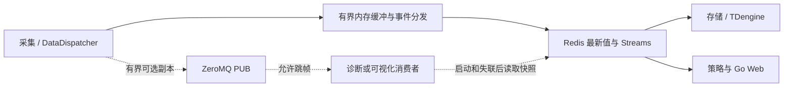

# EMS 引入 ZeroMQ 的必要性评估

> 历史评估（2026-09-13）。2026-09-27 已决定将 ZeroMQ 用于消息订阅与命令下发；2026-09-28 Web 后端目标方案改为 C++17 + Drogon。当前实施边界见 [系统架构](../architecture/system-design.md)与[ZeroMQ 消息订阅与命令下发设计](../common/realtime/zeromq-messaging-design.md)。下文“首期不引入”及 Go/GORM 等表述保留为当时的评估记录，不再代表当前决策。

> 评估日期：2026-09-13｜范围：当前四进程目标架构｜结论：首期不引入，保留局部验证选项。
> 本文基于 [EMS 系统架构设计](../architecture/system-design.md)、[数据采集架构](../processes/collector/design.md) 和官方资料进行设计评估。尚未开展 ZeroMQ 原型或性能测试，文中的性能收益属于待验证假设。

## 1. 结论与适用条件

> 历史评估记录：此处对 ZeroMQ 和 Redis Streams 的结论已由 [ZeroMQ 消息与命令设计](../common/realtime/zeromq-messaging-design.md) 取代。当前方案用 ZeroMQ 传递原始遥测和变化提示，Redis 只保存实时状态。

**原评估结论（已废止）：当前没有足够理由将 ZeroMQ 加入 EMS 的必需依赖。** 共享状态经 [统一实时接口](../common/realtime/access-design.md) 使用 Redis、共享内存或其他合格后端；Redis Streams 传递可靠事件，gRPC 提供内部业务接口，进程内有界队列协调工作线程。以下涉及 Redis 共享状态的比较为当时的默认部署方案。

判断依据是现有需求已经有明确承载方式，而仓库文档尚未提供设备规模、峰值采样率、通信耗时占比及延迟目标的实测数据。此时引入 ZeroMQ 会增加一套连接管理、消息语义、故障恢复和部署验证工作，收益尚无法量化。

后续如果证实存在独立的高频数据分发需求，且允许丢失中间帧、可通过快照恢复，可以验证局部 ZeroMQ 通道。例如将采集数据副本交给诊断或可视化消费者。是否采用，以第 8 节的验证结果为准。

本评估沿用整体架构的控制仲裁、告警归属和四类业务进程边界。MySQL 由 Go 使用 GORM、C++ 各进程使用公共 ormpp API 访问，每个进程独立建立连接或连接池；TDengine 由存储进程统一访问。

## 2. 当前架构中的通信需求

| 路径 | 关键需求 | 当前目标方案 | ZeroMQ 的潜在作用 |
| --- | --- | --- | --- |
| 采集 → 共享实时状态 | 最新值、质量、新鲜度、重启后可查询 | Redis Hash/String | 只能传递更新，仍需要状态存储与快照 |
| 采集 → 存储 | 原始采样、有界缓冲、去重、落库确认 | 内存队列 + Streams + TDengine | 可作传输层，但需要另建可靠投递协议 |
| 策略 → 采集 | 定向路由、期限、幂等、审计、回读 | 策略通过公共 ormpp API 保存命令/outbox，存储发布 Streams | 可直接传消息，不能省去持久接收和执行状态机 |
| 采集/策略 → 审计 | 完整回执、告警生命周期、恢复核对 | MySQL/outbox + Streams | 缺少本项目所需的完整恢复机制 |
| Go → C++ 存储 | 分页历史等跨进程服务、明确错误 | gRPC + Protobuf；普通 MySQL CRUD 由 Go 使用 GORM 完成 | 请求响应可实现，但要增加 RPC 层约定 |
| 采集线程 → 分发线程 | 有界队列、线程唤醒、阻塞隔离 | 进程内队列与条件变量 | 可用 inproc，暂缺替换收益依据 |
| 实时诊断/画面副本 | 低延迟、只关注近期值、可恢复 | 按需快照或刷新通知 | 是后续最适合验证的范围 |

这些是当前目标设计，不代表上述组件已经全部落地；是否新增 ZeroMQ 以本文的验证条件决定，不以旧工程依赖作为设计前提。

## 3. ZeroMQ 能力与保证边界

### 3.1 定位与可能收益

ZeroMQ 是异步消息库，支持发布订阅、请求响应等模式，可在没有专用消息代理服务的情况下运行。它允许将消息通信嵌入应用进程。[ZeroMQ 官方介绍](https://zeromq.org/get-started/)。

对本项目的潜在收益是：部分消息可以在生产者与消费者之间直接传递，减少经过集中服务的路径，并按消费者拓扑组织分发。这是需要基准验证的工程假设，不能据此推导出固定吞吐提升或确定的毫秒级收益。当前 Redis 仍承担共享状态和可靠事件，引入 ZeroMQ 通常也不能减少现有基础设施数量。

### 3.2 发送成功与持久化

`zmq_send()` 成功表示消息已由本地 socket 接管，并不表示已经发到网络，更不表示远端处理完成。[发送接口说明](https://libzmq.readthedocs.io/en/latest/zmq_send.html)。

需要业务确认、重试和故障恢复时，应用必须在基础通信模式上增加协议；官方可靠请求响应指南也在核心模式之上构建这类机制。[可靠请求响应指南](https://zguide.zeromq.org/docs/chapter4/)。

因此，若将 ZeroMQ 用于需要持久恢复的事件，还需另外设计持久状态、恢复游标、确认、去重与清理。当前方案不引入独立本地文件记录：采样只有有界内存缓冲，命令/告警使用 MySQL/outbox；ZeroMQ 不能自动补齐未发布采样的丢失窗口。

### 3.3 消息模式影响丢弃与阻塞

| 模式 | 主要语义 | EMS 使用边界 |
| --- | --- | --- |
| PUB/SUB | 向订阅者分发；PUB 对慢订阅者达到高水位时丢弃消息 | 可用于可丢弃副本，不作为唯一命令/审计通道 |
| PUSH/PULL | 向下游轮转分配任务；无可用容量时阻塞，非阻塞发送可能返回 EAGAIN | 适合可重算任务；存储和策略各需完整数据时不能用竞争消费代替广播 |
| REQ/REP | 按请求、响应交替通信 | 简单交互可用；复杂并发和恢复需额外处理 |
| DEALER/ROUTER | 支持异步交互和路由 | 路由身份不等于业务授权，可靠处理仍需确认和去重 |

各模式的具体行为见 [socket 类型说明](https://libzmq.readthedocs.io/en/latest/zmq_socket.html)。订阅者晚启动、离线或崩溃还可能错过消息，恢复需额外快照或重放机制。[发布订阅恢复说明](https://zguide.zeromq.org/docs/chapter5/)。

### 3.4 线程、传输与参数

常用 PUB/SUB、PUSH/PULL、REQ/REP、DEALER/ROUTER socket 不应由多个线程并发使用。候选实现应采用 socket 所属线程独占的方式，由采集线程向分发线程提交任务。[线程安全说明](https://libzmq.readthedocs.io/en/latest/zmq_socket.html)。

`inproc://` 用于同一进程、同一 ZeroMQ context 内的线程通信；它不能连接 EMS 的四个独立进程。[inproc 说明](https://libzmq.readthedocs.io/en/latest/zmq_inproc.html)。同机独立进程可评估 `ipc://`，其支持依赖系统的 UNIX domain socket 能力；跨主机可评估 TCP。Linux/ARM 和开发环境应分别验证所选构建的传输支持。[ipc 说明](https://libzmq.readthedocs.io/en/latest/zmq_ipc.html)。

高水位按每个对端的排队消息数计量，不能直接当作总字节预算；还要限制消息大小、连接数及应用队列。显式设置发送超时和关闭等待策略。`LINGER=0` 会丢弃未发送消息，无限等待可能阻塞退出。参数和实际容量必须随固定版本验证。[socket 参数说明](https://libzmq.readthedocs.io/en/latest/zmq_setsockopt.html)。

## 4. 与现有技术的关系

| 维度 | Redis Hash/Streams | gRPC + Protobuf | ZeroMQ |
| --- | --- | --- | --- |
| 本项目主要职责 | 共享快照、事件留存与消费 | 类型化服务调用 | 可选的直接消息分发 |
| 查询最新状态 | Hash/String 直接承载 | 由服务实现查询 | 需要另建状态服务 |
| 消费确认与恢复 | Streams 提供消费组、ACK、待处理记录等基础 | 应用定义持久处理与幂等 | 应用补充确认、日志和重放 |
| 接口契约 | 本项目维护版本化 JSON/字段语义 | IDL、生成接口和调用状态 | 需另选序列化并约定消息协议，可复用 Protobuf |
| 运行成本 | Redis 服务、持久化与容量管理 | 服务端及两端工具链 | 库、端点、应用排队和恢复逻辑；代理拓扑另计 |
| 当前取舍 | 保留 | 按目标设计引入 | 暂不增加 |

Redis Streams 的消费能力见 [Redis streaming](https://redis.io/docs/latest/develop/use-cases/streaming/)，gRPC 的服务定义、流式调用及 deadline 见 [gRPC 核心概念](https://grpc.io/docs/what-is-grpc/core-concepts/)。表中的取舍是结合本项目边界作出的判断。

Streams 也不是自动“零丢失”：持久化配置、故障切换、消费者确认和事件保留策略共同决定恢复边界，继续遵守整体架构第 5.3 节。gRPC 调用超时同样不能证明写入没有发生，业务仍需稳定 ID 与结果查询。

ZeroMQ 可与 Redis、gRPC 共存，但必须能解释新增通道解决的具体问题。需要长期事件保留、独立回放或跨站复制时，应围绕持久化事件系统另行选型；不能因为 ZeroMQ 名称包含 MQ 就视为现成的持久化消息服务替代品。

## 5. 各候选方案的必要性

### 5.1 替换 Redis 共享状态：不建议

各进程重启后仍需获取全量配置和最新测点。单纯推送更新无法提供完整查询视图；如果再增加快照服务和一致性协议，会复制 Redis 已承担的职责。保留 Redis 后，再向所有进程全量推送也会增加序列化和网络工作，未必能减少总负载。

### 5.2 替换 Streams 历史与告警通道：不建议

历史和告警关注故障后可恢复、可核对。替换后即使网络发送更快，既定的业务持久记录、入库确认、独立消费者进度及裁剪仍需保留；采样的有界缓冲与丢失边界仍须明确。应先定位是 Redis 处理、消息粒度、数据库写入还是消费者积压造成瓶颈，再选择优化措施。

### 5.3 增加策略到采集的控制直连：首期不建议

控制耗时包含鉴权、策略检查、MySQL 持久接收、消息分发、通道排队、设备协议事务与回读。ZeroMQ 最多改善其中的部分通信耗时，无法解决串口忙碌、设备响应慢或采集循环不能及时检查控制队列的问题。

如果今后验证控制分发是主要瓶颈，必须让同一 `command_id` 在任何投递路径上进入同一个幂等执行状态机，并保留配置版本、期限、所有权代次、outbox 和审计。双路径迟到、重复及单路故障都要验证；仅仅增加一条“更快”的发送路径不足以完成设计。

另外，当前新控制依赖 Go/GORM 或 C++ 公共 ormpp API 完成 MySQL 事务持久保存，并依赖策略仲裁及存储进程发布 outbox。ZeroMQ 直连无法单独实现“Redis/MySQL 不可用时仍正常远程控制”，这需要重新评估整个控制可用性和恢复设计。

### 5.4 替换 Go → 存储 gRPC：不建议

Go 的业务 CRUD 与配置写入直接使用 GORM；分页历史等跨进程查询使用存储 gRPC，与 Go/C++ 类型契约和服务边界匹配。用 ZeroMQ 替换这些服务调用后仍需处理方法路由、请求关联、错误、期限、鉴权和版本。若有持续数据流需求，应先把 gRPC streaming 纳入同条件比较。

### 5.5 替换进程内队列：暂不建议

现有设计使用有界队列、条件变量和独立分发线程，能够直接表达唤醒、优先级和背压。只有出现多个复杂工作流需要统一消息模式，并证明维护或性能收益时，才考虑 inproc。协议事务边界的控制优先调度仍由采集调度器负责。

### 5.6 高频诊断或可视化副本：可作为后续验证对象

当某类消费者只关心近期样本，允许跳过中间帧，且不会依据缺失数据直接执行控制时，直接分发可能有价值。这类需求的恢复与业务审计要求较低，适合与现有路径隔离验证。

## 6. 如需试点，建议的最小边界

仅对明确允许丢弃的数据副本验证 PUB/SUB，不增加独立业务进程。下图是候选试验范围，不是当前实施架构。

试点遵循以下约束：

1. 副本关闭、阻塞或失败不得阻塞可靠分发与协议线程；采样进入 Streams 与最终落库分别确认，不增加本地持久化接收承诺。
2. 消息复用业务字段与稳定事件身份，携带来源代次、序号、时间、质量和配置版本。副本不写权威最新值，不触发控制。
3. 接收端按测点与来源版本去旧；启动或重连时先建立接收及有限缓冲，再读取快照并按版本合并。缓冲溢出或版本不能对齐时重新同步。
4. 周期读取权威快照并检查新鲜度，避免仅靠序号间隙检测：末尾更新丢失后可能没有下一条消息可暴露缺口。重同步只恢复最新视图，不补齐全部中间样本。
5. 初次验证复用相同编码与批量大小，单独测试传输差异；如再试 Protobuf，分别记录编码收益和传输收益。
6. 使用开关停用副本即可回到基线；消费者显示数据陈旧状态，并按既定频率通过原查询路径恢复。

候选试点的价值必须在原有可靠路径仍运行时测量。只测 ZeroMQ 独立发送吞吐，无法说明系统增加副本后的整体收益。

## 7. 依赖与维护成本

| 工作项 | 需要落实的内容 |
| --- | --- |
| C++ 集成 | 固定 libzmq 与绑定版本，验证 C++17、Linux/ARM、安装打包及动态库搜索路径 |
| Go 集成 | 明确是否涉及 Go 消费者；选择绑定后核查原生依赖、交叉编译和运行库要求 |
| 消息契约 | 编码、主题、大小限制、版本、质量、时间、未知类型处理和跨语言样例 |
| 生命周期 | 端点配置、启动顺序、重连、线程归属、队列上限、退出等待、重同步 |
| 运维 | 延迟、新鲜度、接收序号缺口、重同步次数、连接重建、CPU/RSS 和应用队列指标 |
| 访问控制 | 同机端点权限；跨主机身份校验、加密、密钥分发与轮换，限制允许接入的消费者 |

`cppzmq` 是 libzmq 的头文件式 C++ 绑定，仍需底层库。[cppzmq 官方仓库](https://github.com/zeromq/cppzmq)。Go 生态有多种绑定，不能假定它们具有相同的构建与线程语义；例如 `pebbe/zmq4` 需要安装 ZeroMQ。[ZeroMQ Go 入口](https://zeromq.org/languages/go/)、[pebbe/zmq4 仓库](https://github.com/pebbe/zmq4)。

ZeroMQ 的 CURVE 机制提供认证与保密能力，但项目仍需配置可信身份和密钥生命周期。[CURVE 说明](https://libzmq.readthedocs.io/en/latest/zmq_curve.html)。库能够提供传输能力，不意味着相关运维工作可以省略。

PUB 端发送成功不能作为每位订阅者收到消息的指标，因此丢失与陈旧检测主要通过接收端版本、新鲜度及对账统计完成。无消息时也应通过周期检查识别失联。

## 8. 重新评估的触发条件与验证计划

### 8.1 先补齐现场输入

| 输入 | 用途 |
| --- | --- |
| 设备、通道、测点数及各类采样频率 | 计算持续与峰值样本率 |
| 单条/批量消息字节数与消费者数量 | 估算序列化、分发及内存负载 |
| 数据可见延迟、控制完成延迟、新鲜度要求 | 分别定义 p95/p99 目标，避免混用 |
| 最大中断时长、允许丢弃的数据类型 | 确定内存缓冲与 Streams 容量、已投递事件回放与副本恢复边界 |
| 目标 ARM CPU、内存、磁盘与网络 | 在实际资源约束下验证收益 |
| 故障恢复时间与运维能力 | 判断新增通信组件能否长期维护 |

用于估算的量：`样本率 = Σ(测点数 × 采样频率)`；`载荷字节率 ≈ 样本率 × 平均样本字节数`。批量消息还要计入包头、批次等待和每个接收者的传输副本。缓冲/积压载荷可按字节率乘中断时长估算，Streams 实占另加索引、元数据和余量；进程内缓冲不能替代持久存储；这些公式不代表任何中间件的实测容量。

### 8.2 何时值得做原型

同时满足下列条件才进入试点：

- 已定义的业务延迟或资源预算不达标，并通过分段测量确认通信/分发是主要瓶颈。
- 已评估批量、序列化、消费者并发、Redis 状态与事件负载隔离等基线优化，仍有明确缺口。
- 存在可以单独评估的路径，数据丢弃与恢复语义已明确；收益不依赖取消必须的审计或持久化。
- 团队可以维护该路径的依赖、监控和回退，并愿意以实际收益决定是否采用。

例如，“高频诊断视图的 p99 数据年龄持续超过已约定目标，且主要时间消耗在当前分发路径”是有效触发条件。“进程超过四个”或“ZeroMQ 宣称高性能”不足以构成依据。

### 8.3 公平的比较方法

| 项目 | 验证要求 |
| --- | --- |
| 基线与候选 | A 为当前目标路径；B 为优化后的基线；C 为保留可靠路径并开启 ZeroMQ 副本；必要时加入 gRPC streaming 对照 |
| 控制变量 | 同一设备或同规格 ARM 主机、编码、消息大小、批量等待、消费者数、持久化和安全配置 |
| 负载 | 现场持续负载、峰值突发、慢消费者，以及主业务与副本同时运行 |
| 分段时间 | 采集完成、入队、发布、接收、业务处理、设备协议确认/回读；明确每个指标起止点 |
| 时钟 | 同机用可比较的单调时钟；跨机量化同步误差，不能把未校准的时间差当精确单向延迟 |
| 资源 | 全系统 CPU、RSS、网络、磁盘、应用积压，以及对可靠通道的影响 |
| 数据结果 | 有效样本数、缺口、重复、陈旧比例、重同步耗时、可靠事件最终对账 |

不能用无持久化的 ZeroMQ 吞吐直接对比含磁盘确认的可靠事件路径。必须在同一业务语义下比较。也不能只报告成功收到的消息延迟而隐藏丢弃数量。

故障验证至少包括生产者/消费者重启、订阅者晚加入、持续慢消费、达到队列上限、网络中断与恢复、Redis 快照暂不可用，以及进程带未发送消息退出。副本允许丢帧，但要能发现陈旧并恢复最新视图；可靠通道仍须按原验收标准核对数据。

### 8.4 采用或退出的标准

试验前填写数据可见延迟、新鲜度、CPU/RSS、恢复时间、可靠路径退化上限及最小有意义收益的具体数值。本文不虚构尚未确认的现场指标。

只有候选方案在重复测试中达到既定目标、收益足以覆盖维护成本、故障恢复可重复通过，并且不破坏可靠路径预算时，才把该局部路径写入正式架构决策。若基线优化已达标、收益来自不同编码/持久化条件，或恢复与维护成本过高，则结束试点并保留原方案。

## 9. 当前工程决策记录

| 项目 | 决策 |
| --- | --- |
| 是否加入首期依赖 | 否 |
| 是否替换 Redis、Streams 或 gRPC | 否 |
| 是否增加控制直连路径 | 否 |
| 保留的候选方向 | 有明确瓶颈的高频诊断/可视化副本 |
| 下一步 | 先落实当前通信契约与可靠路径，采集现场规模和分段性能数据 |
| 本次产出 | 独立评估文档及导航入口；未实现原型、安装依赖或运行基准 |

官方资料访问日期为 2026-09-13。本文引用的 latest 文档用于能力核实；正式集成时应固定库和绑定版本，重新验证所用 API、构建选项及平台支持。
