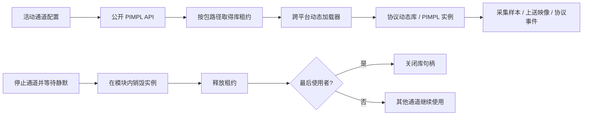

# 采集执行与协议插件设计

> 2026-09-19 修订：本文说明 C++17 通信进程的采集执行子模块。进程完整职责见 [采集与上送进程](index.md)，设备/通道/协议的统一模型见 [设备、通道与协议](../../architecture/channel-protocol.md)。轮询线程与插件示例仅说明 acquisition 客户端路径，不代表所有协议或服务端角色都必须实现同一套轮询接口。

Redis 地址遵循 [Redis 键设计](../../common/realtime/redis-key-design.md)：全局唯一 unit_code 为根，设备与子设备 code 逐级展开；共享通道位于 station 命名空间，设备资产路径与通信路由分别解析。站字段统一使用 station_id/station_code。

公共实时状态访问采用 [C++17 多后端接口设计](../../common/realtime/access-design.md)：数据分发层注入 `RealtimeService/IRealtimeStore`，支持共享内存、Redis 与其他内存数据库派生类。本文涉及 Redis 最新值的流程和示意为默认部署实现；有界采样缓冲、事件通道、配置仓储与实时状态后端分别承担职责，协议和通道线程不判断后端类型。

设备类型、固有点位、厂家点表与实例绑定遵循 [EMS 设备模型与点表绑定设计](../../architecture/device-model.md)。采集按厂家路由读取并解码，再转换为标准逻辑点；控制按生效标准命令配置编码，执行前检查启用状态、版本、能力条件及独立反馈。

## 1. 概述

### 1.1 设计目标

数据采集模块是 EMS 系统的核心组件，负责通过多种工业通信协议与现场设备交互，完成遥测（YC）、遥信（YX）、遥控（YK）、遥调（YT）四类数据的采集与下发。

本设计基于以下核心原则：

- **资源单一所有者**：独立通道使用一个 C++17 工作线程；共享同一物理串口/总线的设备绑定由同一线程调度，禁止重复打开同一资源
- **设备与通道多对多**：支持采集专用、控制专用和采控共用，控制在事务边界插队，并保证采集新鲜度
- **规约动态库按需加载**：各协议包独立动态库；公开 C++ API 使用 PIMPL，按平台加载 `.dll` / `.so`，不用到的协议不加载
- **统一接口抽象**：所有协议插件实现统一的 C 接口，采集引擎不依赖任何具体协议实现

### 1.2 目标协议与采集能力

| 协议 | 传输方式 | 默认端口 | 典型设备 | 动态库文件名 |
|------|---------|---------|---------|-------------|
| Modbus TCP/RTU | TCP / RS485 | 502 | PCS、BMS、通用工控设备 | `libproto_modbus.so` |
| DL/T 645-2007 | 串口网关 / RS485 | 网关配置，无统一 TCP 端口 | 电能表 | `libproto_dlt645.so` |
| IEC 60870-5-104 | TCP | 2404 | 电力远动设备、保护装置 | `libproto_iec104.so` |
| IEC 61850 MMS | TCP | 102 | 变电站 IED，报告/控制按能力验收 | `libproto_iec61850.so` |

---

GOOSE/SV 不包含在 MMS 的 TCP 接口中，须独立 profile、发布/订阅角色与能力验收。上送服务端的模型、会话和控制入口见 [通道协议设计第 6 节](../../architecture/channel-protocol.md#6-上送通道设计)。

## 2. 整体架构

### 2.1 架构图

```
┌─────────────────────────────────────────────────────────────────────────┐
│                          采集进程 (collect)                              │
├─────────────────────────────────────────────────────────────────────────┤
│                                                                         │
│  ┌─────────────────────────────────────────────────────────────────┐   │
│  │                     采集引擎 (CollectEngine)                     │   │
│  │                                                                 │   │
│  │  ┌──────────────┐  ┌──────────────┐  ┌──────────────┐          │   │
│  │  │ 通道线程 #1   │  │ 通道线程 #2   │  │ 通道线程 #N   │  ...     │   │
│  │  │              │  │              │  │              │          │   │
│  │  │ ChannelCtx   │  │ ChannelCtx   │  │ ChannelCtx   │          │   │
│  │  │  ┌────────┐  │  │  ┌────────┐  │  │  ┌────────┐  │          │   │
│  │  │  │Protocol│  │  │  │Protocol│  │  │  │Protocol│  │          │   │
│  │  │  │Plugin* │  │  │  │Plugin* │  │  │  │Plugin* │  │          │   │
│  │  │  └────────┘  │  │  └────────┘  │  │  └────────┘  │          │   │
│  │  └──────┬───────┘  └──────┬───────┘  └──────┬───────┘          │   │
│  │         │                 │                 │                   │   │
│  └─────────┼─────────────────┼─────────────────┼───────────────────┘   │
│            │                 │                 │                        │
│  ┌─────────▼─────────────────▼─────────────────▼───────────────────┐   │
│  │                    插件管理器 (PluginManager)                     │   │
│  │                                                                 │   │
│  │   dlopen/dlsym 按需加载，统一生命周期管理                          │   │
│  │                                                                 │   │
│  │   ┌─────────────────┐  ┌─────────────────┐                      │   │
│   │   │ libproto_    │  │ libproto_    │  ...                 │   │
│   │   │ modbus.so     │  │ iec104.so     │                      │   │
│  │   └─────────────────┘  └─────────────────┘                      │   │
│  └─────────────────────────────────────────────────────────────────┘   │
│                                                                         │
│  ┌─────────────────────────────────────────────────────────────────┐   │
│  │                    数据分发层 (DataDispatcher)                    │   │
│  │                                                                 │   │
│  │   采集数据 ──▶ Redis Hash + Streams ──▶ 存储/策略                │   │
│  └─────────────────────────────────────────────────────────────────┘   │
│                                                                         │
│  ┌─────────────────────────────────────────────────────────────────┐   │
│  │                    参数加载器 (ParaLoader)                        │   │
│  │                                                                 │   │
│  │   从 Redis 版本快照加载配置，缺失时经公共 ormpp API 读库         │   │
│  └─────────────────────────────────────────────────────────────────┘   │
│                                                                         │
└─────────────────────────────────────────────────────────────────────────┘
```

### 2.2 核心组件职责

| 组件 | 职责 |
|------|------|
| **CollectEngine** | 采集引擎主类，管理所有通道线程的创建/销毁/启停，协调插件加载与数据分发 |
| **ChannelThread** | 每个通道对应一个独立线程，持有该通道的协议插件实例，执行轮询采集循环 |
| **PluginManager** | 通过 PIMPL 跨平台加载器管理库租约、协议别名与工厂；具体契约见通讯协议专题 |
| **ProtocolPlugin** | 动态库内 PIMPL 协议实现，经版本化 C ABI 与主程序交互 |
| **DataDispatcher** | 有界内存缓冲、经统一接口更新最新值、经独立事件接口发布采样；发布失败在预算内重试，超限报告缺口；默认使用 Redis/Streams，变更通知仅作刷新提示 |
| **ParaLoader** | 从存储发布的 Redis 快照或公共 ormpp API 加载指定版本的资产、通道绑定和测点配置，维护实际应用版本；数据库连接由采集进程独立管理 |

---

## 3. 通道线程模型

### 3.1 一个独立资源一个工作线程

独立通道对应一个 `std::thread`，线程独占协议实例；同一 RS485 总线的多个设备通过不同从站地址绑定到该通道。一个设备也可绑定多个独立通道，分别采集不同测点、控制或作为主备。

```text
PCS01 ── telemetry ──▶ 通道 A / 独立连接 A / 线程 A
       └─ control   ──▶ 通道 B / 独立连接 B / 线程 B

PCS02 ── both ───────▶ 通道 C / 共用连接 C / 线程 C
                       优先控制队列 + 到期采集队列

电表-01 / addr=1 ──┐
电表-02 / addr=2 ──┴──▶ 通道 D / 同一 RS485 / 线程 D
```

连接资源、设备资产归属、协议地址分别建模。多个逻辑通道若指向同一个不可并发物理资源，必须合并到同一调度器或拒绝冲突配置。详细调度见第 3.5、5.2 节。

### 3.2 线程隔离的好处

1. **阻塞隔离**：有界通信超时限制独立通道相互等待；共享总线仍会相互影响，插件内存错误仍可能导致整个采集进程退出
2. **协议隔离**：不同协议的阻塞调用（如串口 I/O）不会互相阻塞
3. **独立调度**：每个通道可以配置不同的采集周期和策略
4. **资源可控**：每个通道的内存和 CPU 使用独立可监控

### 3.3 通道线程生命周期

```
                    ┌──────────┐
                    │  Created │
                    └────┬─────┘
                         │ start()
                    ┌────▼─────┐
           ┌───────│ Starting │──────────┐
           │       └────┬─────┘          │
           │ 加载插件    │ connect()      │ 加载失败
           │ 失败       │ 成功            │
           │       ┌────▼─────┐    ┌─────▼──────┐
           │       │ Running  │    │  Error     │
           │       └────┬─────┘    └─────┬──────┘
           │            │ stop()         │ 重试/恢复
           │       ┌────▼─────┐          │
           └──────▶│ Stopping │◀─────────┘
                   └────┬─────┘
                        │
                   ┌────▼─────┐
                   │ Stopped  │
                   └──────────┘
```

### 3.4 通道上下文结构

```cpp
struct ChannelContext {
    int64_t channel_id;
    ChannelConfig config;
    std::unique_ptr<std::thread> thread;
    std::atomic<bool> running{false};

    std::unique_ptr<ProtocolChannel> protocol;  // PIMPL API，内部持有库租约

    std::vector<DeviceContext> devices;    // 由 device_channel_binding_version 构建的运行时设备视图
    int poll_interval_ms{1000};            // 采集周期

    std::mutex cmd_mutex;                  // 遥控/遥调命令队列锁
    std::condition_variable wakeup;        // 命令/停止/配置变更唤醒
    std::deque<CommandTask> cmd_queue;     // 简化示意，实际为有界优先队列
};
```

---

### 3.5 绑定、路由与控制插队

- `device_channel_binding_version` 保存 device_id、channel_id、config_version、operations 与类型化 device_address；采集专用/控制专用/采控共用对应 telemetry_in/control_out 的不同组合。本端 client/server 角色属于 channel_version.local_role，与此操作组合分开。vendor_point_route_version 保存厂家点的协议地址、编码与通道；point_binding 将标准逻辑点映射到厂家点并指定转换和主备来源。控制配置另行指定写入编码、启用条件和反馈逻辑点，写通道与反馈通道可以不同。
- telemetry 不允许控制写入；control 无常规遥测轮询，但允许协议确认/控制反馈读取；both 串行完成读取和控制。独立采控连接需设备支持，冲突控制仍按设备仲裁。
- 每次只开始一个有界协议事务，在响应完成或超时后检查高优先命令。不得打断已发送帧；大批量读取拆分为多个事务，避免整轮采集阻塞控制。
- ZeroMQ 命令入口只负责接收、校验并持久登记 inbox；执行器从持久 inbox 恢复后入队、唤醒，不在网络回调中直接调用协议句柄。线程等待必须可被命令唤醒；队列锁不得跨网络 I/O 持有。
- 设置控制连续预算、采集最大延迟和关键数据读取预算。优先队列满返回 queue_full；过期返回 expired。同优先级 FIFO，只有允许覆盖且未发送的设定值可合并，并记录 superseded。
- 命令由策略仲裁，通过公共 ormpp API 将命令与 outbox 同事务保存，再由 outbox 发布器用 ZeroMQ REQ/REP 交给采集的持久 inbox。采集执行前再次验证有效期、配置版本、控制权代次与互锁；通过公共 Repository 条件登记 MySQL 执行状态后执行并回读验证，回执与 outbox 同事务保存，重复/不确定结果按整体架构第 6 节处理。
- 通道故障与来源切换更新质量和 source_epoch；回读用发送后的新样本。未确认旧采集实例隔离时，不自动接管控制。

## 4. 动态库插件机制

统一契约见 [通讯协议动态库设计](protocol-design.md)：公开 API、PIMPL、按需加载、C ABI、引用与安全卸载、Windows/Linux/macOS 加载和部署。



同一 Modbus 包可服务 TCP/RTU 多通道，库句柄复用，通道实例与会话分别隔离。未启用通道、配置浏览和草稿编辑不触发加载。

## 5. 采集流程

### 5.1 启动流程

```
1. 采集进程启动（C++17）
   │
   ├── ParaLoader::load_all_as_config()
   │   ├── 读取 Redis 版本化快照；缺失时通过公共 ormpp API 读取 MySQL 指定版本
   │   ├── 校验资产、设备、通道及 device_channel_binding
   │   ├── 加载四遥点表与控制/回读路由
   │   └── 校验完整性后切换版本，反馈 actual_config_version
   │
   ├── CollectEngine::initialize()
   │   ├── 初始化 DataDispatcher (注入实时库与事件通道)
   │   └── 初始化 PluginManager (设置插件目录)
   │
   └── CollectEngine::start_all()
       │
       └── for each channel:
           │
           ├── PluginManager::load(protocol_name)
           │   └── dlopen + dlsym (按需加载)
           │
           ├── 创建 ChannelContext
           │   ├── 绑定插件实例
           │   ├── 绑定设备/测点列表
           │   └── 设置采集周期
           │
           └── 启动 ChannelThread
               └── plugin->connect() → 进入采集循环
```

### 5.2 采集与控制循环

下列为调度伪代码，函数代表待实现职责，不能直接编译：

```text
while running:
    处理停止请求、配置切换和所有者状态
    清理已过期/失效命令并持久记录结果
    if 未连接:
        进行有界重连；可唤醒等待退避时间
        continue

    task = 在控制优先级、连续控制预算、采集新鲜度约束内选择任务
    if 没有任务:
        条件变量等待至下一采集/重连时刻，或被命令/停止/配置唤醒
        continue

    if task 是控制:
        再校验目标绑定、期限、配置版本、控制权和实时互锁
        查询/条件登记 command_id 的 MySQL 执行状态，失败不执行，拒绝不安全重复执行
        持久记录发送意图
        执行一个有超时的写事务，记录协议确认/失败/unknown
        调度发送后的反馈读取，满足条件才标 verified
    else:
        读取一个有界采集事务，生成时间、质量、来源代次和序号
        将结果交给有界分发队列

    事务结束返回调度点，重新检查控制队列
```

连接重试、写入和反馈读取均有时间上限。连续控制预算防止遥测饥饿；不能通过无限清空命令队列、整轮设备遍历或固定 sleep 实现上述要求。IEC104 等主动上报协议仍需处理接收/保活事件，不直接套用轮询专用循环。

### 5.3 数据分发与恢复

```text
通道线程 → DataDispatcher 有界内存队列（稳定 event_id）
                                  → 分别更新最新值、ZeroMQ 发布原始遥测
                                                            │
                                              存储消费原始事件 → TDengine
                                                            │
                                              失败计入可观察的历史缺口

PUB/SUB 本地接受不证明存储收到；内存样本不保证跨重启恢复

策略读取权威实时快照；告警/回执先持久写 MySQL/outbox
Drogon Web 读取快照并推送前端；变化提示与原始遥测使用独立 ZeroMQ PUB/SUB 主题
```

分发工作由独立工作线程执行，避免数据库/Redis 阻塞直接占用协议线程；队列满必须触发显式背压/降采样规则，不可无限增长。ZeroMQ 发布成功只表示本地接受；采集不等待归档确认。缓冲超限、进程重启、订阅离线或数据库故障可能丢样，应报告可观察的丢弃/缺口，不以最新值伪造缺失历史。

采集进程可通过 `backend/src/common/db/` 公共模块执行职责内的 MySQL 操作，数据库工作安排在配置/业务线程。公共模块封装 ormpp API；采集、存储、策略分别创建和维护自己的连接或连接池，不跨进程共享连接、事务或连接池实例，详见整体架构第 7.2 节。

最新值按 source_epoch/sequence 去旧；Redis 实时写入和 ZeroMQ 遥测发布分别记录结果。历史使用已接收到的原始事件，不能收到通知后再读 Hash。命令回执先与 outbox 同事务写入 MySQL，ZeroMQ 仅发出状态变化提示；采集按持久 inbox 与执行状态对账，不采用本地文件记录。

---

## 6. 目录结构

协议 API、实现、平台适配及安装目录见 [通讯协议工程结构](protocol-design.md#8-工程与构建)。采集调度和分发仍位于 `backend/src/net/collect/`，协议实现位于 `backend/src/net/protocol/`，公开头位于 `backend/include/net/protocol/`。

## 7. CMake 构建配置

自研目标采用 C++17。主程序静态链接轻量 SDK，具体协议构建为 `MODULE`，仅在运行时加载；系统依赖使用 `Threads::Threads` 与 `${CMAKE_DL_LIBS}`。符号导出、三平台产物命名和部署规则由 [通讯协议构建契约](protocol-design.md#8-工程与构建)统一维护。

## 8. 关键设计决策

### 8.1 为什么选择一个通道一个线程？

| 方案 | 优点 | 缺点 |
|------|------|------|
| **每通道一线程** (选用) | 故障隔离好、实现简单、协议阻塞调用不影响其他通道 | 线程数与通道数成正比，大量通道时线程开销大 |
| 线程池 + 异步 I/O | 线程数可控、资源利用率高 | 协议库多为同步阻塞 API，需要复杂封装；故障隔离困难 |
| 协程 (C++20) | 轻量级、高并发 | 依赖 C++20、第三方协议库不支持协程、调试困难 |

首期在目标硬件和实际通道数量下验证线程、内存及响应开销；通道规模扩大后可在 C++17 下评估异步 I/O/事件循环。无实测数据时不假定所有现场都在固定通道数量范围。

### 8.2 为什么选择动态库按需加载？

| 方案 | 优点 | 缺点 |
|------|------|------|
| **动态库按需加载** (选用) | 按需加载节省内存、新增协议无需重编译主程序、协议库可独立升级 | 运行时加载有微小开销、需要定义稳定的 C 接口 |
| 静态链接所有协议 | 无加载开销、调试方便 | 未使用的协议也占用内存、新增协议需重编译 |
| 进程级隔离 | 最强隔离、可独立重启 | 进程间通信开销大、架构复杂 |

动态库方案支持按需加载，使协议实现与核心引擎解耦。

### 8.3 为什么插件接口使用 C 导出函数？

- **ABI 约束**：C 导出避免名称修饰，但仍需统一结构体布局、版本、调用约定和内存所有权；不跨边界传递 STL 或异常
- **兼容验证**：不同编译器/运行库组合需实测，不能仅凭 extern C 保证二进制兼容
- **平台封装**：Windows 使用 `LoadLibraryExW/GetProcAddress`，Linux/macOS 使用 `dlopen/dlsym`，均隐藏在加载器 PIMPL 中
- **内部仍用 C++**：SDK 和各协议实现采用 PIMPL；C ABI 桥在模块内调用协议对象

---

## 9. 错误处理与重连机制

### 9.1 连接异常处理

```
┌──────────────────────────────────────────────────────────────┐
│                   连接异常处理流程                             │
├──────────────────────────────────────────────────────────────┤
│                                                              │
│  采集循环中检测到连接断开:                                     │
│                                                              │
│  plugin_->is_connected() == false                            │
│       │                                                      │
│       ▼                                                      │
│  标记该通道所有测点品质为 Invalid                              │
│       │                                                      │
│       ▼                                                      │
│  进入重连循环:                                                │
│       │                                                      │
│       ├── 重试次数 < max_retries ?                            │
│       │       │                                              │
│       │    Yes│         No                                   │
│       │       ▼              ▼                               │
│       │  可唤醒退避等待   标记通道为 Error                    │
│       │  connect()        通知上层（日志/告警）                │
│       │       │                                              │
│       │  成功? ──Yes──▶ 恢复采集循环                          │
│       │    │                                                  │
│       │   No ──▶ 继续重试                                     │
│       │                                                      │
│  指数退避策略:                                                │
│    backoff = min(base_delay * 2^retry_count, max_delay)      │
│    base_delay = 1s, max_delay = 60s                          │
│                                                              │
└──────────────────────────────────────────────────────────────┘
```

### 9.2 采集超时处理

- 单次读取超时：标记该测点品质为 Invalid，按协议清理/隔离迟到响应，必要时重建会话后再采下一事务
- 连续超时超过阈值：触发重连
- 遥控/遥调超时：发送前到期为 expired；发送后不能确认结果为 unknown，不能直接认定设备执行失败；先回读/核验，不盲目自动重发

---

## 10. 性能优化策略

### 10.1 Modbus 批量读取优化

将同一从站、同一功能码的连续寄存器合并读取：

```
原始测点列表:
  slave=1, fc=3, addr=0   (FLOAT, 2寄存器)
  slave=1, fc=3, addr=2   (FLOAT, 2寄存器)
  slave=1, fc=3, addr=10  (UINT16, 1寄存器)
  slave=1, fc=3, addr=11  (UINT16, 1寄存器)
  slave=2, fc=3, addr=0   (FLOAT, 2寄存器)

优化后请求:
  1) slave=1, fc=3, read_holding_registers(0, 4)    // 合并 addr 0~3
  2) slave=1, fc=3, read_holding_registers(10, 2)   // 合并 addr 10~11
  3) slave=2, fc=3, read_holding_registers(0, 2)    // 不同 slave
```

上述 Modbus 合并仍受单事务长度和控制延迟预算限制；每个合并请求完成后必须返回调度点检查控制队列。

### 10.2 IEC104 事件驱动优化

- 启动时发送总召唤（InterrogationCommand），全量同步
- 后续依赖设备主动上报（Spontaneous），仅处理变化量
- 设置合理的 T1/T2/T3 链路超时参数

### 10.3 IEC61850 DataSet 批量读取

按数据模型组织批量读取：

- 利用 DataSet 一次读取多个关联测点
- 按 FC (Functional Constraint) 分组读取
- 连接时自动发现数据模型，缓存 LN/DO 结构
