# 通讯协议动态库设计

> 版本：1.0｜日期：2026-10-04｜状态：目标设计；Modbus 首期落地范围见第 10 节，三平台验收尚未全部完成。  
> 自研接口采用 C++17；公开类使用 PIMPL；每个协议包独立动态加载；目标平台为 Windows、Linux、macOS。

## 1. 总体结构

**业务通过公开 API 头文件操作协议；首次启动使用该协议的通道时加载动态库，最后一个使用者安全退出后释放库句柄。**

```mermaid
flowchart TB
    App[采集 / 上送通道管理器] --> API["公开 C++ API 头文件<br/>ProtocolRuntime / ProtocolChannel"]
    API --> SDK["静态链接轻量 SDK<br/>PIMPL / 配置转换 / 生命周期"]
    SDK --> Loader["DynamicLibrary::Impl<br/>跨平台加载器"]
    Loader --> ABI["版本化 C ABI<br/>ems_protocol_get_api"]
    ABI --> M["Modbus 动态库<br/>ModbusProtocol + Impl"]
    ABI --> I["IEC 104 动态库<br/>Iec104Protocol + Impl"]
    ABI -.使用时才加载.-> E["IEC 61850 MMS 动态库<br/>MmsProtocol + Impl"]
    M --> ML[Modbus 第三方依赖]
    I --> IL[IEC 104 第三方依赖]
    E --> EL[MMS 第三方依赖]
```

| 决策 | 约定 |
| --- | --- |
| 打包粒度 | 一个协议包一个动态库；Modbus TCP/RTU 共用 Modbus 包，角色在实例配置中选择 |
| 实例粒度 | 一个活动通道一个协议实例；服务端实例可拥有多个会话 |
| 按需条件 | 启动已启用、分配给当前进程的通道才加载；仅查看目录、保存草稿、停用通道不加载 |
| 编译依赖 | 主程序链接轻量 SDK，不链接任何具体协议动态库或其导入库 |
| 扩展边界 | 新协议实现统一契约并登记清单；需要新操作时先扩展能力与 ABI |

设备、通道、角色和点映射沿用 [设备、通道与协议](../../architecture/channel-protocol.md)；调度、数据分发和控制仲裁沿用 [采集执行设计](design.md)。本页唯一负责协议 API、PIMPL、动态加载及跨平台契约。

## 2. PIMPL 与接口边界

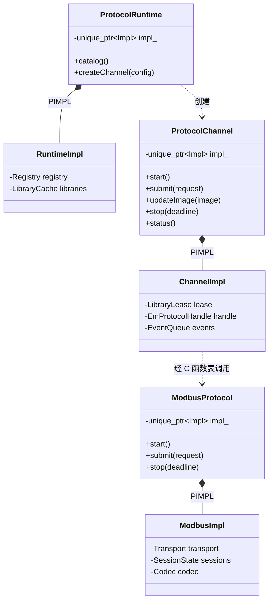

| 接口层 | 对使用者公开 | 隐藏在 `.cpp` / `Impl` |
| --- | --- | --- |
| 业务 SDK | runtime、channel、配置/请求/结果等值类型 | 原生库句柄、函数表、锁、加载路径和引用计数 |
| 协议模块 | 插件 ABI 头；模块内的 PIMPL 类声明 | 第三方头、socket/串口、协议栈、线程、编解码和会话容器 |
| 系统适配 | SDK 内部 `DynamicLibrary` 的 PIMPL 声明 | `Windows.h`、`dlfcn.h`、`HMODULE`、平台错误处理 |

公开 PIMPL 头只包含标准库和项目值类型。构造、析构及移动操作在 `.cpp` 定义；默认禁止复制。活动通道不移动，避免回调上下文地址失效。

**PIMPL 隐藏实现并稳定类的私有布局；跨平台需要分别编译，跨编译器兼容由 C ABI 及实测约束。** SDK 的 C++ 类在主程序内使用，插件的 C++ 类在对应动态库内使用，不跨库传递虚表、STL 对象或 `unique_ptr`。

协议模块的 PIMPL 声明示意，`Status`、请求类型等由项目值类型头定义：

```cpp
class ModbusProtocol final {
 public:
    /** @brief 创建未启动实例；不打开通信资源。 */
    ModbusProtocol();
    /** @brief 在模块内销毁 Impl；调用前必须已成功停止。 */
    ~ModbusProtocol();

    /** @brief 禁止复制资源所有者。 @param[in] other 源实例。 */
    ModbusProtocol(const ModbusProtocol& other) = delete;
    /**
     * @brief 禁止复制赋值。
     * @param[in] other 源实例。
     * @return 不可调用。
     */
    ModbusProtocol& operator=(const ModbusProtocol& other) = delete;
    /** @brief 禁止移动活动实例。 @param[in] other 源实例。 */
    ModbusProtocol(ModbusProtocol&& other) = delete;
    /**
     * @brief 禁止移动赋值。
     * @param[in] other 源实例。
     * @return 不可调用。
     */
    ModbusProtocol& operator=(ModbusProtocol&& other) = delete;

    /**
     * @brief 校验配置并启动连接或监听；内部保存配置副本。
     * @param[in] config 不可变通道配置。
     * @return 启动受理状态；协议就绪通过事件报告。
     */
    Status start(const ChannelConfig& config);
    /**
     * @brief 停止任务、会话与回调；成功返回后才允许销毁。
     * @param[in] timeout_ms 停止等待预算，单位毫秒。
     * @return 成功或停止超时；超时时保留实例与库引用。
     */
    Status stop(std::uint32_t timeout_ms);

 private:
    class Impl;
    std::unique_ptr<Impl> impl_;
};
```

其他协议采用同一封装形式。C 导出桥在本模块内创建/调用/销毁这些类，业务不包含模块实现头。

## 3. 对外 API 与能力

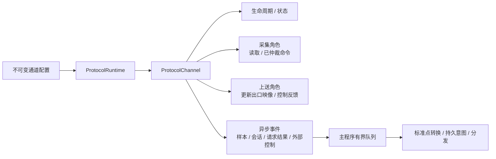

| SDK 接口 | 行为与约束 |
| --- | --- |
| `catalog()` | 读取安装清单和配置 schema，不执行插件代码；支持角色与能力仍需加载后核验 |
| `createChannel(config)` | 校验协议/角色/传输/版本，取得库租约并创建实例；失败自动回滚 |
| `start()` | 异步建立连接或监听；受理成功与数据就绪分别报告 |
| `submit(request)` | 提交带 request_id、配置代次、截止时间的读请求或已仲裁执行命令；队列满明确拒绝 |
| `updateImage(image)` | 上送实例替换出口映像；同一协议响应读取同一映像版本 |
| `replyControl(result)` | 将持久受理/仲裁结果关联回原 peer、session、request_id |
| `status()` | 返回主程序持有的状态副本，区分监听、连接、协议就绪与测点新鲜度 |
| `stop(deadline)` | 成功表示所有会话、工作线程和回调已静默；超时不销毁、不卸载 |

配置至少包含 `channel_id / config_generation / protocol_id / local_role / transport / profile_version / bindings / routes_or_maps / budgets`。采集和上送按能力开放接口，服务端无需实现轮询读取。值保留类型、质量、UTC 毫秒时标、来源和序列；超时预算用单调时钟。

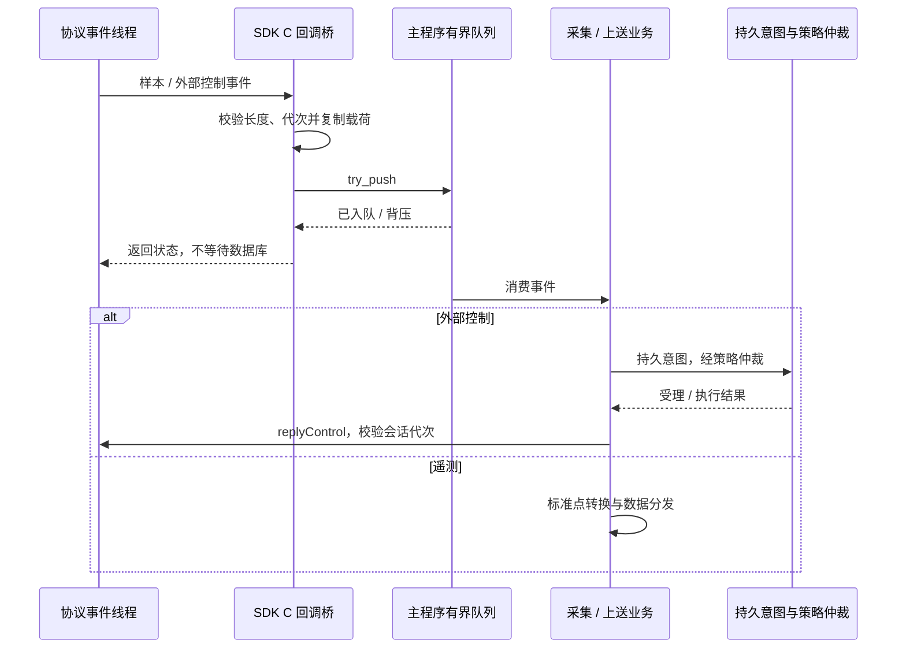

回调不重入插件，不调用停止/卸载，不阻塞数据库。SDK 回调桥捕获异常并返回错误；回调载荷只在该次调用内有效。队列满按事件类别背压/拒绝/显式合并，不统一丢弃控制与需保序事件。

## 4. 动态库 C ABI

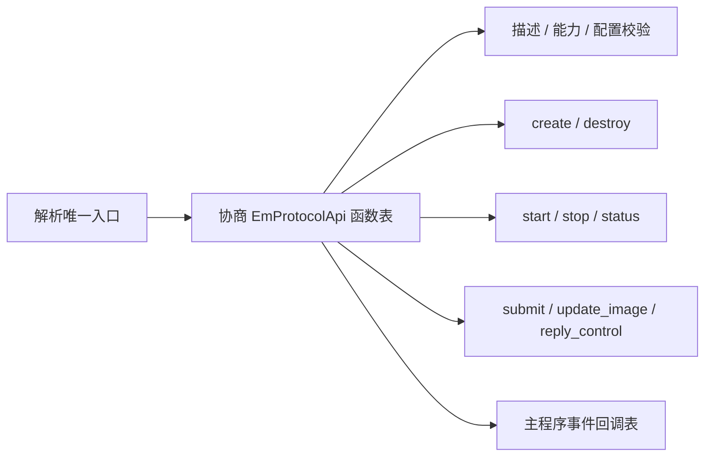

新契约使用 **ABI major = 2**，与当前 `EMS_PLUGIN_API_VERSION = 1` 区分。`protocol_plugin_api.h` 保留为纯 C 头；实现阶段升级，不复用旧版本编号修改布局。

| 契约项 | 约定 |
| --- | --- |
| 导出 | 只导出 `ems_protocol_get_api`；Windows `__declspec(dllexport)`，其他平台默认可见性；其余符号隐藏 |
| 调用约定 | Windows 使用 `__cdecl`，函数表与回调同样标注；导出名称必须固定，32 位 Windows 用 `.def` 等方式核验无修饰名称 |
| 函数表 | 主程序提供零初始化缓冲区与容量；返回 `abi_major / abi_minor / struct_size`，仅访问双方支持的字段 |
| 升级 | major 不匹配拒绝；minor 只在尾部追加可选字段，检查字段是否存在和能力标志；必需函数缺失拒绝 |
| 数据 | 固定宽度整数、显式指针/长度、不透明实例句柄；UTF-8 文本；版本化 JSON 表达配置/地址，采样批次采用约定类型记录 |
| 布局 | 同平台、同架构、同调用约定和约定结构对齐；不用位域、C++ enum、`bool` 或私有 C++ 对象布局 |
| 所有权 | 输入借用至调用返回，异步保留须在插件内复制；实例由插件创建并在插件销毁；输出由调用方提供缓冲区 |
| 缓冲区 | 同时传容量和实际/所需字节数；容量不足返回 `BufferTooSmall`，不写越界；重试取结果不重复发起读写事务 |
| 异常 | 每个 C 入口及回调桥捕获异常，转状态码；错误描述复制至调用方缓冲区，不返回短生命周期字符串 |

入口签名示意；导出/调用宏按上述平台规则定义：

```c
typedef struct EmProtocolApi EmProtocolApi;

/**
 * @brief 获取版本化函数表；不创建实例，不启动线程或通信。
 * @param[in] abi_major 主程序要求的 ABI 主版本。
 * @param[in] host_api_size out_api 可写容量，单位字节。
 * @param[out] out_api 主程序分配的函数表，插件仅写入容量内字段。
 * @return 0 成功；非零表示版本不兼容或参数错误。
 */
EMS_PROTOCOL_EXPORT int32_t EMS_PROTOCOL_CALL ems_protocol_get_api(
    uint32_t abi_major, uint32_t host_api_size, EmProtocolApi* out_api);
```

C++ 编译时声明放在 `extern "C"` 中。函数表及记录结构的完整定义在实现阶段固化为 ABI 头；各接口参数方向、长度、所有权和错误语义必须写 Doxygen 注释。

## 5. 按需加载与复用

清单将协议 ID 映射到 `plugin_id + package_version + 平台文件 + ABI + schema + 能力声明`。别名先归一化；缓存键为**规范化绝对库路径 + 包版本**，不能按 `ModbusTCP/ModbusRTU` 分别缓存。

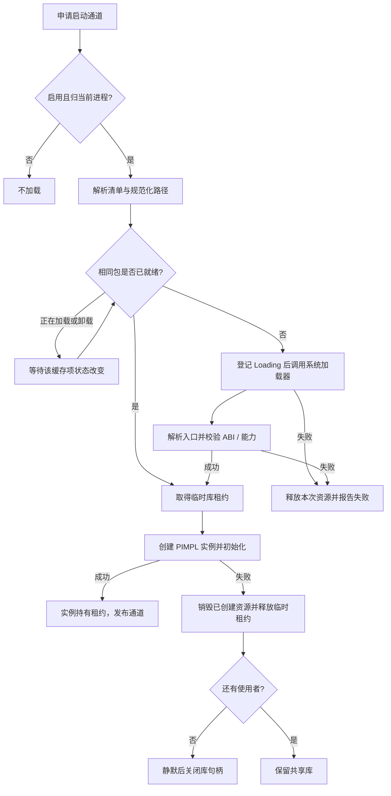

同一缓存项只允许一次加载；不同库可独立加载。登记状态时持缓存锁，执行系统加载器、插件构造/回调时释放全局锁。租约仅在实例成功后转交通道，所有失败分支可回滚；卸载状态期间新申请等待，避免函数表悬空。

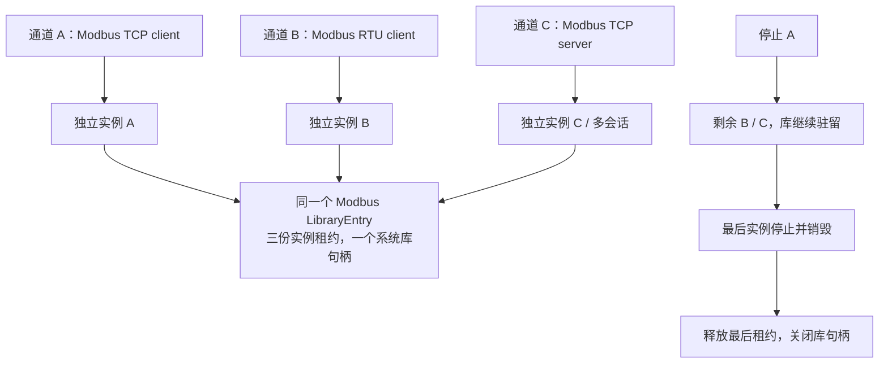

正常断线重连复用实例和库，不反复加载。列出协议清单不等于将库映射入进程；加载某包时，操作系统可能同时加载该包的依赖。关闭句柄也不保证操作系统立即回收全部映射，业务保证的是无使用者时释放自身引用。

## 6. 所有权与卸载

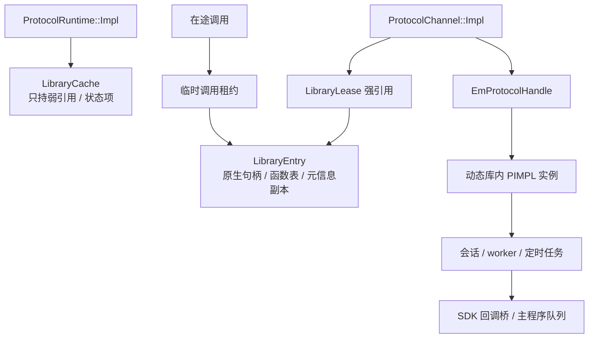

SDK 通道析构必须显式先停止、再经函数表销毁实例、最后释放租约，不能仅依赖成员默认析构顺序。已复制到主程序队列的数据不携带插件析构器或函数指针。

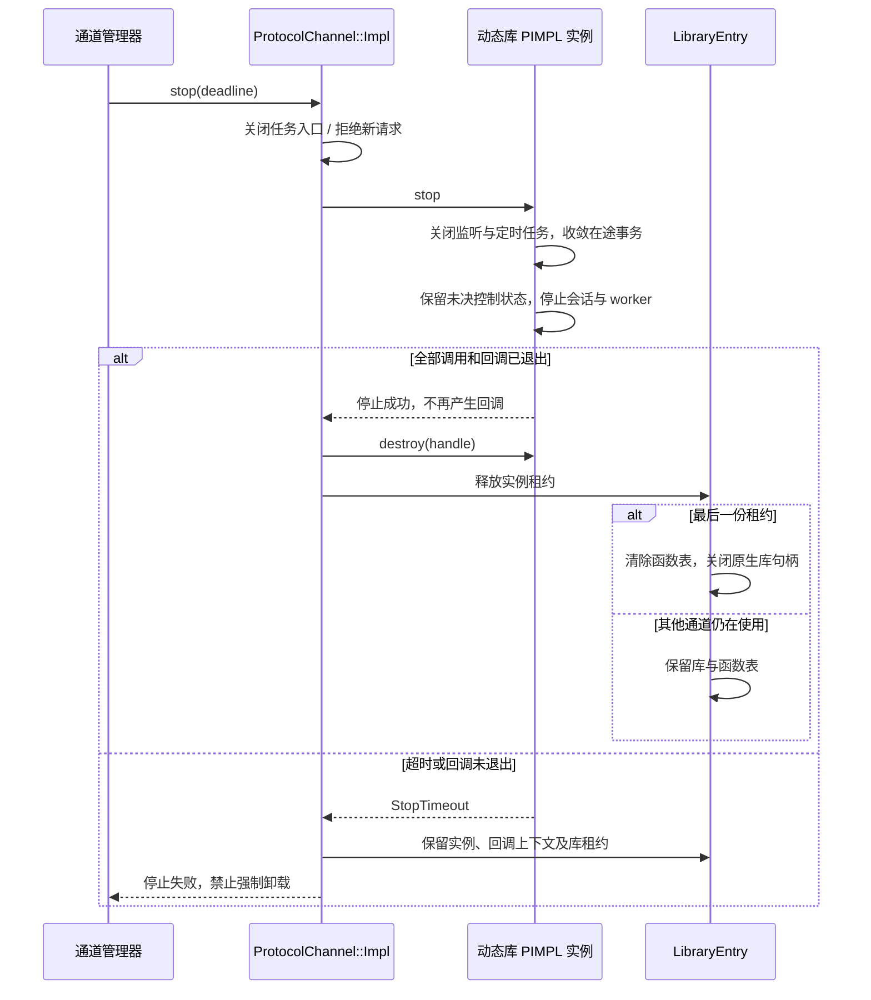

停止超时的实例转入 runtime 的隔离持有区，拒绝新业务、允许再次收敛；退出时仍无法静默则保留至进程终止。不能为了析构完成而释放仍被线程访问的内存。

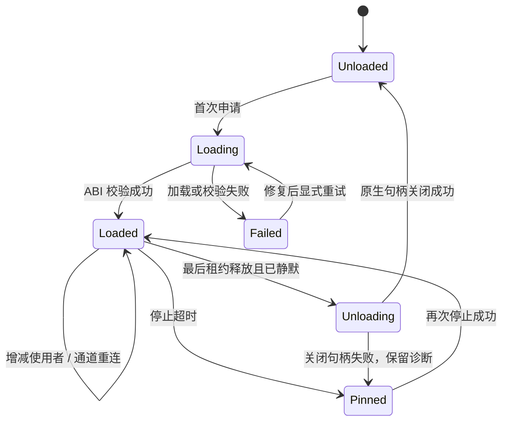

新配置切换：先校验新包/配置 → 暂停入口 → 停旧实例并释放独占资源 → 建新实例 → 成功后公布新代次。重启旧配置前确认新实例已释放资源；旧命令/事件按配置代次拒绝。首期升级采用停通道后换包，不承诺在途热替换。

## 7. 跨平台加载与部署

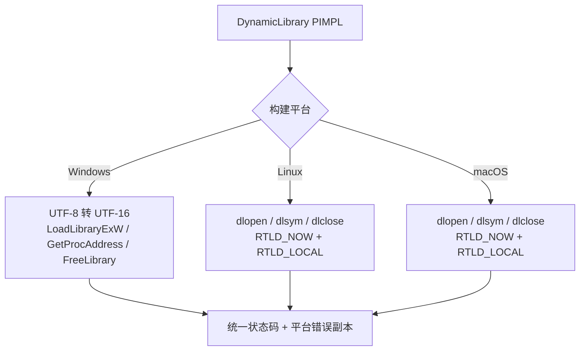

| 平台 | 产物命名（设计约定） | 依赖查找与错误 |
| --- | --- | --- |
| Windows | `proto_modbus.dll` | 绝对路径；`LOAD_LIBRARY_SEARCH_DLL_LOAD_DIR` 与 `LOAD_LIBRARY_SEARCH_DEFAULT_DIRS`；立即保存 `GetLastError` |
| Linux | `libproto_modbus.so` | 插件私有依赖置于同目录/`deps`，设置 `$ORIGIN` 相对 RUNPATH；立即复制 `dlerror` |
| macOS | `libproto_modbus.so`（CMake MODULE），依赖通常为 `.dylib` | 明确插件后缀并写入清单；私有依赖使用 `@loader_path`，必要时配置 `@rpath`；符合应用签名要求 |

Windows 的搜索标志参见 [Microsoft 加载器文档](https://learn.microsoft.com/zh-cn/windows/win32/api/libloaderapi/nf-libloaderapi-loadlibraryexw)，Linux 的加载/引用行为见 [dlopen 手册](https://man7.org/linux/man-pages/man3/dlopen.3.html)，macOS 的相对依赖规则见 [Apple 动态库文档](https://developer.apple.com/library/archive/documentation/DeveloperTools/Conceptual/DynamicLibraries/100-Articles/RunpathDependentLibraries.html)。

清单路径相对安装目录解析，归一化后必须处于指定插件根目录；不依赖启动工作目录。串口使用平台适配层（如 `COM3`、`/dev/ttyUSB0`），参数校验、网络初始化和资源关闭均在 `Impl` 内。`DllMain`/库静态初始化不执行通信、起线程或读取业务配置。

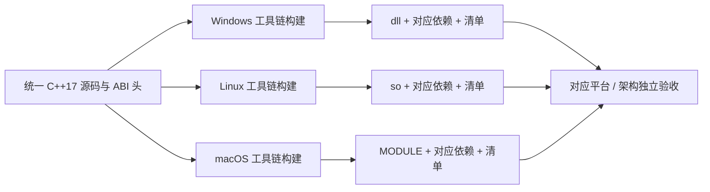

加载器支持三平台不代表第三方协议栈全部可用；清单按实际构建产物登记角色/传输能力，不可用组合拒绝启动。Windows/Linux/macOS、x64/ARM64 分别打包；Debug/Release 与 C/C++ 运行库按包约束匹配。

## 8. 工程与构建

目标目录，尚未创建的接口在实现阶段补齐：

```text
backend/include/net/protocol/
  protocol_runtime.h         业务 API，PIMPL
  protocol_channel.h         通道 API，PIMPL
  protocol_types.h           项目值类型、状态与能力
  protocol_plugin_api.h      插件作者与 SDK 共用的纯 C ABI
backend/src/net/protocol/
  runtime/                  SDK 实现、清单、租约与缓存
  platform/                 DynamicLibrary::Impl、串口/网络适配
  modbus/                   ModbusProtocol + Impl、C 导出桥
  iec104/                   Iec104Protocol + Impl、C 导出桥
  iec61850/                 MMS 等独立能力实现
install/plugins/modbus/1.0.0/
  manifest.json             ID、包版本、ABI、平台文件、schema、能力
  <平台动态库>              与主程序无链接依赖
  deps/                     本包私有运行依赖
```

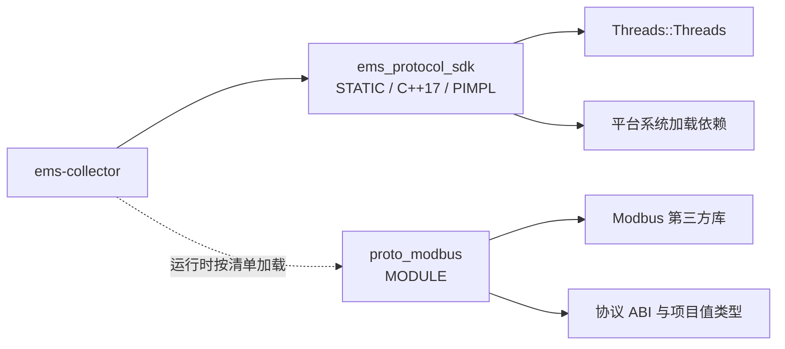

| CMake 约定 | 要求 |
| --- | --- |
| 主程序 | 仅链接 SDK；不将插件加入 `target_link_libraries` |
| 插件 | `add_library(proto_modbus MODULE ...)`；包含 PIMPL 实现与 C 导出桥；第三方依赖 `PRIVATE` |
| 系统依赖 | SDK 使用 `Threads::Threads`、`${CMAKE_DL_LIBS}`；不写死 `pthread`、`dl` |
| 可见性 | 隐藏 C++ 符号，显式导出 C 入口；可用 `GenerateExportHeader` 生成宏，加载方不依赖导入库 |
| 输出 | DLL 配 `RUNTIME`、MODULE 配 `LIBRARY` 安装位置；清单记录实际文件名；本设计显式约定 macOS MODULE 后缀 `.so` |
| 安装 | 第三方运行依赖一并打包；安装路径和相对依赖规则在可迁移安装目录中验证 |

MODULE 的运行时加载用途见 [CMake add_library](https://cmake.org/cmake/help/latest/command/add_library.html)；系统动态加载依赖使用 [CMAKE_DL_LIBS](https://cmake.org/cmake/help/latest/variable/CMAKE_DL_LIBS.html)，导出宏可参考 [GenerateExportHeader](https://cmake.org/cmake/help/latest/module/GenerateExportHeader.html)。

## 9. 改造起点与实施验收

| 改造前状态 | 目标改造 |
| --- | --- |
| `backend/include/net/protocol/protocol_plugin_api.h` 是 ABI v1 | 新增 v2 函数表、能力、长度和异步事件契约；旧插件通过显式适配或拒绝加载 |
| `backend/src/net/collect/plugin_manager.cpp` 已使用 `dlopen` | 拆出跨平台 PIMPL 加载器，缓存按包路径归一化，失败回滚与租约管理 |
| Modbus 已有 `proto_modbus MODULE` | 将第三方状态收进 `ModbusProtocol::Impl`，补齐 C 入口异常封装 |
| 当前加载器缓存按协议名称维护 | TCP/RTU 归同一库条目，每通道独立实例；停一个通道不卸载其他通道的代码 |
| 当前 CMake 有 `dl/pthread`、C++20 设置 | 实现本设计时统一自研 C++17，替换平台硬编码并逐平台验证依赖 |


| 验收场景 | 预期 |
| --- | --- |
| 未配置、禁用或未归当前进程的协议 | 不调用系统加载器；主程序的动态依赖列表中无具体协议库 |
| 并发启动 TCP/RTU 多通道 | 只建立一个库缓存条目；实例、串口/连接、会话状态独立 |
| 停止部分通道 / 最后通道 | 部分停止不卸载；最后使用者静默并销毁后释放句柄 |
| 缺库、缺依赖、入口缺失、ABI/能力不符、create/start 失败 | 错误定位到包和通道；清理本次资源，无引用泄漏或半启动通道 |
| 缓冲不足、非法参数、插件/回调异常、队列满 | 无越界；错误可见；重取结果不重复执行控制 |
| stop 超时、回调迟到、关闭句柄失败 | 保留必要对象和库，禁止悬空调用；按代次拒绝旧事件 |
| 配置切换 / 包升级 | 独占资源只有一个所有者；未决命令不自动重发；回滚状态明确 |
| 三平台加载、重连和重复启停 | API 头可独立编译，符号名称正确；对应协议/角色运行验收通过 |
| 中文路径、迁移安装目录、不同架构/工具链组合 | 路径处理正确；有效包可加载，不兼容包明确拒绝 |

诊断至少记录 `plugin_id / package_version / abi / platform / channel_id / config_generation / 库状态 / 活动租约 / stop_timeout / 平台错误码`。日志不输出凭据或未经脱敏的完整配置。

## 10. Modbus 首期实施记录

**本次先完成 Modbus 的 PIMPL、跨平台加载和现有采集入口迁移，继续兼容 ABI v1；第 3～4 节的通用异步 SDK / ABI v2 是后续目标。**

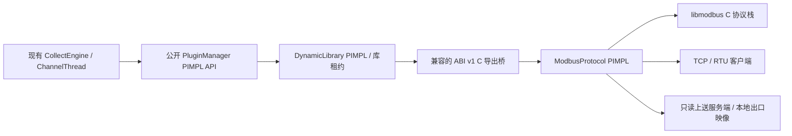

| 已实现 | 文件 / 行为 |
| --- | --- |
| 公开头 | `backend/include/net/protocol/plugin_manager.h`、`modbus_protocol.h`、`dynamic_library.h`；只依赖标准头与项目 C ABI |
| PIMPL | 管理器、平台加载器、Modbus 对象均仅持有 `unique_ptr<Impl>`；动态库内创建和销毁协议对象 |
| 按需加载 | TCP/RTU 共用规范化路径缓存，实例持有库租约；按实际实例取得函数表，支持换包期间旧实例继续存在 |
| 失败处理 | 缺文件/依赖/符号、ABI 不符、创建失败回滚；停止失败保留实例和库，可恢复后重试释放 |
| 客户端 | FC 1/2/3/4 读取，FC 5/6/15/16 写；合并连续读，单请求最多 125 寄存器 / 2000 位；结果保持输入顺序 |
| 编码 | UINT16/INT16/UINT32/INT32/FLOAT/DOUBLE/UINT8/INT8/BOOL/BIT；四种字序；写值做类型与范围校验 |
| 上送 | TCP 支持多个会话和多个 Unit ID；RTU 一个串口资源一个从站；网络读取本地映像，外部写返回协议异常 |
| 采集接入 | 通道退出统一销毁实例后释放租约；修复单通道空函数表、失败分支错误卸载、TCP 串口占位配置和布尔/无效点解析 |
| 缓冲重试 | ABI v1 增加兼容错误码 `-2`；同编码扩容重取本次缓存结果，不重复协议读取；采集缓冲上限 8 MiB |
| 独立构建 | 协议子工程与主进程解耦，产出动态库、静态 runtime、公开头、包清单；显式部署运行依赖 |

首期 API 操作由插件桥串行执行；原有设备级 handler 保留给存量调用。新动态插件直接依赖 libmodbus，不加载 libmodbuspp。清单已随包生成，首期运行入口仍使用默认映射 / `register_mapping`；完整清单解析、能力协商、版本化异步请求及停止截止时间留待 ABI v2。

| 配置 | 首期约定 |
| --- | --- |
| `transport` / `local_role` | `tcp/rtu`、`client/server`；`protocol=ModbusTCP/ModbusRTU` 兼容旧入口 |
| TCP | `host/port` 或旧 `connection=IPv4:port`；端口 1～65535 |
| RTU | `serial_port` 或 `connection`，`baudrate/baud_rate`、`data_bits`、`stopbits/stop_bits`、`parity=N/E/O` |
| 超时 | `timeout_ms` 为毫秒；旧 `settings.timeout` 为秒，转换后校验；1～60000 毫秒 |
| 地址 | `slave:function:offset[:decode[:endian[:bit]]]`；decode 0～9、endian 0～3，BIT 可显式指定位偏移 0～15 |
| 服务端 | `slaves`、`image_size`（各地址空间从 0 起）、`max_sessions`；`write` 仅更新本地映像 |

独立构建入口，libmodbus 必须是与目标平台/工具链匹配的 **3.1.6 或更高版本**：

```sh
cmake -S backend/src/net/protocol -B build/protocol \
  -DLIBMODBUS_INCLUDE_DIR=<libmodbus头目录> \
  -DLIBMODBUS_LIBRARY=<库或导入库路径>
cmake --build build/protocol
ctest --test-dir build/protocol --output-on-failure
cmake --install build/protocol --prefix <安装目录>
```

共享依赖通过 `EMS_PROTOCOL_RUNTIME_DEPENDENCIES` 指定文件列表（Windows 包括 libmodbus DLL 和相应编译器运行库）；构建时复制到插件目录，安装时按平台放置。调用方将插件根目录指向安装包位置，并通过相对映射选中 `modbus/2.0.0/<平台库文件>`；主程序不链接该协议库。

验证记录：Windows x64 MinGW / MSVC 各运行 13 项协议集成测试并全部通过，两个工具链安装包的双向动态加载及 UTF-8 中文路径加载通过；公开头独立通过 C11 / C++17 编译检查，旧采集接入代码通过语法编译。Linux/macOS 分支已提供，尚未在对应系统执行构建/运行验收；RTU 当前验证配置、错误处理与资源释放，真实串口收发仍需现场设备或串口仿真验收。完整 EMS 后端的数据库/Redis 联调不属于本次独立协议测试。

## 11. IEC 104 首期实施记录

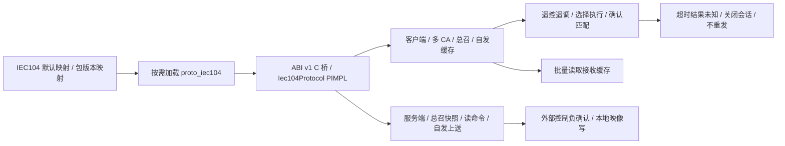

| 实施项 | 本次结果 |
| --- | --- |
| 参考实现 | ems_simulate 的多 Station、APCI 参数、缓存读取及显式 ASDU 类型；直接封装仓库内 lib60870 C 栈 |
| 生命周期 | STARTDT 确认才就绪；重连清缓存；停止等待回调退出后卸载；Windows 独占端口绑定 |
| 点契约 | CA:IOA:ASDU，支持 16 种监视 / 12 种命令类型，保留 IEC 品质和时标来源 |
| 控制 | 确认匹配地址、类型、OA、值、选择位和限定词；可选 SBO；默认等待 ACT_CON 与 ACT_TERM |
| 构建 | 独立包 iec104/1.0.0；EMS_BUILD_MODBUS=OFF、EMS_BUILD_DLT645=OFF 可只构建 IEC104，无需 libmodbus/Boost |
| 验证 | 新增 11 项 IEC104 报文集成测试，连同原有 13 项回归在 MinGW / MSVC 验证 |
| 后续 | ABI v2、TLS、服务器远程控制仲裁、冗余配置、可靠事件历史；Linux/macOS 与现场实机验收 |

配置示例、类型列表、时区/品质约定和队列限制见 [IEC 104 动态库接入](../../reference/protocol/iec104.md)。

## 12. DL/T 645 首期实施记录

| 实施项 | 本次结果 |
| --- | --- |
| 参考实现 | ems_simulate 的 12 位表地址、00–04 类读取、需量时间与复合字段、密码写参 |
| 动态边界 | Dlt645Protocol PIMPL + ABI v1 C 桥；静态集成仓库协议栈，Boost 类型不跨边界 |
| 通信 | TCP / RTU 客户端；同一端点支持多个表地址；按实例串行调用 |
| 只读出口 | 多表本地映像，仅暴露配置 DI；拒绝远端写入和管理命令 |
| 兼容 | 通道 connection/settings/rtu_addr；bcd_endian=big 对接当前模拟器 |
| 构建 | EMS_BUILD_DLT645 默认 ON；需 Boost 1.83+ 头文件；包 dlt645/1.0.0 |
| 验证 | 新增 10 项集成测试；MSVC / MinGW 全后端各 131 项通过，模拟器 Python 库双向 TCP 互通通过 |
| 待验收 | Linux/macOS 平台构建、真实 RTU 串口收发；ABI v1 不表达复合写入及管理命令 |

配置、测点编码、只读映像及独立构建见 [DLT645 动态库接入](../../reference/protocol/dlt645.md)。

## 13. 独立 handler 层实施记录

应用处理器已统一移至 `backend/src/net/handler/`，与 `protocol/` 平级。新路径为 `CollectEngine / ChannelThread → ProtocolHandler → PluginManager → C ABI → 协议对象`；协议目录不再构建或包含 handler。

- ModbusTCP / ModbusRTU、IEC104、DLT645 均有具体处理器，通过公共适配器管理实例、配置和读写结果。
- 采集线程统一创建处理器，初始化失败同步返回；停止和异常退出均释放实例与库租约。
- 存量 Modbus 设备处理器及其原基类迁移到 handler 目录，保留原接口。
- 新增四项 handler 集成测试及四项真实通道测试，覆盖协议读写、重连、缓冲扩容、初始化回滚、重复启停和退出后的卸载。Windows MSVC / MinGW 全后端各 139 项测试通过；DLT645 单插件的 handler 独立子工程 12 项测试通过。

目录、调用示例及构建方式见 [协议处理器接入](../../reference/protocol/handlers.md)。
