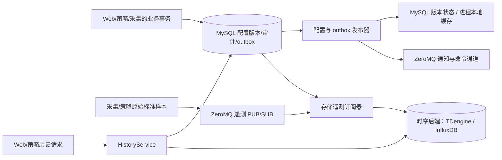

# 存储进程详细设计

> 版本：1.2｜日期：2026-09-29｜状态：目标设计；存储入口已接入 ZeroMQ 原始采样、统一时序接口及 TDengine 适配，采集发布端、InfluxDB 适配和生产联调尚未完成。
> 本文细化 [`ems-storage` 进程入口](index.md)。点位的业务身份以[设备模型](../../architecture/device-model.md)为准；事件、配置与实时状态的公共契约以[系统架构](../../architecture/system-design.md)和[实时数据与配置](../../common/realtime/index.md)为准。

## 1. 目标与职责边界

`ems-storage` 是 C++17 业务进程，负责接收 ZeroMQ 原始采样事件、写入所选时序数据库、发布已提交的配置和 outbox、对账业务审计，以及提供有界的历史查询。MySQL 保存**点位身份及其历史配置版本**，时序数据库保存**点位在各采样时刻的值**。首期后端是 TDengine（TAOS）3.4.2，接口允许后续增加 InfluxDB。历史曲线必须按稳定 `point_id` 和样本的 `config_version` 在应用层关联两库，不能拿当前点位名称、单位或资产路径解释旧样本。

ZeroMQ PUB/SUB 的原始采样采用尽力投递：发布入队不证明存储已接收，订阅者离线、队列溢出或数据库故障都可能丢样。项目接受这类采样缺口，必须暴露可观测指标和告警，不承诺 ACK、pending、自动重放或无损归档。Redis 在目标方案中只存实时最新值，存储进程不把它用作事件队列或配置快照。

| 数据或操作 | 权威位置 | 本进程的职责 |
| --- | --- | --- |
| 资产、标准点、厂家点、绑定和启用状态的版本 | MySQL | 发布前校验，形成历史查询用的不可变点位目录 |
| 已接收的原始标准点及派生点样本、时序聚合 | 时序数据库（首期 TDengine） | 校验事件、写入、查询、保留与补算 |
| 命令执行、告警生命周期、配置变更及 outbox | MySQL | 发布、归档视图和周期对账；业务事实由产生它的进程在事务中写入 |
| 最新值 | Redis 实时数据库 | 由采集更新；不充当历史回填数据 |
| 原始采样传输 | ZeroMQ 独立遥测 PUB/SUB 通道 | 订阅完整事件；接收前或处理失败可能形成缺口 |

Web 使用 C++17 + Drogon 提供 HTTP/WebSocket，各业务进程均复用公共 ormpp Repository 并独立建立 MySQL 连接池。`ems-storage` 提供统一的时序后端接口和历史 gRPC，不充当其他进程的 MySQL 代理。实时最新值访问继续使用独立接口，不改变历史落库语义。



## 2. MySQL：历史点位目录

### 2.1 稳定身份和版本

- `point_id` 是标准逻辑点的稳定身份，重导厂家点表、改显示名称或切换采集通道均不改变它；`point_code` 只在所属资产内有意义。厂家地址和北向上送地址分别属于版本化绑定，不作为 TAOS 的测点身份。
- 每条样本带产生时的作用域（有 `unit_id` 时为 unit，否则为 station）、`point_id` 和 `config_version`。MySQL 的 `point`、`device_standard_point_version`、定义、绑定和路由版本解释当时的名称、单位、资产归属、启用状态与转换规则。配置版本按作用域递增，不能只凭一个裸版本号查目录。
- 值类型或物理含义发生不兼容变化时，发布流程拒绝沿用原 `point_id`，建立新逻辑点并保留旧点供历史查询。显示名称、路径或通信路由变化只产生新配置版本。已退役 ID 不分配给新点。
- 命令点也保留在 MySQL 点位目录中，但普通控制命令及回执进入 MySQL 审计，不伪装为遥测曲线；只有明确配置为可读取的反馈点才写 TAOS。

目标实施增加 `history_point_snapshot` 作为**发布版本的只读投影**，便于按样本版本批量解释历史。它从同一 MySQL 权威配置表生成，不接受单独编辑。以下是逻辑字段与键设计，不是已经执行的迁移脚本：

```sql
CREATE TABLE history_point_snapshot (
    scope_kind       VARCHAR(8)   NOT NULL,  -- station / unit
    scope_id         VARCHAR(64)  NOT NULL,
    config_version   BIGINT UNSIGNED NOT NULL,
    point_id         VARCHAR(64)  NOT NULL,
    asset_id         VARCHAR(64)  NOT NULL,
    point_code       VARCHAR(128) NOT NULL,
    display_name     VARCHAR(256) NOT NULL,
    point_kind       VARCHAR(16)  NOT NULL,
    value_type       VARCHAR(16)  NOT NULL,
    unit             VARCHAR(32)  NULL,
    definition_id    VARCHAR(64)  NULL,
    definition_version BIGINT UNSIGNED NULL,
    enabled          BOOLEAN      NOT NULL,
    device_path      JSON         NOT NULL,
    PRIMARY KEY (scope_kind, scope_id, config_version, point_id),
    KEY ix_history_point (point_id, scope_kind, scope_id, config_version)
);
```

另设版本头记录 `(scope_kind, scope_id, config_version, checksum, point_count, ready_at)`，只在该版本所有点位快照及校验完成后标记 `ready`。重复构建同一版本且 checksum 相同视为完成；同版本不同内容报警并停止发布。目录可用分批暂存加最终就绪标记实现，查询和消费只读就绪版本。配置保存、快照发布和各实例实际应用仍是三个不同状态；station 涉及多个 unit 时按版本清单逐项核对，不宣称跨作用域原子生效。

历史目录及其来源配置版本至少保留到对应时序后端的原始数据和聚合数据均过保留期；备份恢复也按同一水位核对。禁止先删除 MySQL 旧版本再留下无法解释的曲线。若 `config_version` 不存在或尚未就绪，不得用当前版本猜测补写；已接收但无法归档的样本记录缺口与诊断信息。确定为非法身份或矛盾版本的事件进入隔离与人工处理。

### 2.2 点位与时序表的映射

首期 MySQL `history_point_series` 记录 `point_id`、值类型、受控 TDengine 子表名、创建时间及退役状态，`point_id` 和子表名均唯一。首次发布可存储的点位时创建映射，后续版本复用。表名只由内部稳定 ID 编码生成，不能拼接用户输入的点名、设备路径或协议地址；SQL 值使用客户端参数绑定。退役后保留映射直至历史和备份清理完成。该表的 `series_table` 是 TDengine 适配器的物理映射；增加 InfluxDB 时应为其建立受控映射或版本化扩展，不把 TAOS 子表名泄露到公共时序接口。

`history_event_identity` 是已接收事件的轻量身份账本，主键为全局 `event_id`，保存 `point_id`、原 `source_time_us`、规范化**完整事件**的 SHA-256 和首次登记时间，不复制时序值作为另一份历史。写时序后端前先在 MySQL 原子登记或核对：同 ID 同摘要允许幂等处理，同 ID 不同摘要隔离。它阻止已到达的冲突重发覆盖原事件，但不证明每个采集样本都到达，也不提供补传。账本保留期至少覆盖原始样本保留期；登记提交而时序写入失败时可能留下缺口，必须记录和告警，不能宣称账本可重放原始载荷。

旧的 `backend/data/point_config_v2.sql` 四遥表和 `backend/data/ems_config.sql` 中的 MySQL 采样历史表是遗留结构，不直接当作目标版本目录或双库写入方案。迁移必须先建立旧 ID、类型、单位和时间精度到标准点的映射报告。

## 3. 时序后端抽象与 TDengine 实现

存储进程通过 C++17 抽象接口调用时序后端。接口以业务对象表达 `write(sample)` 和受限 `scan(query, series_mappings, limit)`，统一返回成功、确定性错误或结果未知，并保留时间精度、质量、来源和事件 ID。连接、建表、批量、重试以及查询 SQL 留在各适配器内部；调用方不依赖 TDengine 的 stmt2、子表或 InfluxDB 的测量名。进程启动时按明确的后端配置创建一个适配器，不在同一作用域隐式双写。首期只提供 TDengine 3.4.2；InfluxDB 适配须另行设计映射迁移、幂等写入、同微秒多事件保留及分页顺序，并通过同一行为测试后启用。

### 3.1 表结构与时间

TDengine 适配器首期采用**按值类型分超级表、每个逻辑点一张子表**。数值、精确整数、布尔、枚举/文本分别使用匹配的数据列；不得把 64 位整数、状态码或无效值统一转成 `DOUBLE`。子表标签只放稳定的 `point_id` 等不会因配置版本变化而改变的身份。显示名称、单位、资产路径和当前厂家路由由 MySQL 版本目录解释；样本本身保存作用域、配置版本、来源和质量。

TAOS 历史库明确使用 UTC Unix **微秒**精度；`ts` 使用事件原 `source_time`，源时间缺失时按公共事件契约使用接收时间并保存缺失原因。`ingest_ts` 是采集接收时间，归档写入时间另记，三者不能混同。查询输入输出保持微秒整数，不经 JavaScript 浮点数往返。

项目目标部署版本为 **TDengine 3.4.2**，服务端与 C/C++ 客户端需锁定兼容的补丁版本；复合主键能力见[官方超级表文档](https://docs.tdengine.com/tdengine-sql/ddl/stable/)。`(ts, event_id)` 是单点子表的行身份：同一个事件重试写相同键与载荷；同一测点同一微秒发生的不同事件仍各自保留。不能只增加普通 `event_id` 列便宣称完成去重。以下数值表是迁移草案，实际类型、长度、批量 API 与建表语句需在锁定的服务端和客户端版本上验证：

```sql
CREATE STABLE ems_history.telemetry_numeric (
    ts             TIMESTAMP,
    event_id       VARCHAR(64) COMPOSITE KEY,
    sample_value   DOUBLE,
    quality        INT,
    ingest_ts      TIMESTAMP,
    time_origin    TINYINT,
    time_reason    VARCHAR(64),
    quality_reason VARCHAR(64),
    payload_sha256 VARCHAR(64),
    scope_kind     VARCHAR(8),
    scope_id       VARCHAR(64),
    config_version VARCHAR(20),
    source_id      VARCHAR(64),
    source_epoch   VARCHAR(20),
    sequence       VARCHAR(20)
) TAGS (point_id VARCHAR(64));
```

同样模式定义其他类型的超级表；无效值以空值加质量/原因表示，不能写 `NaN`、`Infinity` 或默认零。`time_origin` 标识设备源时钟或接收时间回退，具体码表进入事件契约。`source_epoch`、`sequence`、`config_version` 若为无符号 64 位，按十进制文本无损保存，比较时在应用层转换为整数。目标版本中主键列不能随意修改，因此事件 ID 最大长度、时间精度和列类型须在首次建库前冻结。[TDengine 超级表与复合主键](https://docs.tdengine.com/tdengine-sql/ddl/stable/)说明相同复合键会更新同一行；[数据库精度与保留](https://docs.tdengine.com/tdengine-sql/ddl/database/)需按目标部署配置。若实际版本不支持复合主键，不能静默退化为“时间戳加普通 event_id 列”，应先重新设计去重与同刻事件保留方案并完成迁移验收。

每个事件 ID 对应的内容必须不可变。消费者在重投或对账发现同一 `event_id` 的点位、时间或载荷摘要不一致时隔离并报警，不能让后到的冲突内容覆盖原事件。多个标准点由一条厂家原始值派生时，每个标准样本都要有自己的稳定事件 ID，同时保留共同的来源关联。

### 3.2 聚合与保留

各时序后端的原始、分钟和小时数据使用分开的保留策略，并依据点位语义选择聚合：瞬时功率统计均值、最小/最大值；累计电量计算有效相邻读数差值或按功率积分；状态点统计持续时间和变化次数。聚合按点位、作用域和配置版本分组，版本或归属在桶内变化时拆开，不把不同语义混成一行。聚合记录样本数、预期数、坏质量数和覆盖率，避免丢样区间显示为完整曲线。迟到或更正样本触发受影响时间桶重算，并记录聚合版本或重算水位。

保留期、分区、压缩与副本数根据 `点数 × 平均采样频率 × 保留时长 × 每行成本` 及故障恢复目标测算。不同保留窗口优先使用独立数据库及各自的 `KEEP` 策略，不能假设同一数据库内所有超级表都能设置不同的库级保留期。目标部署使用的 TAOS 版本和版本特有功能须实测；不把企业版降采样能力当作开源部署的默认能力。MySQL 历史目录保留期覆盖最长的原始或聚合查询窗口。

## 4. ZeroMQ 遥测订阅、写入与缺口

采集和策略通过独立的 ZeroMQ 遥测 PUB/SUB 通道发布**原始标准样本事件**，正文为公共 `EventEnvelope` JSON。实时变更提示只用于刷新视图，不是历史源；存储进程不得收到提示后重新读取 Redis 最新值补写历史。默认遥测主题为 `ems:telemetry:<station|unit>:<scope_id>`；订阅端复核消息内的作用域类型和 ID。接收线程只做帧大小和主题边界检查，将载荷放入有界处理队列；耗时的 MySQL 和时序写入放在工作线程。队列满时丢样并增加缺口计数，不能阻塞 ZeroMQ 接收线程等待数据库。

1. 对已收到的原始事件校验 schema、作用域、稳定 `point_id`、版本、值类型、质量、时间范围、来源字段和载荷大小。按事件配置版本查 MySQL 点位快照，不使用当前 active 版本替代。规范化完整事件并在 MySQL 登记 `event_id` 与摘要；同 ID 异载荷不得写时序后端。
2. 按值类型、映射和批量预算写入所选时序后端。TDengine 适配器使用受控子表与原 `ts/event_id`。当前实现从接收队列取出后不重新入队；超时、写入失败或结果不明均计入丢样。将来若增加进程内重试，必须保留原 ID、时间和值，并明确重试仍无法覆盖进程退出后的缺口。
3. 确定性坏消息、无法映射的已退役 ID、超出保留窗口的源时间、冲突事件 ID 等保存可查询的隔离记录和告警，记录接收时间、主题、事件 ID、受限原始载荷与原因。隔离持久化失败时至少报告处理失败与缺口；PUB/SUB 不会因为未写隔离记录而重新投递。

PUB/SUB 没有消费者确认、待处理队列或重放游标。发布器的本地入队成功、发送 API 成功以及订阅端收到帧，都不能证明时序行已持久化。晚启动、断线、发送或接收高水位、存储进程崩溃、MySQL/时序库故障都可能造成历史缺口。来源代次和序号可帮助检测部分缺口；没有后续样本时仍需通过采样计划和新鲜度监控发现静默。MySQL 身份账本只覆盖实际收到的事件，不能修复未到达的样本；若业务将来要求无损恢复，须另行设计发送端持久缓冲与应用级确认，不得把普通 PUB/SUB 描述为可靠事件队列。

## 5. 配置、outbox 与审计

| 模块 | 提交规则 | 恢复规则 |
| --- | --- | --- |
| 配置发布器 | 读取 MySQL 已提交版本与 outbox，校验依赖，构建历史点位目录并条件切换 active；ZeroMQ 通知实例重读配置 | 以版本和 checksum 对账；迟到发布不能回退 active；实例 applied 由实例反馈及心跳判断 |
| outbox 发布器 | 领取带租约的已提交 outbox，按事件 ID 发布命令交接或变化提示；发布状态独立于业务事务 | 响应不明允许重复发布；命令由采集持久 inbox 及 MySQL 状态去重，不能以重复通知重做设备动作 |
| 审计对账器 | 检查 MySQL 告警、命令回执、配置操作记录与发布状态，提供按业务 ID 的归档检索 | 产生业务事实的进程先写 MySQL；ZeroMQ 通知只唤醒查询，遗漏后按持久记录补查 |

MySQL、时序后端和 ZeroMQ 之间没有共同事务。业务变更与 outbox 必须由发起进程在 MySQL 同一事务提交；存储进程只对已提交事实发布和对账。配置版本切换成功不代表采集 listener 已启动，也不代表所有设备在线。命令交接的 REQ/REP 应答只证明采集端持久受理，最终执行结果仍以 MySQL 状态及回读/反馈为准。

## 6. 历史查询服务

内部 `HistoryService` 使用 gRPC/Protobuf，Web 和策略通过有截止时间的业务请求调用；不开放任意 SQL。请求至少限定 station/unit 权限上下文、`point_id` 列表、`[start_us, end_us)`、原始或聚合粒度、最大行数和分页游标。服务限制点数、跨度、单页结果、并发数及资源消耗；拒绝无界全站扫描。策略使用独立短查询预算，报表不得占满写入和 outbox 工作池。

查询先用 MySQL 版本目录确定目标点、值类型及历史归属，再按 `point_id` 和时间范围查选定的时序后端；返回行按其 `(scope_kind, scope_id, config_version, point_id)` 批量取元数据，保留值类型、质量、源时间、接收时间、事件 ID 和缺失标记。同一个点改名、改单位或移动资产时，旧行显示旧版本语义。调用方服务身份与用户作用域由服务端共同校验。跨库查询是两次读取的应用层组合，不保证 MySQL 与时序后端的分布式快照；目录缺失时返回明确的元数据缺失错误或局部状态，不套用当前配置。

分页以 `(ts, point_id, event_id)` 确定排序，游标包含查询条件摘要及有效期；迟到样本可能在后续刷新中出现，客户端不把多页当不可变快照。查询结果的权限按请求作用域和样本当时归属复核；不能只凭调用方给出的 `point_id` 跳过站点鉴权。实时最新值仍经实时查询契约获取，历史查询不承诺代替最新值读取。

## 7. 运行、故障与恢复

遥测订阅、时序写入、配置发布、outbox、审计对账、历史查询分别配置工作池、连接与队列上限。MySQL 和时序后端连接独立重连。当前实现关闭时停止接收新帧，未处理的队列事件不会排空；关闭丢样也应纳入运行统计。一个模块退化时报告模块健康，不用“进程还活着”代表历史与命令发布都已就绪。

| 故障 | 处理与可观察结果 |
| --- | --- |
| 时序后端不可用或写超时 | 当前实现将本批样本计入丢样，后续新样本继续处理；队列满或进程崩溃也形成缺口；监视最新值可继续 |
| MySQL 历史版本暂不可读 | 不改用当前配置猜测；已收到却无法写入的样本计入缺口并报警 |
| ZeroMQ 断线或存储进程中断 | 重连后仅接收新样本；离线期间事件不自动补发，统计已知缺口并检查采样新鲜度 |
| 配置只发布一部分 | 保留版本清单和发布进度；补齐后再切 active，各实例应用状态独立核验 |
| outbox 发布后状态写回失败 | 允许再次发布，用稳定业务 ID、inbox 和状态对账，不重复执行未知设备动作 |
| 两库备份水位不一致 | 核对 MySQL 点位版本和时序行的已知水位，标注不可恢复缺口后开放历史查询；不假定 ZeroMQ 可重放 |

关键指标包括按模块的吞吐、P95/P99 延迟、ZeroMQ 发布拒绝/发送错误、订阅最新接收时间、接收队列溢出、时序批量成功/失败与丢样数、MySQL 事件账本冲突和写入延迟、版本目录缺失数、隔离事件数、采样序号缺口与静默时长、outbox 最老未完成时长、查询排队/截断、两库连接池占用及聚合覆盖率。指标标签不使用 `point_id` 或 `event_id` 等高基数字段；诊断日志保存脱敏关联 ID。

## 8. 实施与验收

1. 固定 ZeroMQ 原始遥测事件 schema、topic、质量码、UTC 微秒与 `point_id/config_version` 契约；锁定并实测 TDengine 服务端/客户端版本及复合主键行为。
2. 用一套 MySQL 版本化迁移建立点位目录投影和首期 TDengine 子表映射，验证 Web、采集、存储与策略复用公共 ormpp Repository 的读写兼容；应用不得自动修改正式表结构。
3. 实现独立的 ZeroMQ 遥测订阅器、有界接收队列、TDengine 时序适配器和 `HistoryService`；接入配置发布、outbox 与审计对账，配置独立资源预算。InfluxDB 作为后续适配器按相同接口和行为契约实现。
4. 盘点旧四遥点表及 MySQL 历史数据，导出 ID、类型、单位、时间精度和质量映射；备份后按受控批次回填 TAOS。旧记录没有事件 ID 时用稳定的旧表主键生成迁移事件 ID，重复运行产生同一键。核对数量、时间范围和抽样曲线后再切换查询入口；不直接删除旧表。

验收至少覆盖：同一事件重复接收、同一点同微秒不同事件、同一事件 ID 不同载荷冲突；坏质量/null、精确整数与字符串；旧版本迟到样本和点位改名/迁移；ZeroMQ 发布端或订阅端晚启动、断线、满队列、MySQL/时序后端分别中断时的可观测缺口；配置部分发布、outbox 重发及命令未知结果；跨站越权、分页与大查询隔离；原始/聚合保留和两库备份恢复。验收报告需记录目标硬件、点数、采样率、丢样数量和原因、查询 P99 及明确的丢失边界；文档方案本身不等于这些测试已通过。
