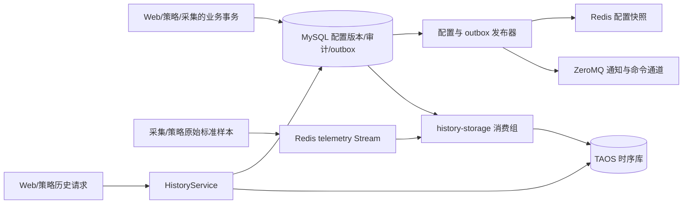

# 存储进程详细设计

> 版本：1.1｜日期：2026-09-28｜状态：目标设计；C++17 历史消费与查询核心、ormpp MySQL/TDengine/Redis 原生适配及迁移草案已落地，真实三库联调、配置发布与故障验收待完成。
> 本文细化 [`ems-storage` 进程入口](index.md)。点位的业务身份以[设备模型](../../architecture/device-model.md)为准；事件、配置与实时状态的公共契约以[系统架构](../../architecture/system-design.md)和[实时数据与配置](../../common/realtime/index.md)为准。

## 1. 目标与职责边界

`ems-storage` 是 C++17 业务进程，负责把可靠采样事件写入 TAOS（TDengine）、发布已提交的配置和 outbox、对账业务审计，以及提供有界的历史查询。MySQL 保存**点位身份及其历史配置版本**，TAOS 保存**点位在各采样时刻的值**。历史曲线必须由两库在应用层按稳定 `point_id` 和样本的 `config_version` 组合，不能拿当前点位名称、单位或资产路径解释旧样本。

| 数据或操作 | 权威位置 | 本进程的职责 |
| --- | --- | --- |
| 资产、标准点、厂家点、绑定和启用状态的版本 | MySQL | 发布前校验，形成历史查询用的不可变点位目录 |
| 原始标准点及派生点样本、时序聚合 | TAOS | 校验事件、批量写入、查询、保留与补算 |
| 命令执行、告警生命周期、配置变更及 outbox | MySQL | 发布、归档视图和周期对账；业务事实由产生它的进程在事务中写入 |
| 最新值与待归档采样 | 实时后端与 Redis Streams | 消费原事件；最新值不充当历史回填数据 |

Web 使用 C++17 + Drogon 提供 HTTP/WebSocket，各业务进程均复用公共 ormpp Repository 并独立建立 MySQL 连接池。`ems-storage` 只统一访问 TAOS 和提供历史 gRPC，不充当其他进程的 MySQL 代理。共享内存实时部署下，它另外提供只读实时查询服务；这条路径不改变历史落库语义。



## 2. MySQL：历史点位目录

### 2.1 稳定身份和版本

- `point_id` 是标准逻辑点的稳定身份，重导厂家点表、改显示名称或切换采集通道均不改变它；`point_code` 只在所属资产内有意义。厂家地址和北向上送地址分别属于版本化绑定，不作为 TAOS 的测点身份。
- 每条样本带产生时的作用域（有 `unit_id` 时为 unit，否则为 station）、`point_id` 和 `config_version`。MySQL 的 `point`、`device_standard_point_version`、定义、绑定和路由版本解释当时的名称、单位、资产归属、启用状态与转换规则。配置版本按作用域递增，不能只凭一个裸版本号查目录。
- 值类型或物理含义发生不兼容变化时，发布流程拒绝沿用原 `point_id`，建立新逻辑点并保留旧点供历史查询。显示名称、路径或通信路由变化只产生新配置版本。已退役 ID 不分配给新点。
- 命令点也保留在 MySQL 点位目录中，但普通控制命令及回执进入 MySQL 审计，不伪装为遥测曲线；只有明确配置为可读取的反馈点才写 TAOS。

目标实施增加 `history_point_snapshot` 作为**发布版本的只读投影**，便于按样本版本批量解释历史。它从同一 MySQL 权威配置表生成，不接受单独编辑。以下是逻辑字段与键设计，不是已经执行的迁移脚本：

```sql
CREATE TABLE history_point_snapshot (
    scope_kind       VARCHAR(8)   NOT NULL,  -- station / unit
    scope_id         VARCHAR(64)  NOT NULL,
    config_version   BIGINT UNSIGNED NOT NULL,
    point_id         VARCHAR(64)  NOT NULL,
    asset_id         VARCHAR(64)  NOT NULL,
    point_code       VARCHAR(128) NOT NULL,
    display_name     VARCHAR(256) NOT NULL,
    point_kind       VARCHAR(16)  NOT NULL,
    value_type       VARCHAR(16)  NOT NULL,
    unit             VARCHAR(32)  NULL,
    definition_id    VARCHAR(64)  NULL,
    definition_version BIGINT UNSIGNED NULL,
    enabled          BOOLEAN      NOT NULL,
    device_path      JSON         NOT NULL,
    PRIMARY KEY (scope_kind, scope_id, config_version, point_id),
    KEY ix_history_point (point_id, scope_kind, scope_id, config_version)
);
```

另设版本头记录 `(scope_kind, scope_id, config_version, checksum, point_count, ready_at)`，只在该版本所有点位快照及校验完成后标记 `ready`。重复构建同一版本且 checksum 相同视为完成；同版本不同内容报警并停止发布。目录可用分批暂存加最终就绪标记实现，查询和消费只读就绪版本。配置保存、快照发布和各实例实际应用仍是三个不同状态；station 涉及多个 unit 时按版本清单逐项核对，不宣称跨作用域原子生效。

历史目录及其来源配置版本至少保留到对应 TAOS 原始数据和聚合数据均过保留期；备份恢复也按同一水位核对。禁止先删除 MySQL 旧版本再留下无法解释的曲线。若 `config_version` 不存在或尚未就绪，样本保持未确认并重试；确定为非法身份或矛盾版本的事件进入隔离与人工处理，不按当前版本猜测补写。

### 2.2 点位与时序表的映射

目标 MySQL `history_point_series` 记录 `point_id`、值类型、受控 TAOS 子表名、创建时间及退役状态，`point_id` 和子表名均唯一。首次发布可存储的点位时创建映射，后续版本复用。表名只由内部稳定 ID 编码生成，不能拼接用户输入的点名、设备路径或协议地址；SQL 值使用客户端参数绑定。退役后保留映射直至历史和备份清理完成。

`history_event_identity` 是轻量事件身份账本，主键为全局 `event_id`，保存 `point_id`、原 `source_time_us`、规范化**完整事件**的 SHA-256 和首次登记时间，不复制时序值作为另一份历史。写 TAOS 前先在 MySQL 原子登记或核对：同 ID 同摘要允许重试，同 ID 不同摘要隔离。它解决复合主键只能控制行身份、不能阻止错误重投改写载荷的问题。账本保留期至少覆盖 TAOS 原始样本及可能的回放窗口；批量登记、索引大小和 MySQL 写入预算必须按采样率压测。账本已提交而 TAOS 未写入时原 Stream 保持 pending，重试复用登记；它不是跨库事务或独立补传副本。

旧的 `backend/data/point_config_v2.sql` 四遥表和 `backend/data/ems_config.sql` 中的 MySQL 采样历史表是遗留结构，不直接当作目标版本目录或双库写入方案。迁移必须先建立旧 ID、类型、单位和时间精度到标准点的映射报告。

## 3. TAOS：时序模型

### 3.1 表结构与时间

首期采用**按值类型分超级表、每个逻辑点一张子表**。数值、精确整数、布尔、枚举/文本分别使用匹配的数据列；不得把 64 位整数、状态码或无效值统一转成 `DOUBLE`。子表标签只放稳定的 `point_id` 等不会因配置版本变化而改变的身份。显示名称、单位、资产路径和当前厂家路由由 MySQL 版本目录解释；样本本身保存作用域、配置版本、来源和质量。

TAOS 历史库明确使用 UTC Unix **微秒**精度；`ts` 使用事件原 `source_time`，源时间缺失时按公共事件契约使用接收时间并保存缺失原因。`ingest_ts` 是采集接收时间，归档写入时间另记，三者不能混同。查询输入输出保持微秒整数，不经 JavaScript 浮点数往返。

项目目标部署版本为 **TDengine 3.4.2**，服务端与 C/C++ 客户端需锁定兼容的补丁版本；复合主键能力见[官方超级表文档](https://docs.tdengine.com/tdengine-sql/ddl/stable/)。`(ts, event_id)` 是单点子表的行身份：同一个事件重试写相同键与载荷；同一测点同一微秒发生的不同事件仍各自保留。不能只增加普通 `event_id` 列便宣称完成去重。以下数值表是迁移草案，实际类型、长度、批量 API 与建表语句需在锁定的服务端和客户端版本上验证：

```sql
CREATE STABLE ems_history.telemetry_numeric (
    ts             TIMESTAMP,
    event_id       VARCHAR(64) COMPOSITE KEY,
    sample_value   DOUBLE,
    quality        INT,
    ingest_ts      TIMESTAMP,
    time_origin    TINYINT,
    time_reason    VARCHAR(64),
    quality_reason VARCHAR(64),
    payload_sha256 VARCHAR(64),
    scope_kind     VARCHAR(8),
    scope_id       VARCHAR(64),
    config_version VARCHAR(20),
    source_id      VARCHAR(64),
    source_epoch   VARCHAR(20),
    sequence       VARCHAR(20)
) TAGS (point_id VARCHAR(64));
```

同样模式定义其他类型的超级表；无效值以空值加质量/原因表示，不能写 `NaN`、`Infinity` 或默认零。`time_origin` 标识设备源时钟或接收时间回退，具体码表进入事件契约。`source_epoch`、`sequence`、`config_version` 若为无符号 64 位，按十进制文本无损保存，比较时在应用层转换为整数。目标版本中主键列不能随意修改，因此事件 ID 最大长度、时间精度和列类型须在首次建库前冻结。[TDengine 超级表与复合主键](https://docs.tdengine.com/tdengine-sql/ddl/stable/)说明相同复合键会更新同一行；[数据库精度与保留](https://docs.tdengine.com/tdengine-sql/ddl/database/)需按目标部署配置。若实际版本不支持复合主键，不能静默退化为“时间戳加普通 event_id 列”，应先重新设计去重与同刻事件保留方案并完成迁移验收。

每个事件 ID 对应的内容必须不可变。消费者在重投或对账发现同一 `event_id` 的点位、时间或载荷摘要不一致时隔离并报警，不能让后到的冲突内容覆盖原事件。多个标准点由一条厂家原始值派生时，每个标准样本都要有自己的稳定事件 ID，同时保留共同的来源关联。

### 3.2 聚合与保留

原始、分钟和小时数据使用分开的保留策略，并依据点位语义选择聚合：瞬时功率统计均值、最小/最大值；累计电量计算有效相邻读数差值或按功率积分；状态点统计持续时间和变化次数。聚合按点位、作用域和配置版本分组，版本或归属在桶内变化时拆开，不把不同语义混成一行。聚合记录样本数、预期数、坏质量数和覆盖率，避免缺样区间显示为完整曲线。迟到或更正样本触发受影响时间桶重算，并记录聚合版本或重算水位。

保留期、分区、压缩与副本数根据 `点数 × 平均采样频率 × 保留时长 × 每行成本` 及故障恢复目标测算。不同保留窗口优先使用独立数据库及各自的 `KEEP` 策略，不能假设同一数据库内所有超级表都能设置不同的库级保留期。目标部署使用的 TAOS 版本和版本特有功能须实测；不把企业版降采样能力当作开源部署的默认能力。MySQL 历史目录保留期覆盖最长的原始或聚合查询窗口。

## 4. 历史消费、写入与确认

`history-storage` 是 Redis telemetry Stream 的固定竞争消费组；同组实例分担消息，实例名带启动代次。采集和策略发布**原采样事件**，存储以事件载荷落库，不在收到变化通知后重新读取最新值。Stream ID 仅用于投递和 ACK，`event_id` 才是历史写入身份。

1. 从新消息及超时 pending 中有界领取，校验 schema、作用域、稳定 `point_id`、版本、值类型、质量、时间范围、来源字段和载荷大小。按事件的配置版本查 MySQL 点位快照，不使用当前 active 版本替代。将规范化事件的身份与摘要原子登记到 MySQL 账本，冲突事件不得写 TAOS。
2. 按值类型、子表和批量预算组批；同一点的建表与写入串行协调。建表采用已登记的受控名称，失败不 ACK。TAOS 写入使用原 `ts/event_id` 和账本摘要；重试不重生 ID、时间或值。
3. 客户端确认整批成功后逐条 XACK；若结果只确认部分，ACK 已证实成功的事件；超时或结果不明时按原键重试并核对，不把“不知道是否写入”当失败后另造一行。
4. 非法格式、无法映射的已退役 ID、超出保留窗口的源时间、冲突事件 ID 等确定性错误写入可查询的隔离记录和告警；隔离记录以 Stream 作用域及 Stream ID 定位原消息，保存受限的原始载荷、原因、处理状态和时间。只有隔离记录持久提交并明确人工处理责任后才允许 ACK 原消息。暂时的 MySQL/TAOS 故障继续保留 pending，并按有界退避重试。

批量任务、待处理消息接管、重新投递均可能带来重复；复合键使**同一不变事件**重复写入可幂等。消费组的 pending、水位和必需消费者最小确认进度共同约束 Stream 裁剪。TAOS 成功但 ACK 丢失时重复写同一键；ACK 不得先于 TAOS 成功。Redis AOF/复制和采集有界内存队列仍有尚未发布样本的丢失窗口，必须记录缺口，不能承诺全链路零丢失或用最新值伪造补传。

## 5. 配置、outbox 与审计

| 模块 | 提交规则 | 恢复规则 |
| --- | --- | --- |
| 配置发布器 | 读取 MySQL 已提交版本与 outbox，校验依赖，构建历史点位目录及不可变 Redis 快照/索引，最后条件切换 active | 以版本和 checksum 对账；迟到发布不能回退 active；实例 applied 由实例反馈及心跳判断 |
| outbox 发布器 | 领取带租约的已提交 outbox，按事件 ID 发布命令交接或变化提示；发布状态独立于业务事务 | 响应不明允许重复发布；命令由采集持久 inbox 及 MySQL 状态去重，不能以重复通知重做设备动作 |
| 审计对账器 | 检查 MySQL 告警、命令回执、配置操作记录与发布状态，提供按业务 ID 的归档检索 | 产生业务事实的进程先写 MySQL；ZeroMQ 通知只唤醒查询，遗漏后按持久记录补查 |

MySQL 和 TAOS、Redis/ZeroMQ 之间没有共同事务。业务变更与 outbox 必须由发起进程在 MySQL 同一事务提交；存储进程只对已提交事实发布和对账。配置快照成功不代表采集 listener 已启动，也不代表所有设备在线。命令交接的 REQ/REP 应答只证明采集端持久受理，最终执行结果仍以 MySQL 状态及回读/反馈为准。

## 6. 历史查询服务

内部 `HistoryService` 使用 gRPC/Protobuf，Web 和策略通过有截止时间的业务请求调用；不开放任意 SQL。请求至少限定 station/unit 权限上下文、`point_id` 列表、`[start_us, end_us)`、原始或聚合粒度、最大行数和分页游标。服务限制点数、跨度、单页结果、并发数及资源消耗；拒绝无界全站扫描。策略使用独立短查询预算，报表不得占满写入和 outbox 工作池。

查询先用 MySQL 版本目录确定目标点、值类型及历史归属，再按 `point_id` 和时间范围查 TAOS；返回行按其 `(scope_kind, scope_id, config_version, point_id)` 批量取元数据，保留值类型、质量、源时间、接收时间、事件 ID 和缺失标记。同一个点改名、改单位或移动资产时，旧行显示旧版本语义。调用方服务身份与用户作用域由服务端共同校验。跨库查询是两次读取的应用层组合，不保证 MySQL 与 TAOS 的分布式快照；目录缺失时返回明确的元数据缺失错误或局部状态，不套用当前配置。

分页以 `(ts, point_id, event_id)` 确定排序，游标包含查询条件摘要及有效期；迟到样本可能在后续刷新中出现，客户端不把多页当不可变快照。查询结果的权限按请求作用域和样本当时归属复核；不能只凭调用方给出的 `point_id` 跳过站点鉴权。实时最新值仍经实时查询契约获取，历史查询不承诺代替最新值读取。

## 7. 运行、故障与恢复

时序消费、配置发布、outbox、审计对账、历史查询分别配置工作池、连接与队列上限。MySQL 和 TAOS 连接独立重连；关闭时停止新领取、完成可完成的写入，未确认事件留在 Stream pending，租约到期由新实例接管。一个模块退化时报告模块健康，不用“进程还活着”代表历史与命令发布都已就绪。

| 故障 | 处理与可观察结果 |
| --- | --- |
| TAOS 不可用或写超时 | 不 ACK 原事件；限速重试和背压，历史查询显示延迟；监视最新值可继续 |
| MySQL 历史版本暂不可读 | 保留采样 pending，暂停依赖该版本的归档和发布；不改用当前配置猜测 |
| Redis/存储进程中断 | 消费组 pending 接管并重试；尚未进入 Stream 的采集内存样本按公共链路的缺口规则报告 |
| 配置只发布一部分 | 保留版本清单和发布进度；补齐后再切 active，各实例应用状态独立核验 |
| outbox 发布后状态写回失败 | 允许再次发布，用稳定业务 ID、inbox 和状态对账，不重复执行未知设备动作 |
| 两库备份水位不一致 | 先恢复 MySQL 点位版本和 TAOS 行，重放仍保留的事件，按点/版本核对后开放历史查询 |

关键指标包括按模块的吞吐、P95/P99 延迟、TAOS 批量成功/未知/重试数、MySQL 事件账本冲突和写入延迟、Stream pending 与最老年龄、版本目录缺失数、隔离事件数、采样缺口范围、outbox 最老未完成时长、查询排队/截断、两库连接池占用及聚合覆盖率。指标标签不使用 `point_id` 或 `event_id` 等高基数字段；诊断日志保存脱敏关联 ID。

## 8. 实施与验收

1. 固定事件 schema、质量码、UTC 微秒与 `point_id/config_version` 契约；锁定并实测 TAOS 服务端/客户端版本及复合主键行为。
2. 用一套 MySQL 版本化迁移建立点位目录投影和子表映射，验证 Web、采集、存储与策略复用公共 ormpp Repository 的读写兼容；应用不得自动修改正式表结构。
3. 实现 TAOS 类型化表、历史消费者和 `HistoryService`；接入配置发布、outbox 与审计对账，配置独立资源预算。
4. 盘点旧四遥点表及 MySQL 历史数据，导出 ID、类型、单位、时间精度和质量映射；备份后按受控批次回填 TAOS。旧记录没有事件 ID 时用稳定的旧表主键生成迁移事件 ID，重复运行产生同一键。核对数量、时间范围和抽样曲线后再切换查询入口；不直接删除旧表。

验收至少覆盖：同一事件重复投递和 ACK 丢失；同一点同微秒不同事件；同一事件 ID 不同载荷冲突；坏质量/null、精确整数与字符串；旧版本迟到样本和点位改名/迁移；TAOS/MySQL 分别中断、配置部分发布、消费接管、outbox 重发及命令未知结果；跨站越权、分页与大查询隔离；原始/聚合保留和两库备份恢复。验收报告需记录目标硬件、点数、采样率、积压恢复时间、查询 P99 和明确的丢失边界；文档方案本身不等于这些测试已通过。
