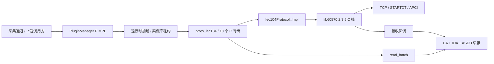
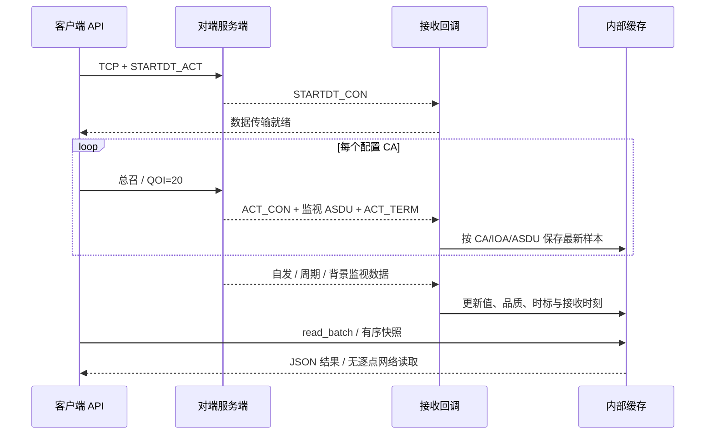
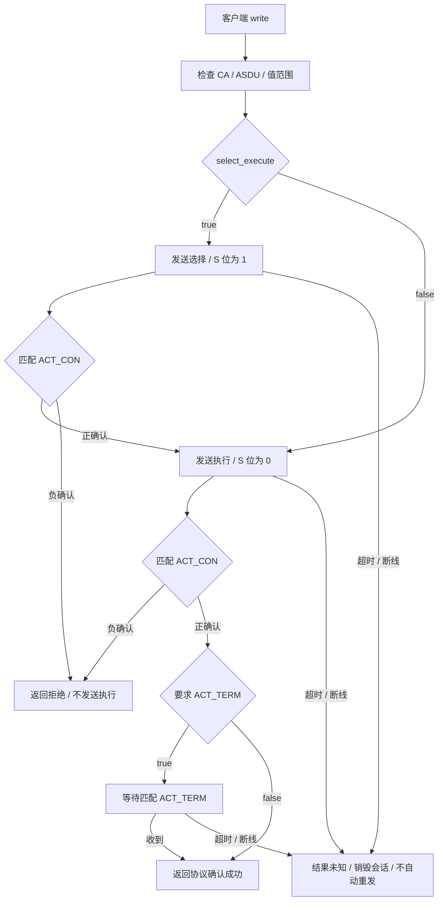

# IEC 104 动态库接入

> 包 `iec104/1.0.0` · ABI v1 · C++17 PIMPL · 2026-10-04

## 1. 运行结构



| 项目 | 实现 |
| --- | --- |
| 公开头 | `backend/include/net/protocol/iec104_protocol.h`、`plugin_manager.h`、`protocol_plugin_api.h` |
| 动态入口 | 通过 PluginManager 获取 C 函数表；不直接链接协议 MODULE 或跨库传递 C++ 对象 |
| PIMPL | Iec104Protocol 仅持有 unique_ptr；协议栈、回调、锁、缓存和连接完全隐藏 |
| 客户端 | 一个实例一个 TCP 连接，支持多个 CA；等待 STARTDT 确认后才标记就绪 |
| 服务端 | 多 CA、多独立客户端，本地监视点映像、总召、读命令、自发上送 |
| 停止 | API 线程销毁连接/服务端并等待全部回调退出，随后释放库租约 |
| 平台 | Windows DLL、Linux SO、macOS MODULE；Windows HAL 使用独占端口绑定 |
| 依赖 | 静态链接仓库内 lib60870 C 栈，不依赖 Python/c104 或 IEC 61850 栈 |

参考 `ems_simulate/src/proto/iec104/iec104client.py`、`iec104server.py` 的多 Station、APCI 参数、接收缓存与总召行为，以及 `src/enums/points/iec104_type.py` 的显式 ASDU 类型。C 栈调用遵循 [lib60870 官方指南](https://github.com/mz-automation/lib60870/blob/master/user_guide.adoc)；构建使用本仓库固定源码版本。

## 2. 点地址与数据类型

```text
CA:IOA:ASDU
1:16385:M_ME_NC_1    # 与 1:16385:13 等价
2:100:M_SP_TB_1
1:5000:C_SC_NA_1
```

CA 为 `1..65534`，IOA 为 `0..16777215`。编码顺序固定，不套用 Modbus 功能码/解码码格式。

| 方向 / 值 | 已支持 ASDU 编号 |
| --- | --- |
| 单点监视 | 1、2、30 |
| 双点监视 | 3、4、31；0/3 中间态输出无效品质 |
| 归一化监视 | 9、10、21、34 |
| 标度化监视 | 11、12、35 |
| 短浮点监视 | 13、14、36 |
| 单点 / 双点 / 步调节控制 | 45、46、47、58、59、60 |
| 归一化 / 标度化 / 短浮点设定值 | 48、49、50、61、62、63 |

归一化值范围 `[-1,32767/32768]`；标度化值为 `[-32768,32767]` 的整数；单点控制为 0/1，双点/步调节控制为 1/2；短浮点须有限且可用 float 表示。



| 结果规则 | 行为 |
| --- | --- |
| 有效样本 | quality=0、数值、UTC 毫秒时标 |
| 缺值 / 类型不符 / 非有限值 / 双点中间态 | value=null、quality=1 |
| IEC 品质 | iec_quality 保留原始位；任一位置位时公共结果无效 |
| 过期 | 用单调接收时刻计算 stale_ms，过期输出 null，保留原始时标 |
| CP56 | 校验日期/时间字段，按固定时区偏移转换 UTC；timestamp_source=device_cp56 |
| CP24 / 无时标 | CP24 无完整日期/小时，使用接收时刻；timestamp_source=received；无效时标仍使品质无效 |
| 服务端映像 | timestamp_source=local_image；本地写使用当前 UTC 时刻 |
| 断线 / 重连 | 清空客户端缓存；新 STARTDT 就绪不等于已收到全部站点初值 |
| 缓冲不足 | 返回 -2，同编码扩容重取本次快照，不重发总召或逐点读取 |

## 3. 遥控 / 遥调确认



确认须匹配 **CA、IOA、ASDU、OA、编码后的值、选择位和限定词**。测试帧或其他点的确认不能完成本次请求。选择与执行共用一个命令截止时间；成功只表示协议确认，物理执行结果由上层回读/核验。

ABI v1 将拒绝、错误和结果未知统一返回 -1，原因通过 last_error 获取；结构化命令状态及控制仲裁接入留待 ABI v2。服务端始终负确认外部控制，本地 write 只更新已配置监视点并自发上送。

## 4. 配置

客户端配置可放入旧通道 settings JSON 对象或 JSON 字符串：

```json
{
  "local_role": "client",
  "host": "127.0.0.1",
  "port": 2404,
  "common_addresses": [1, 2],
  "originator_address": 0,
  "timeout_ms": 3000,
  "command_timeout_ms": 3000,
  "stale_ms": 30000,
  "general_interrogation_on_connect": true,
  "select_execute": true,
  "command_require_termination": true,
  "cp56_timezone_offset_minutes": 480
}
```

服务端配置：

```json
{
  "local_role": "server",
  "host": "0.0.0.0",
  "port": 2404,
  "common_addresses": [1, 2],
  "max_connections": 8,
  "queue_size": 1024,
  "points": [
    {"code": "1:16385:M_ME_NC_1", "value": 220.5, "quality": 0},
    {"code": "2:100:M_SP_NA_1", "value": 1, "quality": 0}
  ]
}
```

| 配置项 | 默认 / 约束 |
| --- | --- |
| host/ip、port | IPv4/主机名，2404；兼容 connection=host:port，显式 host/port 优先 |
| common_addresses | [1]；兼容 slaves 或单一 common_address；1～256 个不重复 CA |
| timeout_ms / command_timeout_ms | 3000；1～60000 毫秒；握手、总召窗口与命令等待预算，底层 DNS/线程回收不承诺硬截止时间 |
| stale_ms | 30000；0 禁用过期判断，最大 86400000 毫秒 |
| send_window_size / receive_window_size | k=12、w=8；1≤w≤k≤32767 |
| connection_timeout / message_timeout / confirm_interval / keep_alive_interval | t0/t1/t2/t3 = 10/15/10/20 秒；t2<t1 |
| originator_address | 0；0～255 |
| select_execute / command_require_termination | false / true |
| command_qualifier | 0；0～3；选择与执行使用相同限定词 |
| cp56_timezone_offset_minutes | 0；-840～840；UTC+8 用 480；固定偏移，不自动切换夏令时 |
| max_points | 65536；缓存/映像有界，接收缓存满时拒收新键并保存诊断 |
| max_connections / queue_size | 8 / 1024；1～100 个会话、16～65536 个 ASDU 队列槽 |
| points[].timestamp | 当前 UTC 毫秒；加时区偏移后须在 2000～2099 年内 |

总召从冻结的站级映像应答，一点一个 ASDU；queue_size 应覆盖该站点数及确认余量。高优先级队列满时不发送成功 ACT_TERM，记录错误。自发遥测使用栈的有界队列，拥塞时可能覆盖旧条目；本地最新映像仍保留，可通过总召恢复。首期不承诺 SOE 保序、可靠历史补送或逐消息送达确认。

## 5. 构建与部署

```sh
cmake -S backend/src/net/protocol -B build/iec104 -DEMS_BUILD_MODBUS=OFF
cmake --build build/iec104
ctest --test-dir build/iec104 --output-on-failure
cmake --install build/iec104 --prefix build/iec104-package
```

```text
iec104-package/
  include/net/protocol/       # PIMPL/API 公共头
  lib/                       # ems_protocol_runtime 静态库
  plugins/iec104/1.0.0/
    proto_iec104.dll          # Linux/macOS: libproto_iec104.so
    manifest.json
    LICENSE.lib60870
    <编译器运行依赖>
```

```cpp
ems::net::collect::PluginManager manager;
manager.set_plugin_dir("./plugins");
#ifdef _WIN32
manager.register_mapping("IEC104", "iec104/1.0.0/proto_iec104.dll");
#else
manager.register_mapping("IEC104", "iec104/1.0.0/libproto_iec104.so");
#endif
// load 创建实例；get_instance_functions 获取其所属库的函数表。
// init/connect/read_batch/write 通过函数表调用；退出时 release(instance)。
```

Windows 使用 EMS_PROTOCOL_RUNTIME_DEPENDENCIES 指定编译器 DLL 列表，与模块同目录部署。只构建 IEC104 不需要 libmodbus；默认一起构建全部协议，运行时仍按需加载。

| 验证 | 本次内容 |
| --- | --- |
| Windows x64 MinGW / MSVC | 各 11 项 IEC104 报文集成测试通过，覆盖 16 种监视类型、12 种命令类型 |
| 回归 | 各 13 项既有 Modbus / runtime 测试通过，总计各 24 项 |
| 安装包 | 单独 IEC104 构建/安装、C11/C++17 公开头检查、中文路径加载、跨工具链双向加载与报文收发通过 |
| 生命周期 | 多实例共享库、部分释放、断线清缓存、重连、重复停止、端口冲突 |
| 边界 | 配置、品质/时标、时区、小窗口、缓存满、确认错站/测试帧/缺终止、缓冲重试 |
| 待验收 | Linux/macOS 实机、现场设备、完整后端数据库/Redis 联调 |

TLS、IPv6、计数器/文件服务、服务器远程控制接入、冗余组配置和 ABI v2 事件 API 尚未实现；启用 TLS 配置会明确失败。
