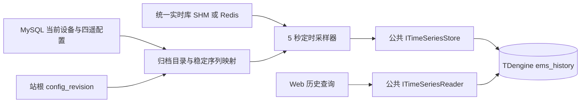

# 历史数据存储设计

`ems-storage` 按固定周期从统一实时库采样并写入 TDengine；默认周期为 **5000 毫秒**，涵盖配置中的 YC、YX、YK、YT 四类点位。归档不执行遥控或遥调，保存其已有实时状态；没有状态时保存缺失质量。

## 数据流与职责

配置允许原地修改，保存即生效。存储进程读取站根 `cfg_device.config_revision`，仅在计数变化时重建目录；不发布配置版本，不创建配置快照或文件代际。每个实际采样周期使用当前目录，错过的周期不会用最新值回填。

| 模块 | 职责 |
| --- | --- |
| `ArchiveDirectorySource` | 使用公共 MySQL 事务读取站根、设备及四遥，登记或复用稳定序列映射，提交成功后替换目录 |
| `PeriodicArchiveSampler` | 读取实时值、校验类型和质量、生成周期记录、调用公共时序写入口 |
| `storage_options` | 校验启动配置并解析相对路径，不连接外部服务 |
| `common/database/timeseries` | 共享连接配置、类型、TDengine 参数绑定与有界游标扫描 |
| `HistoryService`（Web） | 验证身份和设备范围，归并站/单元流并按查询间隔采样 |

MySQL、实时库和时序库均复用公共接口。存储模块不另建 ORM、SQL 连接或现场协议会话。核心采样器通过读取函数和时序写入接口注入依赖，可以脱离外部服务验证。

## 点位目录与热加载

读取站根时加共享锁，确保全量点表和修订号属于同一次配置读取。目录构建检查唯一站、设备真实父链、环、孤立点、四遥重复身份和值类型；点位归属最近的单元，没有单元时归属站。设备或祖先停用会将对应采样标记为禁用。

稳定映射复用现有 `history_point_series`。新点使用 `p_` 加 `SHA-256(point_id)` 作为内部子表名，不拼接用户名称或路径；已有点沿用原映射，改名不改子表。值类型发生不兼容变化时拒绝覆盖原映射，应使用新的稳定点位 ID。目录失败时跳过本周期，不能继续使用已经失效的旧点表。

四遥仍使用各自配置表与模型，不引入 `point_type` 配置单表。采样器的分类字段仅选择对应实时记录。

## 周期与质量

调度使用 `steady_clock`，默认每 5 秒执行一次实际采样，UTC 时间槽用于历史横轴。周期耗时超限时跳过错过的槽；进程退出最多按短睡眠粒度响应，不等待一个完整采样周期。

| 情况 | 历史值与质量 |
| --- | --- |
| 正常且新鲜 | 保存有类型值，质量为 Good |
| 值未变化 | 下一周期照常保存，不依赖变位或变化通知 |
| 缺少实时记录 / 读取失败 | `null`，CommFailure，保留 `sample_missing` / `realtime_unavailable` 原因 |
| 点位或祖先停用 | `null`，Disabled，不读取或执行现场命令 |
| 超过点位或站根新鲜度期限 | `null`，Stale，保留原采集时间 |
| 原质量异常、类型错误或非法时间 | `null`，Invalid，不以零替代异常 |

采样槽时间保存于 `ts`，实际归档接收时间保存于 `ingest_ts`，原实时采集时间保存于 `measurement_ts`。因此重复保存未变化值不会伪造新的采集时间，也能区分“每 5 秒执行归档”和“现场一直未更新”。

有符号整数用 BIGINT；布尔值接受原始 bool 或严格的 0 / 1；文本保留原码。无符号 64 位值用文本序列保存，避免转 DOUBLE 丢失精度。已被实时采集转为不精确浮点数的整数会被拒绝，不猜测原值。

`config_revision` 只记录站根热加载计数，不是可回滚或可读取的配置版本。样本值解释由固定值类型及质量保证，不依赖旧配置快照。

## TDengine 表结构

部署脚本为 `backend/data/tdengine_history.sql`。它显式建立微秒精度的 `ems_history` 库与四张超级表，默认保留 365 天；部署时可按容量要求调整保留期。应用启动不执行 DDL。

| 超级表 | `sample_value` 类型 |
| --- | --- |
| `telemetry_numeric` | DOUBLE |
| `telemetry_integer` | BIGINT |
| `telemetry_boolean` | BOOL |
| `telemetry_text` | VARCHAR(1024) |

每个逻辑点一个子表，以 `point_id` 为稳定标签。数据列按适配器参数绑定顺序为 `ts`、`event_id`、`sample_value`、`quality`、`ingest_ts`、`time_origin`、`time_reason`、`quality_reason`、`payload_sha256`、`scope_kind`、`scope_id`、`config_revision`、`source_id`、`source_epoch`、`sequence`、`measurement_ts`。

`event_id` 为第二复合主键，使用点位身份与采样槽生成稳定摘要。单实例内重复或倒退的槽不再写入，重新执行同槽记录保持同一主键。部署同一站时应只运行一个周期归档实例。复合主键及超级表语法参见 [TDengine 官方文档](https://docs.tdengine.com/tdengine-sql/ddl/stable/)。

原生适配器要求 3.4.2.x 客户端，使用 stmt2 绑定标签、值和条件；查询验证微秒精度及返回列数，再校验映射、作用域与游标。`measurement_ts` 和 `config_revision` 与本脚本一致，不能套用旧表结构。

## 运行与验证

部署及命令见[存储进程入口](index.md)。Web 和存储读取同一份 `timeseries.json`，环境变量可覆盖凭据；日志和配置错误不输出密码。

周期报告包含配置点数、成功写入数、质量无效数和失败数；写失败不会计为成功。后续周期会尝试重新建立时序连接，错过的周期不回填。当前周期内存数据不提供断电恢复或持久重放。

单元测试覆盖四遥目录、稳定命名、父链校验、5 秒周期、未变化值、缺失/停用/陈旧/非法质量、无损整数、时序失败、期限及重复槽。SQLite 配置测试覆盖修订号热加载；启动测试覆盖默认间隔、相对路径、非法参数和脱敏错误。真实 TDengine 服务端尚未部署，因此实际落库、重连和保留清理仍需现场联调。
