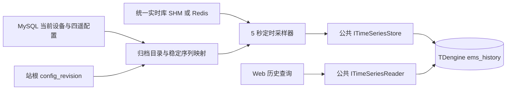

# 历史数据存储设计

`ems-storage` 按固定周期从统一实时库采样，通过共享配置选择 TDengine 或 InfluxDB 2.9；默认周期为 **5000 毫秒**，涵盖配置中的 YC、YX、YK、YT 四类点位。归档不执行遥控或遥调，保存其已有实时状态；没有状态时保存缺失质量。

## 数据流与职责

配置允许原地修改，保存即生效。存储进程读取站根 `cfg_device.config_revision`，仅在计数变化时重建目录；不发布配置版本，不创建配置快照或文件代际。每个实际采样周期使用当前目录，错过的周期不会用最新值回填。

| 模块 | 职责 |
| --- | --- |
| `ArchiveDirectorySource` | 使用公共 MySQL 事务读取站根、设备及四遥，登记或复用稳定序列映射，提交成功后替换目录 |
| `PeriodicArchiveSampler` | 读取实时值、校验类型和质量、生成周期记录、调用公共时序写入口 |
| `storage_options` | 校验启动配置并解析相对路径，不连接外部服务 |
| `common/database/timeseries` | 共享连接配置、类型、TDengine 参数绑定与有界游标扫描 |
| `HistoryService`（Web） | 验证身份和设备范围，归并站/单元流并按查询间隔采样 |

MySQL、实时库和时序库均复用公共接口。存储模块不另建 ORM、SQL 连接或现场协议会话。核心采样器通过读取函数和时序写入接口注入依赖，可以脱离外部服务验证。每批最多 256 条，原生适配器按值类型绑定多子表后执行一次 stmt2 写入；每条状态按输入顺序返回，不能把部分成功计为整批成功。

## 点位目录与热加载

读取站根时加共享锁，确保全量点表和修订号属于同一次配置读取。目录构建检查唯一站、设备真实父链、环、孤立点、四遥重复身份和值类型；点位归属最近的单元，没有单元时归属站。设备或祖先停用会将对应采样标记为禁用。

序列映射保存在 `history_point_series`。子表名沿 `cfg_device.parent_device_id` 从站根逐级取 `code`，最后加测点 `code`，各段以 `:` 连接，例如 `station:unit01:bms01:rack01:voltage`。没有单元或部件时省略对应层级，部件按自身归属树取路径，不使用通信来源设备替代父节点。`point_id` 仍为稳定业务身份和 TDengine 标签，不再用其摘要命名子表。

每段编码为 1–64 字节，支持 ASCII 字母、数字、下划线、短横线和点，禁止冒号、空白和 SQL 引用字符。设备同父编码唯一，测点同设备编码跨四遥唯一；配置保存和目录构建都校验完整路径，按 MySQL 映射唯一索引的大小写规则拒绝碰撞。完整表名最长 192 字节，不截断、不回退到哈希。TDengine 写入绑定和查询都使用反引号引用表名，保留冒号与编码大小写。`history_point_series.series_table` 长度同步为 192。

修改显示名称不改子表。修改编码、父级或值类型后，已有映射与当前配置不一致时明确报错，不能继续沿用旧表名或静默覆盖映射。开发期旧哈希表与映射应在停用存储进程后清理，再启动存储进程按当前树重新登记和归档；不保留旧开发历史，不引入配置版本。目录失败时跳过本周期，不能继续使用已经失效的旧点表。

四遥仍使用各自配置表与模型，不引入 `point_type` 配置单表。采样器的分类字段仅选择对应实时记录。

## 周期与质量

调度使用 `steady_clock`，默认每 5 秒执行一次实际采样，UTC 时间槽用于历史横轴。周期耗时超限时跳过错过的槽；进程退出最多按短睡眠粒度响应，不等待一个完整采样周期。

| 情况 | 历史值与质量 |
| --- | --- |
| 正常且新鲜 | 保存有类型值，质量为 Good |
| 值未变化 | 下一周期照常保存，不依赖变位或变化通知 |
| 缺少实时记录 / 读取失败 | `null`，CommFailure，保留 `sample_missing` / `realtime_unavailable` 原因 |
| 点位或祖先停用 | `null`，Disabled，不读取或执行现场命令 |
| 超过点位或站根新鲜度期限 | `null`，Stale，保留原采集时间 |
| 原质量异常、类型错误或非法时间 | `null`，Invalid，不以零替代异常 |

采样槽时间保存于 `ts`，实际归档接收时间保存于 `ingest_ts`，原实时采集时间保存于 `measurement_ts`。因此重复保存未变化值不会伪造新的采集时间，也能区分“每 5 秒执行归档”和“现场一直未更新”。

有符号整数用 BIGINT；布尔值接受原始 bool 或严格的 0 / 1；文本保留原码。无符号 64 位值用文本序列保存，避免转 DOUBLE 丢失精度。已被实时采集转为不精确浮点数的整数会被拒绝，不猜测原值。

`config_revision` 只记录站根热加载计数，不是可回滚或可读取的配置版本。样本值解释由固定值类型及质量保证，不依赖旧配置快照。

## TDengine 表结构

部署脚本为 `backend/data/tdengine_history.sql`。它显式建立微秒精度的 `ems_history` 库与四张超级表，默认保留 365 天；部署时可按容量要求调整保留期。应用启动不执行 DDL。

| 超级表 | `sample_value` 类型 |
| --- | --- |
| `telemetry_numeric` | DOUBLE |
| `telemetry_integer` | BIGINT |
| `telemetry_boolean` | BOOL |
| `telemetry_text` | VARCHAR(1024) |

每个逻辑点一个子表，以 `point_id` 为稳定标签。数据列按适配器参数绑定顺序为 `ts`、`event_id`、`sample_value`、`quality`、`ingest_ts`、`time_origin`、`time_reason`、`quality_reason`、`payload_sha256`、`scope_kind`、`scope_id`、`config_revision`、`source_id`、`source_epoch`、`sequence`、`measurement_ts`。

`event_id` 为第二复合主键，使用点位身份与采样槽生成稳定摘要。单实例内重复或倒退的槽不再写入，重新执行同槽记录保持同一主键。部署同一站时应只运行一个周期归档实例。复合主键及超级表语法参见 [TDengine 官方文档](https://docs.tdengine.com/tdengine-sql/ddl/stable/)。

原生适配器要求 3.4.3.x 客户端，使用 stmt2 绑定标签、值和条件；查询验证微秒精度及返回列数，再校验映射、作用域与游标。`measurement_ts` 和 `config_revision` 与本脚本一致，不能套用旧表结构。

## InfluxDB 2.9 存储

公共适配器通过仓库内 `influxdb-cxx` 的 HTTP 兼容接口读写，不实现自有 HTTP 客户端或行协议编码器。InfluxDB 的 bucket、保留期、API token 和默认 DBRP 映射由部署管理，应用只验证连接。两种后端均实现 `ITimeSeriesDatabase`，由 `timeseries.json.backend` 选择，Web 与存储使用同一选择；配置切换需要重启进程。

measurement 名为 `telemetry_numeric`、`telemetry_integer`、`telemetry_boolean`、`telemetry_text`。标签为 `series_key`、`point_id`、`event_id`、`scope_kind`、`scope_id`；其中三个 ID 按 UTF-8 字节转十六进制，保留身份并避免标签转义和查询注入问题。`series_key` 使用已校验的完整逻辑路径。写入时间使用原始微秒时间及库的 `MicroSeconds` 精度，时间范围受 InfluxDB 的有符号 64 位纳秒时间边界约束。

同一标签集合和时间重复写入会覆盖同身份记录；`event_id` 标签保留同一点同一微秒的不同事件。事件标签会提高序列基数，部署需按采样量、bucket 保留期和内存容量评估；不能直接将 TAOS 的容量验收结果视为 InfluxDB 的容量保证。调用方仍负责身份及载荷核验，不用重复写覆盖业务冲突。

字段包括原生类型的 `sample_value`、`value_present`、`quality`、三个微秒时间字段和 `record`。`record` 为完整样本的 JSON 字符串，保留所有来源、质量、摘要、修订号和类型信息，是 EMS 查询还原的依据。这样可保留精确 int64、极小浮点、空字符串、中文与控制字符，不依赖库 `query()` 的 double 转换或固定小数位格式。文本 `sample_value` 同样使用 JSON 字符串编码；`value_present=false` 表示 null，原生值列的占位值不能视为有效测量。`config_revision` 仍只是站根热加载计数。

每批最多 256 条，先完整校验再调用库的批量 `write()`；不保留跨调用的待发送批次。请求超时取配置与调用剩余期限的较小值。连接或发送异常采用脱敏错误，无法确认是否部分写入时整批返回 `Unknown`，不伪装为未写入或成功。并发调用各自创建客户端，避免共享库中非线程安全的会话。

查询以作用域、逻辑路径、点位和半开时间区间过滤，每次读取受行数、点数和调用期限限制。使用 `execute()` 原始 JSON，验证响应结构、类型、标签与样本身份；任一异常不返回局部成功页。InfluxQL 只支持时间排序，适配器补取分页边界上完整的同时间记录，再按 `(source_time_us, point_id, event_id)` 排序并应用游标。同一点同一微秒超过 1001 个事件返回 `ResourceExhausted`，不静默截断；常规周期归档每槽只生成一个事件。参见 [InfluxQL 排序能力](https://docs.influxdata.com/influxdb/v2/reference/flux/flux-vs-influxql/)。

`ems_influxdb` 通过本地 HTTP fixture 调用真实 `influxdb-cxx`，覆盖类型与 null、幂等重投、同时间多事件、跨点游标、半开区间、部分写入、断连、超时、损坏响应和失败批次清理。这不替代实际 InfluxDB 2.9 的服务端兼容性、性能与长时间运行验收。

## 运行与验证

部署及命令见[存储进程入口](index.md)。Web 和存储读取同一份 `timeseries.json`，环境变量可覆盖凭据；日志和配置错误不输出密码。

周期报告包含配置点数、成功写入数、质量无效数和失败数；写失败不会计为成功。后续周期会尝试重新建立时序连接，错过的周期不回填。当前周期内存数据不提供断电恢复或持久重放。

单元测试覆盖四遥目录、稳定命名、父链校验、5 秒周期、未变化值、缺失/停用/陈旧/非法质量、无损整数、时序失败、期限及重复槽。SQLite 配置测试覆盖修订号热加载；启动测试覆盖默认间隔、相对路径、非法参数和脱敏错误。2026-11-08 已使用 3.4.3.9 社区版完成原生类型读写、批量写入、复合主键、游标分页、真实工程点归档及 Web 历史服务联调；长时间故障重连与保留清理仍需部署运维验收。
