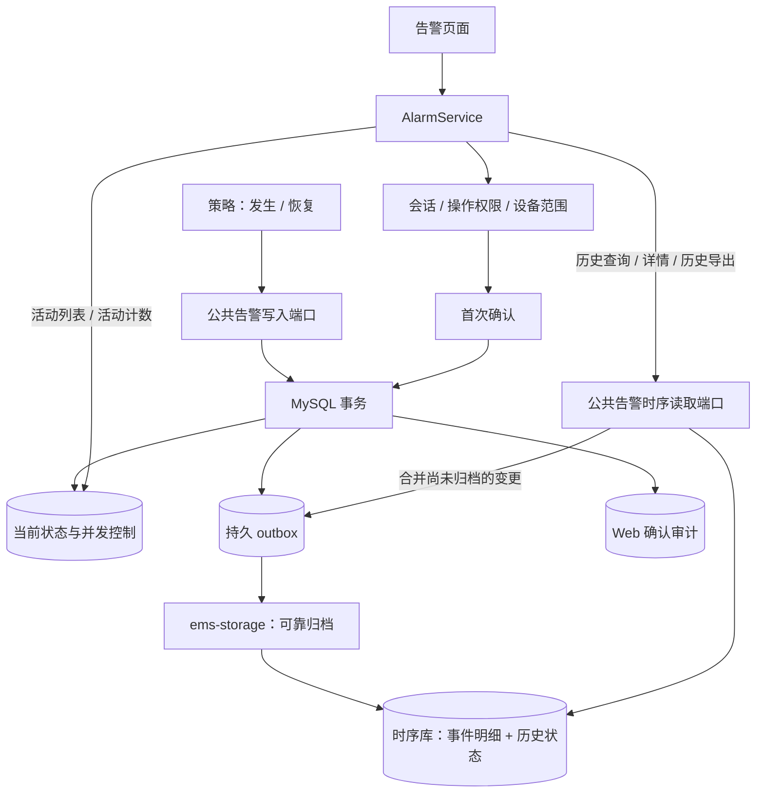
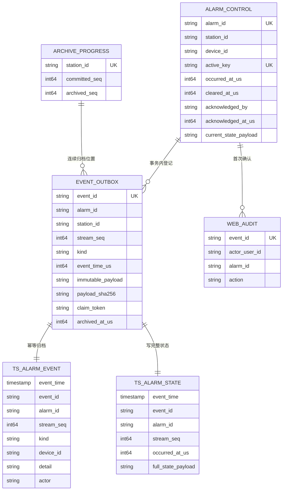
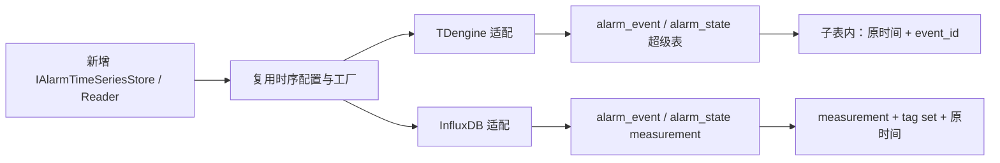
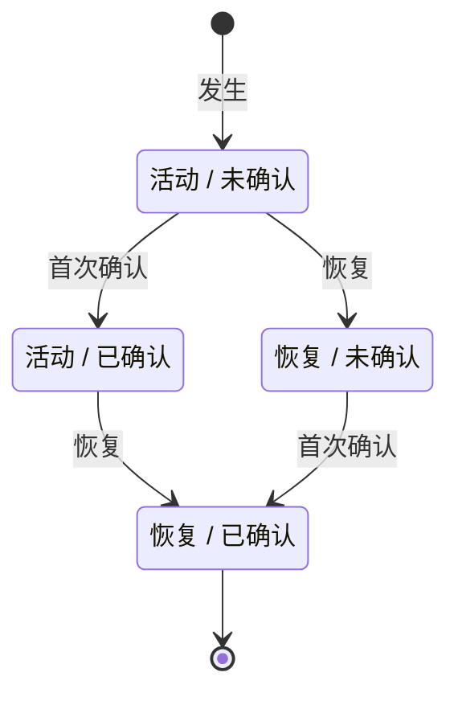
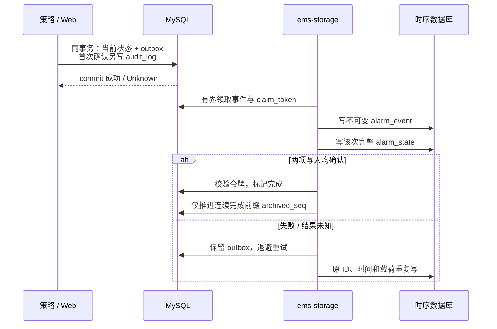
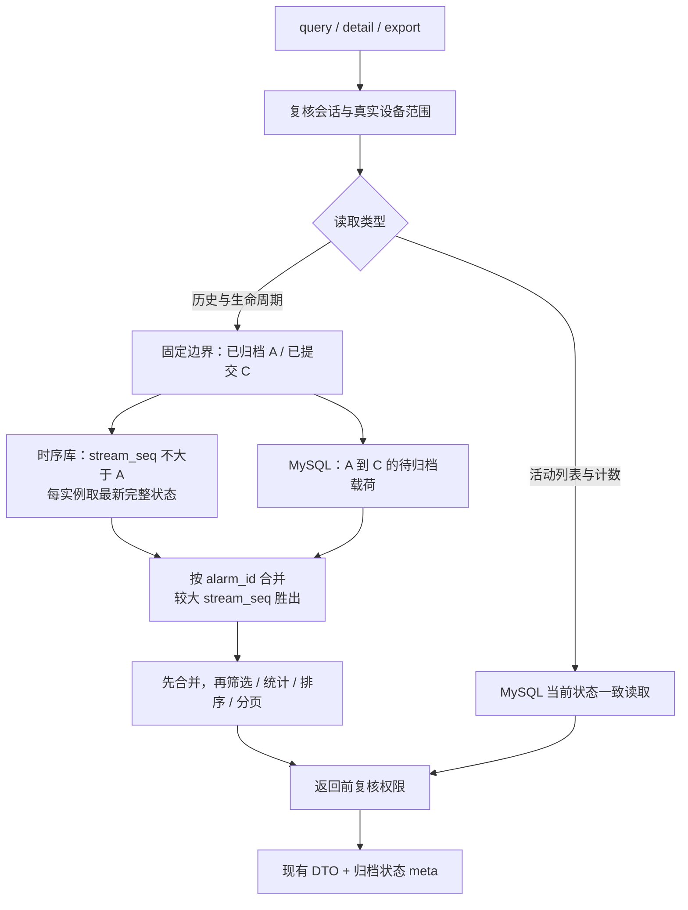
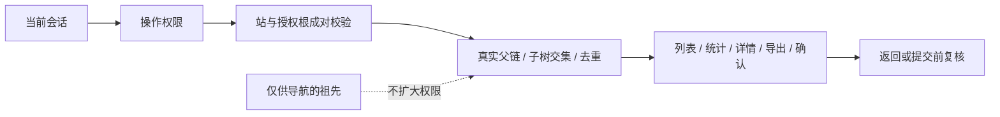
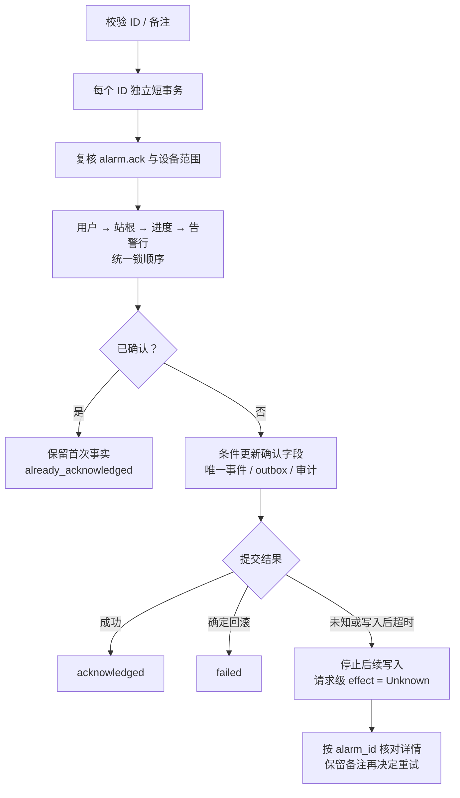
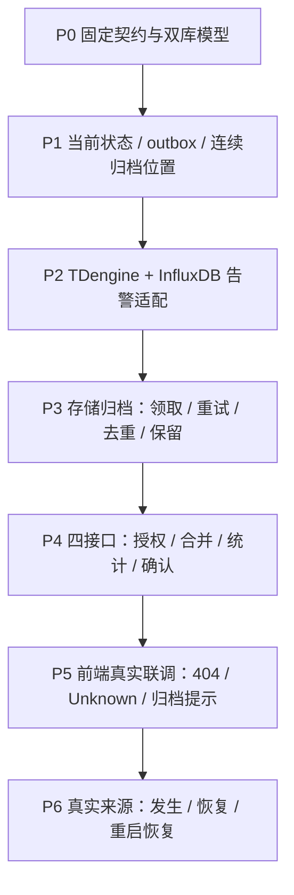
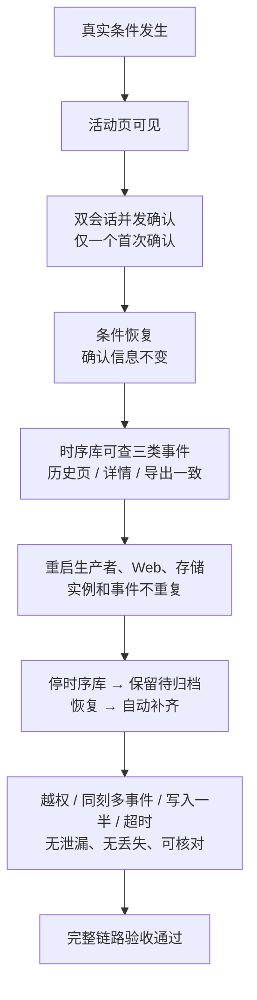

# 告警

`ems-web` 提供活动和历史查询、详情、首次确认与导出。`ems-storage` 将公共告警仓储接收的事件写入所选时序库。

## 1. 总体架构

| 存储 | 职责 |
| --- | --- |
| TDengine / InfluxDB | 历史主存储：发生、恢复、确认事件及状态变化；历史检索、生命周期详情、导出 |
| MySQL `ems` | 当前状态、首次确认竞争、活动实例身份、待归档事件、归档进度 |
| MySQL `ems_web` | 复用身份、授权、`audit_log`；确认与审计同一连接事务提交 |

共享既有 `timeseries.json` 选后端。历史查询必须读取时序库；时序库不可用时明确报错，不静默改成关系库历史查询。

## 2. 数据模型

| 规则 | 约定 |
| --- | --- |
| 实例 | 每次发生新 `alarm_id`；`active_key` 区分设备、规则与条件实例，恢复置空 |
| 事件 | `event_id` 全链路稳定；同 ID 同载荷幂等，异载荷冲突；重试保持原时间 |
| 顺序 | 同站事务内锁进度行、分配连续 `stream_seq` 并登记 outbox；回滚不留空洞；它是事件顺序，不是配置版本 |
| 状态 | 每次发生、恢复、首次确认各写一条事件及完整状态；按 stream_seq 还原，避免乱序覆盖 |
| 字段 | 完整状态含编码、等级、发生时设备名/路径、触发条件和值、确认人/时间/备注；测点可选 |
| 时间 | UTC 微秒存储、HTTP 安全整数毫秒；未恢复和未确认为 null |

关系表沿用整数主键和业务 ID 唯一约束；图中只列关键字段。时序告警使用独立模型，不塞入遥测 `Sample.value`。

### 后端适配

修改既有 `backend/data/tdengine_history.sql`；InfluxDB 复用 bucket / DBRP 部署。两后端验证同刻多事件、重复写入、精确整数和中文；InfluxDB 的事件身份标签须验收基数与容量。保留期须覆盖活动实例，不能因发生事件过期丢失解释信息。

## 3. 生命周期

确认和恢复作为独立事实保存。Web 通过公共仓储写入确认，告警发生和恢复由事件生产者写入。生产者重启时可以通过仓储恢复持久活动身份。现场策略生产者仍待接入。

## 4. 可靠归档

跨库不假设共同事务。确认成功表示首次确认已持久受理；归档成功须两项时序写入都完成。ZeroMQ 只唤醒，存储仍轮询 outbox 补漏；告警不能走遥测允许丢样的路径。

## 5. 读取与归档延迟

| 场景 | 处理 |
| --- | --- |
| 刚确认即重读 | 合并待归档变更后再筛选；不能只修改已分页行，否则状态筛选与总数错误 |
| 乱序或只写成功一张时序表 | 不进入连续归档位置，重试完成后再推进 |
| 读取期间推进归档 | 读取凭据保护固定边界内 outbox，保留至读取结束或期限到达；不立即删除 |
| 大结果集 | 时序适配器按站、发生时间和归档边界筛选，最多返回 30000 条快照；Web 按实例归并后统计。待归档尾部最多 2048 条，活动快照最多 20000 条。超预算报错 |
| 时间范围 | 按发生时间筛选，不能只扫描范围内的生命周期事件；较晚恢复仍关联原发生实例 |
| 归档延迟 | `meta.alarm_archive` 向整站授权会话返回归档进度及积压条数，告警页面显示待归档条数 |
| 时序离线 | 历史/完整详情返回 503；活动查询与持久确认可继续，明确显示归档异常 |
| 保留与清理 | 清理不得越过读取保护和待归档边界；事件与状态保留策略一致，记录明确保留范围 |

当前 MySQL 为 READ COMMITTED。活动列表与设备活动计数共享同一次快照查询；历史快照和尾部使用固定边界，读取期间已归档的 outbox 行仍可按该边界读取。时序状态按 `occurred_at_us` 筛选，Web 在有界快照上合并状态后再筛选并统计。

## 6. 接口与授权

沿用 Cookie、Origin、CSRF、POST JSON、`{ data, meta }` 与现有 `AlarmRecord/AlarmDetail`。

| `POST /api/alarms/…` | 权限 | 来源 / 限制 |
| --- | --- | --- |
| query | alarm.read | active 读当前状态；history 读时序并合并尾部；页大小 8/20/50 |
| detail | alarm.read | 时序生命周期 + 待归档事件，按 event_id 去重；当前值独立读取实时库 |
| acknowledge | alarm.ack | 1–200 个不重复 ID；备注 trim 后 1–500 Unicode 码点 |
| export | alarm.read | 按 view 复用读取规则，独立授权；最多 10000 条及 truncated |

| 查询约定 | 规则 |
| --- | --- |
| 范围 | 空根为全部授权设备；选中根取子树与授权集合交集；不用展示路径授权 |
| 历史 | 含活动与恢复，发生时间闭区间，最长 31 天 |
| 排序 | occurred_at_ms 降序、alarm_id 升序，同毫秒稳定 |
| 统计 | summary 为完整筛选集；device_counts 为全部授权子树活动数，不受列表筛选影响 |
| 错误 | 404 区分资源不存在与路由未实现，保留 effect；依赖异常不显示零告警 |
| 当前值 | 无质量良好的样本显示 —；设备缺失或父链无法验证时拒绝访问，不删除告警历史 |

## 7. 首次确认

只更新确认字段，与恢复竞争同一实例行；重复确认无重复业务效果。HTTP 写操作识别加入 acknowledge。正常响应每个 ID 恰好一项，未知结果不伪装 failed；时序不可用无法核对时保持未知，不盲目重试。

## 8. 实施顺序

| 范围 | 改动位置 |
| --- | --- |
| 公共模型 | `common/model/alarm.h` 补 alarm_id；扩展既有告警/outbox 接口与上下文，增加独立告警时序端口 |
| 公共数据库 | `common/database/alarm/`、`src/common/db/alarm/`；事务一致读取选项和测试适配 |
| 时序实现 | `src/common/db/timeseries/` 两后端及工厂；既有 `backend/data/tdengine_history.sql` |
| 关系库部署 | Python ORM 与既有初始迁移补协调表；已初始化开发库显式处理差异 |
| 存储进程 | 独立可靠归档任务，与 5 秒四遥采样分开调度 |
| Web / 前端 | 新增 `modules/alarm/`、路由/CMake/超时分类；错误映射、归档提示和测试 |

不新增配置版本或代际迁移文件；沿用 cfg_device、四遥四表，告警写入不递增 config_revision。不启动建表，不清空已有库；C++ 遵循根目录格式与 Doxygen 约定。

当前归档 worker 按站读取队首事件，两条时序记录均写入后推进归档位置。失败后按原载荷重投，同站并行运行会重复写入相同键。归档 outbox 行当前保留以支持固定边界读取。部署开关与建表入口见[存储进程说明](../storage/index.md#告警时序归档)。

## 9. 验收路径

| 验证层 | 必须证明 |
| --- | --- |
| 契约 | 四种生命周期组合、31 天闭区间、Unicode 备注、全量统计、CSV 防护 |
| MySQL | 并发首写、审计原子性、提交未知、连续序号、隔离与读取保护 |
| 时序库 | 原生持久化、同刻不覆盖、幂等重试、历史筛选聚合、保留期与容量 |
| 跨库 | 时序成功但归档标记失败、事件/状态部分写入、读取时归档推进、预算耗尽 |
| 前端与权限 | 三种角色、子树/导航祖先、撤权、部分成功、真实 404、归档落后与服务离线 |

**接口验收包含真实时序写入与历史读取；完整链路还须实际策略生产者。** 内存响应、SQLite 和开发种子不能替代 MySQL 与所选时序后端联调。

