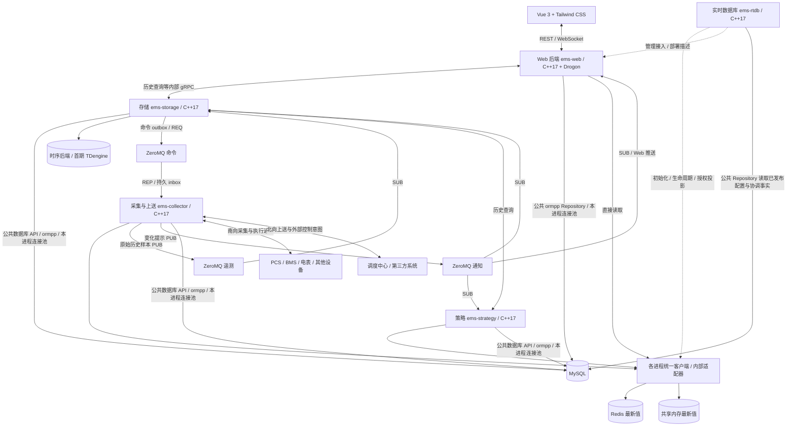
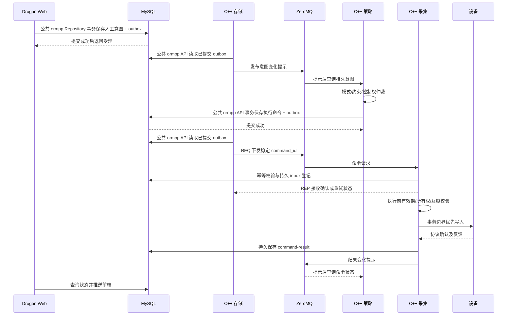
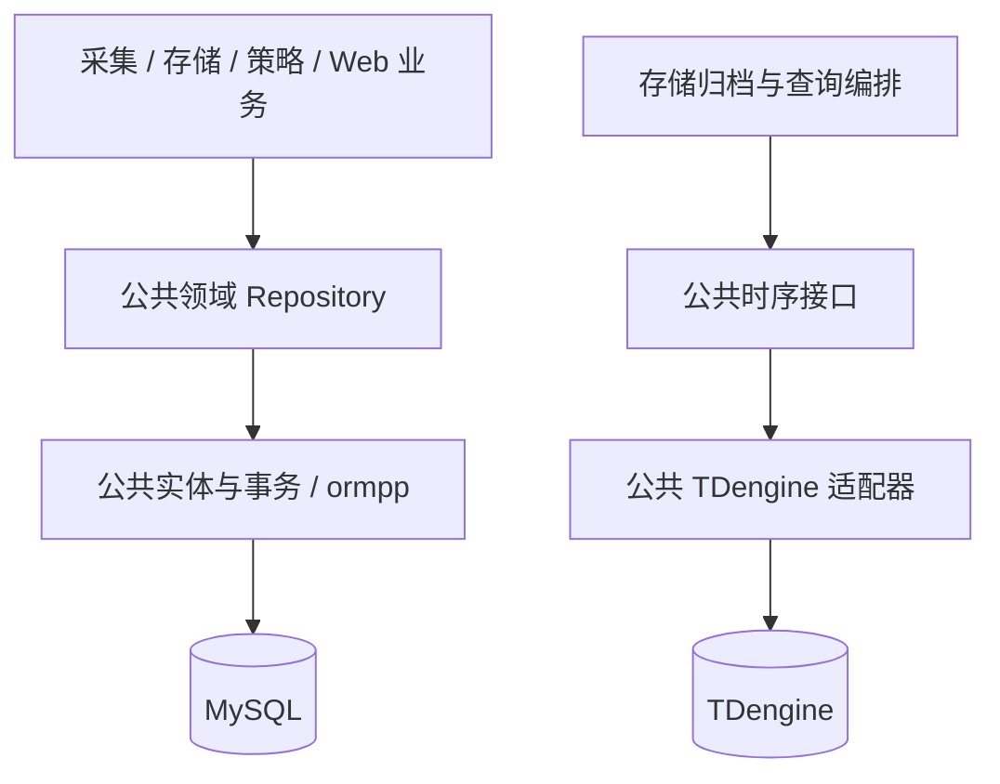

# EMS 系统架构设计文档

> 版本：2.16｜更新日期：2026-10-24｜状态：目标架构，待分阶段实现；常驻实时数据库进程通过配置选择后端，业务只使用统一客户端。
> 本文是整体架构决策基线；采集细节见 [数据采集架构](../processes/collector/design.md)，实时数据与配置入口见 [实时数据与配置](../common/realtime/index.md)。下列进程名、接口、消息与数据模型是设计约定，不代表仓库已经实现。

## 1. 架构决策

| 项目 | 决策 | 边界与理由 |
| --- | --- | --- |
| C++ 标准 | 所有自研 C++ 模块统一 C++17 | 采集、实时数据库、存储、策略、Web 后端及公共库、协议插件使用同一标准；前端使用自身工具链 |
| 后台进程 | 采集与上送、实时数据库、存储、策略、Web 后端五类进程 | 实时数据库进程常驻管理实时后端生命周期；通信进程管理南向采集与北向上送，分布式部署可增加同类实例 |
| 后端框架 | 五类业务进程均使用 C++17；Web 后端采用 Drogon | 通过版本化通信契约协作，不跨进程共享 C++ 对象；Drogon 负责 HTTP/WebSocket 层 |
| 前端 | Vue 3 + TypeScript + Tailwind CSS | 通过 Drogon Web 后端的 REST API 和 WebSocket 访问系统 |
| 共享实时数据 | 统一 RealtimeClient + 可扩展后端；Redis 为默认实现 | ems-rtdb 在所有后端下常驻并由配置选择后端；公共客户端内部完成发现和直接访问，业务不感知实现，见[公共实时访问接口](../common/realtime/access-design.md) |
| 配置快照 | MySQL 保存版本化权威配置，各进程维护本地缓存 | ZeroMQ 提示重读；遗漏时按 MySQL 版本对账 |
| Redis 键 | 全局唯一储能单元 code 为根，设备 code 按资产层级逐级展开 | 单元 hash tag 为 `{unit_code}`；站级公共资源使用 `{station:station_code}`；详见 [Redis 键设计](../common/realtime/redis-key-design.md) |
| 异步消息 | ZeroMQ 负责发布订阅与命令交接 | 原始遥测独立 PUB/SUB，允许丢样；命令 REQ/REP 配合 MySQL outbox/inbox 恢复 |
| gRPC | 建议首期引入，限定用于跨进程服务 API | 历史查询由存储提供，实时管理由实时数据库进程提供；正常实时读写不经管理 RPC，MySQL 操作调用公共 ormpp Repository |
| 独立 MQ | 首期不引入 Kafka/RabbitMQ 等独立中间件 | 达到明确的吞吐、积压、回放或跨站复制需求后再评估 |
| 历史存储 | 公共时序访问接口，首期 TDengine 3.4.2 | 公共层封装客户端与方言，仅存储进程装配，其他进程经历史服务查询；InfluxDB 后续实现 |
| 业务存储 | MySQL；各进程按职责复用公共 ormpp Repository | 实体、查询、连接池实现及事务集中公共模块，各进程创建独立实例；业务代码不写 SQL |
| 设备模型 | 站点 → 储能单元 → 设备/部件，加独立关系模型 | 分开描述资产归属、电气连接、控制能力与通信路径 |
| 设备点位抽象 | 类型固有点位 → 厂家点表 → 实例绑定 | 导入先选实际设备，缺失能力显式禁用；标准读取、设定命令与反馈分开，见 [设备模型与点表绑定](device-model.md) |
| 通道模型 | 设备与通道多对多；通道引用一个协议 profile 版本 | 分开定义采集/上送用途、EMS 客户端/服务端角色、连接模式与操作权限；详见 [设备、通道与协议](channel-protocol.md) |

“五类进程”指 EMS 业务进程，不包含 Redis、MySQL、TDengine、可选 Nginx 等基础设施和前端构建工具。告警管理与状态聚合仍属于策略进程；新增实时数据库进程的边界见[实时数据库进程设计](../processes/data/design.md)。

## 2. 整体架构与职责

### 2.1 整体架构图

下图将实时状态、管理和消息传输分开。`ems-rtdb` 在 Redis、共享内存及未来合格后端下均常驻，从统一配置选择后端并管理接入、生命周期与维护。业务只调用 `RealtimeClient`；公共客户端内部完成发现和 `RealtimeService → IRealtimeStore → 适配器` 组装，直接访问后端，正常读写不经管理 RPC。浏览器仍只访问 Web。更换已内置后端修改实时数据库进程配置并按维护流程执行，业务 API 和代码保持一致，不承诺热切换。详细边界见[实时数据库进程设计](../processes/data/design.md)、[公共实时访问接口](../common/realtime/access-design.md)与[消息契约](../common/realtime/zeromq-messaging-design.md)。



### 2.2 进程边界

| 进程 | 主要职责 | 允许访问 | 不承担的职责 |
| --- | --- | --- | --- |
| 采集与上送 | 南向协议接入/执行/回读、北向状态出口/意图受理、通道会话管理、有界采样缓冲 | 现场与上级协议对端、公共实时库、事件通道；公共 ormpp API 读配置、持久意图/outbox | 不做调度优化，不直写 TDengine，不绕过策略执行任何外部控制 |
| 实时数据库 | 统一接入与配置选型、后端初始化、生命周期、健康、授权投影安装与维护 | 公共实时组件、公共 Repository 读取已发布配置与持久协调结果；提供管理 gRPC | 不转发每次实时读写，不做聚合/告警/仲裁，不代理 MySQL 或全部消息 |
| 存储 | 时序批量写入/查询、告警/命令回执归档、配置发布、outbox 发布与补发 | MySQL（公共 ormpp API）、所选时序后端、ZeroMQ；提供历史 gRPC，必要状态投影经公共实时库 | 不建立现场连接，不生成调度决策，不以最新值补造历史 |
| 策略 | 单元状态聚合、站级优化、功率分配、告警规则、手自动仲裁、约束检查 | 公共实时库直接访问选定后端、MySQL（公共 ormpp API）；经存储 gRPC 查询历史 | 不直接操作协议句柄，不绕开采集进程控制设备 |
| Web 后端 | Drogon HTTP/WebSocket、登录与权限、业务 CRUD、配置编辑和查询编排 | 公共实时库读取选定后端、MySQL（公共 ormpp Repository）；经存储 gRPC 查询历史 | 不直连设备，不绕过策略仲裁下发执行命令 |

各进程按业务职责直接访问同一 MySQL，连接和事务上下文归各自进程所有；C++ 公共数据库模块是可复用的库，不增加数据库代理进程。历史 gRPC 运行于存储，实时管理 gRPC 运行于实时数据库进程；公共实时库不依赖实时数据库进程业务类。存储内部将时序写入、归档事务和历史查询分配到独立队列/工作池，限制查询时长与返回行数，避免大报表挤占审计归档和配置发布资源。

### 2.3 主要数据流

1. **遥测**：设备 → 采集 → 选定的共享内存或 Redis 最新值后端，同时经独立 ZeroMQ PUB/SUB 发送原始采样 → 存储 → 所选时序后端；离线和故障可能形成历史缺口。
2. **控制**：Web 人工意图、北向协议上级意图或策略自动意图 → 策略统一仲裁 → MySQL 命令/outbox → ZeroMQ REQ/REP → 所属采集实例的持久 inbox → 协议写入/回读 → MySQL 回执与 ZeroMQ 状态提示。持久审计和重复执行防护见第 6 节。
3. **配置**：Vue → Drogon Web 鉴权/校验 → 公共 ormpp Repository 在 MySQL 事务中保存配置版本和 outbox → ZeroMQ 提示采集与策略重读并反馈应用版本。遗漏提示时定期对账 MySQL。
4. **查询**：Vue → Drogon Web → 公共 ormpp Repository 查询 MySQL 业务数据；TDengine 历史由 Web 经存储 gRPC 查询；实时最新值由 Web 通过公共库直接读取同机共享段或 Redis。跨主机实时访问首期选择 Redis，不默认增加存储实时代理。
5. **上送**：标准逻辑点 → 通信进程的出口映像/北向映射 → IEC 104、MMS 或 Modbus 等上送通道 → 调度中心/第三方；peer 控制请求进入持久意图与统一仲裁。
6. **实时管理**：实时数据库进程核验部署与实际后端 → 发布后端/布局/代次描述 → 各进程挂接并独立读写；共享段重建与后端切换先停止并隔离旧使用者，再发布新代次。

## 3. 储能与设备建模

### 3.1 建模评估

“现场有多个储能单元，每个单元下面有 PCS、BMS 等设备”适合作为基础资产树。建议将**储能单元定义为可独立监控、分配功率并执行约束的逻辑资源**，不固定等同于一个柜子、一台 PCS 或一套 BMS。

MESA-Device 区分功率变换设备、电池储能和电表的通信模型，可参考其能力划分。[MESA-Device 官方说明](https://mesastandards.org/mesa-device/)。下述资产树和数据库关系是本项目的工程建议，不是该标准规定的数据库结构。

```text
站点 Station
├── PCC / 变压器 / 母线 / 站级电表 / 公共消防等
├── 储能单元 ESSUnit01（独立调度资源）
│   ├── PCS01
│   ├── BatterySystem01（电池资产）
│   │   ├── BMS01（管理设备）
│   │   └── Rack / Cluster → Pack → Cell（按需求展开）
│   ├── 单元电表
│   └── 温控 / 消防 / 辅助设备
└── 储能单元 ESSUnit02
    ├── PCS02、PCS03
    ├── BatterySystem02、BMS02
    └── 其他设备
```

- **电池资产与 BMS 分离**：BMS 是管理/测量来源；Rack、Pack、Cell 可以只有逻辑节点和测点，不要求各自建立网络连接。
- **数量可变**：一个单元可有多个 PCS、电池簇和多级 BMS，不强制 1:1。设备只有一个主要资产归属；公共设备归站点/公共分组，通过关系供多个单元引用。
- **电气拓扑独立**：用端口/连接边描述 PCS 的 AC/DC 端、母线、开关和电池系统。共享 PCS/直流母线通过关系表达，由更高层协调功率，不能被多个单元重复计量或同时争用。
- **通信关系独立**：多个设备可共享网关/串口，同一 PCS 可有独立采集与控制连接，不能从资产父子关系推导通信地址。
- **策略依赖能力**：使用 `read_soc`、`set_active_power`、`start_stop` 等能力绑定测点；厂商寄存器留在协议映射层。

PCS、BMS、电表、消防、空调、环控、保护装置与通用其他设备分别维护版本化类型目录；光伏逆变器是目标扩展，当前公共 C++ 目录尚未实现。实例的固有点位绑定厂家点位，型号缺少的项目可显式禁用，未配置与运行质量异常分别表达。设备是否可监视或参与某项调度，由启用点位、映射、反馈及能力依赖共同决定。完整目录、导入流程和运行模型见 [EMS 设备模型与点表绑定设计](device-model.md)。

### 3.2 逻辑实体

以下为逻辑表建议，实际 DDL 在实施阶段通过版本化迁移落地。

| 实体 | 关键字段 | 关系/约束 |
| --- | --- | --- |
| `station` | `station_id, asset_id, code, timezone, pcc_asset_id` | 站统一使用 station 命名；ID 稳定，code 全局唯一 |
| `asset_node` | `asset_id, station_id, parent_asset_id, code, asset_type` | 站点、单元、设备、电池部件组成无环资产树，不可跨站挂接；设备/子设备 code 在同一父节点下唯一 |
| `ess_unit` | `unit_id, asset_id, code, rated_power_kw, rated_energy_kwh` | 资产节点的调度属性扩展；code 全局唯一、发布后稳定，用作 Redis 单元根 |
| `device` | `device_id, asset_id, type_version_id, model_version_id, manufacturer, firmware_version` | 业务设备固定引用类型与型号版本；不以单一协议字段限制其多个通信绑定 |
| `asset_relation` | `from_asset_id, to_asset_id, relation_type` | 表达 managed_by、serves、controls 等多对多关系 |
| `electrical_port / connection` | `asset_id, port_id, ac_dc, from_port, to_port` | 电气连接与开关状态绑定 |
| `device_type_version / standard_point_definition / capability_definition` | `type_version_id, standard_code, kind, unit, capability_code, required_points` | 固有点位目录与功能依赖，命令和读取定义分开 |
| `device_model_version / point_template_version` | `model_version_id, template_version_id, manufacturer, model, protocol_version` | 厂家型号点表与绑定建议；实例连接参数独立保存 |
| `channel / channel_version` | `channel_id, station_id, code, config_version, purpose, local_role, connection_mode, profile_ref, resource_id, owner_shard` | 通道是版本化配置，运行会话为其子对象；code 在 station 内唯一 |
| `protocol_definition / protocol_profile_version` | `protocol_id, schema, roles, transports, services, profile_id, version, typed_parameters` | 通道固定引用一个 profile 版本，服务能力由驱动验收结果决定 |
| `communication_resource` | `resource_id, station_id, code, resource_type, endpoint` | 共享物理通信资源，code 在 station 内唯一；同一实际资源不重复登记 |
| `device_channel_binding_version` | `binding_id, config_version, device_id, channel_id, operations, device_address, enabled` | 多对多绑定；采集/上送操作权限明确，协议设备地址属于绑定 |
| `forwarding_point_map_version` | `channel_id, binding_id/asset_scope_ref, config_version, point_id, direction, protocol_point_address, encode_spec` | 标准点到上送地址的独立映射，不复用厂家采集地址 |
| `channel_peer_policy_version` | `channel_id, config_version, peer_id, identity_ref, visible_scope, control_scope, limits` | 对端权限与运行 session 分开建模 |
| `point / device_standard_point_version` | `point_id, asset_id, code, origin, definition_id, kind, config_version, state` | 固有/厂家扩展/派生逻辑点身份；code 在所属资产内唯一，实例固有点按版本启用/禁用 |
| `device_vendor_point / vendor_point_route_version` | `vendor_point_id, source_device_id, config_version, binding_id, protocol_spec, decode_spec` | 厂家点稳定身份与版本化地址、编码、通道路由 |
| `point_binding / command_profile_version` | `point_id, vendor_point_id, config_version, binding_role, mapping, encoder, feedback_point_ids` | 逻辑点映射厂家来源；命令配置明确写值、条件、冲突资源及反馈 |
| `strategy_config / schedule` | `strategy_id, station_id, unit_id, version, params` | 站级/单元级策略、时段计划、生效版本 |
| `command / command_event` | `command_id, intent_id, event_id, state, actor, result` | 唯一 ID 去重，追加式状态审计 |
| `alarm / alarm_event` | `alarm_id, rule_id, asset_id, state, acknowledged_by` | 产生、确认、恢复分别记录 |
| `config_version / outbox` | `version, checksum, event_id, payload, published_at` | 配置变更与待发布事件同事务保存 |

地址在相应通道内校验唯一性。同一点可有主备采集映射，但同时只有一个来源更新权威实时值；切换需新的来源代次，不能直接比较不同来源的自增序号。测点业务身份独立于通道，换通信路径不应丢失历史归属。

code 用于可读地址，稳定 ID 用于数据库关联、历史和审计；设备 code 取对应资产节点的 code，子设备及更深部件也使用同一节点模型。`ess_unit.code`、`station.code` 与对应资产节点 code 在同事务中保持一致。唯一约束、code 字符规范、层级索引与改名/迁移规则统一见 [Redis 键设计](../common/realtime/redis-key-design.md)。

点位表与导入暂存、模板、配置版本以 [设备模型与点表绑定设计第 7 节](device-model.md#7-数据库逻辑设计) 为准；通道、profile、绑定及上送模型以 [设备、通道与协议](channel-protocol.md) 为准。point_binding 负责逻辑映射，vendor_point_route_version 负责南向地址，forwarding_point_map_version 负责北向地址。

### 3.3 单元状态与约束

策略使用的 `UnitState` 至少包含 SOC、SOH、可用能量、实际有功/无功、最大可充/可放功率、运行/故障状态、质量、计算时间及输入版本。聚合值使用独立派生测点，由策略写入，与采集原始点区分所有权。

SOC 按有效容量加权并输出覆盖率，不能直接平均不同容量电池；功率限值综合 BMS 动态限值、PCS 能力、变压器/PCC 容量、SOC、温度和运行模式。共享设备不能重复汇总。数据陈旧、离线或覆盖率不足时按配置限制或停止新设定值。

统一工程单位与功率方向：向交流侧送电（放电）为有功正值，充电为负值，厂商相反方向由适配层转换。额定能力与实时可用能力分开保存。EMS 承担监督/调度，快速保护和硬件急停由 PCS/BMS/保护装置负责。

## 4. 采集与上送进程、通道和控制

### 4.1 通道用途与协议角色

设备通过版本化绑定关联通道；同一个 PCS 可以由 Modbus 客户端采集，再由 IEC 104 服务端和 Modbus 服务端同时对外提供标准状态。设备、通道、协议、资源、session 的定义与依赖见 [设备、通道与协议](channel-protocol.md)。

| 用途 | EMS 常见角色 | 绑定操作与规则 |
| --- | --- | --- |
| acquisition 采集专用 | client；受支持协议也可 subscriber | telemetry_in，拒绝未经声明的控制写入 |
| acquisition 控制专用 | client | control_out，允许控制确认及必要反馈读取 |
| acquisition 采控共用 | client | telemetry_in + control_out，共用资源在协议事务边界调度 |
| forwarding 只读上送 | server；受支持协议也可 publisher | telemetry_out，标准点转换成独立北向地址模型 |
| forwarding 上送并受理控制 | server | telemetry_out + control_in；控制先持久受理再经策略仲裁 |

purpose、local_role、connection_mode、operations 分别表达用途、本端角色、建连方式、操作权限，不能互相替代。IEC 104 服务端主动发送遥测仍是服务端，Modbus 服务端通过上级轮询提供数据仍属于上送。

一个实际串口/不可并发会话只有一个 I/O 所有者；服务端一个 listener 可以创建多个 session，不等于每台设备都开一条监听通道。独立采控连接须设备支持，设备级冲突命令仍串行仲裁。模型例子、协议矩阵和上送控制闭环以专题文档为准。

### 4.2 线程与插队语义

首期阻塞协议采用每个独立通道/物理资源一个 `std::thread`，线程独占协议实例；共享资源的逻辑绑定交给同一调度器。使用 C++17 条件变量唤醒等待，不使用固定长休眠，不依赖 C++20 协程。

“控制插队”指**当前请求得到响应或超时后、下一采集事务开始前优先执行**，不截断已发送报文、串口帧或设备内部动作。长批量读取拆成有上限的事务，每个事务后检查命令，不等采完整站再检查。

```text
命令消费者 → 校验目标/有效期/所有权 → 有界优先队列 → 唤醒通道线程
通道线程 → 完成当前事务 → 再校验互锁和限值
         → 下一条合法控制或一个到期采集事务 → 数据/回执 → 继续调度
```

优先级由服务端确定，同优先级 FIFO；配置连续控制数量/时间预算与采集最大延迟，避免无限清空命令队列导致遥测饥饿。关键保护数据保留读取预算；不能同时满足命令期限与数据新鲜度时拒绝/过期处理。队列满返回 `queue_full`，不可静默丢弃。

仅显式允许覆盖且尚未发送的设定值可以合并，被替代命令记录 `superseded`；启停、复位、脉冲不能随意合并或重试。控制等待包括当前事务剩余超时、优先积压、总线间隔和必要校验读取，不承诺所有协议都有固定毫秒时延。

### 4.3 协议适配与故障

Modbus TCP/RTU 优先复用现有 C/C++ 封装；IEC 60870-5-104 复用现有依赖并验证控制确认；DL/T 645、IEC 61850 按现场需求接入，实际支持范围以驱动和测试为准。不能仅凭 IEC 61850 插件名称宣称已支持 MMS、GOOSE 等全部能力。

插件内部 C++17，动态库边界使用带版本的 C ABI、不透明句柄和明确内存释放函数，不跨 ABI 传递 STL 容器/异常。接口携带绑定地址、点路由、事务超时及结构化结果。卸载前停止新任务、完成/终止在途事务，再销毁实例。

断线使用有上限退避重连，等待中仍检查命令有效期；离线值保留但标异常质量。恢复先获取新状态、校验配置，禁止自动重放过期控制。

## 5. Redis、gRPC 与 MQ 评估

### 5.1 通信分工

| 机制 | 使用场景 | 保证边界 |
| --- | --- | --- |
| Redis Hash/String | 最新值、设备/通道/单元运行状态 | 当前状态不是完整历史，通过版本/质量识别陈旧 |
| ZeroMQ 遥测 PUB/SUB | 原始历史采样 | 离线、高水位和写库故障允许丢样；无确认与重放 |
| ZeroMQ 变化提示 PUB/SUB | 页面刷新、缓存失效与状态变化提示 | 断开期间会漏消息，重连需重新读 MySQL 或实时权威状态 |
| ZeroMQ REQ/REP | 执行命令交接 | 应答只表示采集端持久受理状态，MySQL outbox/inbox 与执行状态机处理重试、去重和结果核验；见[设计文档](../common/realtime/zeromq-messaging-design.md) |
| gRPC + Protobuf | 分页历史等跨进程服务调用 | 类型化请求响应与 deadline；超时不代表服务端没有完成操作 |
| 独立 MQ | 后续大规模事件总线 | 额外部署、容量、监控和一致性成本，首期不启用 |

ZeroMQ PUB/SUB 语义见 [ZeroMQ 指南](https://zguide.zeromq.org/docs/chapter1/)；gRPC 接口生成、deadline 与调用双方结果可能不同的行为见 [gRPC 核心概念](https://grpc.io/docs/what-is-grpc/core-concepts/)。

**gRPC 结论**：本项目希望历史查询、实时管理等跨进程服务使用统一的版本化类型契约，因此建议首期采用 gRPC。各 C++ 进程使用公共 ormpp API 直接完成职责内的 MySQL 操作，实时值通过公共库直接访问所选后端；是否走 gRPC 取决于服务职责。仍需承担 Protobuf 生成工具链和进程间兼容测试成本。它不替代共享实时状态或 ZeroMQ 遥测通道。

**MQ 结论**：目前没有设备数量、采样率、最大中断时间的实测输入，暂不增加独立 MQ。先测算峰值样本率、消息大小、消费者数与进程内有界缓冲；明确允许的丢样数量和观测方式。

若将来要求长时间保留、回放、跨站复制或无损采样，再针对指标验证持久消息方案。遥测接收抽象只提供有界读取；事件 ID 与控制状态机不依赖传输游标。

### 5.2 Redis 键、层级与所有权

实时键目录、字段、生命周期与迁移规则单独维护在 [Redis 键设计](../common/realtime/redis-key-design.md)，本节只保留架构摘要。

储能单元 code 在系统全局唯一且发布后稳定，以 `{ess000001}` 标识作用域，设备层级按 `<设备code>:<子设备code>` 递归展开。测点键统一采用 `ems:rt:point:<作用域>:<设备层级>:<point_code>`，单元自身测点省略设备层级；其他资源仍使用 `ems:<作用域>` 加对应路径与资源后缀。例如：

```text
ems:{ess000001}:rt:state
ems:rt:point:{ess000001}:pcs01:active_power
ems:rt:point:{ess000001}:battery01:rack01:pack01:voltage
ems:rt:point:{station:station001}:pcc-meter01:active_power
```

同父节点的设备 code 唯一，code 路径表达资产归属；通道与共享物理资源使用独立 station 路径，不能从设备层级推断。`station_id / station_code` 保留在元数据、消息和权限上下文中。历史采样主题按作用域区分，命令按 owner_shard 路由到对应 ZeroMQ 端点；存储和策略分别查询持久回执，配置按实例跟踪应用版本。

`{unit_code}` 是单元级 hash tag，设备层级不参与槽位划分。同单元实时值可安排同槽操作；跨单元及 station 数据不承诺原子快照或全局顺序。大单元可能形成热点，按容量验证后另行设计单元内分片迁移，首期不在 tag 中加入分片编号。Cluster 同槽规则见 [Redis Cluster 规范](https://redis.io/docs/latest/operate/oss_and_stack/reference/cluster-spec/)。

### 5.3 遥测丢样与业务恢复

- 采样生成稳定 `event_id`，进入有界内存队列后分别更新实时值与通过独立 ZeroMQ PUB/SUB 发布原始事件；不提供本地文件缓冲。发布成功只代表本地接受，存储未必收到。
- 存储订阅器只以收到的原始事件入库，不能收到变化提示后读 Redis 最新值代替原样本。订阅端离线、两端高水位、队列溢出或数据库故障都可能产生不可自动恢复的历史缺口，计数和采样静默必须可观测。
- 各业务进程通过公共 ormpp API 将职责内的命令、告警和 outbox 同事务写入 MySQL。命令经 ZeroMQ REQ/REP 交接，其他状态变化经 PUB/SUB 提示并由消费者查询 MySQL；这些业务事实与允许丢样的遥测语义分开。

### 5.4 跨进程与前后端数据契约

统一 `schema_version、event_id、trace_id、station_id、station_code、unit_id、unit_code、producer_id、config_version、event_time、ingest_time`；station 级事件的单元字段为 null，设备事件另携带 `asset_id、device_path`，路径是按层级排列的 code 数组。时间采用 UTC 并明确精度，展示按站点时区转换。业务 ID、64 位计数器和高精度时间在 JSON 中用字符串，避免 JavaScript 精度丢失；浮点工程值用数字，无效值用 null 加质量，禁止 NaN/Infinity。

规划在 `contracts/proto` 维护 gRPC 与事件定义，在 `contracts/jsonschema` 维护 JSON 映射。ZeroMQ 遥测首期采用版本化 JSON，字段语义与 Protobuf 一致，不直接序列化 C++ struct 内存。兼容升级保留废弃字段编号，已收到的未知版本进入隔离并报警。

遥测至少包含 `point_id、point_code、device_id、channel_id、source_epoch、sequence、value_type、value、unit、quality、source_time、ingest_time`，设备及子设备层级由公共字段 device_path 表达。源时间不可用时记录原因、使用采集时间。旧样本可补历史，不覆盖新快照；TTL 用于清理，`stale_after` 用于新鲜度判定。

## 6. 控制闭环与策略进程

### 6.1 意图、仲裁与审计

人工、自动与北向上级意图都经过策略仲裁，检查控制权、手自动模式、计划、生效配置和实时约束。Web 不直接写执行队列；策略不可用时停止新的常规远程调度，设备本地保护持续生效。



消息包含 `command_id、intent_id、target_asset_id、capability、value、unit、priority、issued_at、expires_at、expected_config_version、owner_epoch、actor、reason、trace_id`。设备/通道/寄存器路由由后端配置解析；浏览器不能指定任意地址，不能只凭前端提交的 actor/priority 授权。

Web 返回受理前，通过公共 ormpp Repository 以稳定 ID 将人工意图和 outbox 同事务写 MySQL；策略通过同一公共 API 持久保存自动意图，并在仲裁后将执行命令和 outbox 同事务写 MySQL。存储进程按 outbox 通过 ZeroMQ REQ/REP 下发命令；采集持久登记 inbox 后才回复 `Accepted`。持久受理与设备执行是两个阶段。MySQL 不可用时拒绝新的常规控制；事务提交或 ZeroMQ 应答结果不确定时以原 ID 查询/重试，存储周期对账未终结命令。

### 6.2 状态、回读与重复处理

```text
accepted → validated → queued → dispatched → protocol_acked → verified
执行前 → rejected / expired / cancelled / superseded
发送后明确失败 → failed
发送后无法判定设备结果 → unknown
```

accepted 仅表示可靠接收，protocol_acked 仅表示协议确认；只有满足配置反馈条件才为 verified。回读应是发送后的新样本，在误差/稳定窗口内验证；无法回读的动作显示“协议已确认，未验证设备结果”。

采集先将命令登记到持久 inbox，再在 I/O 前通过公共 Repository 条件登记 MySQL 执行状态；回执与 outbox 同事务持久提交，恢复时结合数据库记录与设备状态。登记失败不执行新动作，执行后数据库不可用则停止新控制并在恢复后对账。重复 command_id 返回已知状态。设备执行后、记账前崩溃仍可能结果不确定；切换、复位、脉冲等非幂等动作不能盲目重发。所有者切换后持久状态不可得或结果未知时，先进入 unknown 并回读/人工核验，仅在证明安全时重试。

命令回执和告警生命周期事件分别由采集、策略通过公共 ormpp API 将业务记录与 outbox 同事务保存，ZeroMQ 仅提供变化提示，消费者查询持久记录并对账；不设置本地执行日志或文件回放。按稳定 event_id/command_id 去重，通知发送成功不作为业务审计数据的唯一清理依据。

### 6.3 分布式控制权

采集按物理资源分片，策略按站点/调度域指定唯一活动所有者；租约协调，命令携带 owner_epoch，执行前拒绝旧代次。失去租约停止新写入。

Redis 异步复制租约本身不能保证网络分区下现场单写，PCS/串口通常不能验证 fencing token。主动接管还需可靠隔离旧主，例如关闭旧实例/主机、独占网关或经验证的设备排他控制。不能确认隔离时禁止自动接管控制，只恢复监视；不能把 Redis 锁等同设备级 exactly-once。

### 6.4 策略模块

策略内部分为状态聚合、规则告警、计划/优化、站级分配、单元约束和命令仲裁。首期按项目配置实现定功率、时段充放电、削峰填谷、防逆流与 SOC 边界，具体参数现场验收。需量保护、计划曲线、手动模式与光伏协同的目标规则见[策略进程详细设计](../processes/strategy/design.md)。优化周期可独立设置，失败采用明确回退计划，不阻塞状态/告警。

## 7. 数据存储设计

### 7.1 三类存储职责

| 数据 | 权威存储 | Redis 用途 |
| --- | --- | --- |
| 台账、拓扑、点表、策略、用户/角色、计划 | MySQL | 无；各进程维护本地配置缓存 |
| 命令/配置审计、告警生命周期 | MySQL | 可选的当前状态投影，消息由 ZeroMQ 传输 |
| 原始测点、派生指标、历史、聚合 | 所选时序后端，首期 TDengine | 最新值；原始遥测经 ZeroMQ 发送 |
| 心跳、通道在线、新鲜度、临时控制权 | Redis | 运行时状态，重启后结合实际设备重建 |

### 7.2 MySQL 与公共 ormpp 模块

全项目持久数据访问统一到公共库，详细实施基线见[公共数据库访问层](../common/database/)。



| 统一复用 | 运行约束 |
| --- | --- |
| 配置、控制、告警、用户、outbox 与历史目录/事件 Repository | 实体、映射、查询与并发语义集中实现，业务不拼 SQL 或直调驱动 |
| 公共连接池、事务、工厂与错误转换 | 各进程创建自身实例；同进程同数据库/凭据与用途共池，Repository 不各建连接 |
| 公共时序读写、映射及客户端适配 | 仅存储进程装配，其他进程经 HistoryService；不把历史业务算法迁入公共层 |
| 部署迁移 | 关系表使用 backend/python/db 的 ORM/Alembic，TDengine 单独部署；应用不自动建业务表或升级 schema |

固定版 ormpp 支持 MySQL/PostgreSQL/SQLite，不含 TDengine。MySQL 普通 CRUD 使用 ORM；必要的参数化复杂查询仅留公共实现，TAOS 客户端/方言仅留公共时序适配器。公开 API 不提供任意 SQL，也不暴露 ORM/驱动对象。

复用公共代码不跨进程共享连接、socket、锁或事务；fork 后重建连接，各实例连接上限计入数据库总预算。业务与 outbox 同事务，跨 Repository 使用同一连接；MySQL 与时序库不组成分布式事务，账本提交不等于历史归档完成。

数据库工作放有界配置/业务线程，避免阻塞协议 I/O、策略计算和 Drogon 网络线程；表/操作权限仍按业务所有权限制。配置分别报告已保存/已发布/各实例已应用，版本不一致时拒绝依赖新映射的控制。后端更换仍需类型、索引、事务、迁移和行为兼容验收。

### 7.3 TDengine 时序模型

首期按数据类型划分超级表、每个测点一张子表，适配不同设备点表/采样周期；同构高频设备可经容量测试评估宽表。标签是子表级元数据，不能在同一子表逐行更换 point_id 标签混存多个点。[TDengine 数据建模](https://docs.taosdata.com/quick-start/data-modeling/)、[数据表说明](https://docs.taosdata.com/tdengine-sql/ddl/table/)。

目标版本为 TDengine 3.4.2，服务端与客户端锁定兼容补丁。数值、整数、布尔及文本分别映射类型化超级表，以稳定 point_id 作标签，行身份为 `(ts, event_id)`；历史库与超级表按存储设计由部署单独准备，未纳入当前 SQLAlchemy 迁移，动态子表只经公共适配器按受控映射创建。完整目录、字段组与消费规则见[存储进程详细设计](../processes/storage/design.md)。

表名由受控 ID 映射产生，值使用参数绑定。布尔、状态、字符串和高精度整数使用对应类型，不能全部转 DOUBLE。名称、单位、资产归属等可变信息通过 MySQL 版本模型解释历史，避免修改标签造成历史含义漂移。

重试保留原采样时间和稳定身份。同一子表以 `(ts, event_id)` 区分同刻不同事件；相同事件重试必须写入相同载荷。`event_id` 只是普通列时没有上述去重保证；部署版本不支持复合主键时，须先完成替代模型设计和验收，不能直接沿用此表结构。离散命令及告警审计仍存 MySQL。

### 7.4 写入、聚合与保留

按子表、批量大小、最大等待时间组批，确认成功后推进水位，部分失败只重试失败部分。协调同测点写入顺序，补传不覆盖新的实时值。

历史保留、原始/分钟/小时粒度、压缩和副本由容量及恢复目标决定。聚合按测点语义：瞬时功率均值/极值，电量用累计表差值或功率时间积分，不能把功率采样直接求和当 kWh；质量异常/缺样记录覆盖率。选用目标 TDengine 版本支持的流计算或定时任务，迟到数据重算/补偿，不依赖未经验证的聚合建表语法。

## 8. Drogon Web 与 Vue 前端

Drogon Web 提供版本化 REST API、WebSocket、鉴权、限流和审计上下文；同步 MySQL 操作及长查询进入有界业务工作池，内部 gRPC 设置 deadline、请求 ID 与读写权限，重试写操作必须幂等。WebSocket 重连先取快照并对齐版本，命令最终状态以查询接口为准。具体分层见 [Web 进程设计](../processes/web/index.md)。

| 接口示例 | 行为 |
| --- | --- |
| `GET /api/v1/stations/{station_id}/units` | 资产树、单元能力、状态摘要 |
| `GET /api/v1/devices/{device_id}/channels` | 角色、绑定、在线状态、应用配置版本 |
| `GET /api/v1/points/latest` | 限定测点范围，返回权威实时值、质量和新鲜度 |
| `GET /api/v1/history` | 经存储 gRPC 按测点/时间/粒度分页 |
| `PUT /api/v1/configurations/{id}` | 携带期望版本更新，展示发布/应用进度 |
| `POST /api/v1/control-intents` | 鉴权、幂等接收，返回意图 ID/受理状态 |
| `GET /api/v1/commands/{command_id}` | 返回阶段、原因、协议确认、反馈值与审计 |
| `GET /api/v1/alarms` | 活动/历史告警，确认操作单独授权并留审计 |

Vue 3 + TypeScript + Tailwind CSS 按站点总览、单元、设备、通道、点表、策略计划、告警、历史曲线和运维组织。区分离线、数据陈旧、配置未应用、命令受理/执行/未知；不把写 API 成功显示为设备已动作。

前端仅访问 Drogon Web，不直连 Redis/数据库/内部 gRPC。按站点/资产/操作鉴权，登录权限与设备控制权分开。数据库/Redis 采用最小权限账号，按部署边界配置 TLS/内部身份认证；凭据不进入前端响应、配置快照或日志。

## 9. 部署、运维与降级

### 9.1 部署路径

- **单站**：systemd/容器管理五类业务进程；实时数据库进程先核验/初始化后端，再启动业务使用者，整组退出时最后停止实时数据库进程。共享内存参与者须处于兼容平台与可共享的 OS 命名空间；Vue 静态产物由 Drogon 或可选 Nginx 提供，基础数据库独立配置备份。
- **站内扩展**：采集按通道/网关资源分片；策略每调度域唯一主控；存储按 ZeroMQ 遥测主题分片订阅并按事件身份幂等；Web 无状态扩展，实时连接各自同步快照。
- **多站**：站内保留本地 Redis 与控制闭环，跨站汇总单独同步；避免 WAN Redis 成为现场控制唯一依赖。Cluster 用于有容量需求的站内分片，跨站复制单独设计。

### 9.2 故障策略

| 故障 | 行为 |
| --- | --- |
| 实时数据库进程不可用 | 后端与授权仍有效时已挂接者可继续直接访问；新接入、授权变更和维护暂停。管理恢复复用实际存储代次，不清段；对象丢失时按受控恢复处理 |
| Redis 不可用 | Redis 为权威实时后端时停止依赖最新值的新控制；共享内存为权威后端且 MySQL、配置、控制权与 ZeroMQ 均就绪时，可继续经持久 outbox/inbox 下发命令。遥测发布与 Redis 实时写入分别记录结果 |
| 时序后端不可用 | 已接收但写入失败的样本计入历史缺口并告警；实时监视可继续 |
| MySQL 不可用或业务进程连接失败 | 既有配置继续采集/状态计算；受影响进程暂停配置修改和需持久审计的新控制 |
| 存储进程不可用 | 历史查询、事件归档与 outbox 发布暂停；离线期间 PUB/SUB 遥测丢失。其他 C++ 进程仍可通过各自连接访问 MySQL；已受理意图保持待发布，新控制返回发布不可用，恢复后校验期限再处理 |
| 策略不可用 | 采集和设备本地保护继续，停止新 EMS 调度；恢复加载快照/未终结命令 |
| Web 不可用 | 自动策略和采集继续；界面恢复重新取状态 |
| 采集失联 | 标记对应数据陈旧，控制不可达/未知；接管执行旧主隔离规则 |
| 磁盘/队列不足 | 分级告警、预配置背压/降采样，显式记录缺口，关键命令不能静默丢弃 |

### 9.3 监控指标

监控进程心跳、通道在线率、采样延迟、陈旧率、控制排队/执行/反馈时延、未知命令、Redis 实时内存、ZeroMQ 发布拒绝与本地接收队列丢弃、数据库写入失败、配置版本差异和策略周期超时。日志关联 trace_id/event_id/command_id/station_id/channel_id，使用 UTC 并维护时钟同步。

设备数、通道数、点数、采样周期、控制延迟、内存缓冲容量、允许的遥测缺口、RPO/RTO 与保留期需现场量化；当前不承诺未经测试的固定吞吐、时延或零丢失。

## 10. 工程组织与迁移

代码按公共、采集、协议、实时数据管理、历史数据、存储、Web、策略等逻辑模块组织，与五类进程分别管理：实时生命周期组装在实时数据库进程中，历史业务与持久化实现组装在存储中，公共模块作为库供各进程直接使用。设备、资产、标准点、能力与绑定归公共模型；会话归采集/协议，控制决策归策略。公共目录与迁移见[公共模块设计与实施规范](../common/design.md)，数据入口规划见[实时数据库进程详细设计](../processes/data/design.md)。

### 10.1 目标目录（规划）

```text
backend/                    # C++17
  src/net/                  # 采集、通道、协议插件
  src/rtdb_service/         # 实时数据库进程：统一接入、生命周期与维护（待新增）
  src/scd/                  # 存储服务，沿用现有目录时明确含义
  src/stgy/                 # 策略、控制仲裁
  include/common/               # core、model、codec、config、database、messaging 等公开接口
  include/rtdb/                 # 统一 RTDB 公共客户端、模型和存储契约
  src/common/               # 公共接口实现，设备模型不持有连接或线程
    model/                  # 资产/设备/测点/能力/绑定及纯校验
    config/                 # 精确版本、快照与校验
    db/                     # 公共数据库 API、ormpp Repository、进程内连接管理
    realtime/               # 业务门面、工厂、共享内存/Redis/其他后端
    messaging/              # 事件总线适配，不承载业务消费者
  apps/                     # 进程入口与后端依赖组装
  src/web/                  # Drogon Controller、Filter、Web Service；通过公共 Repository 访问 MySQL
frontend/                   # Vue 3 + TypeScript + Tailwind CSS
contracts/                  # Protobuf、JSON Schema、契约样例
deploy/                     # 部署配置、数据库迁移、环境模板
website/                    # 文档站点（内容位于 website/docs/）
```

自研 C++ 统一 `CMAKE_CXX_STANDARD 17`、`CMAKE_CXX_STANDARD_REQUIRED ON`、`CMAKE_CXX_EXTENSIONS OFF`；第三方锁定兼容版本并验证目标平台，不把标准迁移理解为只改数字。

### 10.2 现状与实施顺序

本节按重新设计规划实施，不以旧代码结构作为前提。各进程入口见 [进程设计](../processes/index.md)，设备通道与协议契约见 [专题设计](channel-protocol.md)。

| 阶段 | 工作 | 完成标准 |
| --- | --- | --- |
| 1. 标准/契约 | 迁移 C++17，定义单位/质量/时间/状态，锁定 Drogon 等依赖 | 目标 Linux/ARM 构建通过，进程间消息与前端 JSON 契约一致 |
| 2. 资产/配置 | station 命名、全局单元 code、设备层级、固有点位与厂家绑定、导入草稿、模板版本、禁用/能力依赖；建立设备/通道多对多绑定与独立上送映射 | code 无冲突，先选设备再导入，两厂家 PCS 映射一致，缺失能力可禁用，旧配置可回滚 |
| 3. 数据访问与存储服务 | 公共 ormpp Repository、历史目录/事件仓储、时序适配、统一迁移与历史 gRPC | 无进程私有 SQL/驱动实现，实例独立，事务/并发/Unknown 与故障缺口验收通过 |
| 4. 采集/事件 | 按独立 Redis 文档实现实时层级键；接入 MySQL 配置版本、ZeroMQ 原始遥测、有界内存缓冲与优先调度 | 键生成契约一致，遥测丢样可观测，双通道/共用通道运行，控制唤醒及时、采集不饥饿 |
| 5. 策略闭环 | 聚合、仲裁、MySQL 幂等执行状态、回读、未知状态、主控隔离 | 重复/过期/旧代次命令不误执行，审计可对账 |
| 6. Web/前端 | Drogon REST/WebSocket、Vue 页面、配置和历史 | 多单元监视、控制、查询、配置应用可完整演示 |
| 7. 扩容验收 | 故障演练、分片、容量、备份恢复 | 量化 RPO/RTO 和性能，再决定独立 MQ |

后续验收至少覆盖：单设备多通道、多设备共享 RS485、事务边界插队、持续控制下遥测新鲜度、命令重复/过期/未知、Redis/数据库中断下的已投递事件恢复与未发布采样缺口、配置并发修改、主备旧主隔离、TDengine 同刻冲突、前端 JSON 精度、Drogon I/O 线程不被同步数据库操作阻塞，以及各 C++ 进程对同一表的读写兼容、独立重连/退出、连接总量限制、并发版本冲突和业务/outbox 事务原子性。本次文档修改不代表已完成这些实现测试。

## 11. 文档修订记录

| 版本 | 日期 | 说明 |
| --- | --- | --- |
| 2.0 | 2026-09-13 | C++17/Go/Vue 四进程，Redis/Streams/gRPC/MQ 分工，储能模型、多通道、MySQL/ormpp、控制闭环和迁移计划 |
| 2.1 | 2026-09-13 | Go 使用 GORM，C++ 公共模块封装 ormpp API，各进程独立连接；修正进程边界、配置/控制/查询流程及验收要求 |
| 2.2 | 2026-09-13 | 站统一为 station；全局唯一储能单元 code 与递归设备 code 键设计独立成文，明确 station 公共资源、同槽边界和迁移规则 |
| 2.3 | 2026-09-13 | 设备层级键简化为 code 直接串联，补充资源保留字与路径解析规则 |
| 2.4 | 2026-09-13 | 编号直接连接名称，统一单元、station、设备、部件与通道示例 |
| 2.5 | 2026-09-13 | 测点键将 rt:point 紧接 ems 前缀，统一模板、示例和解析规则 |
| 2.6 | 2026-09-14 | 新增设备类型固有点位、厂家点表与实例绑定设计，明确导入、禁用、模板版本及标准命令/反馈 |
| 2.7 | 2026-09-19 | 公共实时状态改为 C++17 抽象基类与多后端派生实现，明确共享内存、Redis、其他内存数据库、独立事件/配置通道及 Go 查询路径 |
| 2.8 | 2026-09-19 | 设备关联采集/上送通道，独立协议 profile/角色/权限与会话模型；北向控制统一仲裁，文档按进程与公共专题组织 |
| 2.9 | 2026-09-19 | 明确七个逻辑模块与四类进程的关系，设备模型归公共模块，新增公共模块实施规范及配置/数据库/消息的实施验收入口 |
| 2.10 | 2026-09-19 | 移除本地 journal，采样采用有界内存缓冲与 Streams；命令/回执/告警使用 MySQL/outbox，明确未发布采样的丢失边界 |
| 2.11 | 2026-09-28 | 实时最新值可选共享内存/Redis；消息订阅和命令下发分别改用 ZeroMQ PUB/SUB 与 REQ/REP，命令依赖 MySQL outbox/inbox 幂等恢复 |
| 2.12 | 2026-09-28 | Web 后端由 Go/GORM 目标方案改为 C++17 + Drogon，四类进程复用公共 ormpp Repository；保留 Vue 前端与内部 gRPC 边界 |
| 2.13 | 2026-09-29 | Redis 限于实时状态；原始遥测改走允许丢样的 ZeroMQ PUB/SUB；存储采用统一时序后端接口，首期 TDengine 3.4.2 |
| 2.14 | 2026-10-21 | MySQL 实体/ormpp Repository、连接池/事务及历史时序适配统一收口公共层；各进程装配独立实例，明确 SQL、迁移、跨库边界及整改验收 |
| 2.15 | 2026-10-23 | 新增常驻实时数据库进程管理实时后端生命周期；五类进程通过公共库直接访问共享内存/Redis，管理 RPC 与数据访问分离；同步 Web 路径、恢复、部署及维护边界 |
| 2.16 | 2026-10-24 | 统一命名实时数据库进程 ems-rtdb，所有后端下常驻；业务只使用 RealtimeClient，由进程配置与公共工厂选择可扩展后端，明确配置切换及客户端透明性 |
