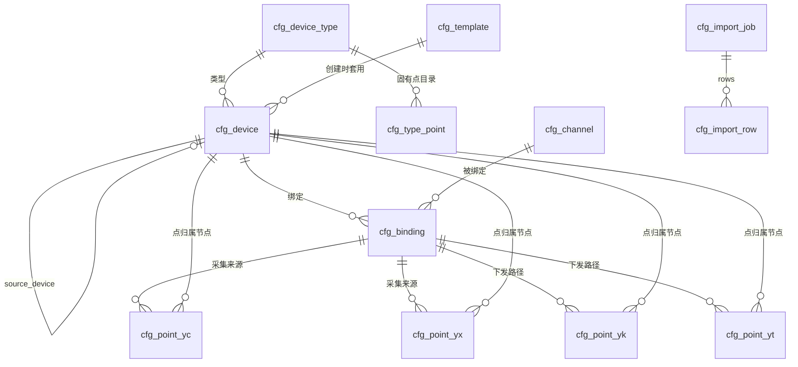

# 设备管理数据库表设计

> 日期：2026-10-24｜状态：表结构已落为 `003` 迁移，仓储已实现，Web 接口待实现
> 依据：`.pen/device_manage.pen` 全部 9 个页面、[公共模型设计](../design)、[实时访问接口设计](../realtime/access-design)
> 迁移：`backend/data/migrations/003_device_management_mysql.sql` + `backend/data/seeds/device_management_seed.sql`（旧 42 表设计已被本设计取代，脚本原地改写）

## 0. 本次重构结论

| 问题 | 前版做法 | 本文做法 |
| --- | --- | --- |
| 资产与设备两套概念 | `cfg_asset` + `cfg_device` 双主键，部件点还要 `device_id NULL` | 只有一张 `cfg_device` 设备树，`node_kind` 区分组织节点与设备节点 |
| 四遥被拆散 | `point_kind=telemetry/status/event/command`，遥调并入 command | `cfg_point_yc/yx/yk/yt` 四张表，代码对应 `YcPoint/YxPoint/YkPoint/YtPoint` 四类 |
| 一个物理量写三张表 | 厂家点 + 标准点 + 路由 + 转换 | 每类一张表：`semantic_code` 为空即扩展点，转换/命令/反馈内联为列 |
| 派生状态建表 | 固有点三态、能力、地址占用各建表 | 三态由点行推出；能力由 `capability_codes_json` 聚合；地址区间保存时即时计算 |
| 版本体系 | `cfg_version` + 草稿/复制/发布/快照/回执/差异 | **开发阶段不需要版本**：表可原地改，保存即生效，热加载靠站根 `config_revision` |

**表数：14。**

## 1. 目标与边界

**范围内**

- 一棵设备树：站 → 储能单元 → 通信设备 → 部件（电池系统/簇/包/电芯），以及站级公共设备。
- 设备类型、固有点目录（四遥）、型号模板复用。
- 通道（连接）与设备-通道绑定，采集/控制/转发角色。
- 四遥点：协议地址、取值转换、命令写入规则、反馈判据、固有点映射。
- 点表导入（逐行预览、地址基准、逐项确认、幂等重放）。
- 配置保存后热加载：`config_revision` 单调递增，消费者轮询比对。
- 与实时库配套的 5 分钟通信统计、设备/通道状态变化历史。

**范围外**

- 历史数据（TDengine 超级表，见 `002_storage_taos.sql`）与告警业务表。
- 用户、角色、操作审计：归统一审计/权限模块，本设计不建 `audit_log`。
- 北向转发映射（原 `cfg_forward_map`）：归通信管理模块，等该模块设计确认后再建表。
- 采集驱动、策略算法、控制仲裁本身的行为。
- 旧四遥表删除：过渡期保留只读，按第 9 节迁移。

## 2. 三个核心约定

### 2.1 只有设备，没有资产

设计图上不存在“资产”入口，也没有“资产详情”页面。因此删除 `cfg_asset`、`cfg_ess_unit`，不再有 `asset_id`/`asset_type`/`asset_path`：

| `node_kind` | 含义 | 能否绑通道 | 能否挂点 | 页面表现 |
| --- | --- | --- | --- | --- |
| `station` | 站根节点，全树唯一；承载站点级默认值 | 否 | 否 | 层级树根 |
| `unit` | 储能单元 | 否 | 否 | “储能单元 01 · 12 项” |
| `device` | 通信设备（PCS/BMS/空调/消防/电表/保护/环控） | 是 | 是 | 有“通道绑定”“点表导入”页签 |
| `component` | 部件（电池系统/簇/包/电芯） | 否 | 是 | 类型列显示“层级”，详情显示“经 bms01 采集” |

- 部件节点不能自己通信，`source_device_id` 指向采集它的通信设备，正是页面 08 的 `bms01 → rack01`。
- `device_id` 是文本稳定 ID，跨重复导入不变；数字自增主键只用于连接，不对外。
- 站点级默认值放在站根行：`timezone`、`default_stale_after_ms`、`config_revision`。不单独建 `cfg_scope`。

### 2.2 四遥是点的唯一分类，四张表 + 四个类型

| 表 | C++ 类型 | 语义 | 特有字段 |
| --- | --- | --- | --- |
| `cfg_point_yc` | `model::YcPoint` | 遥测（上行模拟量） | 倍率、偏移、量程、死区 |
| `cfg_point_yx` | `model::YxPoint` | 遥信（上行离散量，含 SOE） | `soe`、`invert`、枚举码表 |
| `cfg_point_yk` | `model::YkPoint` | 遥控（下行离散量） | `write_mode`、固定值、脉冲、写组 |
| `cfg_point_yt` | `model::YtPoint` | 遥调（下行模拟设定） | 工程值换算、可写量程、写组 |

- 方向由表决定，不存在 `access_mode` 列，因此不会有“遥测点可写”这种数据。
- 遥信变位/事件顺序记录不是第五类：仍属遥信，用 `soe` 标记，告警业务另表处理。
- 页面 05 的分页签是“遥测/遥信/遥控/遥调”；原来的“事件 N”归入遥信并显示 SOE 角标。
- 固有点目录 `cfg_type_point` 仍是一张表：四种类型的目录字段完全同构，拆开只是复制四份；能力归属用 `capability_codes_json` 表达多对多。

**代码侧与表一一对应**：

- 四个类型共享 `model::PointBase`（点 ID、设备节点、编码、名称、四遥分类、记录种类、值类型、单位、启用、反馈引用），基类构造函数 protected，只有四个具体类型能创建，`point_type` 与 `kind` 不可能不自洽。
- `ModelCatalog` 持有 `points_yc/points_yx/points_yk/points_yt` 四个集合，`for_each_point` 遍历，`find_point` 返回 `const PointBase*`；索引存“类型 + 下标”，目录拷贝后索引仍有效。
- 运行目录 `RuntimePoint` 保持单一结构但带 `point_type`：实时记录对四遥是同构的（值、质量、序号、时间），拆开只会让 `findPoint` 返回变体。

### 2.3 直接改工程表，不做版本

开发阶段配置还在反复调整，不需要草稿/发布/快照/回滚。约定：

- 页面“保存”直接 `INSERT/UPDATE/DELETE` 工程表，事务提交即生效。
- 每次保存成功后，站根 `cfg_device.config_revision + 1`（同一事务内）。采集、策略、实时库等消费者按固定周期读该值，发现变化就重编运行目录并热切换，不重启进程。
- `config_revision` 是缓存失效令牌，不是业务版本号：不提供历史查询、差异对比、回滚到旧版本。需要追溯时查统一审计日志。
- 页面 06 从“发布 v13 / 差异预览 / 应用回执”收敛为“保存校验结果 + 各服务已加载的 revision”：校验不通过拒绝保存，不再有“草稿不影响运行”的状态。

## 3. 与设计图页面的对应

| 设计页面 | 页面要求 | 承载表 |
| --- | --- | --- |
| 01 层级总览 | 站→单元→设备/部件；设备与部件同列表；固有点覆盖率、最近通信 | `cfg_device`、`cfg_type_point`、`cfg_point_*`、`ops_comm_stat_5m`、`ops_state_log` |
| 02 设备详情 | 档案、所属单元、父级节点、设备能力、接入诊断 | `cfg_device`、`cfg_device_type`、`cfg_type_point`、`cfg_point_*` |
| 03 通道绑定 | 同设备多绑定、采集/控制角色、协议/Profile、Unit ID、5 分钟健康度 | `cfg_channel`、`cfg_binding`、`ops_comm_stat_5m` |
| 04 点表导入 | 地址基准、逐行预览、目标节点、地址冲突逐项确认 | `cfg_import_job`、`cfg_import_row`、`cfg_point_*`、`cfg_binding` |
| 05 固有点位 | 四遥分页、启用/禁用、厂家来源、转换/写入、反馈规则 | `cfg_type_point`、`cfg_point_*`、`cfg_device_type` |
| 06 配置校验 | 保存前离线校验、地址冲突、服务热加载状态 | 各配置表 + 站根 `config_revision` |
| 07 新建设备 | 节点性质（通信设备/层级节点）、父级、类型、模板 | `cfg_device`、`cfg_device_type`、`cfg_template` |
| 08 层级详情 | 部件概况、子节点列表、采集来源、pack/cell 固有点 | `cfg_device`、`cfg_point_*`、`cfg_binding` |
| 09 规范页 | code 唯一、层级上限、禁用必须说明、地址不重叠 | 唯一键与 CHECK |

页面 07 的“节点性质”直接落为 `node_kind`：选“层级节点”即 `component`，必须选父级并指定采集设备；选“通信设备”即 `device`，保存后才出现通道绑定入口。

## 4. 表总览（14 张）

| 域 | 表 | 说明 |
| --- | --- | --- |
| 设备 | `cfg_device` | 设备树（站/单元/设备/部件）+ 站点默认值与 `config_revision` |
| 设备 | `cfg_device_type` | 设备类型（复合主键含类型版本） |
| 设备 | `cfg_type_point` | 类型固有点目录（四遥 + 能力编码数组） |
| 设备 | `cfg_template` | 型号模板（默认四遥点表，`points_json`） |
| 通道 | `cfg_channel` | 通道/连接（同一行被多次绑定即共享） |
| 通道 | `cfg_binding` | 设备-通道绑定与角色标志 |
| 点 | `cfg_point_yc` | 遥测：倍率、量程、死区 |
| 点 | `cfg_point_yx` | 遥信：SOE、取反、码表 |
| 点 | `cfg_point_yk` | 遥控：固定值、脉冲、写组、反馈判据 |
| 点 | `cfg_point_yt` | 遥调：工程值换算、可写量程、反馈判据 |
| 导入 | `cfg_import_job` | 导入任务与幂等键 |
| 导入 | `cfg_import_row` | 逐行解析与逐项确认 |
| 运行 | `ops_comm_stat_5m` | 绑定维度 5 分钟通信统计 |
| 运行 | `ops_state_log` | 设备/通道/绑定状态变化历史 |

## 5. 逻辑模型



要点：

- `cfg_device` 自引用成树，根 `parent_device_id` 为空串且 `node_kind='station'`，深度 ≤ 8（与实时库 `RecordKey.device_path` 上限一致）。
- 四张点表都同时挂两个维度：`owner_device_id`（点归属节点，可以是部件）+ `binding_id`（实际采集来源）。部件点因此不需要虚构通信设备，也不需要路由表。
- 一个设备可有多条绑定（采集口与控制口分开），但同一设备+同一通道只允许一行；采集/控制/转发用标志位表达。

## 6. 核心表字段语义

完整列定义以 `003` 迁移为准，这里只写有决策含义的字段。

### 6.1 `cfg_device`（设备树）

| 字段 | 说明 |
| --- | --- |
| `device_id` | 稳定设备 ID，全树唯一 |
| `parent_device_id` | 父节点；站根为空串（不用 NULL，唯一键才能约束根节点） |
| `node_kind` | `station/unit/device/component` |
| `code` | 同父节点下唯一 |
| `path` | 相对站根的路径，如 `/unit01/battery01/rack01`；实时库记录键的来源 |
| `depth` | 0–8，CHECK 约束 |
| `device_type_code/type_version` | 类型引用；`device/component` 必填，站与单元为空 |
| `template_id` | 创建时套用的型号模板，仅记录来源 |
| `source_device_id` | `component` 必填，指向采集它的通信设备 |
| `vendor/model/firmware_version/rated_power_kw` | 设备档案字段 |
| `timezone/default_stale_after_ms/config_revision` | **仅站根使用**：时区、点默认时效、热加载令牌 |
| `enabled` | 配置启用，与运行在线状态无关 |
| `legacy_ref` | 旧四遥表数字 ID |

唯一键：`(device_id)`、`(parent_device_id, code)`、`(path)`。

### 6.2 `cfg_device_type`（设备类型）

`(type_code, type_version)` 复合主键，如 `pcs` + `pcs-v1`；`category` 供页面分组；`status` 支持停用。不随设备复制。

### 6.3 `cfg_type_point`（类型固有点目录）

| 字段 | 说明 |
| --- | --- |
| `(type_code, type_version, semantic_code)` | 主键；如 `active_power`、`run_state`、`start` |
| `point_type` | `yc/yx/yk/yt`，决定映射行必须落在哪张点表 |
| `value_type/unit` | 与实例比对，不一致拒绝保存 |
| `required` | 属于任一能力即为必需；必需固有点未映射时阻止保存 |
| `capability_codes_json` | 所属能力数组，如 `["monitor_power","set_active_power"]` |
| `writable` | 仅 `yk/yt` 允许为真，CHECK 约束 |
| `stale_after_ms` | 0 表示继承站默认 |

**能力不单独建表**，页面 02 的能力状态由固有点聚合：

| 页面状态 | 判定 |
| --- | --- |
| 可用 | `capability_codes_json` 含该能力的全部 `required=1` 固有点均为“已启用” |
| 不可用 | 任一必需固有点为“已禁用”，展示其 `disabled_reason` |
| 未配置 | 存在必需固有点没有任何映射行 |

### 6.4 `cfg_template`（型号模板）

`(template_id, template_version)` 主键，`points_json` 保存默认四遥点表与映射。模板是“复制源”，不参与运行期联表，所以用 JSON 一次存全。套用模板时由服务按固有点类型生成对应点表的行；模板里的地址只是建议值，绑定通道不同需重填。

### 6.5 `cfg_channel`（通道）

`channel_id` 稳定 ID，`code` 唯一；`protocol` + `conn_mode` + `endpoint` + `serial_json` 描述连接；`poll_interval_ms/timeout_ms/retry_times` 是采集参数；`max_sessions` 表达共享连接上限。

**共享通信资源不单独建表**：一条通道就是一条物理连接，多个设备绑同一通道即共享，绑定表已能回答“谁在共用”。

### 6.6 `cfg_binding`（设备-通道绑定）

| 字段 | 说明 |
| --- | --- |
| `binding_id` | 稳定绑定 ID，`ops_comm_stat_5m` 的统计维度 |
| `device_id` + `channel_id` | 联合唯一 |
| `device_address` | Unit ID / 公共地址 / 从站号 |
| `profile_version` | 协议 Profile，如 `mbtcp-v3` |
| `can_collect/can_control/can_forward` | 角色标志，三者至少一个，CHECK 约束 |
| `enabled` | 绑定级开关 |

页面 03 的“主采集 · ch01”“控制下发 · ch01”两行是**同一绑定的两个角色视图**，不再按角色重复建行。采集与控制若走不同连接，绑两条不同通道即可。

### 6.7 四遥点公共列

四张表前 17 列同义：

| 字段 | 说明 |
| --- | --- |
| `point_id` | 稳定点 ID；四表之间也全局唯一（服务校验，单表唯一键表达不了） |
| `owner_device_id` | 点归属节点；部件点填 rack/pack/cell |
| `binding_id` | 实际采集来源绑定；部件点填 BMS 的绑定 |
| `code/name` | 业务编码与显示名；`code` 同归属节点唯一 |
| `semantic_code` | 非空=固有点映射；空=厂家扩展点（只采集诊断） |
| `vendor_key` | 厂家点稳定键，重复导入据此更新；`(binding_id, vendor_key)` 唯一 |
| `origin` | `type/template/vendor/component` |
| `address_space/address_offset/bit_offset/register_count` | Modbus 地址；非寄存器协议为空 |
| `protocol_address_json` | IEC104 `casdu/ioa`、DLT645 `data_id`、IEC61850 `object_ref` |
| `wire_type/byte_order` | 原始数据类型与字节序 |
| `enabled/disabled_reason` | 禁用必须有原因，CHECK 约束 |
| `stale_after_ms` | 0 表示继承站默认 |
| `source_import_row_id/legacy_ref` | 导入行追溯与旧表映射 |

协议取自 `cfg_binding → cfg_channel.protocol`，点表不重复存 `protocol`。

**空值语义**：`semantic_code`、`vendor_key` 用空串而非 NULL，唯一性靠函数索引 `NULLIF(col,'')`——“空”不参与唯一，同一设备可以有多条扩展点。这是为适配 ormpp 行映射（它只对算术类型清 NULL 值）而做的显式取舍。

### 6.8 `cfg_point_yc`（遥测）

| 字段 | 说明 |
| --- | --- |
| `value_type` | `double/int64/uint64`，CHECK 限定 |
| `scale_factor/offset_value` | 标准值 = 原始值 × scale + offset，`scale_factor <> 0` |
| `range_min/range_max` | 工程值量程，越限进 `OutOfRange` 质量 |
| `deadband` | 变化死区，0 表示逐点上报 |
| `unit/decimals` | 工程单位与显示精度 |

表上没有 `write_mode`、`pulse_width_ms`，从结构上排除“遥测点可写”。

### 6.9 `cfg_point_yx`（遥信）

| 字段 | 说明 |
| --- | --- |
| `value_type` | `bool`（单点）、`int64`（状态字）或 `string`（枚举标签） |
| `soe` | 记录变位；事件不是第五类遥，仍属遥信 |
| `invert` | 原始位取反（常闭接点） |
| `enum_json` | 码表 `[{raw,label,severity}]` |
| `unknown_policy` | `retain_raw/uncertain/invalid`，默认保留原码 |
| `feedback_of_point_id` | 反馈点指回遥控/遥调点 |

### 6.10 `cfg_point_yk`（遥控）与 `cfg_point_yt`（遥调）

| 字段 | YK | YT |
| --- | --- | --- |
| `value_type` | `bool/int64` | `double/int64` |
| `write_mode` | `fixed/direct` | 固定 `scaled`（不存列） |
| `fixed_raw_value` | `fixed` 模式必写 | — |
| `pulse_width_ms` | 脉冲宽度，0 表示保持 | — |
| `scale_factor/offset_value` | — | 原码 = (工程值 - offset) / scale |
| `range_min/range_max` | — | 可写工程值上下限 |
| `min_interval_ms` | 最小指令间隔 | 最小调节间隔 |
| `write_group_key` | 共享写寄存器组，同组互斥 | 同左 |
| `feedback_json` | 多判据 `[{point_code,criterion,expected,tolerance,order,required}]` | 同左 |
| `feedback_timeout_ms/failure_policy` | 反馈超时与失败策略 | 同左 |

遥信反馈点通过 `cfg_point_yx.feedback_of_point_id` 指回本表，或由 `feedback_json` 声明多判据；保存校验要求引用存在且指向命令点。

### 6.11 `cfg_import_job` / `cfg_import_row`

`cfg_import_job`：`import_job_id`、`device_id`、`binding_id`、`source_kind`、`file_name`、`file_sha256`、`address_base(zero/one)`、`idempotency_key`（`SHA-256(device|binding|sha256)`，唯一）、`status(parsed/confirmed/applied/failed)`、行数统计、提交人与时间。

`cfg_import_row`：逐行 `vendor_key/vendor_name`、`point_type`（决定写入哪张点表）、`target_device_path`（空即“目标节点缺失”）、`semantic_code`、地址与取值列、`parse_status/parse_code/parse_message`、`confirm_state(none/accepted/fixed/rejected)` 与确认留痕、`resolved_point_id`。

**地址冲突不落表**：保存/预览时按 `(binding_id, address_space)` 实时展开 `[offset, offset+register_count)` 求重叠。读-读允许；写-写仅当同一 `write_group_key` 才合法；读写交叉报错。冲突项写进对应 `import_row.parse_status='warning'` + `parse_code='address_overlap'`，用户逐项确认后 `confirm_state` 才有值；未确认的 warning 阻止保存。

### 6.12 `ops_comm_stat_5m` / `ops_state_log`

- `ops_comm_stat_5m`：`(binding_id, window_start)` 主键，请求/成功/超时/错误计数、平均与 p95 时延、最近有效数据时间。采集进程 5 分钟一窗，保留 30 天。
- `ops_state_log`：`object_kind(device/channel/binding)` + `object_id` + `state` + `since`，只在状态变化时写，保留 90 天。最新状态仍在实时库，本表只做追溯。

## 7. 关键流程

### 7.1 保存配置

```text
BEGIN;
  -- 1. 校验：字段合法性、四遥与表一致、固有点必需项已映射、地址区间不重叠
  -- 2. 直接写工程表（INSERT/UPDATE/DELETE），不做版本复制
  -- 3. 递增站根修订号，消费者据此热加载
  UPDATE cfg_device SET config_revision = config_revision + 1
   WHERE node_kind = 'station' AND device_id = ?;
COMMIT;
```

校验失败整事务回滚，页面展示逐项问题；没有“草稿”中间态。

### 7.2 热加载

```text
消费者（采集/策略/实时库）每 N 秒：
  SELECT config_revision FROM cfg_device WHERE node_kind='station' LIMIT 1;
  与内存中的已加载值比较：
    相同 -> 不做任何事
    不同 -> 重新编译运行目录 -> 校验通过后原子切换 -> 记录已加载 revision
```

运行目录构建失败时保留旧目录继续运行并上报告警，不部分生效。消费者读取配置的查询必须在一个事务内完成，避免读到“保存到一半”的中间状态。

### 7.3 重复导入与稳定身份

```text
1. 计算 idempotency_key；已存在则直接返回原任务。
2. 解析文件写 cfg_import_row，不写点表。
3. 目标节点按 path 匹配（禁止按重名）；未命中即 parse_status='error'。
4. 厂家点按 (binding_id, vendor_key) 命中 -> 复用 point_id 并 UPDATE；
   未命中 -> 分配新 point_id 并 INSERT。
5. 地址冲突逐项确认后写入点表，回填 resolved_point_id。
```

稳定身份只靠唯一键：`(path)`+`code`、`(binding_id, vendor_key)`、`(owner_device_id, semantic_code)`。

### 7.4 运行侧取点

```sql
-- 采集计划：遥测 + 遥信
SELECT p.*, 'yc' AS point_type FROM cfg_point_yc p
  JOIN cfg_binding b ON b.binding_id = p.binding_id
  JOIN cfg_channel c ON c.channel_id = b.channel_id
  JOIN cfg_device d  ON d.device_id  = p.owner_device_id
  JOIN cfg_device sd ON sd.device_id = d.source_device_id
 WHERE p.enabled=1 AND b.enabled=1 AND c.enabled=1
   AND d.enabled=1 AND (d.source_device_id='' OR sd.enabled=1)
UNION ALL
SELECT p.*, 'yx' FROM cfg_point_yx p /* 同构 JOIN */;

-- 控制能力：遥控 + 遥调，只取 can_control 的绑定
SELECT p.point_id FROM cfg_point_yk p JOIN cfg_binding b ON b.can_control=1 /* ... */;
SELECT p.point_id FROM cfg_point_yt p JOIN cfg_binding b ON b.can_control=1 /* ... */;
```

采集与控制取点集合天然分离：YK/YT 不会被误编进周期采集计划。

## 8. 不变量与校验分层

| 不变量 | 数据库保证 | 服务/保存校验 |
| --- | --- | --- |
| 设备 ID 全局唯一 | `uq_device_id` | — |
| 同父节点 code 唯一 | `uq_device_sibling` | — |
| 路径唯一且深度 ≤ 8 | `uq_device_path`、`ck_device_depth` | 无环、不跨站 |
| 部件必须有采集设备 | `ck_device_component` | 指向 `node_kind='device'` 且启用 |
| 同设备同通道单绑定 | `uq_binding_pair` | 角色至少一个（CHECK） |
| 点 code 同归属节点唯一 | 四表各 `uq_*_code` | — |
| 厂家点键同绑定唯一 | 四表各 `uq_*_vendor_key`（函数索引） | — |
| 固有点每设备仅一行 | 四表各 `uq_*_semantic`（函数索引） | — |
| 点 ID 跨四表唯一 | 单表唯一键表达不了 | 保存前按 `point_id` 合并去重 |
| 遥控固定值必须有写入值 | `fixed_raw_value NOT NULL` | 保存前按 `write_mode` 校验 |
| 遥测/遥调倍率非零 | `ck_yc_scale`、`ck_yt_scale` | — |
| 类型目录与实例类型一致 | — | 比对 `cfg_type_point.point_type` 与目标表 |
| 禁用必须说明 | 四表各 `ck_*_reason` | 页面逐项校验 |
| 必需固有点均已映射 | — | 保存校验（`required=1`） |
| 地址区间不重叠 | 无法用唯一键表达 | 保存校验 + 逐项确认 |

## 9. 旧四遥表迁移

| 旧表 | 新结构 | 规则 |
| --- | --- | --- |
| `device` | `cfg_device(node_kind='device')` | `group_id` 映射为父节点；旧 ID 写 `legacy_ref`；另建一行站根与单元节点 |
| `channel` | `cfg_channel` + `cfg_binding` | 每通道一条；`device_id` 转成绑定，`rtu_addr` 转 `device_address` |
| `point_yc` | `cfg_point_yc` | `func_code/reg_addr/slave_id` → 地址列；`mul_coe/add_coe` → 倍率偏移；`min/max_limit` → 量程 |
| `point_yx` | `cfg_point_yx` | `bit` → `bit_offset`；`reverse_flag` → `invert` |
| `point_yk` | `cfg_point_yk` | `command_type` → `write_mode`；`related_yx_id` → 反馈点 `feedback_of_point_id` |
| `point_yt` | `cfg_point_yt` | `write_mode` 固定 `scaled`；`related_yc_id` → `feedback_json` 首条判据 |

迁移期间旧表只读；采集切到新结构后保留一个验证周期再下线。`ems_point_import` 工具改为按类型写四张点表。

## 10. 与实时库的契约

实时库不读 `cfg_*`，只接收配置服务编译出的运行目录（`runtime_catalog.h`）：

| 配置字段 | 运行目录字段 | 使用方式 |
| --- | --- | --- |
| `cfg_device.path` | `PointAddress.device_path` | 组成 `RecordKey`，最多 8 级 |
| 四张点表的 `point_id/code/value_type/unit` | `RuntimePoint` | 类型校验与快照返回 |
| 点所在表（`cfg_point_yc/yx/yk/yt`） | `RuntimePoint.point_type` | `YC/YX/YK/YT`；控制侧据此区分“固定值写入”与“工程值缩放写入” |
| `point_type` 映射 | `RuntimePoint.kind` | `YC→Telemetry`、`YX→Status`、`YK/YT→Command` |
| 四表 `stale_after_ms` / 站根 `default_stale_after_ms` | `RuntimePoint.stale_after_ms` | 计算 `stale`，不删除最后值 |
| 点/绑定/通道/设备 `enabled` | 目录是否包含该点 | 禁用项不进入采集计划 |
| 站根 `config_revision` | `RuntimeCatalog::configVersion()` | 转成文本如 `r37`，拒绝旧 revision 样本 |
| `cfg_binding.binding_id` | 来源标识 | 样本来源判定 |

`RuntimePoint.point_type` 与 `PointSnapshot.point_type` 已在代码中落地（`common/model/point.h`、`rtdb/model/runtime_catalog.h`、`rtdb/client/realtime_service.h`）。

## 11. 实施顺序与验收

| 阶段 | 内容 | 验收 |
| --- | --- | --- |
| 1 | 执行 `003` 迁移与种子 | 空库可重复执行；`SHOW CREATE TABLE` 无隐式截断；种子幂等 |
| 2 | 配置仓储：整树读取、CRUD、递增 `config_revision` | 保存后 revision +1；校验失败整事务回滚 |
| 3 | 设备树与通道绑定 | 四类节点可建；部件必须指定采集设备；部件点可归属 rack/pack/cell |
| 4 | 点表导入与固有点映射 | 重复文件返回同一任务；目标节点按 path 匹配；四遥分类正确 |
| 5 | 地址冲突与逐项确认 | 重叠区间必须逐项确认；同 `write_group_key` 的写区间不报错 |
| 6 | 热加载与运行统计 | 消费者 revision 变化后重建目录；5 分钟成功率、平均时延可查 |

**改名连带修改**：本文重写时已同步 `runtime_catalog.h` 的表名与措辞注释、`realtime/service-design.md` 的旧表引用。仍需随实现同步：Web 接口与热加载消费端。

## 附录 A：枚举字典

| 枚举 | 取值 |
| --- | --- |
| `cfg_device.node_kind` | `station`、`unit`、`device`、`component` |
| `cfg_device_type.category` | `pcs`、`bms`、`hvac`、`env`、`fire`、`meter`、`relay`、`battery`、`rack`、`pack`、`cell` |
| `cfg_type_point.point_type` | `yc`（遥测）、`yx`（遥信）、`yk`（遥控）、`yt`（遥调） |
| 点表类型 | 由表名决定：`cfg_point_yc/yx/yk/yt`，不存列 |
| `cfg_point_yc`.value_type | `double`、`int64`、`uint64` |
| `cfg_point_yx`.value_type | `bool`、`int64`、`string` |
| `cfg_point_yk`.value_type | `bool`、`int64` |
| `cfg_point_yt`.value_type | `double`、`int64` |
| `cfg_point_yk.write_mode` | `fixed`、`direct`（遥调固定 `scaled`，不存列） |
| 四表 `unknown_policy`（YX/YC 使用） | `retain_raw`、`uncertain`、`invalid` |
| 四表 `address_space` | `coil`、`discrete_input`、`input_register`、`holding_register` |
| `cfg_point_yk/yt.failure_policy` | `reject`、`retry`、`escalate` |
| `cfg_import_job.status` | `parsed`、`confirmed`、`applied`、`failed` |
| `cfg_import_row.confirm_state` | `none`、`accepted`、`fixed`、`rejected` |
| `ops_state_log.object_kind` | `device`、`channel`、`binding` |
| 运行设备状态 | `unconfigured`、`online`、`alarm`、`fault`、`offline`（实时库字符串，不入配置表） |

## 附录 B：删除表对照

| 前版表 | 去向 |
| --- | --- |
| `cfg_asset` / `cfg_ess_unit` | 并入 `cfg_device`（`node_kind` 与站根字段） |
| `cfg_scope` / `cfg_version` / `cfg_version_snapshot` / `cfg_scope_active` / `cfg_apply_receipt` / `cfg_validation_finding` | **全部去掉**：不做配置版本，改为站根 `config_revision` + 保存前校验 |
| `cfg_device_type_version` | 并入 `cfg_device_type` 复合主键 |
| `cfg_standard_point_def` / `cfg_capability_def` / `cfg_capability_requirement` | `cfg_type_point`（`capability_codes_json`） |
| `cfg_model_template` / `_version` / `cfg_template_point` | `cfg_template`（`points_json`） |
| `cfg_connection_resource` | `cfg_channel`（同一行被多次绑定即共享） |
| `cfg_binding_operation` | `cfg_binding.can_collect/can_control/can_forward` |
| `cfg_device_standard_point` | 由四张点表的行状态推出三态 |
| `cfg_vendor_point` / `cfg_point_route` | 并入 `cfg_point_yc/yx/yk/yt`（`semantic_code` 空即扩展点） |
| `cfg_value_conversion` / `cfg_enum_set` / `cfg_enum_item` | 内联为点表列与 `enum_json` |
| `cfg_command_rule` / `cfg_command_write_group` / `cfg_command_feedback` | 内联为 YK/YT 的写入列、`write_group_key`、`feedback_json` |
| `cfg_forward_map` | 移出本文，归通信管理模块 |
| `cfg_address_occupancy` / `cfg_address_confirmation` | 保存前即时计算 + `cfg_import_row.confirm_*` |
| `cfg_identity_binding` / `cfg_legacy_link` | 唯一键 + `legacy_ref` |
| `cfg_change_audit` | 统一审计模块（`audit_log`） |
| `ops_device_state_log` / `ops_channel_state_log` | `ops_state_log`（`object_kind`） |

## 附录 C：仍在权衡的点

1. **固有点目录仍是单表**：`cfg_type_point` 四种类型字段完全同构，拆四张只会复制结构，且“按能力取必需固有点”要 UNION 四次。若后续出现类型专有字段（如 YK 默认固定值、YC 默认量程），再拆。
2. **运行目录不拆四类**：实时记录结构对四遥同构，拆 `RuntimePoint` 会让 `findPoint` 返回变体、快照构造分四份，收益仅为省一个 `point_type` 字段。当前用 `point_type` 标记，控制侧仍能区分 YK/YT。
3. **一期不支持同点多通道冗余**：双网采集若要在一期支持，需要“点多来源”，代价是重新引入路由表。当前按“两条点 + 上层择优”处理。
4. **不做配置历史**：直接改表意味着过期配置不可回放。若投运后需要审计级追溯，再引入版本或影子表；开发阶段以审计日志记录“谁在何时改了什么”即可。
