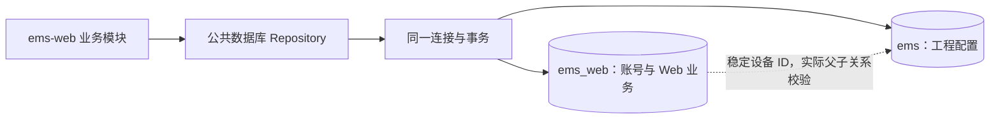

# EMS Web 数据库与表设计

> 日期：2026-10-30｜状态：独立 SQLAlchemy 模型、初始化迁移和策略种子已实现；生产数据库部署、C++ 持久化身份服务与真实 MySQL 联调待完成。
> 关联：[用户管理与角色权限](../../processes/web/user/index.md) · [登录设计](../../processes/web/user/login.md) · [公共数据库访问层](index.md)。

Web 账号、授权、会话、登录策略和 Web 操作审计使用独立的 **`ems_web` 数据库，共 5 张表**。设备配置继续使用现有工程库 `ems`，不复制设备树、通道或四遥数据。

## 1. 数据库划分

| 数据库 | 保存内容 | 写入责任 |
| --- | --- | --- |
| `ems_web` | 用户、设备授权范围、登录会话、登录保护策略、Web 操作审计 | Web 业务模块通过公共 Repository 写入 |
| `ems` | 现有设备、通道、绑定、四遥、模板、导入任务等工程数据 | 继续使用现有配置 Repository |
| 历史与实时存储 | 历史时序、实时值和运行状态 | 继续使用对应公共接口，不迁入 `ems_web` |

两个 MySQL 库部署在**同一个 MySQL 实例**，业务表使用 InnoDB。独立数据库用于划分业务数据，不增加数据库代理或分布式事务。



- Web 继续复用公共数据库层的一套 MySQL 连接池，默认库保持现有工程库；身份和审计 Repository 使用固定的 `ems_web.表名`。不使用请求参数拼接库名、表名，也不在连接借还时执行 `USE` 切库。
- 配置修改需要身份校验及操作审计时，`ems_web` 与 `ems` 的读写必须使用同一条连接、同一个事务；两个独立连接各自提交不具备原子性。
- 当前公共实现仍以单库工程配置为主，实施时需补齐公共 Repository 内的库限定查询、身份行锁和就绪检查；本文不表示这些能力已经实现。
- Web 用户保存不修改设备站根 `config_revision`；设备配置保存仍按原规则递增。账号和策略不引入配置版本、发布或回滚机制。

## 2. 表清单与公共约定

| 表 | 用途 | 主要关联 |
| --- | --- | --- |
| `auth_user` | 账号、密码哈希、角色与账号状态 | 一个用户对应多个范围和会话 |
| `auth_user_scope` | 用户可访问的站或设备子树 | 关联用户；逻辑引用工程库的设备 ID |
| `auth_session` | 完整会话和首次改密受限会话 | 关联用户 |
| `auth_login_policy` | 全实例唯一的登录保护策略 | 固定一行，同时承担管理员管理事务的串行锁 |
| `audit_log` | Web 登录、安全管理及业务操作审计 | 记录操作主体、目标和结果 |

三种固定角色直接保存为 `auth_user.role_code`，权限集合由代码集中定义。不建角色表、权限表、菜单授权表或用户角色关联表；首次改密和失败锁定也不拆表。

| 项目 | 约定 |
| --- | --- |
| 字符与比较 | 展示文本使用 `utf8mb4`；稳定 ID、用户名和令牌使用区分大小写的二进制排序规则 |
| 内部主键 | 多行表统一使用 `BIGINT UNSIGNED AUTO_INCREMENT` 的 `id`；策略表固定 `id=1` |
| 对外 ID | 用户、会话和审计事件分别使用服务端生成的稳定字符串 ID，字段为 `VARCHAR(64)`；内部自增 ID 不作为 API 身份 |
| 用户名 | 4～64 位 ASCII，首位字母，允许数字、下划线、点和连字符；先转小写再校验唯一性 |
| 时间 | `DATETIME(3)`，由服务端写入 UTC；API 转为 UTC RFC 3339，不依赖数据库服务器本地时区 |
| 枚举 | 下文列出的固定值使用 MySQL `ENUM`；布尔值为 `TINYINT UNSIGNED`，限制为 0 或 1 |
| 可空与默认 | 表格中的 `NULL` 表示允许空；“必填”表示写入时必须提供；不为未知数据填写伪造值 |
| 更新 | 业务 Service 显式设置时间并提交事务；不依赖触发器或启动时自动补数据 |

## 3. 表结构

### 3.1 `auth_user`：用户账号

一个用户一行，认证和管理所需字段集中保存。

| 字段 | 类型 | 默认 / 可空 | 含义 |
| --- | --- | --- | --- |
| `id` | BIGINT UNSIGNED | 自增主键 | 内部行 ID |
| `user_id` | VARCHAR(64) | 必填，唯一 | 稳定用户 ID，删除后不复用 |
| `username` | VARCHAR(64) | 必填，唯一 | 归一化后的用户名，创建后不可修改 |
| `display_name` | VARCHAR(64) | 必填 | 姓名，去首尾空白后为 1～64 个字符 |
| `password_hash` | VARCHAR(255) | 必填 | 编码后的密码哈希，包含算法、盐和成本，不保存明文 |
| `role_code` | ENUM | `observer` | `admin` / `operator` / `observer` |
| `status` | ENUM | `disabled` | `enabled` / `disabled` / `deleted` |
| `scope_mode` | ENUM | `selected` | `all` / `selected`；all 仅管理员可持有 |
| `must_change_password` | TINYINT UNSIGNED | `1` | 创建或重置后必须修改临时密码 |
| `temporary_password_expires_at` | DATETIME(3) | NULL | 临时密码期限；必须改密时必填，默认设置为创建/重置后 24 小时 |
| `failed_attempts` | TINYINT UNSIGNED | `0` | 连续失败次数，达到当前阈值后锁定；锁定期间不继续累加 |
| `locked_until` | DATETIME(3) | NULL | 临时锁定期限，与账号停用独立 |
| `password_changed_at` | DATETIME(3) | NULL | 最近设置个人密码或重置密码的时间；初次创建临时密码时可空 |
| `created_at` | DATETIME(3) | 必填 | 创建时间 |
| `updated_at` | DATETIME(3) | 必填 | 资料、授权或安全管理变更时间；普通登录不更新 |
| `last_login_at` | DATETIME(3) | NULL | 最近成功登录时间；失败登录不更新 |
| `deleted_at` | DATETIME(3) | NULL | 逻辑删除时间，status=deleted 时必填 |

约束和索引：

- 主键 `id`；唯一键 `user_id`、`username`。已删除账号继续占用用户名。
- 查询索引 `(status, role_code)` 与 `(created_at, user_id)`，分别支持筛选和默认稳定分页；首期关键词按有界模糊查询处理，不建全文检索表。
- `scope_mode=all` 要求 `role_code=admin`；`must_change_password=1` 要求临时密码期限非空，完成改密后同时清空期限；`status` 与 `deleted_at` 保持一致。
- 行内约束使用 `CHECK`，跨行规则由事务处理。必须始终保留至少一个 enabled 管理员，不允许用普通查询后无锁更新来实现这一规则。
- 密码哈希只在内部认证记录中使用，用户列表、详情、导出和审计均不得返回。

### 3.2 `auth_user_scope`：设备授权范围

每行表示一个授权根。`selected` 模式将所有行取并集；`all` 模式不保存范围行。空列表表示无设备权限，不影响用户维护个人资料。

| 字段 | 类型 | 默认 / 可空 | 含义 |
| --- | --- | --- | --- |
| `id` | BIGINT UNSIGNED | 自增主键 | 内部行 ID |
| `user_id` | VARCHAR(64) | 必填 | 关联 auth_user.user_id |
| `station_id` | VARCHAR(64) | 必填 | 逻辑引用 ems.cfg_device.device_id，节点必须为 station |
| `device_root_id` | VARCHAR(64) | `''`，非空 | 空串表示整个站；非空表示站内设备子树，包含该根及全部后代 |

约束和索引：

- 主键 `id`；唯一键 `(user_id, station_id, device_root_id)`，同时支持按用户读取。
- `user_id` 建本库外键，物理删除限制为 RESTRICT；业务逻辑删除用户时显式删除其范围行。
- **API 中整站仍使用 `device_root_id=null`**；Repository 在入库时转换为 `''`，出库时转回 null。这样不增加生成列，也能通过唯一键防止重复整站授权。
- 不跨库建立设备外键。保存时从 `ems.cfg_device` 校验站、根和实际父链；读取时重新计算有效范围。根被删除后失效，不自动扩大到父节点。
- 整站与子树重叠、父子授权重叠时仅保留最上层授权根；整批替换在锁定用户的事务内完成。每用户最多保存 200 个规范化范围。

例如，API 的 `{"station_id":"ess000001","device_root_id":null}` 保存为 `(user_id, 'ess000001', '')`；对子树 `unit01` 的授权保存为 `(user_id, 'ess000001', 'unit01')`。不复制设备名称、路径或子设备列表。

### 3.3 `auth_session`：登录会话

同一张表保存完整与首次改密受限会话。浏览器持有 Cookie 原值，数据库只保存其 SHA-256 摘要。

| 字段 | 类型 | 默认 / 可空 | 含义 |
| --- | --- | --- | --- |
| `id` | BIGINT UNSIGNED | 自增主键 | 内部行 ID |
| `session_id` | VARCHAR(64) | 必填，唯一 | 会话管理用 ID，不能作为登录凭证 |
| `user_id` | VARCHAR(64) | 必填 | 关联 auth_user.user_id |
| `kind` | ENUM | 必填 | `full` / `password_change` |
| `token_hash` | BINARY(32) | 必填，唯一 | 高熵 Cookie 的 SHA-256 摘要，不存 Cookie 原值 |
| `csrf_token` | CHAR(43) | 必填 | 32 随机字节的无填充 base64url 值；仅在认证成功或受保护会话响应中交给前端 |
| `created_at` | DATETIME(3) | 必填 | 会话创建时间 |
| `auth_time` | DATETIME(3) | 必填 | 最近密码认证时间，敏感操作要求 5 分钟内认证 |
| `last_interactive_at` | DATETIME(3) | 必填 | 最近有效用户交互时间，轮询不续期 |
| `absolute_expires_at` | DATETIME(3) | 必填 | 完整会话创建后 8 小时；受限会话创建后 5 分钟 |
| `revoked_at` | DATETIME(3) | NULL | 撤销时间；空值不等于会话一定有效 |
| `revoke_reason` | VARCHAR(32) | NULL | 如 logout、password_changed、access_changed、user_disabled、session_limit |
| `source_ip` | VARCHAR(45) | NULL | 规范化 IP；仅信任已配置代理提供的来源 |
| `user_agent` | VARCHAR(256) | `''` | 去控制字符并截断的客户端信息，仅供展示 |

约束和索引：

- 主键 `id`；唯一键 `session_id`、`token_hash`；`user_id` 建本库外键，物理删除限制为 RESTRICT。
- 查询索引 `(user_id, revoked_at, last_interactive_at)`，支持会话列表、批量撤销及最早活动会话选择；索引 `(absolute_expires_at)` 支持分批清理。
- 有效会话必须同时满足：未撤销、未超过绝对期限、未超过当前空闲期限、用户 enabled 且未删除；受限会话固定 5 分钟，不靠交互续期。
- 不存 `idle_expires_at`、角色或权限副本：空闲期限由当前策略计算，权限由当前用户和范围读取。会话响应中的这些字段均为计算结果。
- 同一用户最多 3 个有效完整会话；登录事务锁定用户后计数，必要时撤销最早活动会话，再插入新会话。
- 过期或撤销记录至少保留到绝对期限后 24 小时，再分批物理删除；永久审计不依赖会话行存续。

### 3.4 `auth_login_policy`：登录保护策略

只允许一行，`id=1`。管理员修改时原地 UPDATE，未提供的实例策略行视为部署未完成，不能静默采用宽松默认值。

| 字段 | 类型 | 默认 / 可空 | 含义 |
| --- | --- | --- | --- |
| `id` | TINYINT UNSIGNED | 主键，固定 `1` | 实例唯一策略行 |
| `failed_login_limit` | TINYINT UNSIGNED | `6` | 连续失败阈值，3～6 次 |
| `lock_minutes` | TINYINT UNSIGNED | `10` | 账号锁定时长，10～30 分钟 |
| `idle_timeout_minutes` | TINYINT UNSIGNED | `10` | 空闲超时，10～30 分钟 |
| `password_min_length` | TINYINT UNSIGNED | `12` | 密码最小长度，12～32 个字符；最大固定为 32 |
| `login_notice` | VARCHAR(500) | `''` | 登录页纯文本通知 |
| `updated_at` | DATETIME(3) | 必填 | 最近策略更新时间 |

- 对 `id=1` 及四个数值范围建立 `CHECK`，不增加其他索引。
- 完整会话 8 小时、受限会话 5 分钟、临时密码 24 小时、并发完整会话 3 个为当前固定业务规则，不为尚无配置入口的参数增加列。
- 该行也用作首管理员初始化、管理员数量保护和权限管理事务的串行锁：先 `SELECT ... FOR UPDATE` 锁定它，再锁用户。不再建立 `auth_security_guard` 表或增加锁编号、修订号列。
- 普通会话读取不需要独占锁定此行；登录与鉴权读取当前策略。来源 IP 限流仍由入口限流组件处理，不为请求计数单独建表。

### 3.5 `audit_log`：Web 操作审计

在 `ems_web` 中集中保存 Web 发起的认证、安全管理和业务变更事件，复用公共审计接口与事件语义；不在各 Web 模块重复建日志表。采集回执、控制生命周期和告警记录继续留在各自业务域，不在这里复制完整业务状态。

| 字段 | 类型 | 默认 / 可空 | 含义 |
| --- | --- | --- | --- |
| `id` | BIGINT UNSIGNED | 自增主键 | 内部行 ID |
| `event_id` | VARCHAR(64) | 必填，唯一 | 稳定事件 ID，用于审计去重和提交结果核对 |
| `actor_user_id` | VARCHAR(64) | NULL | 当前操作主体；未认证的登录失败或主机初始化可空 |
| `target_user_id` | VARCHAR(64) | NULL | 用户管理操作的目标用户 |
| `action` | VARCHAR(64) | 必填 | 稳定动作码，如 auth.login、user.create、user.set_access、device.update |
| `resource_type` | VARCHAR(32) | 必填 | user / session / login_policy / device 等资源类型 |
| `resource_id` | VARCHAR(128) | NULL | 目标稳定 ID；登录策略为 `1` |
| `outcome` | ENUM | 必填 | `success` / `failure` |
| `reason` | VARCHAR(64) | NULL | 稳定原因码，不直接保存数据库异常或完整报文 |
| `request_id` | VARCHAR(64) | 必填 | 请求关联 ID；主机命令同样生成关联 ID |
| `source_ip` | VARCHAR(45) | NULL | 请求来源；对外查询时脱敏 |
| `details` | JSON | NULL | 白名单字段的必要变更前后值或补充信息，大小受业务载荷上限约束 |
| `occurred_at` | DATETIME(3) | 必填 | 事件发生时间 |

约束和索引：

- 主键 `id`；唯一键 `event_id`；查询索引 `(occurred_at, id)`、`(actor_user_id, occurred_at)`、`(target_user_id, occurred_at)`。
- 不对用户或设备建立物理外键，避免审计受业务清理影响。稳定 ID 保留历史关联；用户逻辑删除不会级联删除审计。
- 记录登录成功/失败、锁定/解锁、首次改密、重置、用户及授权变更、会话撤销、策略修改、初始化与主机恢复，以及已实现的 Web 业务写操作。普通列表轮询不逐条写审计。
- 不记录密码、哈希、Cookie、CSRF 或完整认证请求。未知账号的失败事件仅记录原因与来源，不复制原始登录表单。`details` 不作为任意请求体的存档。
- 业务界面只提供授权查询，不提供编辑或删除入口；默认保留 180 天，由受限维护任务按时间和批次清理。

## 4. 事务与并发规则

### 4.1 账号与会话

| 用例 | 同一事务内完成 |
| --- | --- |
| 首管理员初始化 | 锁定策略行 → 确认从未创建过用户 → 创建 enabled 管理员并要求首次改密 → 记录审计 |
| 新建用户 | 锁定策略行及当前管理员 → 校验权限 → 新增用户及规范化范围 → 记录审计 |
| 角色/范围变更 | 锁定策略行及涉及用户 → 核验 edit_token、管理员数量和设备关系 → 更新角色并替换范围 → 撤销全部会话 → 记录审计 |
| 停用/删除 | 锁定策略行及涉及用户 → 最后管理员校验 → 修改状态，删除时清理范围 → 撤销全部会话 → 记录审计 |
| 改密/重置 | 核验当前认证及目标账号 → 更新哈希、首次改密标记与临时期限 → 撤销全部会话 → 记录审计 |
| 成功登录 | 锁定用户并复核认证相关字段 → 清理失败计数 → 控制完整会话数量 → 创建会话及更新时间 → 记录审计 |
| 登录失败/解锁 | 锁定已有用户 → 更新失败次数或锁定期限 → 记录失败/解锁事件；未知用户只写脱敏审计 |
| 登录策略变更 | 锁定策略行及当前管理员 → 核验权限与 edit_token → 更新策略 → 记录审计 |

密码派生在有界工作池执行，尽量不持锁；提交前锁定用户并重读认证字段，已被停用、改密或撤权时拒绝使用旧校验结果创建会话。账号暂时锁定不撤销此前合法会话；人工停用、删除和凭据/权限变更才撤销会话。

锁顺序统一为：**策略行（管理用例需要时）→ 涉及用户按内部 id 升序 → 会话 → 工程站根**。首次初始化依赖部署工具已写入的策略行，不靠锁定“空用户表”保证唯一。

授予站/设备范围时，按站 ID 固定顺序锁定涉及的工程站根，再校验当前设备关系；不允许在锁定站根后反向申请用户锁。

`edit_token` 由服务端对当前可编辑状态生成不可伪造摘要，更新时在行锁内重算比对。它不入库，不增加用户版本列；登录时间、失败计数等运行字段不参与摘要。策略使用同样规则。

### 4.2 工程配置与审计

配置、用户授权与审计能参与同一事务的前提是两库同实例、InnoDB、同连接。配置写入持有当前用户共享锁，复核完整会话、当前权限、资源范围后，再锁站根并保存。管理员撤权需要用户独占锁，因此按事务先后顺序生效。

```text
BEGIN
  校验并锁定 ems_web.auth_user / auth_session
  读取 ems_web.auth_user_scope，核对 ems.cfg_device 实际关系
  锁定 ems.cfg_device 站根，校验请求的 config_revision
  保存工程配置，递增站根 config_revision
  插入 ems_web.audit_log
COMMIT
```

上例是事务步骤，不是可直接执行的 SQL。任一步失败整体回滚；审计不可写不能先返回业务成功。已经鉴权的在途只读请求可完成，异步人工控制在执行前仍须重新授权。

提交结果不明确时返回 `effect=Unknown`，使用原用户 ID、唯一用户名、资源状态及稳定 event_id 重新核对，不自动重放重置密码或配置操作。两库分置不同实例不属于本期部署方案，不能把两个 COMMIT 当作本方案的替代实现。

## 5. 初始化、访问权限与验收

| 项目 | 规则 |
| --- | --- |
| 建库建表 | 两库共用 backend/python/database.yaml；使用 ems-db --database ems_web init，仅加载独立 Web 模型及迁移历史，不把工程模型建入该库。MySQL 空库由部署预先准备 |
| 初始数据 | 仅写 auth_login_policy 的 id=1 和默认策略，不预置任何账号、默认口令或会话 |
| 首个账号 | 一次性受控主机命令交互创建，只有 auth_user 从未有过记录时允许；不通过 Web 公开注册 |
| 运行连接 | 使用公共配置加载方式；Web 运行账号具备 ems_web 业务 DML 及所需 ems 配置权限，不授予建库、建表或授权权限 |
| 其他进程 | 不默认授予 Web 账号表权限；异步人工任务如需最终鉴权，仅按用例授予必要的公共身份只读能力 |
| 审计权限 | 业务运行仅追加/查询审计，不更新、删除；保留期清理由独立受限维护身份执行 |
| 就绪检查 | 验证工程库现有依赖、ems_web 5 表、唯一策略行及身份密钥；缺失返回 503，不自动建表或绕过身份校验 |
| 备份与恢复 | 两库按一致恢复点备份；恢复后统一撤销会话并重新校验授权根，避免设备关系与授权来自不同时间点 |

### Python 工具入口

工程库模型在 `backend/python/db/models/`，Web 库模型在 `backend/python/web_db/models/`；
二者各有独立的 `migrations/`、`tests/` 与种子入口，只共用连接配置和底层工具代码。
命令行 `--database` 同时选择目标库和模型集合，未指定时保留原工程库行为。

```bash
ems-db --database ems init
ems-db --database ems seed catalog
ems-db --database ems_web init
ems-db --database ems_web seed policy
ems-db --database ems_web check
```

`seed policy` 只在缺少时创建默认策略，不覆盖已有设置。两库的 `alembic_version` 分别存放于各自
数据库；新 Web 初始迁移不追加到工程库迁移链。SQLite 验证使用同目录的两个独立文件，
MySQL / PostgreSQL 仍使用各自独立数据库。当前验证覆盖 SQLite 实际建表与约束、三种方言的
DDL 编译，不等同于真实 MySQL / PostgreSQL 联调。实际命令及配置优先级见 `backend/python/README.md`。

落地时验证以下场景即可，不为尚未实现的扩展能力预建表：

1. 用户名唯一且逻辑删除后不复用；三种角色、默认停用和空范围语义正确。
2. 整站/子树授权去重，API null 与数据库空串正确转换；设备移动或删除后立即按新关系鉴权。
3. 首次改密、失败锁定、会话超时与撤销可跨重启/多 Web 实例生效，不从会话复制旧权限。
4. 并发初始化、最后管理员保护、范围替换和会话数量检查具备真实 MySQL 行锁保证。
5. 用同一连接验证两库业务与审计全部提交或全部回滚；审计失败、撤权竞态和提交结果未知不会绕过校验。

本设计不预建自定义角色、用户组、组织、菜单、密码历史、登录流水或通用键值配置等扩展表。后续新增 Web 业务时再按明确用例增加专用表。
