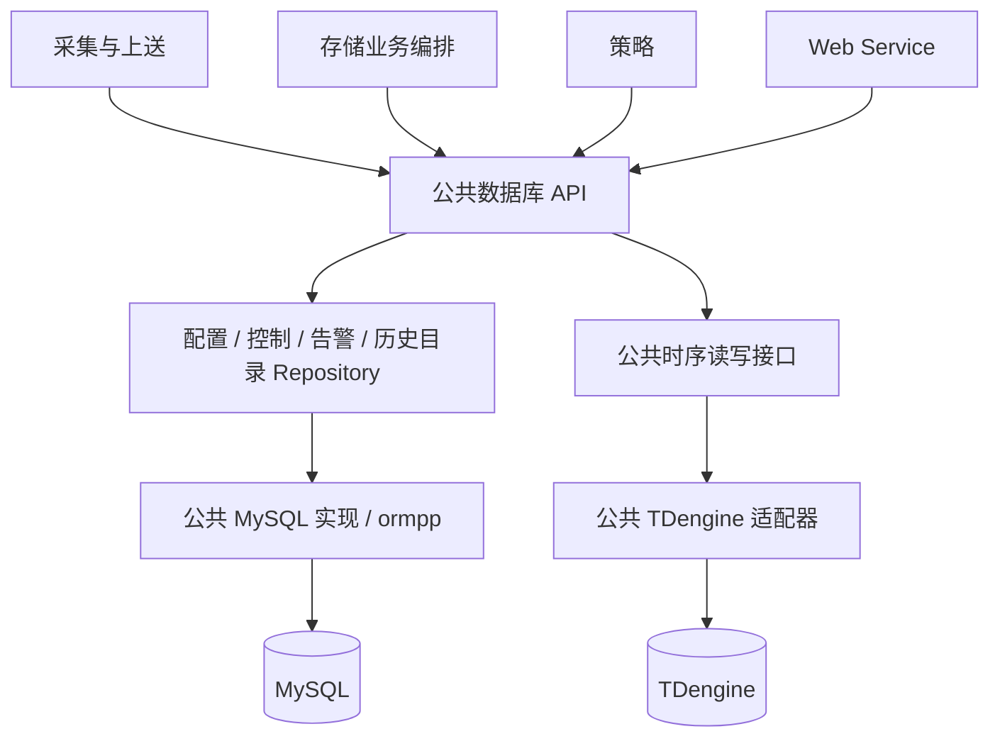
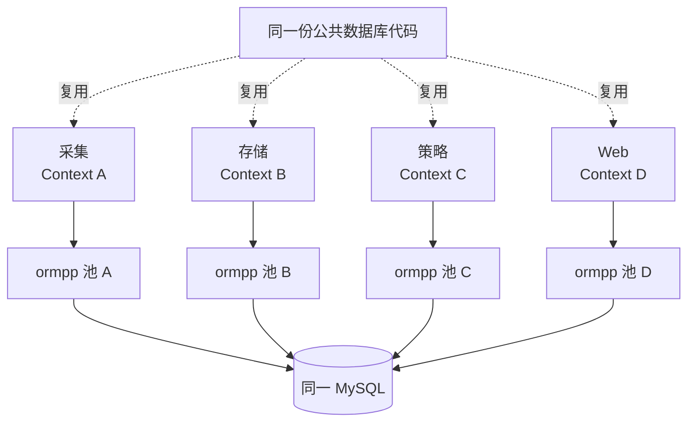
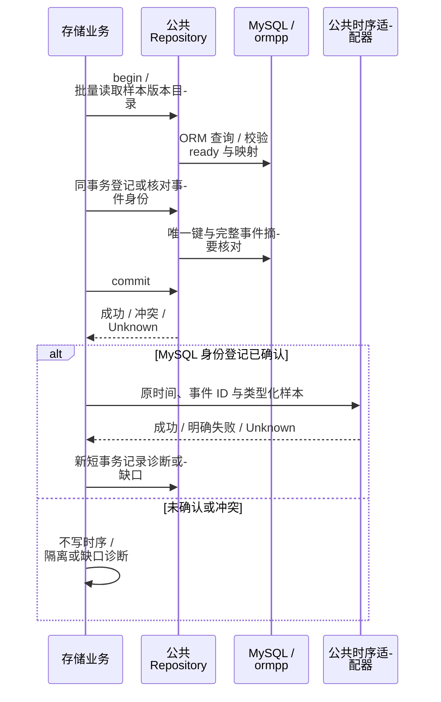

# 公共数据库访问层设计

> 版本：1.3｜日期：2026-10-22｜状态：ormpp 进程内连接池、公共事务适配、历史与工程配置仓储及调用方迁移已实现；其他领域 Repository 和真实服务验收待继续完成。适用全部 C++17 业务进程。
> 本文统一数据库访问层、ormpp 使用、事务与迁移规则；历史数据语义仍见[存储设计](../../processes/storage/design.md)，实时状态沿用[实时访问接口](../realtime/access-design.md)。

## 1. 统一入口与整改范围

**数据库访问代码集中到公共库，各进程只调用类型化业务接口。** 复用实体、Repository、连接管理、事务、错误转换和查询实现；各进程入口创建自己的运行时实例，再注入业务模块。



图表示代码依赖。生产运行中仅存储进程装配时序适配器；Web/策略通过存储的 `HistoryService` 查询历史，采集通过遥测通道送样本。

| 迁移起点 | 实施状态与目标 |
| --- | --- |
| 原 `src/scd/mysql_history.cpp` 自建连接、实体与手写查询 | 已移除，历史目录、事件身份及隔离记录统一由公共 ormpp Repository 实现 |
| 原 `src/common/db/db_manager.cpp` 混合连接、四遥 CRUD、建表及初始化 | 已删除；配置读写与点表导入由公共配置仓储承担，DDL 和示例数据改为显式部署脚本 |
| 原 `src/scd/taos_series.cpp` 私有持有客户端与 SQL | 已迁入公共时序层，存储只保留归档与查询编排；真实 TDengine 验收待完成 |
| 各模块可能各自包含 ormpp/数据库客户端头 | 历史与工程配置路径已由公共适配器私有依赖，参数加载和导入工具只使用公共 API |

仓库固定的 **ormpp 0.2.0** 支持 MySQL/PostgreSQL/SQLite，没有 TDengine 后端，依据仓库内的 ormpp 源码与来源记录。MySQL 统一使用 ormpp；TDengine 经公共时序适配器封装官方客户端，不假设存在 `ormpp::taos`，也不为迁移到 ORM 改变历史数据的权威存储。

## 2. 分层与职责

| 层 | 负责 | 不包含 |
| --- | --- | --- |
| 业务 Service | 权限、状态机、发布/仲裁、采样有效性、聚合与保留决策 | SQL、ORM 实体、驱动连接 |
| 公共 Repository API | 类型化读写、稳定身份、条件更新、幂等与事务参与 | HTTP/gRPC、协议句柄、任意 SQL 入口 |
| 公共 MySQL 实现 | ormpp 实体映射、批量查询、约束冲突、连接池与事务 | 设备控制、告警规则、私自提交业务事务 |
| 公共时序实现 | 类型化批量写/扫描、受控序列映射、客户端和方言 | PCC/需量计算、用户鉴权、跨库提交 |
| 部署迁移 | 唯一版本化 schema、索引与数据升级 | 业务启动时自动建表 |

Redis/共享内存继续由公共 `RealtimeService/IRealtimeStore` 访问；ZeroMQ 属于消息层。统一持久数据访问不意味着把实时状态、消息队列与业务表合成一个万能 `DatabaseManager`。

### 2.1 公共代码与运行实例



各进程使用 `ormpp::connection_pool` 的进程内单例，互不共享连接。进程入口初始化一次，进程内各 Repository 注入同一公共上下文。公共层封装事务、期限与错误转换，池队列、容量和连接借还复用 ormpp，不另建一套池实现。

当前每进程使用一套 MySQL 池配置。首次初始化固定凭据、连接数及预算；后续相同配置复用上下文，不同配置返回 Conflict，避免库的一次初始化行为静默忽略新配置。存储 schema 检查可按调用选择。各进程可使用不同凭据，连接数总和受数据库预算约束。

连接、锁、事务及客户端对象不跨进程共享；复用的是公共代码和契约。池随进程存活，关闭事务上下文只拒绝新事务，在途借用按预算退出，已有事务仍可清理并归还；不重置进程内池。公共层不新增数据库代理进程；业务所有权及数据库最小权限仍限制各进程可执行的操作。

### 2.2 各进程调用范围

| 进程 | 公共 MySQL 接口 | 时序访问 |
| --- | --- | --- |
| 采集 | 精确版本配置、北向意图、持久 inbox、执行状态、回执/outbox | 发布遥测，不装配时序客户端 |
| 策略 | 策略/计划、意图、命令、告警/outbox、执行对账 | 经存储历史服务 |
| 存储 | 历史目录/映射/身份/隔离、配置发布、outbox 领取与审计查询 | 装配公共时序适配器 |
| Web | 用户/权限、配置编辑、人工意图、业务查询 | 经存储历史服务 |

接口共享不授予任意表的写权限：策略仲裁、采集执行、Web 认证、存储发布的职责保持不变。

## 3. Repository 与类型契约

下表是目标逻辑方法，尚非现有完整 API。所有 I/O 接收 `CallContext`，返回公共 `Result<T>/Status`；MySQL 方法显式接收同一 `ITransaction&`，禁止 Repository 内隐式提交或另开连接。

| 接口 | 主要方法 | 关键约束 |
| --- | --- | --- |
| `IConfigurationRepository` | 设备/通道读写、四遥点表暂存、有界工程配置读取 | 当前工程配置 API；显式事务，不自动发布版本 |
| `IConfigRepository` | 精确版本读取、保存版本、条件激活、应用报告 | 不拼接不同版本，乐观并发，active 不倒退 |
| `IControlRepository` | 意图/命令、inbox 登记、条件推进、回执与对账 | 稳定 ID 去重，旧状态/控制权代次不可覆盖新状态 |
| `IAlarmRepository` | 生命周期事件、确认与有界查询 | 稳定事件 ID，业务状态机归策略 |
| `IOutboxRepository` | append、租约 claim、确认发布 | 与业务同事务；网络发送在事务外 |
| `IUserRepository` | 用户、角色、站点/资产授权读取与修改 | Web 定义权限规则，共享事务与映射实现 |
| `IHistoryCatalogRepository` | 按版本批量读点、序列映射、暂存目录、标记 ready | 目录键含作用域；仅完整版本可读；ready 后不可改写 |
| `IHistoryEventRepository` | 登记/核对事件摘要、隔离、处理结果与诊断 | 同 ID 同摘要幂等，异摘要冲突；账本不充当历史载荷备份 |
| `ITimeSeriesDatabase` | 有界 write/批量写、scan | 不接受 MySQL 事务；按事件身份写，保留逐项结果与 Unknown |

复用当前 `Sample/SeriesMapping/ValueType` 等逻辑记录，抽离到公共时序类型；统一 `IHistoryRepository` 的目录/事件职责与现有 `ITimeSeriesStore/Reader/Database` 的读写语义，不在新目录再造一套平行接口。旧接口只作临时委托转接。

ORM 行实体与反射注册留在 `src/common/db/mysql/`，通过显式转换返回公共 DTO。快照包含名称、单位、资产归属、启用及原版本；事件身份包含 ID、点位、原微秒时间与完整事件摘要。逻辑 `series_key` 不暴露物理表名，后端按受控映射解析。

## 4. ormpp 与 SQL 使用规则

| 场景 | 规则 |
| --- | --- |
| MySQL 普通增删改查 | 公共实现使用 ormpp 实体及类型化接口；反射、字段转换、批量逻辑只维护一份 |
| 条件、排序、分页 | 业务传枚举/字段化筛选对象；公共实现固定模板/白名单，值全部绑定 |
| 联表、锁、原子条件更新 | 先用可满足语义的 ORM 操作；确需 SQL 时仅限公共 MySQL 实现内部，经 ormpp 参数化接口执行并独立验证并发语义 |
| TDengine 方言/批量 API | 仅公共时序适配器可使用；值绑定，物理标识符来自受控映射，禁止外部输入拼表名 |
| 业务表、超级表、索引与升级 | 部署迁移保留 SQL；应用仅检查兼容版本，不在启动时 execute DDL；动态子表仅由时序适配器按授权映射受控创建 |

使用 `ormpp::query_s` 执行固定参数化语句属于底层实现手段，不能把 SQL 字符串、`execute(sql)`、`query(sql)` 或 ORM 连接暴露给业务层。禁止通过 `execute` 拼接用户值；不得以“已经调用 ormpp”为由保留各进程自己的实体和 SQL。当前版本不能安全表达的操作，须在公共实现补齐受控能力并验证后使用。

错误统一区分不存在、冲突、版本未就绪、超时、池耗尽和不可用；失败含 `NotApplied/Unknown` 等写入确定性。唯一键冲突不能一律当作网络故障，也不能把任意失败当作幂等成功。

## 5. 事务与历史归档

业务 Service 明确开启/提交事务；一个事务绑定一个公共数据库实例的一条连接，不能跨线程/进程使用。默认 READ COMMITTED，结合唯一键、条件更新或必要锁；需要多次读取一致时显式指定隔离级别。提交响应未知时按原业务 ID 用新连接对账，不重新生成 ID。



MySQL 与 TDengine **无共同事务**，不在等待时序写入时占用 MySQL 长事务。账本成功不代表样本落库；时序失败或未知须计入缺口，不能伪造回滚或宣称账本能重放。当前遥测仍是尽力投递，出队后失败不重入队；公共层迁移不提升投递保证。

业务状态与 outbox 必须同事务。领取 outbox 使用短事务，网络发布后按领取令牌另开短事务确认；租约过期和发布响应丢失都允许重复交接，由持久身份去重。

历史查询由存储编排：公共目录批量读 → 公共时序扫描 → 按每行原作用域/版本补元数据并复核权限。限制行数、时间范围、点数、并发和截止时间，避免逐行查 MySQL；不持有跨两库事务，不承诺分布式快照。

## 6. 目录、构建与迁移

以下是目标路径，未建立部分在实施时补齐：

```text
backend/include/common/database/
  i_database.h / i_transaction.h
  repositories/                  配置、控制、告警、用户、outbox
  history/                       目录、事件身份与隔离接口/DTO
  timeseries/                    统一读写接口、类型、工厂配置
backend/src/common/db/
  runtime/                       配置、池、事务与错误转换
  mysql/                         ormpp 实体、Repository 与受控查询
  timeseries/taos/                官方客户端、映射与读写适配
  timeseries/influxdb/            后续实现，当前不支持
backend/src/scd/                  订阅、归档/聚合/发布/查询编排
backend/data/migrations/          唯一部署迁移来源
```

| Target | 依赖边界 |
| --- | --- |
| `ems_database_api` | 公共类型、Repository、事务接口；不暴露驱动头 |
| `ems_database_mysql` | 私有链接 ormpp 和 MySQL 客户端，复用公共池/事务 |
| `ems_timeseries_api` | 类型化时序接口，无 TAOS 头 |
| `ems_timeseries_taos` | 私有链接 TAOS；仅存储装配，不强迫其他进程链接 |
| 存储核心 | 只链接公共 API，入口负责依赖注入；不再编译私有数据库实现 |

沿用已有 `001_storage_mysql.sql`、`002_storage_taos.sql` 迁移；后续变化新增版本，不篡改已执行脚本或另建竞争目录。生产由部署工具单点执行，记录版本与校验和，应用仅检查。回填/批量升级走离线迁移流程，不作为业务 API 接受任意 SQL。

## 7. 实施顺序与验收

| 阶段 | 完成条件 |
| --- | --- |
| 公共基础 | 统一池/事务/错误和实体归属；单进程各 Repository 复用上下文，多进程分别创建 |
| MySQL 历史迁移 | `mysql_history.cpp` 的实体、查询与连接迁入公共实现，目录与事件 Repository 注入存储；参数化及同事务测试通过 |
| 时序迁移 | 复用现有接口及行为，迁移 TAOS 连接、写入/扫描/映射，业务不再包含 taos.h 或 SQL |
| 其他调用方 | 采集/策略/Web/outbox 改用同一公共 Repository，移除重复模型、直连和旧建表入口 |
| 删除旧入口 | 直接替换 DBManager 及调用方，删除 `ems_db`、旧头文件和自动建表入口，不提供兼容别名或转发 target |

验收必须包含：

- 构建边界：ORM/MySQL/TAOS 头及执行语句仅出现在公共适配器，迁移 SQL 仅由部署执行；业务无绕行数据库调用。
- 事务：业务成功而 outbox 失败全部回滚；两个 Repository 同连接参与；禁止跨上下文事务；提交 Unknown 用原 ID 对账。
- 并发：同事件同摘要幂等、异摘要冲突；配置并发发布及 outbox 租约接管不会覆盖新状态；死锁不盲目重放设备动作。
- 历史：旧版本解释、精确整数/null、同微秒多事件、分页、账本成功而 TAOS 失败的缺口，迁移前后结果一致。
- 资源：慢查询、池耗尽、数据库中断、关闭超时有界；历史查询与命令/发布预算隔离，MySQL 连接总额受控。

### 7.1 首批实现记录

已改为复用 ormpp 进程内池，删除自建池队列与容量管理。公共 `TransactionDatabase` 只提供线程/上下文归属检查、显式提交/回滚、析构回滚及借用生命周期适配；坏连接交还时标记丢弃，由库在下次借用时重建。历史目录/事件 Repository 共用同一运行上下文，普通读写通过 ormpp 实体与参数绑定。存储入口已注入公共实现，目录校验与身份登记同事务，提交 Unknown 时禁止写时序库；时序接口、类型、工厂与 TAOS 实现已迁出 scd。

库池保留单例及一次初始化方式，仅补充按绝对期限借用、显式丢弃坏连接与初始化失败后清理部分连接，补丁列于 `backend/third_party/ormpp/EMS_UPSTREAM.md`，由实际库池的并发、耗尽、重建失败及事务测试覆盖。

当前默认池上限 4、借用预算 1 秒、网络 I/O 上限 5 秒；MySQL 客户端超时按整秒配置，不能亚秒强制取消。启动可检查历史所需列，仍需完善迁移版本记录及索引约束核验。工程配置仓储已迁移；版本配置发布、控制/告警/用户/outbox 的具体 Repository 及完整历史目录发布仍待后续阶段；不能将本阶段等同于全项目整改或 MySQL/TAOS 真实服务联调完成。

### 7.2 工程配置入口替换

旧 `DbManager`、`backend/include/db/` 与 `ems_db` target 已删除。`IConfigurationRepository` 负责设备/通道 CRUD、有界工程配置读取及四遥点表暂存；公开头只定义记录与接口，ormpp 反射及查询放在公共实现内部。点表服务在解析 XLSX 时释放连接，再通过新事务暂存并提交；Unknown 原样返回，不自动重试。

`ParaLoader` 接收进程入口创建的公共上下文，加载成功后再替换本地配置；查询失败不伪装成空配置。点表 CLI 和采集示例直接使用公共工厂。未被调用的 `PointImportCaller/PointImporter` 与 `point_collect` 写入接口已删除，采样归现有遥测/历史链路。

应用不再建库、建表或写示例数据。空库先执行 `backend/data/migrations/000_configuration_mysql.sql`；开发示例可显式执行 `backend/data/seeds/collection_demo.sql`。`load_mysql_options` 统一读取 `EMS_DATABASE_CONFIG` 与 `EMS_MYSQL_*`，旧 `DbConfig`、SQLite 生产连接入口和旧环境变量已退出。SQLite 只用于配置仓储事务回归，不能代替 MySQL 行锁联调。
