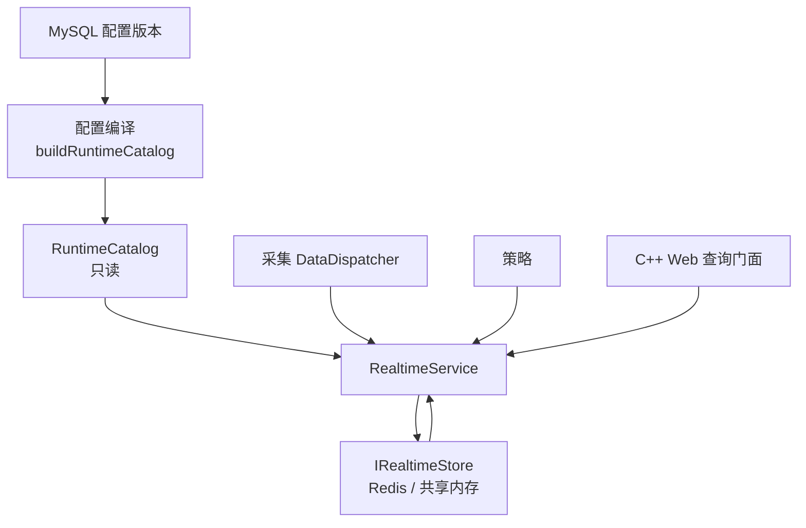

# 实时数据库业务接口设计（RealtimeService）

> 版本：1.0｜日期：2026-10-24｜状态：接口与实现已完成，数据库仓储/采集接入待继续
> 代码：[`runtime_catalog.h`](https://github.com/600888/ems/blob/main/backend/include/rtdb/model/runtime_catalog.h)、[`realtime_service.h`](https://github.com/600888/ems/blob/main/backend/include/rtdb/client/realtime_service.h)、[`realtime_service.cpp`](https://github.com/600888/ems/blob/main/backend/src/rtdb/client/realtime_service.cpp)
> 上层依据：[实时访问接口设计](./access-design) 第 5.2/5.3 节；[设备管理数据库表设计](../database/device-management) 第 11 节

## 1. 目标与边界

`IRealtimeStore` 只解决“逻辑记录如何安全读写”，不负责：

- 把设备树路径、点编码解析成记录键；
- 判断样本是否来自已授权来源、是否属于当前配置版本；
- 判断序号新旧、重复上报与乱序；
- 计算新鲜度、组装类型化值；
- 判断设备能力当前是否具备运行条件。

这些规则集中在 `ems::rtdb::RealtimeService`，业务进程只调用类型化接口，不接触 Redis Hash、共享段偏移或字段名。

**本接口负责**

| 能力 | 接口 |
| --- | --- |
| 测点读取（类型化值、质量、时间、来源、版本、stale） | `getPoint` / `getPoints` |
| 测点写入（授权、序号、重复、CAS） | `updatePoint` / `updatePoints` |
| 首次启用与来源切换 | `createPoint` / `authorizePoint` |
| 设备运行状态 | `getDeviceState` / `updateDeviceState` |
| 通道运行状态与 5 分钟通信窗口 | `getChannelState` / `updateChannelState` / `reportChannelHealth` |
| 作用域配置版本运行记录 | `getScopeRuntime` / `installScopeRuntime` |
| 能力运行条件 | `resolveCapability` |

**本接口不负责**：用户权限、控制权仲裁、命令执行、策略计算、设备 I/O、配置持久化、配置发布。`resolveCapability` 返回的是“配置 + 数据质量 + 版本一致性”结论，策略仍须叠加权限与仲裁结果。

## 2. 结构



- `RuntimeCatalog` 由配置服务投影的设备树快照（`DeviceTreeSnapshot`，只有设备树，没有资产概念）编译，只保存运行需要的最小字段；不持有数据库连接。
- `RealtimeService` 不缓存数据，每次调用都经过存储；实例无状态，可并发调用。
- 时钟可注入，生产使用系统 UTC 微秒，测试用固定时间验证陈旧边界。

## 3. 运行目录

### 3.1 地址模型

```cpp
struct PointAddress {
    Scope scope;                        // unit / station + code
    std::vector<std::string> device_path;  // 相对作用域根的设备树路径，最多 8 级
    std::string code;                   // 点编码
};
```

路径由 `cfg_device.path`（数据库设计第 6.3 节）提供，按 `/` 分段并与 `RecordKey.device_path` 一一对应：

| 数据库 | 运行地址 |
| --- | --- |
| 单元 `unit01` 下设备 `pcs01` 的 `active_power` | `unit|unit01`, `["pcs01"]`, `active_power` |
| 单元下电池簇 `rack01` 的 `soc` | `unit|unit01`, `["rack01"]`, `soc` |
| 电池簇下 `pack03` 的 `cell_voltage_max` | `unit|unit01`, `["rack01","pack03"]`, `cell_voltage_max` |

Pack/Cell 点挂在部件节点上（部件也是 `cfg_device` 树节点，有自己的稳定 ID），路径包含部件层级；部件点的采集通信设备由 `source_device_id` 在采集侧解析，实时库不为每个 Cell 虚构通信设备。

### 3.2 目录内容

| 类型 | 关键字段 | 用途 |
| --- | --- | --- |
| `RuntimePoint` | `point_id`、地址、`point_type`（遥测/遥信/遥控/遥调）、`kind`、`value_type`、`unit`、`stale_after_ms`、`enabled`、`SourcePolicy` | 点读写、能力检查、控制侧区分 YK/YT |
| `RuntimeDevice` | `device_id`、`code`、作用域、`device_path`、`enabled` | 设备状态记录键 |
| `RuntimeChannel` | `channel_id`、`code`、站作用域、`enabled` | 通道状态记录键 |
| `RuntimeCapability` | `device_id`、`capability_code`、所需点/反馈点 | 能力门控 |

目录在一次构建后只读；重复的点 ID、地址或能力键返回 `false`，构建函数把失败写入 `issues`，调用方必须拒绝发布而不是部分生效。

`buildRuntimeCatalog` 处理：

- 作用域根节点按 `scope.kind`（`Station`/`Unit` 对应 `node_kind`）与 `scope.code` 匹配，找不到或重复直接失败；
- 设备树父链缺失、成环、路径段编码非法、路径超过 8 级写入问题列表；
- 设备/部件节点不能同时是作用域根（否则设备状态键与作用域运行键重合）；
- 通道状态固定使用站作用域，通道来自配置服务投影的站内通道；
- 点归属直接使用点表行的 `owner_device_id`（设备或部件节点），不由点表行猜测设备类型。

## 4. 记录契约

测点记录的字段名是 C++/Redis/共享内存共用的稳定契约，完整替换时未出现的旧字段会被删除。

| 分组 | 字段 | 说明 |
| --- | --- | --- |
| 标识 | `schema_version`、`point_id`、`value_type` | `schema_version` 不为 `1` 时读取返回 `SchemaMismatch` |
| 值 | `value`、`unit` | 无值时字段缺失；字符串空值与无值可区分 |
| 质量 | `quality`、`quality_reason` | 数值质量码，稳定码表见 `model::Quality` |
| 时间 | `source_time`、`ingest_time` | UTC 微秒；无效时间字段缺失 |
| 来源 | `source_id`、`source_epoch`、`sequence`、`config_version`、`event_id` | 新旧判断依据 |
| 授权 | `accepted_source_id`、`accepted_source_epoch`、`accepted_config_version`、`write_enabled` | 只能由 `authorizePoint` 或首次创建写入 |
| 诊断 | `updated_at` | 写入时间，不参与新旧判断 |

设备状态记录（`DeviceState`，路径为设备树路径）字段：`state`、`quality`、`quality_reason`、`since`、`last_valid_time`、`active_alarms`、`config_version`、`source_*`、`sequence`。

通道状态记录（`ChannelState`，站作用域 + 通道 code）字段：`state`、`reason`、`since`、`window_start`、`last_success_time`、`last_error`、`requests`、`successes`、`timeouts`、`avg_latency_ms`、`max_latency_ms`、`config_version`、`source_*`、`sequence`。

作用域运行记录使用根级 `DeviceState`（空路径），字段：`config_version`、`activation_revision`、`applied_at`。它不替代站根 `cfg_device.config_revision`，只是“该进程实际已加载哪个修订号”的实时证据。

## 5. 写入规则

### 5.1 测点

```text
1. 地址在目录中不存在            -> NotFound
2. 配置禁用                      -> NotReady("point is disabled")
3. 记录 write_enabled=0           -> NotReady("point write is not authorized")
4. source_id/epoch/config_version 与记录 accepted_* 不符 -> PermissionDenied
5. 值类型与配置不符              -> InvalidArgument
6. 记录不存在                    -> NotReady("create it first")
7. 记录缺 epoch/sequence/授权字段 -> SchemaMismatch
8. 记录 accepted_* 与目录授权不符 -> Conflict（配置已切换，需重新加载目录）
9. 新 epoch < 已存 epoch          -> IgnoredOutOfOrder
   新 epoch = 已存 epoch:
     sequence < 已存 sequence     -> IgnoredOutOfOrder
     sequence = 已存 sequence:
       值/质量/时间/event_id 相同 -> Duplicate
       不同                        -> Conflict
10. 组装完整字段 + CAS(读取 revision)
    CAS Conflict -> 重读并重新校验，最多 3 次；超预算 -> DeadlineExceeded
    CAS 成功     -> Applied
```

`IgnoredOutOfOrder` 与 `Duplicate` 是**业务结果**，不是错误；历史归档仍可由采集侧独立完成，实时库只保留最新值。

`authorizePoint` 是唯一允许修改 `accepted_*` 的入口：

- 记录不存在：按新授权创建空值记录；
- 记录存在：保留最后样本、值、时间，只替换授权字段与 `write_enabled`，CAS 后返回新 revision；
- 后续写入以记录中的 `accepted_*` 为准，不要求运行目录同步重建；旧来源的下一次采样会在第 4 步被拒绝，直到新来源提交；
- 目录中的 `SourcePolicy` 只用于 `createPoint` 的初始授权，不覆盖已安装的运行时授权。

### 5.2 设备状态

- 设备未配置或禁用：`NotFound` / `NotReady`。
- 同代次序号更小：`Conflict`（唯一写角色不应乱序）；同序号同内容：返回现有 revision；同序号不同内容：`Conflict`。
- 新代次更大的 epoch：接受，用于采集重连后的来源代次提升；来源授权本身仍由配置/授权流程负责。
- 新鲜度以 `last_valid_time` 为准；缺失时退化为 `since`。

### 5.3 通道健康

`updateChannelState` 覆盖完整状态；同代次同序号视为幂等重复，直接返回现有 revision，避免重试时重复累加。

`reportChannelHealth` 在门面内完成读改写：

1. 距 `window_start` 不足 5 分钟时累加；
2. 满 5 分钟或 `window_start` 无效时清零并重置窗口；
3. 平均时延按请求数加权，最大时延取窗口内最大值；
4. `successes>0` 时更新 `last_success_time`；
5. 状态变化时更新 `since`；
6. 旧序号返回 `Conflict`，调用方重读窗口后重报。

5 分钟窗口是实时库中的“当前窗口”；落库的 `ops_comm_stat_5m` 由存储/统计进程按窗口关闭事件写入，不在高频路径上直接写 MySQL。

## 6. 读取与派生

| 派生字段 | 规则 |
| --- | --- |
| `stale` | `now - (source_time 或 ingest_time) > stale_after_ms`；无时间视为陈旧 |
| `time_degraded` | 源时间缺失，用接收时间判定 |
| `clock_anomaly` | 源时间超前本地时钟超过 60 秒；此时不判定为陈旧，避免负年龄 |
| `config_current` | 记录 `config_version` 等于目录版本，且记录值类型等于目录类型 |
| `source_authorized` | 记录 `accepted_*` 等于目录授权，且样本来源等于 `accepted_*` |
| `writable` | 记录 `write_enabled=1` |
| `success_rate` | `successes / requests`；零请求为 0 |

读取不因 `stale` 返回错误，也不删除最后值；调用方根据 `stale`、`quality` 自行决定展示。

## 7. 能力运行条件

`resolveCapability(device_id, capability_code)` 的判定顺序：

1. 设备不在目录 → `NotFound`；
2. 设备禁用 → `available=false`，原因 `device_disabled`；
3. 能力未配置 → 原因 `capability_not_configured`；
4. 对每个所需点/反馈点：
   - 目录无该点 → `point_not_configured`；
   - 配置禁用 → `point_disabled`；
   - 无记录 → `no_sample`；
   - 无值 → `no_value`；
   - 质量非 Good → `quality_<码名>`；
   - `config_current=false` → `config_outdated`；
   - `source_authorized=false` → `source_unauthorized`；
   - `stale=true` → `stale`；
5. 全部通过才 `available=true`。

原因码去重后写入 `reasons`，逐点明细写入 `points`，可直接支撑设计图“运行监视/有功调度/无功调节”的可用状态与悬停原因。设备能力不因“有静态配置”而显示可用，必须有新鲜、授权、同版本的当前值。

## 8. 错误映射

| 场景 | ErrorCode | WriteEffect |
| --- | --- | --- |
| 地址/能力/设备不在目录 | `NotFound` | 读 `NotApplicable`，写 `NotApplied` |
| 配置禁用、未授权写入、未初始化 | `NotReady` | `NotApplied` |
| 来源/配置版本不符 | `PermissionDenied` | `NotApplied` |
| 值类型不符、计数器不自洽 | `InvalidArgument` | `NotApplied` |
| 同序号不同内容、CAS 重试耗尽、授权已切换 | `Conflict` | `NotApplied` |
| 旧记录缺少契约字段 | `SchemaMismatch` | `NotApplicable` |
| 字段值无法解析 | `CorruptData` | `NotApplicable` |
| 预算耗尽 | `DeadlineExceeded` | `NotApplied` |

失败不会返回“零值成功”；`BasePoint` 旧运行载荷的 `false` 兼容语义不再用于新接口。

## 9. 并发与性能

- `RealtimeService` 无可变成员，`shared_ptr<IRealtimeStore>` 与 `shared_ptr<const RuntimeCatalog>` 由组装者保证生命周期。
- 测点写入是“读 → 校验 → CAS”，冲突有限重试；高并发同点写入至多一个成功，其余返回 `Conflict` 或按其序号被忽略。
- 批量读调用 `readMany`，批量写逐项调用 `updatePoint`，保持“逐项结果、不整批原子”的既有契约。
- 能力检查复用 `getPoints` 批量读，不逐点单独往返。
- 记录字段上限、值编码长度仍受后端 `max_record_bytes` 约束；字符串值不做静默截断。

## 10. 与配置发布的衔接

```text
保存草稿 v13（MySQL）
  -> 保存：直接写工程表，并把站根 cfg_device.config_revision 加 1
  -> 采集/策略加载精确版本 v13
  -> buildRuntimeCatalog(model::ModelCatalog v13, options{source_id, epoch})
  -> 新 RealtimeService 实例替换旧实例（旧实例在途调用结束后释放）
  -> installScopeRuntime({v13, activation_revision}, expected_revision)
  -> 首次启用点 createPoint；已有记录 authorizePoint 切换来源
  -> 消费者发现 revision 变化后重建运行目录并原子切换
```

关键点：**不修改旧目录**。切换通过替换 `shared_ptr<const RuntimeCatalog>` 实现，读取旧版本的调用继续使用旧对象，直到自然结束。这样“保存 v13 草稿不影响 v12 运行”在进程内也有明确语义。

## 11. 已覆盖的差距

| 差距 | 本接口的落点 |
| --- | --- |
| G1 精确版本应用 | `configVersion`/`activationRevision`、`installScopeRuntime` 条件写入 |
| G2 能力随质量与版本开放 | `resolveCapability` 逐点质量/陈旧/版本/来源检查 |
| G3 BMS 到 Pack/Cell | 部件资产路径，点无设备归属 |
| G5 稳定身份与来源诊断 | `PointAddress`/`point_id`、`source_*` 字段、`source_authorized` |
| G9 最近有效数据与通信统计 | `last_valid_time`、`stale`、`reportChannelHealth` 5 分钟窗口 |
| G4 枚举命令规则 | 值转换与命令规则在配置侧；本接口保留 `value_type=String` 与来源序号，支持投影结果 |

尚未覆盖：控制授权与 owner epoch、跨点原子切换、命令执行回执、告警聚合、历史归档。这些仍属于策略/采集/存储职责。

## 12. 验证

`test_ems_common` 新增 13 项 `RealtimeServiceTest`：

- 资产路径解析、部件点不虚构设备、通道站作用域；
- 首次创建、写入、类型化读取；
- 乱序忽略、重复、同序号冲突；
- 未授权来源与旧配置版本拒绝；
- `authorizePoint` 切换来源后旧样本被拒绝、新来源可写入；
- 禁用点不可写；
- 超过阈值置 stale；
- 批量逐项结果；
- 能力可用/陈旧/未知能力/设备不存在；
- 设备状态序号与新鲜度；
- 通道健康累加、加权时延、5 分钟窗口重置；
- 作用域运行版本条件写入冲突。

全部 108 项公共模块测试通过（MSVC Release）。
