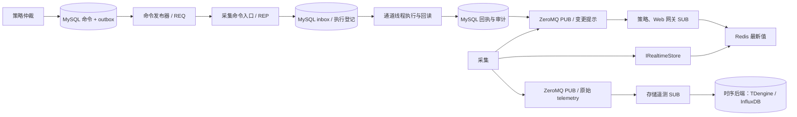

# ZeroMQ 消息订阅与命令下发设计

> 2026-09-29｜目标架构与当前实现边界。当前已提供 C++ PUB/SUB、REQ/REP 传输组件和旧采集分发器的可选通知接入；原始遥测 PUB/SUB、策略 outbox、采集命令持久 inbox 和命令执行状态机仍需业务进程接线。

## 1. 决策

实时最新值保存在 Redis；ZeroMQ 不保存实时值。跨进程变更订阅使用 ZeroMQ PUB/SUB，订阅者收到提示后从 Redis 读取完整快照。原始遥测样本使用独立的 ZeroMQ PUB/SUB 主题传给存储进程，项目接受该通道的采样丢失。控制命令下发使用独立 ZeroMQ REQ/REP 端点，并由 MySQL 命令记录、outbox/inbox、幂等状态机提供持久恢复。命令绝不能发到 PUB/SUB 上；可丢失的变更提示也不能充当原始历史样本。

| 路径 | 传输 | 权威记录与恢复 |
| --- | --- | --- |
| 测点最新值、质量、设备状态 | `IRealtimeStore` → Redis | 来源代次、序号与 CAS 防旧写 |
| 测点变化、配置变化、命令结果的唤醒提示 | ZeroMQ PUB/SUB | 可丢失；消费者定期重读权威状态或 MySQL 记录 |
| 策略 → 采集执行命令 | ZeroMQ REQ/REP | MySQL 命令 + outbox；采集持久 inbox/条件登记；同 `command_id` 重试 |
| 命令执行结果和审计 | MySQL 记录 + outbox；ZeroMQ 只作提示 | 按 `command_id` 查询终态，未决状态在重启后对账 |
| 原始历史采样 | 独立 ZeroMQ telemetry PUB/SUB | 完整 `EventEnvelope` 写所选时序后端；允许离线、高水位与故障丢样，无 ACK 或重放 |

Redis 只承担实时最新值。存储进程已移除 Redis Streams 消费入口并通过 ZeroMQ 订阅原始遥测；配置生效事实保存在 MySQL，变化通过 ZeroMQ 提示实例重读。旧采集 Redis 通知分支仍在，需在采集链路重构时移除。



## 2. PUB/SUB：消息订阅

### 2.1 变更提示

现有 `ZmqChangePublisher` 使用专用线程独占 PUB socket；业务线程只向有界队列提交提示。`ZmqChangeSubscriber` 使用专用接收线程独占 SUB socket，按“完整主题 + NUL”过滤。第一阶段单帧编码为 `<topic><NUL><JSON>`，主题为可打印 ASCII、无空格，默认单帧上限 64 KiB、应用队列上限 1024 条、发送与接收高水位 1024。旧 `DataDispatcher` 提供 Redis/ZeroMQ 通知后端配置，选择 ZeroMQ 时测点写入成功后才提交提示。

PUB 入队成功不代表任何订阅者收到；高水位、晚加入、断线都可能丢通知。接收端启动时先订阅再读快照，重连后重读快照，并按业务新鲜度预算定期重读。最后一条通知丢失时没有后续序号暴露缺口，所以不能仅依赖序号检查。订阅回调应只提交轻量工作，不做长期阻塞 I/O。

跨进程版本化通知信封目标字段为 `schema_version、topic、scope、record_key、source_epoch、sequence、config_version、event_time`；当前旧 `DataDispatcher` 正文仍是原有测点 JSON，尚不满足完整版本化信封。迁移期只能把它当作唤醒，不用载荷直接覆盖本地权威视图。

### 2.2 原始遥测

采集端发布独立的 `telemetry` 主题，正文是完整的版本化 `EventEnvelope` JSON，包含稳定 `event_id`、站/单元作用域、配置版本、源时间和有类型的测点值。主题携带受控作用域，存储端还须核对信封内作用域；旧四遥变更提示 JSON 不含这些历史身份字段，不能转作原始遥测。存储接收线程检查帧边界并提交有界队列；工作线程通过[公共数据库访问层](../database-design.md)读取历史版本、事务登记事件身份，再调用公共时序接口，业务不直调 ormpp/驱动。首期 TDengine 3.4.2，InfluxDB 后续适配。

原始遥测 PUB/SUB 与变更提示同样允许丢失。发布端本地入队成功不表示存储已接收；订阅者晚启动或断线、发送或接收高水位、存储进程队列溢出、MySQL 或时序库故障，都可能形成无法自动补回的历史缺口。此通道不提供 ACK、pending、消费组或重放游标。存储进程的 MySQL `history_event_identity` 和隔离记录只覆盖实际收到的事件，不能推断未收到样本的内容。监控应同时报告发布拒绝、接收队列丢弃、数据库写入失败、来源序号跳变和采样静默；序号只能检测部分缺口，不替代端到端投递证明。恢复时从新样本继续，不能用 Redis 当前值伪造缺失历史。

## 3. REQ/REP：命令下发

### 3.1 交接流程

1. Web/北向请求先形成控制意图；策略完成授权、互锁、所有权和配置版本检查，用稳定 `command_id` 将执行命令及 outbox 同事务写 MySQL。
2. outbox 发布器取出已提交命令，使用 `ZmqCommandClient` 向所属采集分片发送。超时或连接故障保持 outbox 未完成，按同一个 `command_id` 重试；不能生成新 ID。
3. 采集侧 `ZmqCommandServer` 的业务回调验证 schema、目标分片、配置版本、期限、`owner_epoch` 与命令 ID；在 MySQL 中按 ID/载荷幂等登记持久 inbox。持久登记成功后可回复 `Accepted`。重复同载荷回复 `Duplicate` 并查询当前状态；同 ID 异载荷必须拒绝并告警。
4. 采集执行器从持久 inbox 恢复待处理命令，在通道事务边界排队；物理写入前再检查期限、所有权、互锁与执行状态，并先完成条件执行登记。数据库不可用或登记结果未知时不开始新的设备动作。
5. 协议确认、回读和最终结果持久保存于 MySQL，ZeroMQ PUB/SUB 仅通知结果已更新。Web/策略按 `command_id` 查询权威状态。远端 `Accepted` 不是设备成功；设备结果未知时进入 `Unknown`，核验后决定后续动作。

持久 inbox 避免“已回复接收、进程却在内存入队前崩溃”的丢命令窗口。重启后扫描未终结命令并恢复队列；已经开始设备 I/O 但尚未持久记录结果的命令不能盲目重发，须读设备或人工核验。此恢复规则由业务进程实现，ZeroMQ 库自身不提供。

### 3.2 传输 API 与线协议

`ZmqCommandClient::send()` 每次调用创建独立 REQ socket，因此并发调用不会共享非线程安全 socket；发送和接收分别有超时，超时后关闭 socket，下一次用相同 `command_id` 建立新请求。采集侧 `ZmqCommandServer` 专用线程独占 REP socket；回调必须有界，不得在回调内停止 server。接收线程异常退出后 `running()` 变为 false，应撤销命令入口就绪状态。

第一版单帧编码：

```text
请求: "EMS-CMD/1" NUL command_id NUL payload_json
应答: "EMS-ACK/1" NUL status_byte command_id NUL reason
status_byte: A=Accepted, D=Duplicate, R=Rejected, T=RetryLater, I=Invalid, U=Unknown
```

`command_id` 为 1～128 字节的 ASCII 字母、数字、`-` 或 `_`；完整帧默认最多 64 KiB，命令 socket 的发送与接收高水位默认各为 128 条。`payload_json` 应包含 `schema_version、command_id、intent_id、target_asset_id、capability、value、unit、priority、issued_at、expires_at、expected_config_version、owner_epoch、actor、trace_id`。接收端需校验帧 ID 与 JSON ID 一致，不信任任意 TCP 客户端的 actor 或 owner_epoch；旧 `ChannelThread::post_command(pointCode, value)` 没有这些字段，不能直接作为网络命令入口。

| 应答 | 发布器动作 |
| --- | --- |
| `Accepted` | 标记本次交接已被采集持久接收；继续等待 MySQL 中的执行终态 |
| `Duplicate` | 查询该 `command_id` 当前状态；核对载荷一致后视为已交接 |
| `Rejected` / `Invalid` | 停止自动重试，持久保存原因并告警；业务拒绝须有审计记录 |
| `RetryLater` | 保留 outbox，带上限退避重试 |
| `Unknown` / 超时 | 远端可能已经登记；按原 ID 查询或重试，不执行第二个物理动作 |

REQ/REP 的发送成功只表示请求进入 ZeroMQ 通道，不能证明采集端已持久受理。REP 回复丢失时客户端可能得到 `Unknown`，因此即使有应答仍必须用业务 ID、MySQL 状态与幂等执行规则闭环。

## 4. 部署、故障与安全

命令、变更提示和原始遥测分别使用独立端点或明确隔离的主题；现有命令与提示端点示例为 `tcp://127.0.0.1:5558` 与 `tcp://127.0.0.1:5557`，遥测端点需单独配置。每个采集实例有独立命令入口；outbox 按 owner shard 路由，重分配必须先隔离旧执行者并提升 `owner_epoch`。同机可评估 `ipc://`；当前各类对象分别创建 ZeroMQ context，不能用 `inproc://` 连接它们。跨主机部署需身份认证、加密及允许连接的对端列表；当前传输类未配置 CURVE，只能部署在可信本机或隔离网络，不可直接暴露到公网。

| 故障 | 行为与恢复 |
| --- | --- |
| Redis 不可用 | 最新值查询与依赖实时值的控制降级；ZeroMQ 变更提示和遥测传输仍可运行，历史不得从缺失的实时值补写 |
| ZeroMQ 通知断线 | 周期快照和新鲜度检查恢复最新视图；不补中间样本 |
| ZeroMQ 遥测断线或订阅端离线 | 断线期间原始样本可能丢失；重连后只处理新收到的事件，报告已知缺口 |
| MySQL 或时序后端故障 | 已到达但不能归档的样本可能丢失；有界队列内仅可用同一事件 ID 尝试重写，不宣称自动重放 |
| 命令端点断线或超时 | outbox 保留稳定 ID，重试并查询持久 inbox；不得把超时当作未执行证明 |
| 采集进程在 `Accepted` 后崩溃 | 重启扫描持久 inbox；已开始 I/O 的未决命令先核验设备状态 |
| MySQL 不可用 | 拒绝新的常规控制接收/执行；既有现场保护不依赖远程命令入口 |
| 旧主未隔离 | 不允许新主自动执行同一设备的控制，直到完成所有权隔离 |

监控至少包括各 PUB 的本地接受/拒绝/发送错误、遥测订阅最新消息时间和接收队列丢弃数、快照年龄、采样序号缺口、命令 outbox 最旧年龄、`Accepted/Duplicate/RetryLater/Unknown` 数量、采集命令 inbox 未决数量、命令入口 `running()` 和执行终态对账。验收覆盖发布者/订阅者晚启动与重启、满队列、慢消费者、遥测丢样、命令重复/异载荷冲突、回复丢失、数据库故障、采集崩溃和旧主隔离。

## 5. 当前代码与落地顺序

启用构建需目标平台的 libzmq 4.3+ 开发包：

```sh
cmake -S backend -B backend/build/linux-native -DEMS_WITH_ZEROMQ=ON
cmake --build backend/build/linux-native --target ems_zmq_messaging net_collect
```

当前 `ems_zmq_messaging` 提供变更提示 PUB/SUB 和命令 REQ/REP 传输类。旧采集示例可用 `--zmq-endpoint tcp://127.0.0.1:5557` 切换变更通知，但其实时状态仍写 Redis；这条提示没有完整的历史事件信封。接下来按顺序实现：

1. 策略/存储 outbox 发布器调用 `ZmqCommandClient`，根据应答更新交接状态；采集进程接入 `ZmqCommandServer` 与持久 inbox，并补齐命令版本化 JSON 契约。
2. 执行器由持久 inbox 恢复任务，接通 `ChannelThread` 的命令排队、条件执行登记、回读与 MySQL 回执；验证崩溃窗口和重复请求。
3. 变更提示订阅端接入 `ZmqChangeSubscriber`，从 Redis 读取最新值或从 MySQL 重读配置；旧 Redis 命令队列停止作为执行入口。
4. 采集端接入版本化 `EventEnvelope` 原始遥测发布，与已实现的存储订阅器联调，验收接收队列、数据库故障和离线时的丢样指标。ZeroMQ PUB/SUB 不是持久事件日志。

## 参考

- [ZeroMQ REQ/REP 与 PUB/SUB socket 语义](https://libzmq.readthedocs.io/en/latest/zmq_socket.html)
- [ZeroMQ 超时、高水位与关闭选项](https://libzmq.readthedocs.io/en/latest/zmq_setsockopt.html)
- [ZeroMQ 可靠请求应答模式与幂等重试](https://zguide.zeromq.org/docs/chapter4/)
