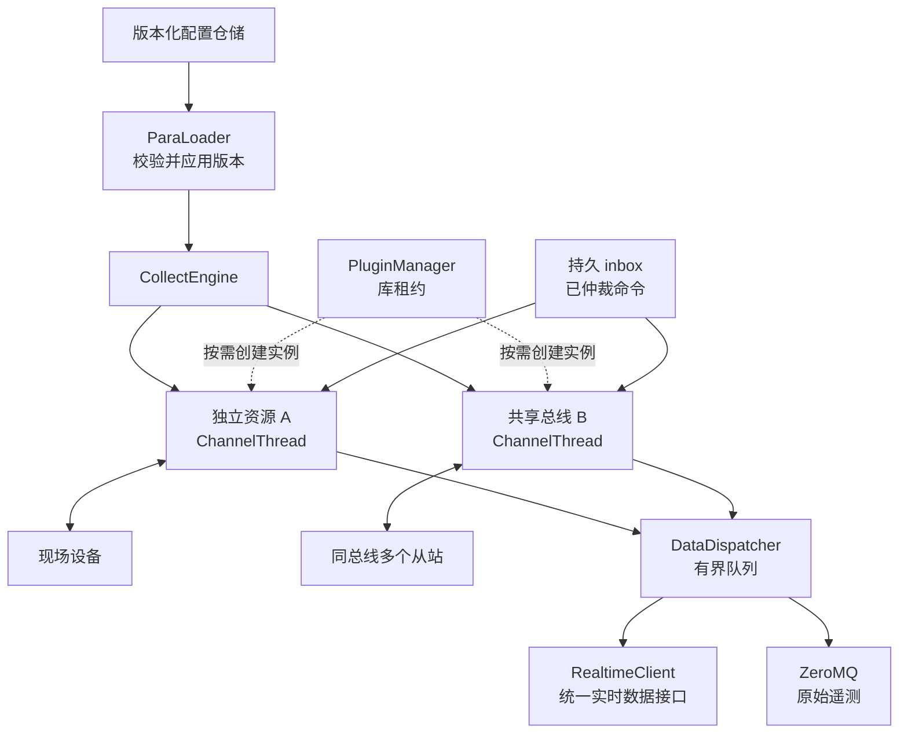
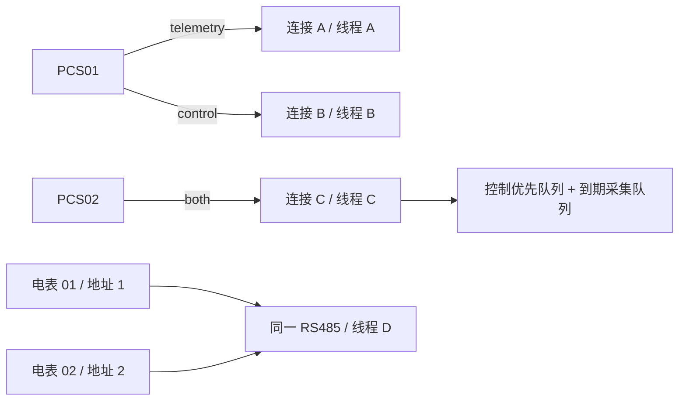
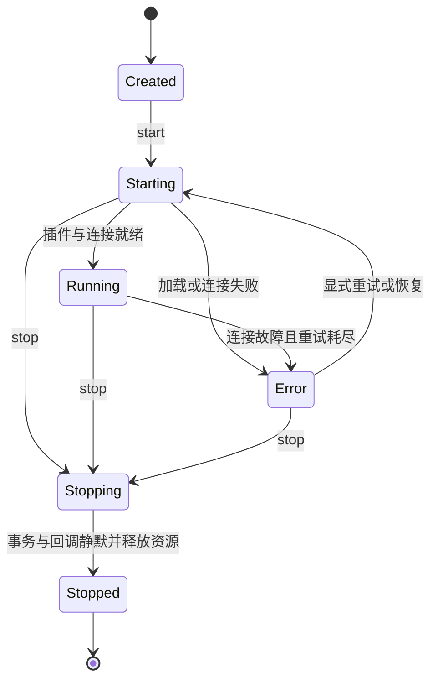
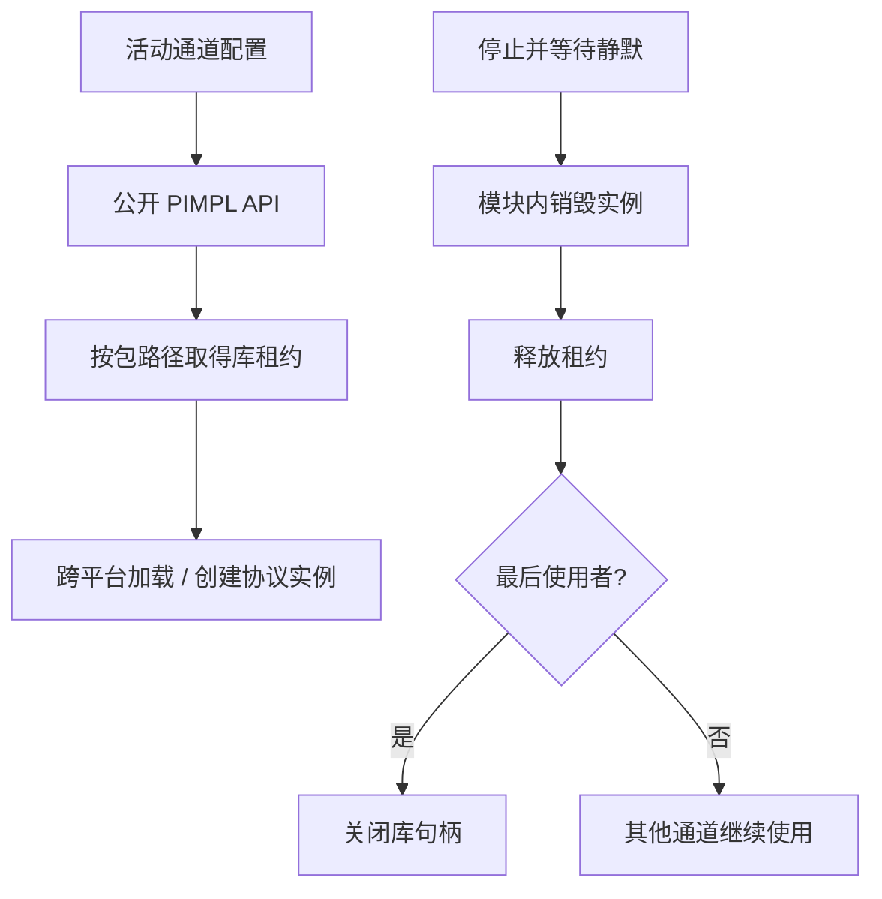
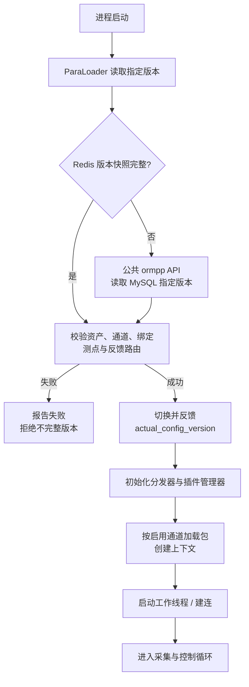
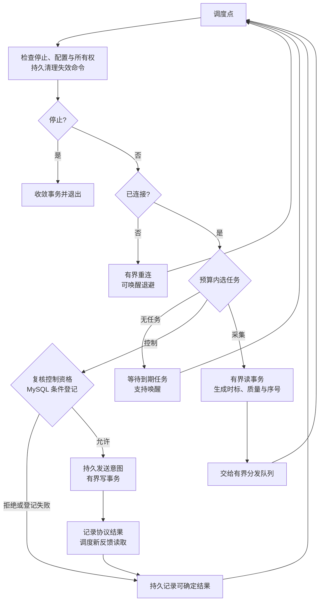
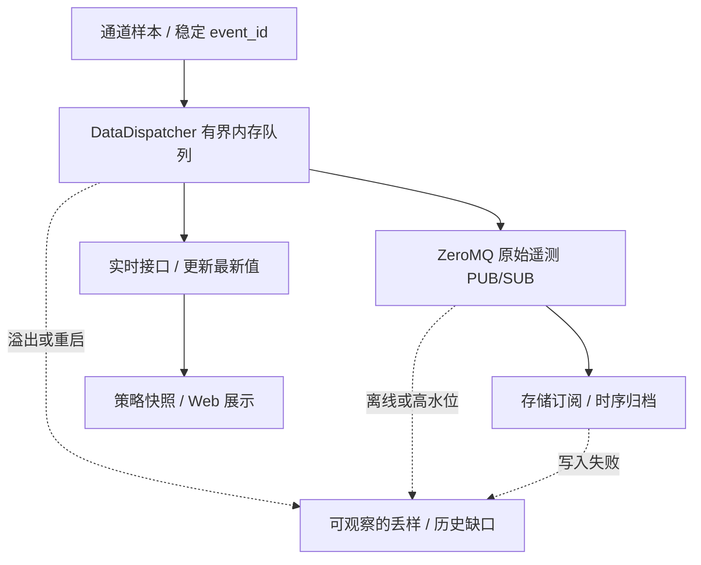
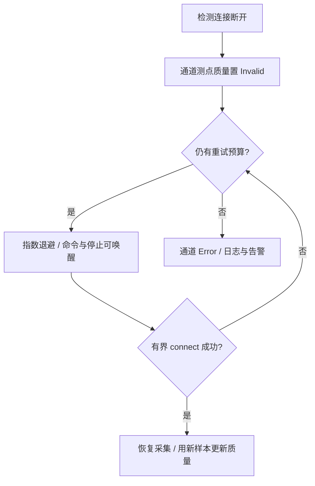

# 采集执行与协议插件设计

> 阅读整理：2026-10-21｜范围：C++17 通信进程的采集执行子模块，目标设计。轮询示例仅适用于 acquisition 客户端；主动上报和服务端按各自能力实现。

进程完整职责见[采集与上送进程](index.md)。本文聚焦通道调度、执行与分发；公共契约统一引用：

| 主题 | 权威设计 |
| --- | --- |
| 设备、通道、角色与路由 | [设备、通道与协议](../../architecture/channel-protocol.md) |
| 标准点、厂家点、实例绑定与反馈 | [设备模型](../../architecture/device-model.md) |
| 实时后端注入与并发 | [公共实时访问接口](../../common/realtime/access-design.md) |
| 资产路径与共享通道命名 | [Redis 键设计](../../common/realtime/redis-key-design.md) |

## 1. 概述

### 1.1 设计目标

负责遥测（YC）、遥信（YX）采集及已仲裁遥控（YK）、遥调（YT）的执行。

| 原则 | 约束 |
| --- | --- |
| 资源单一所有者 | 独立阻塞资源一个 C++17 工作线程；共享串口/总线统一调度，禁止重复打开 |
| 采控可分可合 | 设备与通道多对多；共用连接在事务边界优先控制，并保证采集新鲜度 |
| 协议按需加载 | 每协议包独立动态库；公开 C++ API 使用 PIMPL，跨库使用版本化 C ABI |
| 后端与协议解耦 | 分发器注入实时接口；采样缓冲、事件通道和配置仓储各自承担职责 |

### 1.2 目标协议与采集能力

| 协议 | 传输 | 默认端口 | 典型设备 | 动态库示例（Linux） |
| --- | --- | --- | --- | --- |
| Modbus TCP/RTU | TCP / RS485 | 502 | PCS、BMS、工控设备 | `libproto_modbus.so` |
| DL/T 645-2007 | 串口网关 / RS485 | 网关配置 | 电能表 | `libproto_dlt645.so` |
| IEC 60870-5-104 | TCP | 2404 | 远动设备、保护装置 | `libproto_iec104.so` |
| IEC 61850 MMS | TCP | 102 | IED；报告/控制按能力验收 | `libproto_iec61850.so` |

GOOSE/SV 需独立 profile、发布/订阅角色及验收，不属于 MMS TCP 接口。服务端模型与控制入口见[上送通道设计](../../architecture/channel-protocol.md#6-上送通道设计)。

## 2. 整体架构

### 2.1 架构图

### 2.2 核心组件职责

| 组件 | 职责 |
| --- | --- |
| `CollectEngine` | 创建、启停通道，协调配置、插件与分发 |
| `ChannelThread` | 独占阻塞资源及协议实例，调度有界采集/控制事务 |
| `PluginManager` | 跨平台 PIMPL 加载器，管理包缓存、工厂和库租约 |
| `ProtocolPlugin` | 动态库内 PIMPL 实现，通过版本化 C ABI 交互 |
| `DataDispatcher` | 缓冲采样，分别更新最新值与发布事件；预算内重试，超限报告缺口 |
| `ParaLoader` | 加载指定版本的资产、绑定和测点，校验后反馈实际应用版本 |

## 3. 通道线程模型

### 3.1 一个独立资源一个工作线程

资产归属、连接资源和协议地址分别建模。多个逻辑通道指向不可并发资源时，合并到同一调度器或拒绝配置；独立采控连接须设备支持，控制冲突仍按设备仲裁。

### 3.2 线程隔离的好处

独立资源可分别设置周期、超时及 CPU/内存监控，阻塞 I/O 不拖住其他独立通道。共享总线仍相互影响；插件内存错误仍可能使整个进程退出。

### 3.3 通道线程生命周期

停止超时保留实例和库租约，不强制进入已停止状态；卸载规则见第 4 节。

### 3.4 通道上下文结构

| 字段组 | 运行时内容 |
| --- | --- |
| 身份与配置 | `channel_id`、不可变配置、实际应用版本 |
| 资源 | 工作线程、运行标志、持有库租约的协议对象 |
| 绑定与采集 | 设备运行视图、到期采集任务、采集周期 |
| 控制调度 | 有界优先队列、队列锁、命令/停止/配置变更的唤醒条件 |

队列锁不跨网络 I/O 持有；协议句柄只由资源所有者线程使用。

### 3.5 绑定、路由与控制插队

| 配置 | 用途 |
| --- | --- |
| `device_channel_binding_version` | `device_id/channel_id/config_version/operations/device_address`；telemetry_in/control_out 决定采、控或共用 |
| `channel_version.local_role` | 本端 client/server 角色，与采控操作组合分开 |
| `vendor_point_route_version` | 厂家点的协议地址、编码和通道 |
| `point_binding` | 标准点到厂家点的转换及主备来源 |
| 标准命令配置 | 写入编码、启用条件、独立反馈点；写入与反馈可走不同通道 |

`telemetry` 禁止控制写入；`control` 不做常规轮询，但允许协议确认/反馈读取；`both` 串行采控。

调度只在**响应完成或超时后**切换任务，不打断已发送帧。大批读取拆成多个有界事务；控制连续预算、采集最大延迟和关键读取预算共同防止饥饿。同优先级 FIFO，队满返回 `queue_full`，过期返回 `expired`；仅允许覆盖且未发送的设定可合并，并记录 `superseded`。

ZeroMQ 入口先校验并持久登记 inbox，执行器恢复后入队、唤醒；网络回调不直接操作协议。执行前复核期限、配置版本、控制权代次、互锁和 MySQL 执行状态；持久登记失败则不执行。旧实例未确认隔离时不接管控制。通道故障或来源切换更新质量与 `source_epoch`，反馈使用发送后的新样本。

## 4. 动态库插件机制

同一 Modbus 包复用库句柄，各通道实例与会话隔离；浏览配置、编辑草稿和未启用通道不加载。API、C ABI、所有权及部署规则见[通讯协议动态库设计](protocol-design.md)。

## 5. 采集流程

### 5.1 启动流程

### 5.2 采集与控制循环

重连、写入、回读均设上限。仅满足独立反馈条件才标记 `verified`；结果未知先对账，命令回执与 outbox 同事务保存。禁止用整轮设备遍历、无限清空命令或固定 sleep 代替预算调度。IEC104 等主动上报协议另行处理接收和保活事件。

### 5.3 数据分发与恢复

| 边界 | 规则 |
| --- | --- |
| 线程 | 独立分发线程执行数据库/Redis 工作；队满显式背压或降采样 |
| 最新值 | 按 `source_epoch/sequence` 去旧，实时写入与遥测发布分别记录结果 |
| 历史 | 发布成功仅代表本地接受；不等归档确认，内存样本不保证跨重启恢复；不从最新值伪造缺失历史 |
| 通知 | 原始遥测与刷新提示使用独立主题；历史仅消费原始事件 |
| 持久业务 | 告警/回执先写 MySQL/outbox；采集按持久 inbox 与执行状态对账，不用本地文件替代 |
| 连接 | 配置/业务线程调用公共 ormpp Repository；连接池/实体/事务实现统一于公共层，本进程装配独立实例 |

数据库注入、SQL 约束及连接归属见[公共数据库访问层](../../common/database/)，采集业务不另写 ORM 映射或数据库客户端调用。

## 6. 目录结构

采集调度与分发位于 `backend/src/net/collect/`，处理器位于 `backend/src/net/handler/`，协议实现位于 `backend/src/net/protocol/`，公开头位于 `backend/include/net/protocol/`。详见[通讯协议工程结构](protocol-design.md#8-工程与构建)及[处理器接入](../../reference/protocol/handlers.md)。

## 7. CMake 构建配置

自研目标采用 C++17，主程序静态链接轻量 SDK，具体协议构建为运行时加载的 `MODULE`。系统依赖使用 `Threads::Threads`、`${CMAKE_DL_LIBS}`；符号导出、产物命名和部署统一见[协议构建契约](protocol-design.md#8-工程与构建)。

## 8. 关键设计决策

### 8.1 为什么选择一个通道一个线程？

| 方案 | 取舍 |
| --- | --- |
| 每独立阻塞资源一线程（首期） | 适配同步协议库、调度简单；线程开销随资源数增长 |
| 线程池 + 异步 I/O | 线程可控；同步协议库需额外封装 |
| C++20 协程 | 高并发轻量；超出当前 C++17 约束，协议库适配复杂 |

在目标硬件实测线程数、内存和响应开销；规模扩大后可评估 C++17 事件循环，不预设通道数量上限。

### 8.2 为什么选择动态库按需加载？

按需加载便于协议独立部署、升级，代价是维护稳定 ABI 与加载生命周期。静态链接所有协议会增加主程序依赖；进程级隔离更强，但增加通信与运维成本。

### 8.3 为什么插件接口使用 C 导出函数？

C 导出避免名称修饰，内部仍用 C++ PIMPL；不跨边界传递 STL 或异常。布局、版本、调用约定、所有权及工具链组合仍须约定和实测，`extern C` 本身不保证二进制兼容。

## 9. 错误处理与重连机制

### 9.1 连接异常处理

退避示例：`min(1s × 2^retry_count, 60s)`；具体重试预算按通道配置。

### 9.2 采集超时处理

| 情况 | 处理 |
| --- | --- |
| 单次读超时 | 对应点置 Invalid，隔离迟到响应，必要时重建会话 |
| 连续超时超阈值 | 触发重连 |
| 控制发送前到期 | `expired` |
| 发送后无法确认 | `unknown`；先回读/核验，不盲目重发 |

## 10. 性能优化策略

### 10.1 Modbus 批量读取优化

同一从站、同一功能码的连续寄存器合并；不同从站分开。例如 slave 1 的 FLOAT@0、FLOAT@2 合为读取 0～3，UINT16@10、UINT16@11 合为读取 10～11。每批受长度与控制延迟预算限制，完成后返回调度点。

### 10.2 IEC104 事件驱动优化

启动总召同步，后续处理自发上报；按链路配置 T1/T2/T3 超时。

### 10.3 IEC61850 DataSet 批量读取

按 FC 分组，利用 DataSet 批量读取；连接时发现并缓存 LN/DO 模型。
