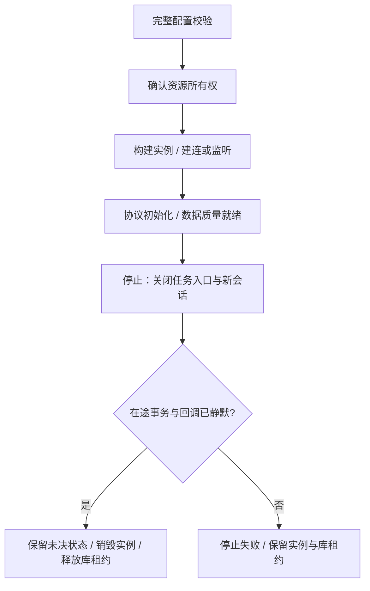

# 采集与上送进程

> 进程：`ems-collector`｜当前入口：C++20｜状态：基础采集入口已接入，完整采集与上送能力仍按下述设计推进。

构建、进程参数、配置文件与当前实现边界见[采集进程构建与运行](running.md)。

该进程从现场设备取得状态，执行经策略仲裁的命令，并向调度中心或第三方系统提供标准状态。客户端/服务端是协议角色，采集/上送是业务用途。

## 模块与依赖

| 模块 | 职责 | 主要依赖 |
| --- | --- | --- |
| 配置装载器 | 加载完整版本，校验通道/profile/绑定/点映射，反馈应用状态 | 配置仓储、公共 ormpp API |
| 通道管理器 | 资源独占、通道实例、重连/监听、启停和版本切换 | 协议工厂、资源协调 |
| 采集执行模块 | 轮询、报告/事件接收、解码、标准投影、执行和回读 | acquisition 绑定、厂家点路由 |
| 上送模块 | 标准点出口映像、总召/读取/报告、peer 权限和会话队列 | forwarding 映射、统一 RealtimeClient |
| 外部意图受理模块 | 北向控制校验、持久保存意图/outbox、反馈受理与结果 | MySQL、公共 ormpp API、可靠回执 |
| 数据分发器 | 有界内存缓冲、最新值、ZeroMQ 原始遥测发布与丢样报告 | IRealtimeStore、ZeroMQ 遥测发布器 |
| 执行命令入口 | 消费已仲裁命令，校验去重/有效期/所有权，路由通道 | 命令流、MySQL 执行状态/outbox |

采集与上送共享逻辑点模型和公共访问接口，不共享未经约束的驱动句柄。北向控制经过持久意图和策略仲裁后，才可能回到南向执行入口。

配置、意图、inbox、执行状态及回执/outbox 统一调用[公共 ormpp Repository](../../common/database/)，进程入口注入本进程数据库上下文；实体、连接管理和 SQL 不在采集模块重复实现。

## 线程与隔离

| 执行单元 | 隔离规则 |
| --- | --- |
| 阻塞串口/轮询 | 每独立资源一个工作线程；异步协议用事件循环 |
| listener / session | listener 管多会话；会话各有协议状态、发送窗口和有界队列 |
| 配置/意图/采样/回调 | 分别设预算；上送慢消费者不挤占采样和反馈 |
| 队列 | 满时背压或拒绝；最新值可显式合并，告警/命令/原始事件不统一覆盖 |

## 生命周期与状态

分别报告进程存活、通道就绪、listener 状态、session 数量/状态、设备通信状态和测点新鲜度。服务端有连接不表示全部设备在线；北向断线不停止南向采样。

## 详细设计与验收

- [设备、通道与协议](../../architecture/channel-protocol.md)：模型、角色矩阵、采集/上送映射、北向控制与例子。
- [采集执行与协议插件](design.md)：采集任务、调度、事务边界插队和数据分发。
- [通讯协议动态库](protocol-design.md)：PIMPL API、按需加载、C ABI、安全卸载与跨平台部署。
- [公共实时访问接口](../../common/realtime/access-design.md)：后端注入、版本并发与恢复。
- [libmodbuspp 开发参考](../../reference/protocol/libmodbuspp-guide.md)：第三方 API 示例。

验收覆盖一设备多通道、多设备共享资源、多上级会话、采控共用、慢消费者、旧配置迟到、重复/未知命令和退出恢复。各协议的客户端、服务端分别验收。
