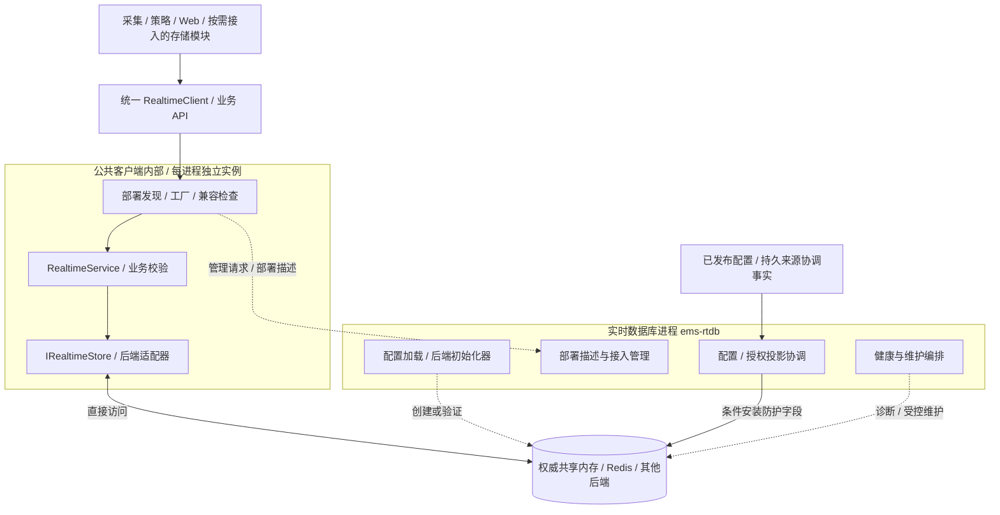
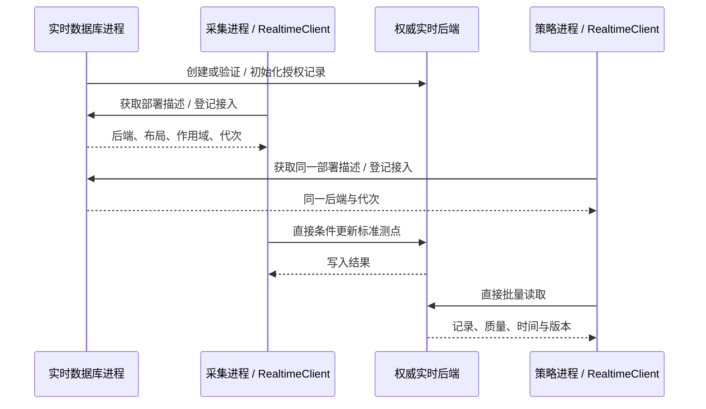

# 实时数据库进程详细设计

> 版本：1.2｜日期：2026-10-24｜状态：分阶段实现；本批落地第三方后端、动态库和配置驱动的基础访问，完整类型化门面及管理 RPC 后续接入。
> 本文定义实时数据库进程、统一客户端、配置驱动及后端扩展的职责；底层记录、并发、来源检查与错误语义引用[公共实时访问接口](../../common/realtime/access-design.md)，不另建一套数据契约。

## 1. 设计决策

EMS 采用采集与上送、实时数据库、存储、策略、Web 五类业务进程。`ems-rtdb` 在 Redis、共享内存以及未来合格实时后端下均常驻，统一管理实时数据接入、后端配置、生命周期和维护。它的职责不只限于创建、销毁共享内存。

对业务提供统一的 `RealtimeClient` 公共库接口，业务代码不选择 Redis/共享内存，不创建后端对象，不维护具体连接或映射。实时数据库进程读取权威后端配置并发布部署描述；客户端库内部完成发现、适配器选择、连接/挂接和兼容校验。正常数据访问继续保留共享内存直接映射能力，不因统一接口而强制逐次经管理 RPC 转发。

| 项目 | 决策 |
| --- | --- |
| 业务入口 | 只调用 `RealtimeClient` 的类型化测点/状态 API；不包含具体后端头文件，不传 BackendSpec 或 Redis/共享内存参数 |
| 正常数据访问 | 客户端库内部 `RealtimeService → IRealtimeStore → 选定适配器`；不经实时数据库进程逐次转发 |
| 共享内存 | 操作系统管理同一共享对象；各进程拥有独立映射、句柄和 C++ 对象 |
| Redis | Redis 服务持有数据；各进程独立连接池，实时数据库进程管理部署契约与接入状态 |
| 后端选择 | 由实时数据库进程读取配置、验证能力并发布，一个作用域、一个部署代次只有一个权威后端；Redis 保持默认 |
| 后端扩展 | 实现统一存储契约与所需生命周期适配，注册到工厂后由配置选择；业务接口和字段语义保持不变 |
| 第三方实现 | 共享内存使用系统 Boost.Interprocess（本机 1.89）；Redis 使用仓库内 redis-plus-plus，不自行实现原生共享内存、socket 或 RESP |
| 交付 | `ems_rtdb` 共享库（Windows DLL/import library，Linux SO）及公共头文件、CMake 包；常驻 `ems-rtdb` 链接同一库 |
| 管理通道 | 目标采用内部版本化 gRPC；仅用于接入、诊断及维护，不进入每次实时读写路径 |
| 记录写角色 | 原始点、派生状态、通道状态、命令投影分别指定业务写入者，实时数据库进程不接管所有写入 |
| 消息与历史 | ZeroMQ 及 MySQL outbox/inbox 继续承担原有职责，不要求经过实时数据库进程 |
| 首期维护 | 停止受影响使用者后切换或重建；不承诺在线热扩容、跨后端双写或自动故障降级 |

这里的“对外接口”有两类：供业务代码调用的公共库 API，以及供进程之间使用的管理 API。前者在调用者进程内执行；后者才需要 IPC/RPC。管理进程存在不意味着共享数据必须经过它复制。

“业务不感知后端”指业务算法、公开 API 和业务配置不出现后端分支；公共客户端的内部实现必须识别后端并采用相应访问方式。数据服务由常驻进程和公共客户端共同组成，不能把 Redis 连接句柄或共享内存指针从实时数据库进程直接传给调用方。

## 2. 总体结构与依赖



公共模型、编解码、门面、客户端和存储适配器仍是可复用库，不能依赖 `ems-rtdb` 业务类。实时数据库进程装配生命周期管理；业务入口只创建统一客户端并注入业务模块，具体后端装配收口客户端实现。平台映射地址、连接池、虚函数对象和 STL 容器不跨进程传递。协议插件继续使用原有 C ABI，通过采集分发器接入统一 API，不要求每个插件单独连接管理服务。

## 3. 职责与写入归属

| 数据或行为 | 责任方 | 实时数据库进程的责任 |
| --- | --- | --- |
| 实测点、设备通信质量、通道状态 | 所属采集实例 | 建立接入信息，按确认的配置与来源事实安装防护字段 |
| 单元/站级聚合、策略状态与告警 | 策略 | 管理后端，不重复计算聚合或运行告警状态机 |
| 命令状态查询投影 | 执行/持久回执协调职责，具体状态字段固定写角色 | 提供存储空间；重建时要求责任方按 MySQL 事实恢复 |
| 已发布配置、来源所有权和代次 | 既有配置发布/持久协调流程 | 读取已确认结果并条件安装，反馈安装版本与缺失项 |
| 历史、审计、配置发布、outbox | 存储及事实产生进程 | 不改变原链路，不将最新值当作历史事件 |
| 用户身份、站点/资产可见范围 | Web | 提供运行诊断；业务鉴权仍在 Web 执行 |

每种记录明确唯一业务写角色；多个采集实例按资源所有权分片。初始化记录时先写无有效样本与防护字段，再允许样本更新，不能填默认零值伪造就绪。普通写入方保持 `accepted_source_id / accepted_source_epoch / accepted_config_version / write_enabled`，不能自行提高 epoch 获取写权。

实时数据库进程安装防护字段也使用同一记录 CAS，冲突后重读并核对当前持久授权。配置发布版本、授权已安装版本、实例已应用版本分别跟踪；多记录安装逐项完成，不承诺作用域内原子切换。分配来源代次、隔离旧采集实例和控制权仲裁仍由持久协调流程负责。现有来源协调尚未完成，实施时须先明确其权威 Repository 与隔离证据，不能以管理心跳代替。

## 4. 公共库接口与直接访问

### 4.1 统一业务接口

目标公开门面为 `RealtimeClient`，它复用 `RealtimeService` 的类型化数据模型与业务校验，不另造一套记录或方法语义。内部存储仍沿用 `IRealtimeStore` 的 `read / compareExchange / erase / readMany / writeMany / info / close`。具体测点/状态参数和逐项返回值引用[门面契约](../../common/realtime/access-design.md#53-业务层使用的公共-api)。客户端为新增设计，现有存储接口不等于已经存在此门面。

| 业务操作 | 统一约定 |
| --- | --- |
| 创建/关闭客户端 | 输入服务定位、身份/角色、作用域和操作预算；库内部发现后端并管理本进程连接/映射 |
| `getPoint / getPoints` | 读取类型化值、质量、时间、来源、配置版本与陈旧状态，保留逐项结果 |
| `updatePoint / updatePoints` | 提交标准样本，由公共门面检查来源/版本/顺序并条件更新；错误不简化成 bool |
| `getState / updateState` | 按状态 schema 与写角色读取/更新设备、通道及聚合状态 |
| `getCommandState` | 查询持久事实的实时投影；不通过实时写值执行设备控制 |

业务层不能调用 `RedisStore::open`、`SharedMemoryStore::open` 或自行拼接底层键，也不根据错误文本猜测后端。存储布局、命名、连接池、同步、重连与错误转换都留在公共客户端实现；后端名称可在受限运维诊断中显示，不成为业务分支条件。

### 4.2 接入与语义约束

| 约束 | 集成要求 |
| --- | --- |
| 进程内实例 | 每个进程独立持有客户端，库内部创建 store；线程间可按接口约定共享，跨进程不共享对象 |
| attach | 客户端库在共享内存模式强制 `create_if_missing=false`，业务层不能覆盖，只挂接已发布的段 |
| 并发 | 库内部执行进程间锁、完整记录读取与 CAS；禁止进程自行 memcpy 修改业务字段 |
| 批量 | 保留逐项结果与部分成功；不把 `readMany` 当作同一时刻快照 |
| 时间与错误 | 每次操作有本地 steady deadline，保留 NotFound、NotReady、Conflict、Unknown 等区别 |
| 地址 | 传逻辑记录键，不能传共享段 offset、裸指针或 Redis 原始键给业务算法 |
| 关闭 | 停入口、等待本进程有界在途调用结束，再关闭自身映射/连接；不删除共享对象 |

### 4.3 典型访问顺序

以下接入由公共客户端内部完成，采集/策略业务代码只看到同一套 API。管理服务不参与后两次数据调用：



## 5. 管理接口与部署描述

管理服务目标名为 `RealtimeAdminService`，契约放在 `contracts/proto/`，首期采用内部 gRPC。接口名和字段为设计约定，仓库尚无对应服务实现。客户端的管理连接与数据连接分开；RPC deadline 转成本地剩余预算，不跨进程序列化 steady_clock 的绝对时间。

| 操作 | 输入 | 返回与限制 |
| --- | --- | --- |
| `GetDeployment` | 逻辑作用域、支持的契约/布局版本 | 当前发布描述；初始化/维护中返回明确状态，不能猜测后端 |
| `RegisterClient` | 实例 ID、启动唯一标识、角色、作用域、已验证的部署/存储代次 | 接入 ID、管理者启动标识、心跳周期；登记不授予设备控制权 |
| `ReportClient` | 接入 ID、加载版本、挂接代次、就绪/维护状态及有界统计 | 接收结果、重核描述或重同步提示；超时只表示状态未知 |
| `UnregisterClient` | 接入 ID、启动标识、退出状态 | 幂等注销，不由注销数量推断可以删段 |
| `GetHealth` | 授权的作用域、分页/条数上限 | 管理、后端、授权、接入状态及诊断；不无限扫描测点 |
| `PrepareMaintenance` | 运维身份、期望部署代次、操作 ID、维护类型 | 维护计划与当前阶段；不立即重建、删段或切换权威后端 |

有副作用的管理请求使用稳定操作 ID 与期望代次；响应丢失后先查询操作状态，不盲目重放。维护结果与发布进度须保存到部署管理的持久记录，原子发布运行描述；具体文件/服务适配在实施时固定，不能仅存于会随进程退出消失的内存。首期实际停止进程及最终清理由部署管理执行，管理 API 不提供任意段名删除、SQL 或任意字段写入接口。

部署描述至少包含：

| 字段组 | 字段与含义 |
| --- | --- |
| 契约 | schema 版本、支持范围、逻辑作用域、配置/授权应用状态 |
| 部署身份 | `deployment_generation`：后端选择及部署清单代次；管理进程普通重启不改变 |
| 存储身份 | `storage_generation`：当前后端实例代次；共享段创建后读取实际值，禁止自行推算 |
| 管理身份 | `manager_incarnation`：本次管理进程启动标识；只用于接入重登记 |
| 后端定位 | 后端类型、共享段名或 Redis 非敏感端点描述、凭据引用 |
| 兼容与容量 | 布局/schema、Boost/平台同步 ABI 要求、段大小、记录数及记录/批量上限；首批仅段级锁 |

部署管理持久保存预期清单，实时数据库进程检查真实后端后发布当前描述。公共客户端内部核对可信服务身份、作用域和描述，选择已注册的适配器，再打开后端并复核实际 `info()`/布局；业务代码不解析这些后端字段。描述文件和 RPC 应答不能代替后端核验。密钥不出现在描述、心跳或日志中。`revision`、来源 `source_epoch`、部署代次、存储代次及管理者启动标识互不替代。

## 6. 启动与接入

一个 authority domain 对应一个作用域或显式列出的作用域集合；整站和按单元管理二选一，不允许重叠管理。首期每个管理实例只负责一个 domain；Redis 跨主机使用时由部署指定唯一活动管理者，不引入未经验证的自动选主。

1. **取得管理权**：部署锁保证 domain 只有一个管理者；同机使用独立于共享段的 OS 独占锁，并在进程生命周期内持有。跨机 Redis 场景依赖部署隔离旧管理者，单机锁不足以证明唯一性。
2. **加载清单**：校验后端选择、平台、预算、容量和已发布配置；Redis 只连接验证，不由实时数据库进程启动 Redis 服务。
3. **创建或复用后端**：共享段不存在时仅在首次部署或已批准的恢复流程创建；已存在时验证布局/存储代次并复用，不清零现有记录。
4. **建立授权投影**：按持久配置与来源事实初始化缺失记录或协调版本；不能每次重启都重置样本、revision 或来源授权。
5. **发布接入描述**：真实后端通过结构检查后允许兼容客户端挂接，分别显示尚未完成的授权/状态恢复。
6. **客户端接入**：业务入口创建 `RealtimeClient`；库内部核对描述、选择适配器，以禁止创建模式打开共享段或创建自身 Redis 池，构造校验门面并登记实际版本与代次。
7. **业务就绪**：按本角色检查配置、所依赖记录的授权和新鲜度；管理服务就绪不代表设备已在线或策略可控制。

管理服务发布前，初始化与部署诊断可用，普通客户端有限重试并保持未就绪。共享段 header 的结构 `READY` 只说明布局和锁已初始化，不代表全部测点、命令投影或业务依赖已恢复。

## 7. 共享内存生命周期

### 7.1 创建、挂接与平台差异

实时数据库进程是指定初始化者，负责命名、容量、布局检查与常驻持有；业务进程只能 attach/detach。初始化仍遵循公共实时专题的独占创建、结构 READY 和崩溃恢复协议，业务进程不自行 `unlink`、truncate 或重建。

Linux 命名共享内存由 `shm_open/mmap` 创建和挂接，`shm_unlink` 移除名称；已有映射可能继续存在，直到全部使用者解除映射才释放对象。因此同名删除再创建可能让新旧进程访问不同对象，维护不能以“名称相同”证明数据相同。[Linux shm_open/shm_unlink 手册](https://man7.org/linux/man-pages/man3/shm_open.3.html)

Windows 使用命名文件映射，各进程分别取得视图和句柄。实时数据库进程常驻持有映射，所有引用释放后对象不能被视为仍然存在；重新创建须按新存储代次处理。[Microsoft 命名共享内存](https://learn.microsoft.com/en-us/windows/win32/memory/creating-named-shared-memory)、[关闭映射](https://learn.microsoft.com/en-us/windows/win32/memory/closing-a-file-mapping-object)

本批使用系统 Boost.Interprocess 的 managed_shared_memory、共享容器和命名锁，替代旧自研映射/布局/原子提交实现。Interprocess 与全部 Boost 依赖使用同一安装版本，本机为 1.89，其他系统通过 CMake 查找系统安装。上面引用的原生 OS 行为用于说明差异，不能直接当作 Boost 各平台实现的生命周期保证。Boost 管理段使用独立名称/版本，与旧段不兼容；Windows 不再依赖最后句柄关闭即消失的假设，清理统一经 Boost remove 并要求全部使用者先退出。参与者须使用兼容的 Boost、编译器、位数与 OS 命名空间。

### 7.2 管理进程重启

管理进程退出后，已挂接且共享段仍有效的业务进程可以继续按现有配置与授权直接读写，不要求每次操作探测管理心跳。其前提是实际存储代次未变、锁恢复成功、样本有效，且业务自身依赖的持久状态与控制权仍满足要求。

管理不可用期间不开放新来源授权、后端切换或新客户端的就绪接入；客户端普通运行重读不依赖管理 RPC。重启的管理者取得唯一管理权后，核对持久部署记录、段内实际 generation、布局和授权，再复用原段；更新 `manager_incarnation` 并收集重新登记，保留原 `storage_generation`。

若对象已丢失、初始化未完成或实际代次无法与可信记录对应，进入恢复待办并停止业务就绪，不因 `create_if_missing=true` 自动创建空段接替原段。心跳过期和 PID 不存在都不是足以删除共享对象的唯一证据。

### 7.3 扩容、重建与清理

首期使用维护窗口，不承诺在线热迁移：

1. 持久登记维护操作及目标部署，关闭新接入，暂停受影响域的新常规调度。
2. 通知参与者停写并排空本进程在途操作；采样缓冲仍有界，超限和停机历史缺口按原规则报告。
3. 由部署管理确认相关使用者已退出或已被 OS/容器级隔离；未报告、断线和心跳超时不能当作已停写。无法证明旧实例隔离则中止切换。
4. 创建带新名称及新 `storage_generation` 的目标共享段，校验容量与布局；不原地修改仍在使用的锁或记录结构。
5. 按配置和持久来源事实恢复防护字段；可复制经验证的最后值，但保留原时间/质量并重新判断陈旧。命令投影从 MySQL 恢复，不能推断未知设备动作已完成。
6. 原子发布新部署描述，重启/重新挂接全部受影响使用者，核对配置、实际代次和角色恢复后开放写入与调度。
7. 确认旧段不再有使用者，按平台规则清理旧对象；维护失败停在明确阶段，不自动把旧写入者接回新权威域。

首期不以“客户端收到了新描述”替代旧写入者隔离。共享段内的普通代次字段和 CAS 无法阻止一个仍持旧映射的进程继续操作旧对象；可靠切换依赖上述停止和隔离流程。回滚同样暂停、隔离并发布新的部署代次，不直接恢复旧来源授权。

## 8. Redis 模式与后端切换

### 8.1 所有后端保留常驻管理

选择 Redis 时也启动 `ems-rtdb`，负责统一配置、部署描述、能力检查、接入及维护。Redis 服务自身负责数据库运行，不能据此省略本项目的数据服务管理入口。公共客户端内部用 `RedisStore` 直接访问权威主节点，持有本进程连接池和预算；业务代码不创建或持有 Redis 句柄。实时数据库进程持有自己的池，重启它不重启 Redis，也不共享连接句柄。

Redis 拓扑恢复按公共实时专题核对来源、配置及状态，管理健康不能代替每个客户端的实际连接健康。当前适配器配置是单地址/端口模型，不能将设计中的 Sentinel、Cluster 或 TLS 字段宣称为已支持能力。

### 8.2 配置驱动与受控切换

权威后端选择仅由实时数据库进程配置的 `realtime.backend.type` 与该后端 options 指定。客户端业务配置不重复填写 backend、Redis 地址或共享段名，避免各进程配置漂移。实时数据库进程解析并校验配置，公共客户端根据发布描述自动组装已内置的适配器。

首期“通过配置切换”指修改实时数据库进程配置后，在维护窗口停止并隔离旧使用者、恢复/迁移状态、发布新部署代次，再重启或重新接入客户端；不需要修改业务 API 或算法代码。它不表示修改文件后立即热切换，也不表示切到空后端就已经迁移了运行状态。运行中的客户端不能同时接受两个作用域相同、代次相同而后端不同的描述。

切换共享内存、Redis 或未来后端沿用第 7.3 节的停写/隔离原则，具体资源创建、复用、清理由所选生命周期适配执行，并遵守[公共接口的迁移约定](../../common/realtime/access-design.md#12-实施计划后端切换与回滚)。同一作用域不得同时接受两个后端的权威写入；后端故障不自动选择另一个数据库。跨主机共享段不受支持，客户端内部能力检查必须拒绝不兼容的部署。

### 8.3 新增实时后端

1. 实现 `IRealtimeStore`，保持逻辑身份、完整记录、CAS、逐项批量、deadline 和错误确定性一致；不把数据库特有字段加入公共业务 API。
2. 在公共实现模块中封装 SDK、配置解析、生命周期与能力检查，包括如何由实时数据库进程初始化/验证，以及客户端如何接入。
3. 以稳定名称注册到 `BackendFactory`，更新合法配置 schema 和部署能力描述；管理端与客户端须支持同一注册名及兼容版本。
4. 用同一存储契约、来源校验、客户端业务用例及维护恢复流程验收，再允许配置选择。
5. 业务源代码仍只使用 `RealtimeClient`；新增后端不新增业务分支，不改变对外字段和错误语义。

首期采用编译期内置实现和显式注册。已经随公共库发布的后端可配置选择；新增驱动需要更新公共库及相应部署，静态链接时也需重新构建使用者，不承诺业务二进制永不更新。未编译、能力不足或版本不兼容的后端明确返回 Unsupported/不就绪，不能静默退回默认后端。未来动态驱动插件属于独立演进，不能把当前 C++ 虚函数/STL 接口当作稳定插件 ABI。

## 9. 通知、历史、控制与 Web

- **变化提示**：由实际更新者在写入后按既有 ZeroMQ 主题发布；实时数据库进程不靠遍历共享段补发每次变化。通知仅唤醒重读，可以丢失；周期性读取和新鲜度检查仍是正确性的基础。管理通知与测点变化主题分开。
- **历史采样**：采集/派生样本产生者发布完整原始事件给存储，最新值更新与发布分别计结果。实时数据库进程不从共享内存轮询生成历史，也不能承诺收到所有中间样本。
- **控制闭环**：写实时值不触发设备动作。MySQL 意图/outbox/inbox、策略仲裁、采集执行与回读链路继续运行；实时数据库进程只维护实时授权投影和状态存储。
- **Web**：同机受信任的 Drogon 后端通过公共门面直接读取，与采集、策略使用同一后端。浏览器只访问 REST/WebSocket；Web 的用户权限、分页和展示刷新由 Web 执行，读取锁等待放入有界业务工作池。

跨主机 Web 无法直接读取本机共享段；首期需要跨机共享实时访问时选 Redis。受限查询网关是另行评审的扩展，不继续默认要求存储进程代理所有 Web 实时查询。

## 10. 权限、健康与故障

### 10.1 直接访问的信任边界

共享段使用 OS 权限/ACL 限制参与者，管理接口另行认证并区分普通接入、只读诊断和维护权限。公共库执行角色与来源校验，但能直接写共享段的受信进程具有底层修改能力；这不是抵御恶意调用者的逐记录权限边界。

当前共享内存读操作也会更新进程间锁的同步状态，映射使用读写权限；Web 的“业务只读”不能等同于 OS `PROT_READ`/只读视图。更强隔离需要额外网关或经验证的布局/权限设计，首期不宣称已支持。

### 10.2 就绪与观测

| 状态 | 判断 |
| --- | --- |
| 管理存活 | 管理循环与独占管理权正常，不等于后端就绪 |
| 后端结构就绪 | 后端可访问、实际代次/布局匹配、必要锁可恢复 |
| 配置授权就绪 | 已确认配置与来源授权按依赖集合安装完成 |
| 客户端就绪 | 各实例报告自身后端、配置与业务依赖有效；报告超时标记未知 |
| 控制就绪 | 策略/采集分别复核持久状态、隔离、质量和能力，实时数据库进程不代为承诺 |

指标包含管理重启/接入拒绝、未就绪原因、共享容量、CAS 冲突、锁超时与恢复、代次不匹配、授权安装滞后、Redis 池等待和后端不可用。直接数据访问的调用量/时延由每个进程采集，管理进程自身流量不能代表全系统吞吐；不承诺现有接口已有 slot 使用率扫描或集中指标聚合，须补受限诊断接口。指标避免 point_id 等高基数标签。

### 10.3 故障矩阵

| 故障 | 处理与边界 |
| --- | --- |
| 管理进程退出、后端仍有效 | 已挂接者按原授权访问；新接入和配置/授权变更暂停；恢复复用同代次 |
| 主机重启、共享资源丢失或损坏 | 按所选 Boost 实现检查有效性并受控恢复；普通关闭不默认删除，缺失时不能填零冒充在线 |
| 初始化者中途崩溃 | 保持未就绪，确认无使用者后管理恢复；客户端不抢先创建 |
| 两个管理者同时启动 | 唯一管理权获取失败者退出，不修改后端；跨机先保证部署隔离 |
| 写入进程持 Boost 命名锁崩溃 | 后续访问有界超时并报告不可用；不自动强制解锁或继续使用可能损坏的容器，停止/隔离所有使用者后重建 |
| 容量满、记录过大 | 返回 ResourceExhausted/InvalidArgument，不覆盖有效数据；进入容量维护流程 |
| 代次/布局不匹配 | 拒绝接入或就绪，不能原地解释为当前布局 |
| Redis 或共享后端不可用 | 客户端保留结构化错误，按业务规则降级；不自动另选后端 |
| 管理通知/变化提示遗漏 | 重读描述或权威快照，检查配置和新鲜度，不依赖一次通知恢复历史 |
| 维护时旧实例无法确认隔离 | 停止切换，保留维护状态；不因心跳超时清段或开放新写入者 |

## 11. 配置与工程组织

以下 YAML 是目标配置示例，不是现有解析器支持承诺。实时数据库进程独占读取后端配置，业务进程只提供公共客户端的服务定位、身份/作用域及调用预算。布局/容量与实际后端参数须统一，创建权限由库按角色决定，不能让业务配置任意覆盖。

实时数据库进程配置示例：

```yaml
rtdb_service:
  instance_id: "rtdb-station001"
  authority_domain: "station001-realtime"
  scopes: ["station:station001", "unit:ess000001"]
  deployment_generation: "rt20261024a"
  admin_endpoint: "127.0.0.1:5562"
realtime:
  backend:
    type: shm
    options:
      segment_name: "station001_rt_a"
      capacity: 1024
      shard_count: 16
      max_record_bytes: 65536
      max_batch_items: 256
      segment_bytes: 268435456
```

选择已发布的 Redis 适配器时，保持 rtdb_service 的服务配置，仅替换 realtime 后端段：

```yaml
realtime:
  backend:
    type: redis
    credentials_ref: "secret/ems/realtime"
    options:
      address: "127.0.0.1"
      port: 6379
      database: 0
      pool_size: 4
      max_record_bytes: 65536
      max_batch_items: 256
```

业务进程的配置在两种后端下相同，不填写 backend、段名或数据库地址：

```yaml
realtime_client:
  service_endpoint: "127.0.0.1:5562"
  instance_id: "collector-station001-01"
  role: collector
  scopes: ["station:station001", "unit:ess000001"]
  operation_timeout_ms: 50
```

`storage_generation` 来自实际后端，不在示例中预造。容量按 Boost 容器、allocator 与业务记录核算，不承诺任意点数或固定时延。上面的 YAML、credentials_ref 与远程管理描述仍是目标设计；首批实际配置是 backend/conf 中的 JSON，尚不支持凭据引用和管理服务字段，解析时明确拒绝。后端参数只在 DLL 内转换；密钥不能进入日志或未来管理描述。

目标工程在现有目录上增量补充，不搬迁已完成的后端实现：

### 11.1 动态库交付

公共实时 API 统一编入 `ems_rtdb` SHARED target，并提供导出宏、安装头文件、运行库和 CMake 导出包。业务只包含公共头、链接 `ems::rtdb`；Boost/redis-plus-plus 的头和 SDK 类型留在实现侧，不由业务调用原生 API。redis-plus-plus 运行库及其 hiredis 依赖按实际链接方式随包部署，hiredis 仅作为第三方的传递依赖，不直接用来编写业务后端。

本批 C++ API 使用 STL/Result 类型，支持相同编译器 ABI、架构、构建配置与兼容 CRT 的应用，不宣称跨 MSVC/MinGW 或任意工具链二进制兼容。对象在 DLL 中创建并通过导出的析构释放。动态库不是独立业务进程，直接共享内存访问仍在各调用进程中执行。

先交付记录级 RealtimeClient（read/CAS/erase/batch）、严格 JSON 配置及创建者/挂接者角色。完整类型化测点门面、授权业务闭环、管理 RPC 和自动发布配置清单仍按后续阶段交付；不能将首批低层 API 当成已经完成控制授权。配置创建权限仅给予常驻进程，业务客户端不能自行创建共享段。

可执行程序名统一为 `ems-rtdb`。新进程实现规划在 `backend/src/rtdb_service/`，与已有 `backend/src/rtdb/` 旧库和 `backend/src/realtime/` 公共后端实现区分；本次不移动既有代码。文档保留 `processes/data/` 路径以维持站内链接稳定，标题与导航统一使用“实时数据库进程”。

```text
backend/include/realtime/             # 已有存储、工厂及后端公共头
  realtime_client.h                  # 待实现：唯一业务入口，隐藏具体后端与接入
  realtime_service.h                 # 待实现：类型化门面
  deployment.h                       # 待实现：部署描述及校验
  admin_client.h                     # 待实现：独立管理客户端
backend/src/realtime/                 # 已有 shm / Redis；补客户端、发现、内部组装
backend/src/rtdb_service/              # 待新增：ems-rtdb 组装与业务编排
  main.cpp
  lifecycle_manager.*
  deployment_registry.*
  authorization_installer.*
  admin_service.*
contracts/proto/                      # 待新增：版本化管理契约
backend/tests/rtdb_service/            # 待新增：生命周期与接入验收
```

目标 `ems-rtdb` 链接实时库、公共配置/数据库 API 和管理传输实现。新增目标 `ems_realtime_client` 提供统一业务门面并在实现侧组装已发布适配器，业务模块只链接其公开 API，不按后端修改链接分支。按需编译选项仍可控制分发能力，但要在启动时核对管理端/客户端支持一致。公共库不依赖实时数据库进程业务目标，公共客户端头不暴露 BackendSpec 或 OS/Redis/gRPC 实现类型。新增 C/C++ 声明须遵循仓库 Doxygen 与格式约定。

部署先启动 MySQL/所选 Redis 等依赖，再启动 `ems-rtdb`；结构与所需授权就绪后启动业务。正常整组退出时先停策略新调度与各业务入口，等待在途操作、关闭各自映射，最后关闭管理进程；单独重启管理者遵循第 7.2 节，不执行整组清理。

## 12. 当前实现与实施计划

| 已有基础 | 尚缺能力 |
| --- | --- |
| `ems_rtdb` 动态库、导出宏、安装头/CMake 包、记录级 RealtimeClient 与严格 JSON 配置 | 类型化 RealtimeService、可信部署发现及业务角色/来源校验 |
| Boost.Interprocess 创建/挂接、共享容器、段级锁、CAS、代次/容量检查及显式 remove | 管理接入登记、授权安装、维护隔离与重建编排 |
| redis-plus-plus 连接池、Hash/eval、完整替换与结构化错误 | 隔离 Redis 实例联调、精细调用预算及拓扑/授权恢复验收 |
| ems-rtdb 基础常驻初始化入口、两套 Windows 工具链测试、独立安装包消费 | 管理 RPC、唯一管理者协调、Linux/ARM 与完整业务端到端验收 |

旧采集分发器尚未接入新客户端。首批入口位于 backend/src/realtime/main.cpp，复用同一个动态库；普通客户端只打开现有共享段，初始化角色由部署保证唯一。当前通过配置文件直接接入，自动管理发现、类型化授权门面及受控切换仍待完成，不能将记录级 CAS 当作控制授权。构建与真实验证范围见[实现说明](https://github.com/600888/ems/blob/main/backend/src/realtime/README.md)。

| 阶段 | 交付 | 退出条件 |
| --- | --- | --- |
| D1 部署契约 | 统一客户端 API、domain/角色、配置 schema、描述/代次与接入错误；明确来源协调权威 | 业务配置无具体后端参数，复用同一记录模型 |
| D2 常驻管理 | 各后端均启动独占管理者；创建/复用、健康、退出 | Redis 与 shm 管理契约一致；管理重启不清空现有段 |
| D3 门面与授权 | 公共业务门面、防护字段安装与持久协调接入 | 旧来源拒绝、版本失配拒绝，多点部分完成可观测 |
| D4 管理与业务接入 | 统一客户端、管理 RPC、配置发现及内部工厂；业务只注入客户端 | 相同业务代码和客户端配置可分别运行于 shm/Redis，正常调用无管理转发 |
| D5 维护恢复 | 停用/隔离、重建、切换、持久进度与清理 | 旧实例未隔离不切换；重建/回滚不复用错误授权 |
| D6 部署验收 | Linux/ARM 与 Windows 多进程、故障、容量及性能报告 | 明确支持矩阵、恢复边界和现场预算 |

## 13. 验收场景

1. 独立 OS 进程创建与挂接，同名/同代次读到同一记录；业务进程禁止创建，错误布局或代次拒绝接入。
2. 多进程同时 CAS 同键最多一个成功；批量逐项结果、完整替换、删除重建与业务来源检查保持公共契约。
3. 停止管理 RPC 或重启管理进程，已挂接业务仍可按原授权直接读写；新接入保持未就绪，恢复后重登记且样本/revision 不被重置。
4. 并发管理者、初始化崩溃、残留对象、持锁写入者死亡、校验损坏分别得到可观测结果，不用同进程线程用例代替。
5. 管理进程和全部业务进程分别退出，核对 Boost 对应平台的资源保留与显式清理；重新启动不误认旧代次，不依赖 Windows 最后句柄关闭假设。
6. 维护时保留一个断联旧写入者，切换必须被阻止；隔离后新段使用新名称/代次，全部使用者重新核验后才能恢复业务。
7. 切换 shm/Redis、Redis 中断恢复、MySQL 授权读取失败、通知遗漏和容量满，不双写、不自动降级、不以最新值补造历史。
8. Web 通过同机公共库或 Redis 读取，用户范围仍由 Web 校验；浏览器不能取得共享段句柄，业务只读不宣称物理只读映射。
9. 按实际点数、频率、记录大小、热点分布、进程数及批大小压测，记录完整门面 P95/P99、锁/池等待、冲突及管理恢复时间；不以 memcpy 或管理 RPC 吞吐代表数据路径性能。
10. 采集/策略/Web 业务模块不包含具体后端头、不解析后端描述、不构造 BackendSpec；同一客户端 API 与业务配置在 shm/Redis 两种部署运行，均保留实时数据库进程。
11. 只修改实时数据库进程后端配置并完成受控切换，业务调用、记录字段、质量/时间/来源、批量与错误语义保持一致；新后端未编译、能力不足或版本不兼容时明确拒绝，不静默替换。
12. 用独立契约测试替身验证第三后端注册/内部组装无需改业务分支；替身测试不代表该后端已通过跨进程、平台故障或生产准入验收。

报告明确实际平台、后端版本、数据规模、通过项与剩余限制。历史丢样、控制持久恢复和配置发布继续执行各自专题验收，不因新增实时数据库进程而视为已解决。
