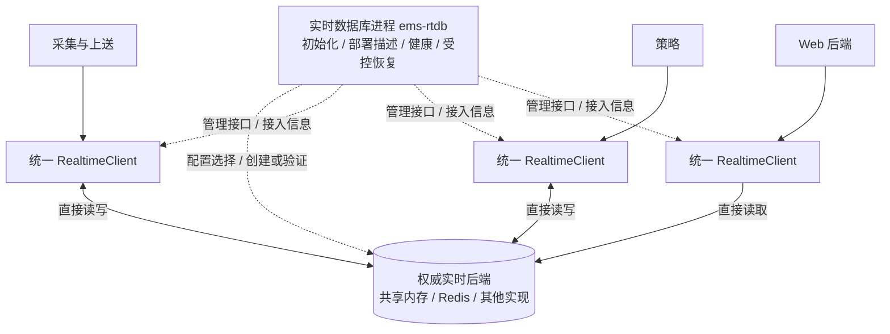

# 实时数据库进程

> 进程：`ems-rtdb`｜语言：C++17｜日期：2026-10-24｜状态：首批 ems_rtdb 动态库、记录级客户端、JSON 配置与常驻入口已实现；完整类型化门面与管理 RPC 待完成。

`ems-rtdb` 在 Redis、共享内存及未来合格实时后端下均常驻，负责统一数据接入、配置、生命周期和维护。业务只使用 `RealtimeClient` 公共接口，不选择后端，也不创建连接或映射；实时数据库进程读取配置并发布描述，公共客户端在内部完成发现与适配器组装。配置切换后业务接口、数据模型和算法保持不变。

共享内存由实时数据库进程创建并持有，客户端库内部直接挂接；Redis 模式由库内部建立各进程自己的连接池。正常实时读写不经管理 RPC 转发，具体后端只对公共实现和运维诊断可见。

## 职责与边界

| 负责 | 约定 |
| --- | --- |
| 统一配置与初始化 | 从配置选择已注册后端，验证语义、版本与能力；一个权威作用域由一个活动管理者负责 |
| 统一接口与后端扩展 | 对业务只提供公共客户端；新增实时数据库由公共适配器与工厂接入，不改业务 API |
| 共享内存生命周期 | 独占初始化、布局/代次检查、常驻持有、受控重建和清理 |
| 接入管理 | 发布不含密钥的后端描述、接入登记、实例心跳与应用状态 |
| 授权投影安装 | 根据已发布配置与持久来源协调结果，安装记录的写入防护字段；不自行分配来源所有权 |
| 运行观测 | 分别报告管理、后端、配置授权及客户端接入状态 |
| 维护编排 | 配合部署管理停止使用者后扩容、切换后端、重建新代次 |

采集仍拥有实测点和通道状态，策略仍负责聚合、告警与控制仲裁；存储仍负责历史、审计、配置发布及 outbox。实时数据库进程不代理 MySQL、历史查询、设备控制或所有消息流。

## 调用方式

业务仅依赖 `RealtimeClient`；内部复用 `RealtimeService → IRealtimeStore → 选定适配器`，不重复定义字段和方法语义。公共客户端隐藏部署发现、工厂选择、连接/映射、来源校验及错误转换，各进程分别持有实例。管理 API 提供接入与维护，不转发每次 `read/update`。浏览器只访问 Web，同机 C++ Web 后端也只调用统一客户端。

共享内存直接访问以同机、兼容布局与同步 ABI、互信进程为前提。不同主机不能映射同一共享段；跨机实时访问采用经验证的 Redis 部署。需要更强访问隔离时，另行评审受限查询网关，不把直接映射宣称为记录级安全隔离。

## 实施与验收

先复用已有 `IRealtimeStore`、`SharedMemoryStore`、`RedisStore` 和 `BackendFactory`，再补统一客户端、配置发现、常驻管理及业务接入。验证相同业务代码与客户端配置在不同后端运行，以及直接访问、管理重启、并发初始化、崩溃恢复和容量维护。首期配置选择采用编译期内置适配器，切换通过维护窗口完成，未内置的新后端需要更新公共库并验收。

本批共享内存使用系统 Boost.Interprocess（本机 Boost 1.89），Redis 使用仓库内 redis-plus-plus，公共头和实现分离。交付为 `ems_rtdb.dll/.lib` 或 SO、公共头及 CMake 包；调用方链接 `ems::rtdb`。MSVC/MinGW 各 10 项通过、4 项真实 Redis 用例跳过，安装包的独立进程消费验证通过。实际构建、接口与限制见[实现说明](https://github.com/600888/ems/blob/main/backend/src/realtime/README.md)。

生命周期、管理接口、部署字段、故障矩阵和实施阶段见[实时数据库进程详细设计](design.md)。记录布局、CAS、错误与来源检查继续以[公共实时访问接口](../../common/realtime/access-design.md)为唯一契约；整体边界见[系统架构](../../architecture/system-design.md)。
