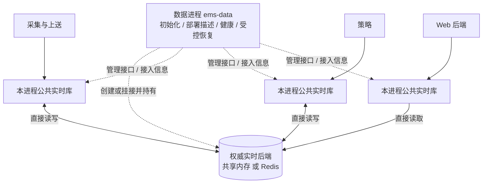

# 数据进程

> 进程：`ems-data`｜语言：C++17｜日期：2026-10-23｜状态：目标设计；已有实时存储接口及共享内存、Redis 后端，常驻管理入口与管理协议尚未实现。

`ems-data` 常驻管理权威实时后端的生命周期。共享内存由它创建、初始化并持有，各业务进程通过本进程的公共实时访问库直接映射、读写同一共享段；Redis 模式下，各进程通过相同业务接口直接连接同一权威 Redis 后端。正常实时读写不经数据进程 RPC 转发。

## 职责与边界

| 负责 | 约定 |
| --- | --- |
| 后端初始化 | 按部署选择共享内存或 Redis；一个权威作用域由一个活动管理者负责 |
| 共享内存生命周期 | 独占初始化、布局/代次检查、常驻持有、受控重建和清理 |
| 接入管理 | 发布不含密钥的后端描述、接入登记、实例心跳与应用状态 |
| 授权投影安装 | 根据已发布配置与持久来源协调结果，安装记录的写入防护字段；不自行分配来源所有权 |
| 运行观测 | 分别报告管理、后端、配置授权及客户端接入状态 |
| 维护编排 | 配合部署管理停止使用者后扩容、切换后端、重建新代次 |

采集仍拥有实测点和通道状态，策略仍负责聚合、告警与控制仲裁；存储仍负责历史、审计、配置发布及 outbox。数据进程不代理 MySQL、历史查询、设备控制或所有消息流。

## 调用方式

业务依赖 `RealtimeService → IRealtimeStore`。两者是公共 C++ 库接口，各进程分别创建实例，不传递跨进程对象或裸指针。管理接口提供部署信息和生命周期操作，不能把每次 `read/update` 变成管理 RPC。浏览器继续只访问 Web；同机受信任的 C++ Web 后端通过公共库读取，不能自行解释共享段布局。

共享内存直接访问以同机、兼容布局与同步 ABI、互信进程为前提。不同主机不能映射同一共享段；跨机实时访问采用经验证的 Redis 部署。需要更强访问隔离时，另行评审受限查询网关，不把直接映射宣称为记录级安全隔离。

## 实施与验收

先复用已有 `IRealtimeStore`、`SharedMemoryStore`、`RedisStore` 和 `BackendFactory`，再补管理入口、类型化业务门面与业务接入。分别验证进程直接访问、管理进程重启不清段、并发初始化、代次不匹配拒绝、写入者崩溃恢复、容量不足和维护切换。

生命周期、管理接口、部署字段、故障矩阵和实施阶段见[数据进程详细设计](design.md)。记录布局、CAS、错误与来源检查继续以[公共实时访问接口](../../common/realtime/access-design.md)为唯一契约；整体边界见[系统架构](../../architecture/system-design.md)。
