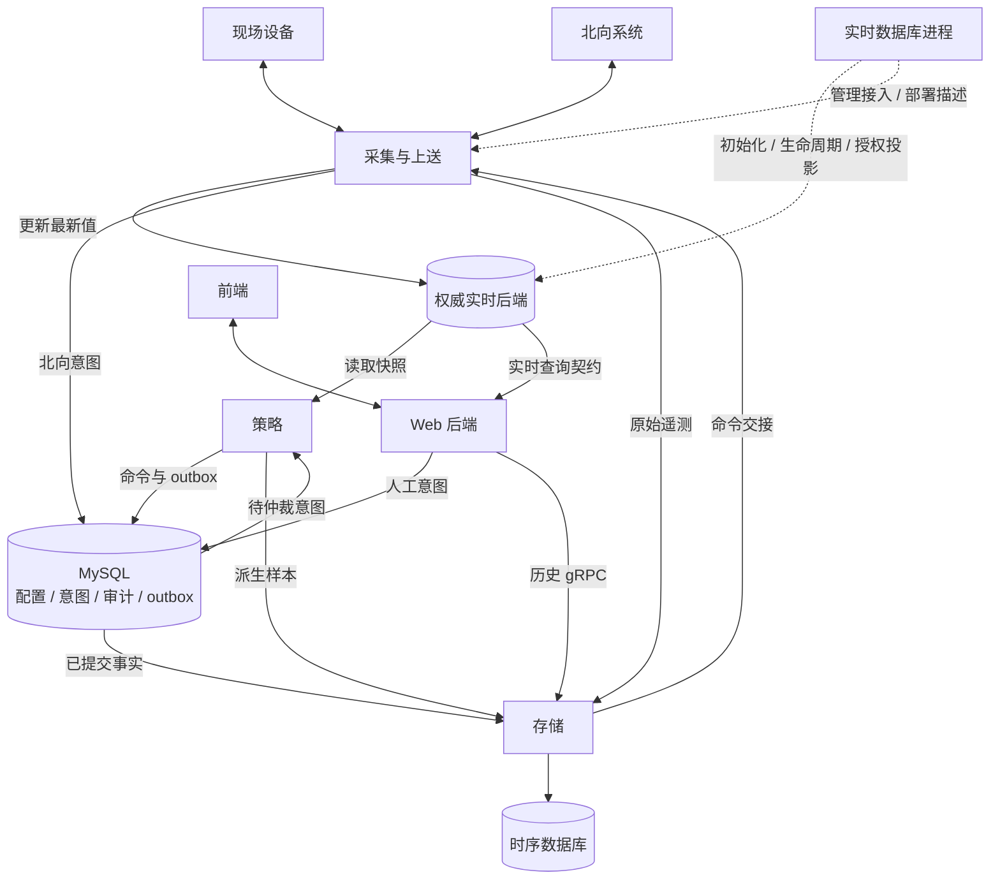

# 进程设计

EMS 分为采集与上送、实时数据库、存储、策略和 Web 五类进程。`ems-rtdb` 在所有后端下常驻并读取统一配置，管理实时数据接入和生命周期。业务只调用 `RealtimeClient`，由公共客户端内部发现、组装并直接访问选定后端，不经管理 RPC 逐次转发。采集与上送共用 `ems-collector`，可按负载分片。

| 进程 | 语言 | 负责 | 不负责 |
| --- | --- | --- | --- |
| [采集与上送](collector/index.md) | C++17 | 南向采样/执行、北向状态出口/外部控制意图受理、协议和会话管理 | 绕过策略直接执行上级控制、生成优化决策 |
| [实时数据库](data/index.md) | C++17 | 配置驱动的后端选择、统一客户端接入、生命周期/健康、授权投影安装与维护 | 每次读写转发、状态聚合、告警、控制仲裁、MySQL 代理 |
| [存储](storage/index.md) | C++17 | 历史审计、配置/outbox 发布、历史查询服务 | 现场协议、告警规则、调度仲裁、实时访问代理 |
| [策略](strategy/index.md) | C++17 | 聚合、告警、优化调度、控制来源仲裁 | 持有现场协议句柄、直接写设备 |
| [Web 后端](web/index.md) | C++17 + Drogon | 身份权限、工程配置保存、业务 API、实时展示 | 直连设备、将界面提交等同动作完成 |

各进程调用同一套[公共数据库访问层](../common/database/)，复用 ORM 映射、Repository、连接池与事务实现；运行时各自持有独立实例。进程间交换版本化数据，生命周期和健康状态独立管理。

共享内存由实时数据库进程创建并持有，其他进程只挂接；Redis 模式各进程独立连接。管理进程重启不清空有效后端，重建/切换前停止并隔离旧使用者，详见[实时数据库进程详细设计](data/design.md)。

优先阅读 [系统架构](../architecture/system-design.md)，再按负责的进程进入相应目录。设备、通道、协议模型统一引用 [公共业务设计](../architecture/channel-protocol.md)，不在不同进程重复定义。

## 运行日志

已实现的进程共用 `<EMS_ROOT>/conf/log.json`，`modules` 的键与可执行文件名一致：
`ems-daemon`、`ems-rtdb`、`ems-web`、`ems-storage`。各进程独立读取自己的
`level`、`file_size`（MiB）和 `count`（滚动备份文件数），重启进程后生效。
`level` 支持 `trace`、`debug`、`info`、`warn`、`error`、`critical`、`off`。
缺失配置时默认使用 `info`、10 MiB、10 个备份；未设置 `EMS_ROOT` 时使用构建根目录。

日志写入 `<EMS_ROOT>/log/<进程名>/<进程名>.log`；配置等级为 `debug` 时文件名为
`<进程名>-debug.log`。启动、就绪、退出和错误写入各自的文件，正常退出时等待异步日志刷盘。
Web 的 Drogon/Trantor 框架日志也写入 `ems-web` 文件，沿用相同等级和滚动配置。
配置中的 `net` 仍供现有采集库和采集示例使用；当前尚未构建独立的 `ems-collector` 入口。
