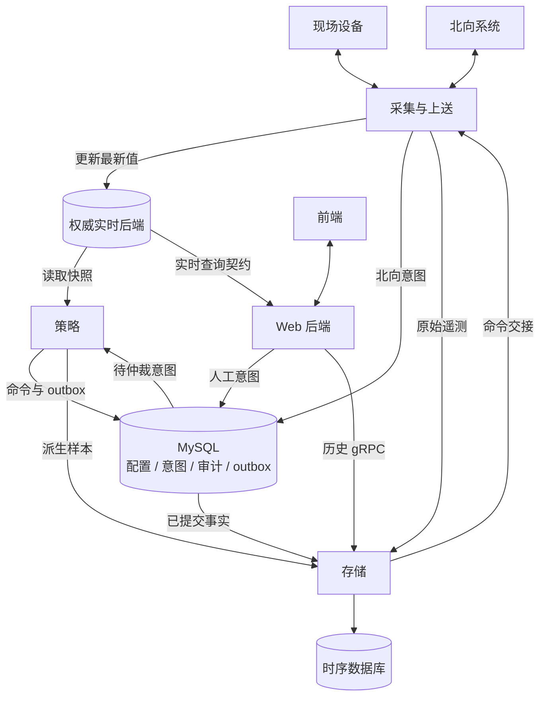

# 进程设计

EMS 分为采集、存储、策略和 Web 四类进程。采集与上送共用 `ems-collector`，内部隔离模块与队列，可按负载分片。

| 进程 | 语言 | 负责 | 不负责 |
| --- | --- | --- | --- |
| [采集与上送](collector/index.md) | C++17 | 南向采样/执行、北向状态出口/外部控制意图受理、协议和会话管理 | 绕过策略直接执行上级控制、生成优化决策 |
| [存储](storage/index.md) | C++17 | 历史审计、配置/outbox 发布、历史与可选实时查询服务 | 现场协议、告警规则、调度仲裁 |
| [策略](strategy/index.md) | C++17 | 聚合、告警、优化调度、控制来源仲裁 | 持有现场协议句柄、直接写设备 |
| [Web 后端](web/index.md) | C++17 + Drogon | 身份权限、配置编辑/发布、业务 API、实时展示 | 直连设备、将界面提交等同动作完成 |

各进程调用同一套[公共数据库访问层](../common/database-design.md)，复用 ORM 映射、Repository、连接池与事务实现；运行时各自持有独立实例。进程间交换版本化数据，生命周期和健康状态独立管理。

优先阅读 [系统架构](../architecture/system-design.md)，再按负责的进程进入相应目录。设备、通道、协议模型统一引用 [公共业务设计](../architecture/channel-protocol.md)，不在不同进程重复定义。
