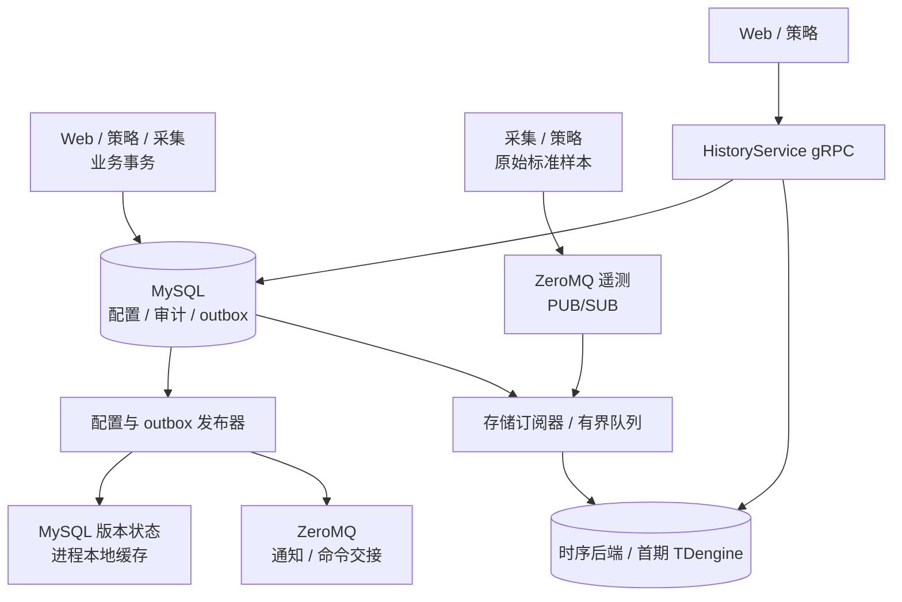
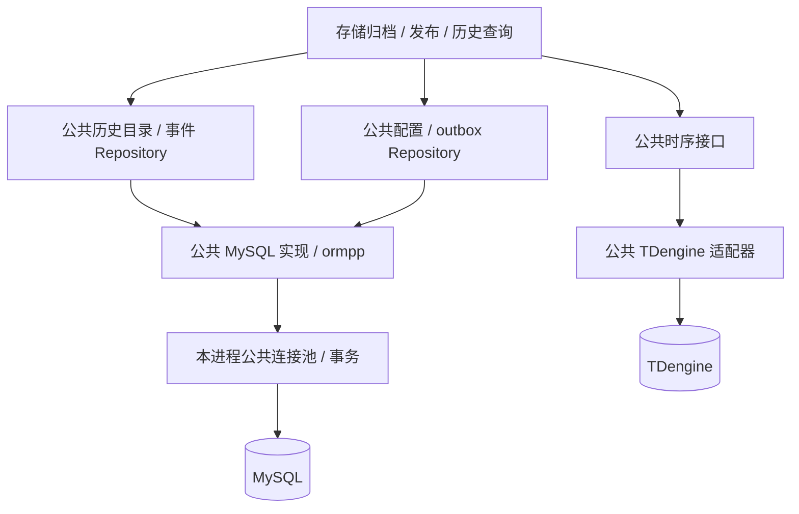
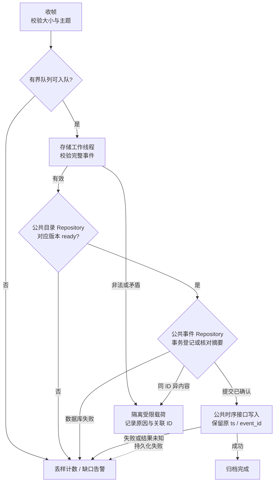
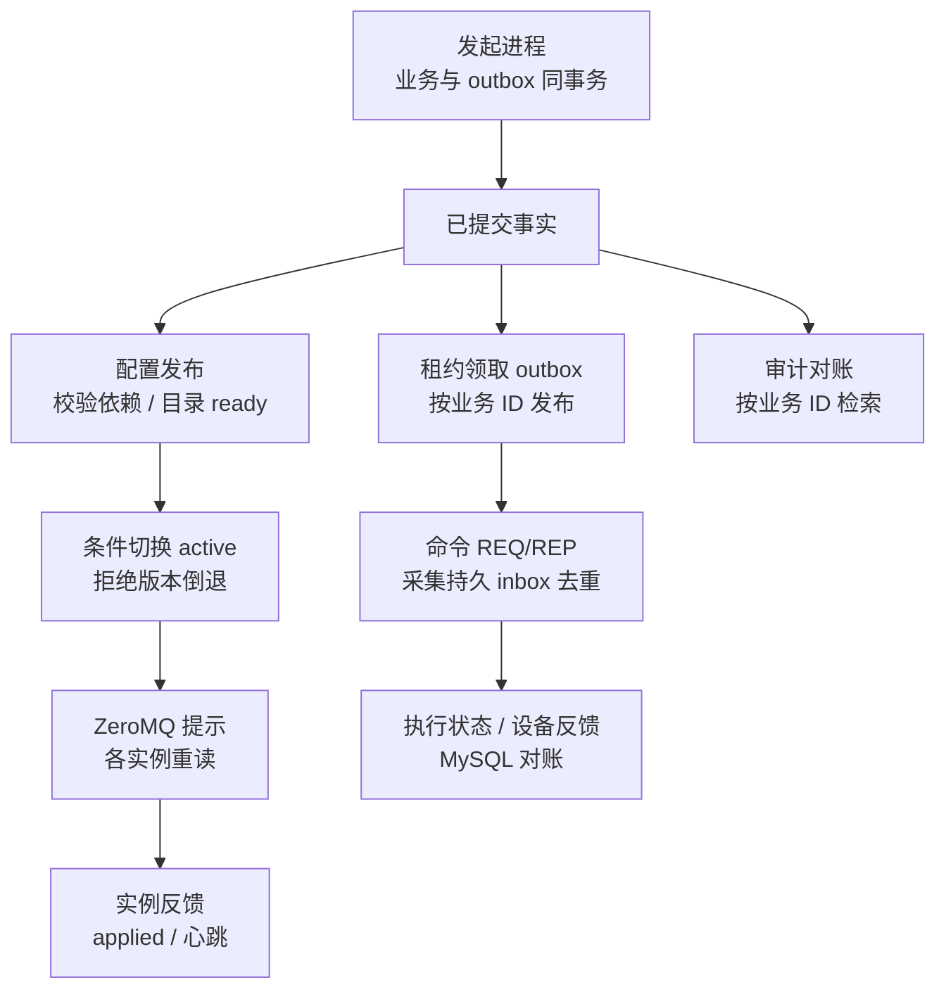
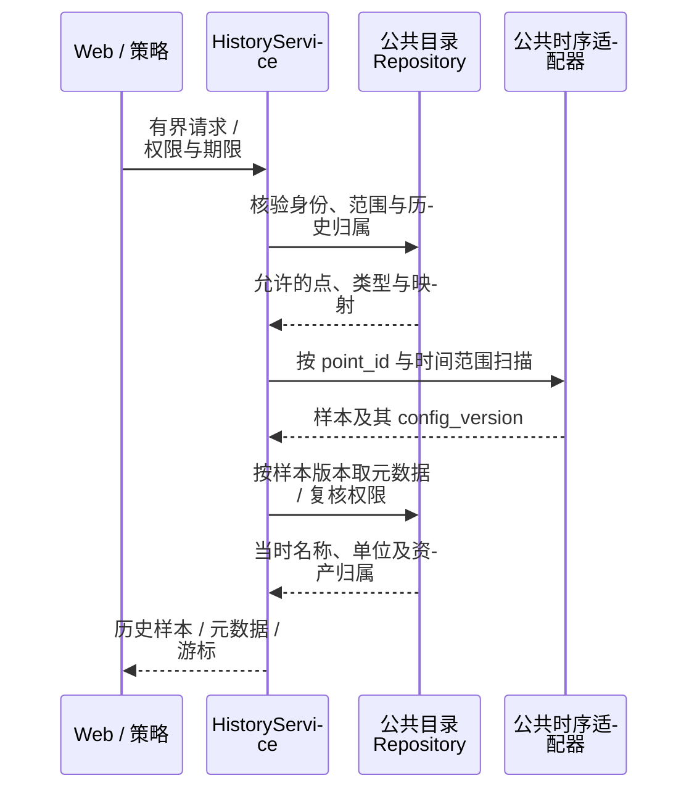

# 存储进程详细设计

> 版本：1.4｜日期：2026-10-21｜状态：公共池/事务、历史 ormpp 仓储与时序适配迁移已实现；目录发布、其他 Repository、采集发布端、InfluxDB 与生产联调尚未完成。
> 本文细化[存储进程入口](index.md)，公共契约见[设备模型](../../architecture/device-model.md)、[系统架构](../../architecture/system-design.md)及[实时数据与配置](../../common/realtime/index.md)。

## 1. 目标与职责边界

`ems-storage` 接收原始样本、写时序库、发布配置/outbox、对账审计并提供有界历史查询。MySQL 保存**点位身份及历史配置**，时序库存**各时刻的值**；应用按 `point_id + config_version + 作用域` 关联，不能用当前名称、单位或路径解释旧数据。

| 数据 | 权威位置 | 存储职责 |
| --- | --- | --- |
| 资产、标准点、厂家点、绑定和启用版本 | MySQL | 校验发布，生成不可变历史点位目录 |
| 已接收的标准/派生样本、聚合 | 时序库 | 校验、写入、查询、保留与补算 |
| 命令、告警生命周期、配置审计、outbox | MySQL | 发布及对账；业务事实由产生它的进程事务写入 |
| 最新值 | Redis 实时库 | 不作为历史回填或事件队列 |

**原始遥测 PUB/SUB 允许丢样，无 ACK、pending 或自动重放。** 队列溢出、离线及数据库故障形成可观察缺口。目标方案 Redis 只存最新值，不存事件或配置快照。各进程独立使用公共 ormpp Repository/连接池，存储不代理其他进程的 MySQL 操作；历史与实时查询接口分开。

### 1.1 数据库访问统一收口

存储只编排订阅、校验、归档、发布与查询，**不自行维护 ORM 实体、SQL 或数据库连接实现**。MySQL 历史目录、事件身份、隔离和 outbox 均使用公共 ormpp Repository；TDengine 读写走公共时序接口。具体目录、事务、SQL 限制与迁移步骤以[公共数据库访问层](../../common/database/)为准。

历史 MySQL 实现已迁入 `src/common/db/mysql/mysql_database.cpp`，使用公共池和显式事务；旧 `src/scd/mysql_history.cpp` 已移除。ormpp 固定版本没有 TDengine 后端，后者封装于公共适配器；存储业务不直接调用客户端或拼 SQL。首批实现和剩余范围见[实施记录](../../common/database/#71-首批实现记录)。

## 2. MySQL：历史点位目录

### 2.1 稳定身份和版本

| 项目 | 规则 |
| --- | --- |
| `point_id` | 标准逻辑点稳定身份；改名、重导厂家表、换通道不变，退役后不复用 |
| `point_code` | 仅在所属资产内有意义；厂家/北向地址属于版本绑定 |
| 样本目录键 | `(scope_kind, scope_id, config_version, point_id)`；有 unit 用 unit，否则 station；裸版本号不够 |
| 不兼容变化 | 值类型或物理含义变化须新建点；名称、路径、路由变化仅生成新版本 |
| 命令点 | 进入 MySQL 审计；仅明确配置的可读反馈点写时序曲线 |

`history_point_snapshot` 是权威配置的只读投影，不接受独立编辑。由公共 `IHistoryCatalogRepository` 读写，ormpp 行实体与反射映射仅在公共 MySQL 实现定义一次：

| 字段组 | 逻辑字段 |
| --- | --- |
| 唯一版本身份 | `scope_kind / scope_id / config_version / point_id`，共同构成主键 |
| 当时归属与展示 | `asset_id / point_code / display_name / device_path` |
| 点语义 | `point_kind / value_type / unit / enabled` |
| 定义引用 | `definition_id / definition_version` |

物理表、联合键及索引由 `backend/data/migrations/001_storage_mysql.sql` 管理，后续调整新增迁移版本；本页不提供应用运行时建表 SQL。

版本头保存 `(scope_kind, scope_id, config_version, checksum, point_count, ready_at)`；支持分批暂存，完整校验后才 `ready`。同版本同 checksum 幂等完成，异内容报警并停止发布；消费/查询只读 ready 版本。

配置保存、发布、实例应用分别跟踪。station 跨 unit 按版本清单核对，不承诺跨域原子生效。目录及来源配置须保留到原始、聚合和备份均不再需要；缺版本不得套当前配置，无法归档的样本记缺口，非法身份/矛盾版本隔离。

### 2.2 点位与时序表的映射

| MySQL 投影/账本 | 内容 | 边界 |
| --- | --- | --- |
| `history_point_series` | `point_id`、类型、受控子表名、创建时间、退役状态；ID/表名唯一 | 首次发布创建，后续复用；历史及备份清理前保留 |
| `history_event_identity` | 全局 `event_id` 主键、point_id、原 source_time_us、规范化完整事件 SHA-256、首次登记时间 | 同 ID 同摘要允许幂等写，异摘要隔离；不复制历史载荷，不提供补传 |

以上投影与账本均经公共 ormpp Repository 访问，存储不自建实体或连接。TDengine 表名由公共适配器按内部稳定 ID 解析，禁止拼接用户点名/路径/地址，值使用绑定；对业务仅返回逻辑序列键。InfluxDB 后续扩展受控映射。

身份账本先于时序写入原子登记，保留期至少覆盖原始样本；账本成功而时序失败仍会留缺口。旧 `point_config_v2.sql` 四遥表及 `ems_config.sql` 的 MySQL 历史表属于遗留结构，迁移前须建立 ID、类型、单位与时间精度映射。

## 3. 时序后端抽象与 TDengine 实现

公共 `ITimeSeriesDatabase` 以业务对象提供 `write(sample)` 与受限 `scan(query, series_mappings, limit)`，返回成功、确定错误或结果未知，保留类型、质量、来源、事件 ID 和时间精度。接口与复用类型迁入 `common/database/timeseries/`；连接、批量、受控映射和方言实现放 `src/common/db/timeseries/`。建库/超级表由部署迁移完成，动态子表仅可经公共适配器的受控映射规则创建；业务不能发 DDL。每作用域显式选择一个后端，不隐式双写。

首期为 **TDengine 3.4.2**，服务端/客户端锁定兼容补丁。InfluxDB 仍待实现，须验证映射迁移、幂等、同微秒多事件及分页行为后启用。

### 3.1 表结构与时间

| 项目 | 首期约定 |
| --- | --- |
| 表组织 | 按值类型分超级表，每逻辑点一子表；数值、精确整数、布尔、枚举/文本使用匹配列 |
| 标签 | 仅稳定身份如 point_id；名称、单位、路径按 MySQL 历史版本解释 |
| 行身份 | 单点子表 `(ts, event_id)`；同事件重试同键同载荷，同微秒不同事件各自保留 |
| 时间 | UTC Unix 微秒；ts 为源时间，缺失则按公共契约用接收时间并留原因；ingest_ts 为采集接收时间，归档时间另记 |
| 无效值 | null 加质量/原因，禁止 NaN、Infinity、默认零 |
| 无损整数 | 不把 64 位整数/状态码转 DOUBLE；无符号 64 位版本/代次/序号用十进制文本，应用层整数比较 |

公共时序记录按下列字段组映射；物理 schema 由 `backend/data/migrations/002_storage_taos.sql` 管理，类型、长度及批量 API 须在锁定版本验证：

| 字段组 | 字段 |
| --- | --- |
| 行身份与值 | `ts / event_id / sample_value`，值按超级表类型保存 |
| 接收与时间来源 | `ingest_ts / time_origin / time_reason` |
| 质量与身份核验 | `quality / quality_reason / payload_sha256` |
| 历史配置 | `scope_kind / scope_id / config_version` |
| 来源顺序 | `source_id / source_epoch / sequence` |
| 稳定标签 | `point_id` |

其他类型使用对应超级表，`time_origin` 码表纳入事件契约。建库前冻结事件 ID 长度、时间精度及主键类型；目标版本不支持复合主键时须重设方案，不能退化为时间戳加普通 event_id 列。参考[超级表/复合主键](https://docs.tdengine.com/tdengine-sql/ddl/stable/)及[数据库精度与保留](https://docs.tdengine.com/tdengine-sql/ddl/database/)。

事件内容不可变，冲突重发不得覆盖原行；同一厂家值派生多个标准样本时各有稳定事件 ID，并保留共同来源关联。查询微秒整数不经 JavaScript 浮点数往返。

### 3.2 聚合与保留

| 点语义 | 聚合 |
| --- | --- |
| 瞬时功率 | 均值、最小/最大值 |
| 累计电量 | 有效相邻差值或功率积分 |
| 状态 | 持续时间、变化次数 |

按点位、作用域和配置版本分桶；桶内版本/归属变化则拆分。保存样本数、预期数、坏质量数、覆盖率；迟到/更正样本触发重算并留水位/版本。

按 `点数 × 频率 × 保留时长 × 行成本` 和恢复目标规划容量。原始、分钟、小时数据独立保留，优先使用独立数据库/KEEP；不假定同库超级表可各设库级保留，也不默认具备企业版降采样。MySQL 目录覆盖最长查询窗口。

## 4. ZeroMQ 遥测订阅、写入与缺口

输入为完整 `EventEnvelope` JSON，主题 `ems:telemetry:<station|unit>:<scope_id>`；正文再次核对作用域。刷新提示不是历史源，不得收到通知后读 Redis 最新值补写。

| 处理边界 | 规则 |
| --- | --- |
| 接收线程 | 仅检查帧/主题并入队，不等待数据库；队满计缺口 |
| 工作线程 | 校验载荷上限、保留窗口、身份和版本，不能用 active 版本替代样本版本 |
| 当前失败行为 | 出队后不重入队；超时、失败、未知均计丢样；未来内存重试也须保留原 ID/时间/值，仍不保证重启恢复 |
| 隔离记录 | 记录接收时间、主题、事件 ID、受限原始载荷及原因；持久化失败仍报告缺口，不会触发 PUB/SUB 重投 |
| 缺口监测 | 代次/序号发现部分缺口，采样计划/新鲜度发现无后续样本的静默 |

发布入队、发送成功或接收帧均不等于归档完成。晚启动、断线、高水位、进程崩溃和数据库故障都可能丢样；账本仅覆盖已收到事件。若将来要求无损恢复，须另设发送端持久缓冲及应用确认。

## 5. 配置、outbox 与审计

MySQL、时序库和 ZeroMQ 无共同事务。存储经公共配置/outbox/审计 Repository 发布已提交事实；业务与 outbox 同事务，网络交接在领取事务外。配置按版本/checksum 对账，跨域按清单补齐后切 active；发布、实例应用、listener 就绪与设备在线分别判断。

outbox 响应未知或发布后状态写回失败可重复发布，由稳定 ID、采集 inbox 和执行状态去重；REQ/REP 应答仅证明持久受理。告警、回执和配置审计以 MySQL 为准，通知遗漏后按持久记录补查。

## 6. 历史查询服务

`HistoryService` 使用内部 gRPC/Protobuf，仅接收业务查询：station/unit 权限、point_id 列表、`[start_us, end_us)`、粒度、行数和游标。不开放任意 SQL；限制点数、跨度、单页、并发及截止时间，策略短查询与报表/写入/outbox 使用独立预算。

分页顺序为 `(ts, point_id, event_id)`，游标含条件摘要及有效期；迟到样本可在后续刷新出现，多页不是不可变快照。两库应用层组合不保证分布式快照；目录缺失返回明确错误/局部状态，不套当前配置。不能仅凭 point_id 跳过作用域鉴权；最新值继续走实时接口。

## 7. 运行、故障与恢复

订阅、写入、配置、outbox、审计、查询各设工作池、连接及队列上限，两库独立重连。当前关闭不排空接收队列，关闭丢样纳入统计；按模块报告健康。

| 故障 | 处理与结果 |
| --- | --- |
| 时序库不可用/超时 | 本批计丢样，后续新样本继续处理；最新值监视可继续 |
| MySQL 历史版本不可读 | 不猜版本，无法归档样本记缺口并报警 |
| ZeroMQ 断线/进程中断 | 重连仅收新样本，离线不补发；核对序号和新鲜度 |
| 配置部分发布 | 保留清单和进度，补齐后切 active；实例应用单独检查 |
| outbox 状态写回失败 | 稳定业务 ID 重发/对账，不重复未知设备动作 |
| 两库备份水位不一致 | 核对版本与时序行水位，标注不可恢复缺口后开放查询 |

| 指标组 | 重点 |
| --- | --- |
| 采样链路 | 吞吐、P95/P99、发布拒绝/错误、最近接收、队列溢出、批量成功/失败、丢样及静默时长 |
| 数据一致性 | 账本冲突/延迟、版本缺失、隔离数、聚合覆盖率 |
| 资源与发布 | outbox 最老未完成时长、查询排队/截断、两库连接池占用 |

指标标签避免 point_id/event_id 等高基数字段，日志保留脱敏关联 ID。

## 8. 实施与验收

| 阶段 | 交付与核验 |
| --- | --- |
| 契约 | 固定 schema/topic、质量码、UTC 微秒与身份/版本；实测锁定 TAOS 的复合主键 |
| 公共 MySQL 层 | 历史实体、目录/身份/隔离及查询从 scd 迁入公共 ormpp Repository；统一连接池、显式事务与错误转换 |
| 公共时序层 | 现有读写接口/类型及 TAOS 客户端封装迁入公共目录；存储只注入 API，不自建 SQL/驱动对象 |
| 版本化迁移 | 沿用 backend/data/migrations，验证目录/映射及公共 Repository 兼容；应用不自动改正式表结构 |
| 运行接入 | 订阅、HistoryService、配置/outbox/审计调用公共接口；验证事务回滚、提交 Unknown、跨进程复用与查询预算；InfluxDB 后续验收 |
| 旧数据迁移 | 备份、导出 ID/类型/单位/精度/质量映射、受控回填；无事件 ID 时用旧表主键生成稳定迁移 ID；核对数量、范围及曲线后切查询，不直接删旧表 |

验收覆盖重复事件、同点同微秒多事件、同 ID 异载荷；null/精确整数/字符串；旧版本迟到、改名与迁移；晚启动/断线/满队列/两库分别中断的缺口；配置部分发布、outbox 重发、未知命令；越权、分页、大查询隔离及保留/备份恢复。报告记录硬件、点数、频率、丢样原因与数量、查询 P99 和丢失边界；设计不代表测试已通过。
