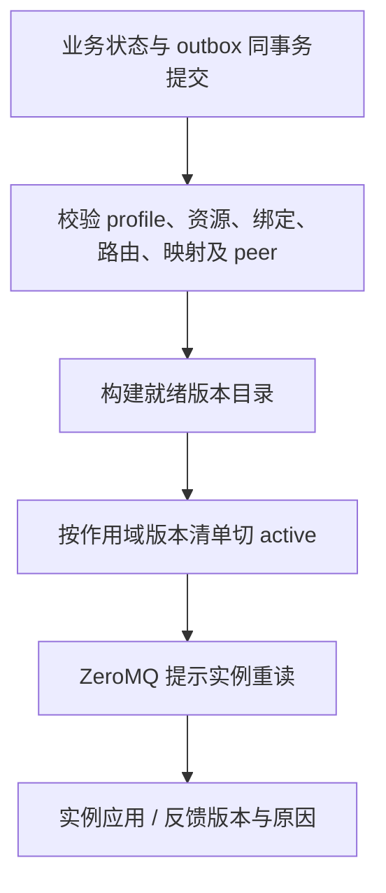

# 存储进程

> 进程：`ems-storage`｜语言：C++17｜状态：历史订阅及公共数据库首批迁移已实现；采集发布端、服务接口和真实数据库联调待完成。

负责接收 ZeroMQ 原始遥测、写入时序数据库、配置与业务事件发布，以及历史查询服务。PUB/SUB 历史采样允许丢样；它不代理其他进程的 MySQL 或实时访问，也不持有现场协议会话。实时后端生命周期由[实时数据库进程](../data/index.md)管理。

## 工作模块

| 模块 | 输入 | 输出与提交边界 |
| --- | --- | --- |
| 历史消费者 | ZeroMQ 原始采样事件 | 通过统一时序接口写入，稳定事件身份去重；处理失败计入丢样 |
| 审计对账器 | MySQL 已提交的告警、执行回执和状态记录 | 按稳定 ID 对账与归档检索；通知遗漏后仍可从持久事实恢复 |
| outbox 发布器 | 各业务进程已提交 outbox | 可靠事件通道；领取、重试、对账，允许重复发布 |
| 配置发布器 | MySQL 不可变配置版本 | 版本目录与 ZeroMQ 变更提示；应用状态独立追踪 |
| 历史查询服务 | Web/策略带期限查询 | 分页、时间范围与行数受限的 gRPC 结果 |
| 必要实时投影 | 职责内已持久确认的业务状态 | 经公共实时库更新投影；不从最新值补造历史，不代理 Web 实时读取 |

历史入库使用事件中的原采样与版本，不能收到变化提示后再读最新值代替原数据。遥测使用独立 ZeroMQ 主题，没有消费组或重放游标。

## 连接、事务与配置发布

通过[公共数据库访问层](../../common/database/)装配 ormpp Repository 与时序适配器，连接池/事务实现、实体和 SQL 统一复用；存储只持有本进程实例并编排业务。时序、审计、outbox、配置与查询分别设预算。数据库与 ZeroMQ 无共同事务，命令按业务 ID 重发/对账，遥测 PUB/SUB 允许丢样。

跨作用域不承诺原子生效；发布成功、实例应用、listener 就绪与设备在线分别判断。

## 故障与验收

入库失败和接收队列溢出均记录丢样；PUB/SUB 离线期间的缺口需要按采样新鲜度与来源序号监测。验证重复事件、配置部分发布、查询挤占、ZeroMQ 断线及数据库故障。

双库表模型、遥测订阅、查询和丢样边界见[存储进程详细设计](design.md)。公共规则见[系统架构第 7 节](../../architecture/system-design.md#7-数据存储设计)、[实时数据与配置](../../common/realtime/index.md)、[实时查询契约](../../common/realtime/access-design.md)。
