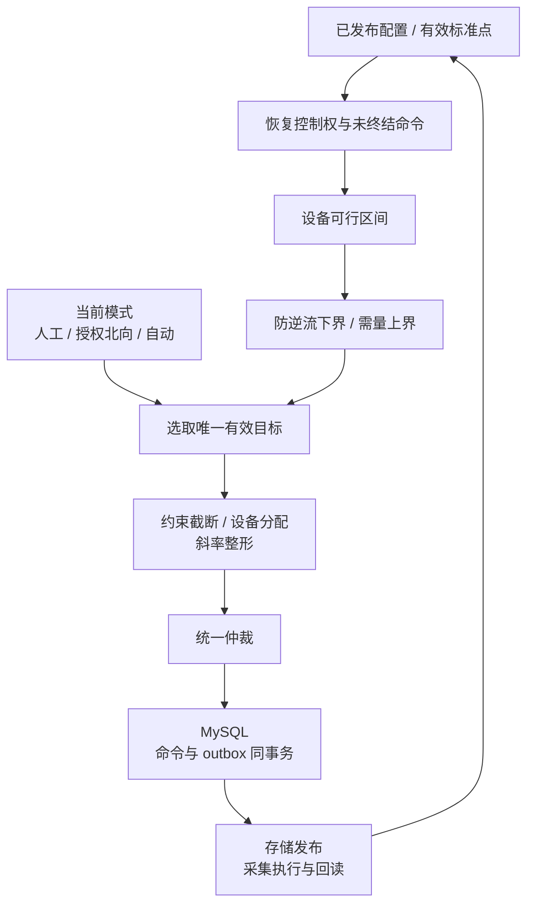
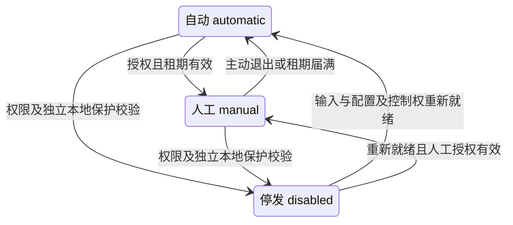
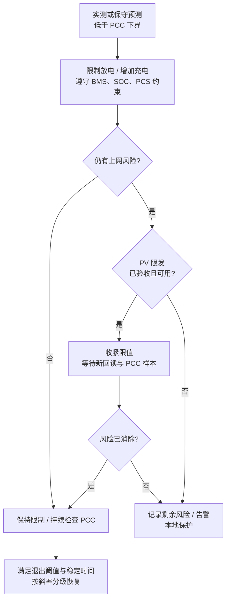
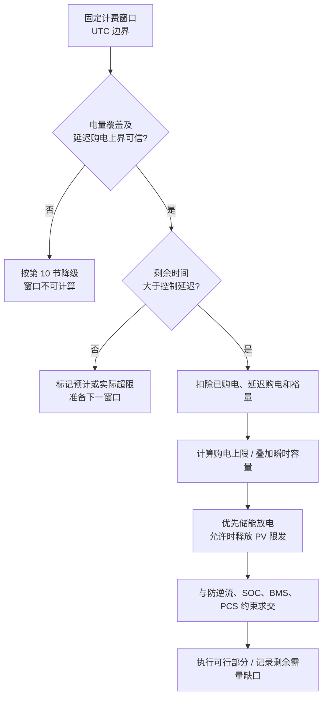
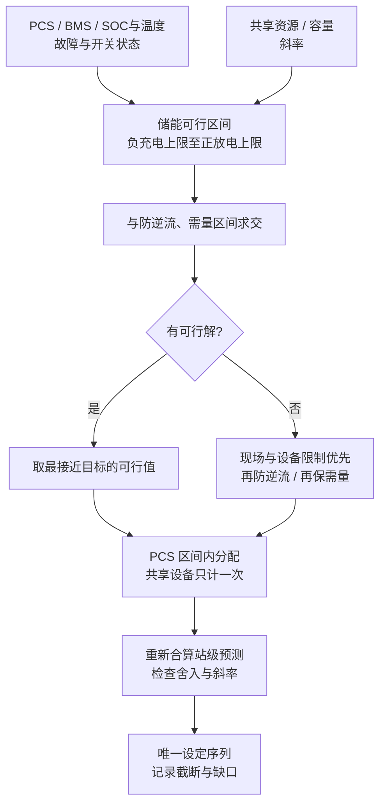
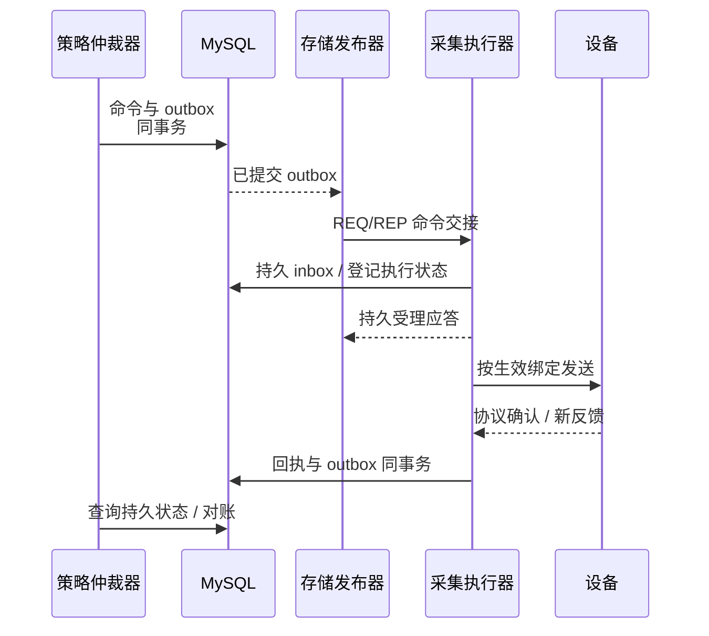

# 策略进程详细设计

> 版本：1.0｜阅读整理：2026-10-21｜状态：目标设计，尚未实现策略运行闭环。参数、计量方向、设备能力和保护动作须经现场配置与验收后启用。
> 公共契约：[设备模型](../../architecture/device-model.md)、[实时访问](../../common/realtime/access-design.md)、[控制闭环](../../architecture/system-design.md#6-控制闭环与策略进程)。

## 1. 范围与基本约定

负责并网储能与光伏的状态聚合、告警、目标计算、功率约束、设备分配及统一仲裁。每个调度域以唯一权威 PCC 和明确拓扑为边界；多 PCC、可切换母线先划域，共享 PCS/PV/电表按物理资产只计一次。

策略读取标准逻辑点和已发布能力，输出持久命令；协议地址与句柄由采集管理。EMS 提供有采样/通信延迟的监督控制；快速逆功率、过流、急停及孤岛保护由现场装置承担。要求 EMS 停止后仍禁止上网的站点，须验收独立本地保护。

### 1.1 功率方向与计量边界

| 量（kW） | 正值 | 负值 | 权威来源 |
| --- | --- | --- | --- |
| `P_grid` | PCC 购电 | PCC 上网 | 调度域唯一 PCC 电表 |
| `P_ess` | 储能放电 | 储能充电 | 域内 PCS 实际交流功率之和 |
| `P_pv` | 光伏发电 | 夜间等交流取电 | 逆变器或校验后的光伏总表 |
| `P_load` | 其他净负荷耗电 | 诊断用反向流 | 拓扑推导量，不代替 PCC 实测 |

发布前用 CT/PT、倍率、反向功率与充放电试验确认方向，厂家方向在采集绑定中转换。同一边界、无其他电源时近似满足 `P_grid = P_load - P_pv - P_ess`。损耗及采样不同步会产生残差，控制仍以 PCC 实测为准。确无光伏可设 `P_pv=0`，光伏测点失效则不能填零。

负荷近似不变时，用两个保守场景预测下一周期：

```text
P_grid_pred_low  = P_grid_meas - (P_ess_cmd - P_ess_actual)
                   - (P_pv_upper - P_pv_actual)
P_grid_pred_high = P_grid_meas - (P_ess_cmd - P_ess_actual)
                   - (P_pv_lower - P_pv_actual)
```

| 预测 | 用途 | PV 边界要求 |
| --- | --- | --- |
| `P_grid_pred_low` | 防逆流 | 用可信发电上界；限发未回读前不假定已经降功率 |
| `P_grid_pred_high` | 需量保护 | 用可信发电下界；增发未验证前不假定已经升功率 |
| `P_pv_plan` 点预测 | 计划跟踪 | 带质量标记，不替代保护用上下界 |

PV 边界包含天气、现有限值及已验证状态；缺少可信边界不得放宽保护。负荷波动、延迟和模型误差由配置裕量覆盖，预测本身不证明保护达成。

## 2. 输入、配置与有效性

### 2.1 标准输入和能力

| 输入 | 用途 | 失效处理 |
| --- | --- | --- |
| PCC 功率、方向、开关/并网状态 | 保护反馈及域边界 | 暂停依赖 PCC 的新命令并告警，不用估算替代 |
| PCC 正向电量或完整正向功率样本 | 需量窗口 | 转已验收的保守瞬时限值；无配置则暂停需量新调度 |
| PCS 功率、故障、本地/远程、动态充放上限、设定反馈 | 基线、可行区间及闭环 | 停止该 PCS 新设定，重分配；状态未知先对账 |
| BMS SOC、许可、动态电流/功率限值、故障 | SOC 与可用功率 | 收紧或禁用相应方向，不用额定值补缺 |
| PV 功率、运行状态、可选限发及回读 | 预测与协同 | 仅监视设备不下限发命令；失效功率不增加调节量 |
| 版本、来源代次、时标、质量、控制权、命令状态 | 输入与执行有效性 | 过期、失配、来源不明或旧主未隔离时拒绝新控制 |

每周期校验启用、能力依赖、量纲、质量、新鲜度、覆盖率及最大采样时差。批量读不是全局快照：计算前后复核关键版本，跨版本或超时差则重读。非有限数、越量程、源时间回退及方向异常不得参与保护。SOC 按有效容量加权并附覆盖率；派生状态保留输入版本、时间和失效原因。

### 2.2 配置模型与发布校验

`strategy_config / schedule` 仍是逻辑表建议，DDL、权限和迁移随[公共数据库访问层](../../common/database-design.md)实施；策略只调用公共 ormpp Repository，不维护自己的实体映射、SQL 或连接实现。

| 配置组 | 必需内容 |
| --- | --- |
| 调度域 | station、唯一 PCC、并网开关、PCS/PV/电池关系、所有者和拓扑版本 |
| 计量 | 方向、CT/PT、精度、最大年龄/时差、需量电量来源及复位规则 |
| 防逆流 | `P_export_allow >= 0`、购电裕量、迟滞、周期、超时、PV 限发能力 |
| 需量 | `D_limit`、固定窗口及对齐时区、能量裕量、可选瞬时上限、覆盖率、提前量 |
| 储能 | SOC 边界/迟滞、动态功率、PCS/变压器/PCC 容量、斜率、保持时间、反馈容差/超时 |
| 计划与模式 | 目标类型、插值、有效区间/版本、时区、缺段回退、人工租期、北向授权/冲突规则 |
| 光伏 | 监视/可控资产、限发范围/斜率、功率与限值回读、解除条件及超时策略 |

发布拒绝负限值、非法 SOC、矛盾 PCC 上下限、重复权威表、重叠/不明计划区间、缺反馈及未确认方向。配置不可变；分别展示已保存、已发布、策略已应用、采集已应用。依赖新绑定的命令必须等待策略和采集应用同一所需版本；现场阈值由调试报告确定。

## 3. 调度周期、模式和优先级

每域仅一个活动策略所有者。状态聚合、告警与优化可分周期，慢优化不能阻塞保护重算。



| 优先层 | 规则 |
| --- | --- |
| 现场资格 | 故障、联锁、本地模式、BMS 许可、开关、控制权和版本不满足则不下发 |
| EMS 约束 | 设备/SOC/拓扑、PCC 防逆流及需量求可行交集；不可兼得时先保防逆流，需量缺口告警 |
| 有效目标 | 人工、授权北向或自动目标只选一个；人工/北向优先级及同级胜出规则由站点显式配置 |
| 执行整形 | 斜率、死区、最小间隔与反馈约束，每资产每周期一个有效设定序列 |



| 模式/转换 | 动作 |
| --- | --- |
| `automatic` | 使用有效计划或优化目标 |
| `automatic → manual` | 可同事务提交首个人工目标；仅切模式时停止续发旧自动目标，以储能零功率为中性目标，施加全部约束并从实测按斜率过渡 |
| `manual → automatic` | 撤销人工目标，读取当前计划、反馈及未终结命令后平滑接入 |
| `disabled` | 停止新的常规设定，保留监视/告警及未终结命令对账；不保证防逆流/需量达成 |
| 离开 `disabled` | 复核 PCC、设备、版本、所有权及命令状态，从实测功率起步 |

依赖持续监督才能满足并网约束的站点，仅在独立本地保护可用且验收后允许 `disabled`。北向意图遵循模式及授权；模式切换、所有权变化和抢占均清理旧目标并审计，不能视为设备已立即跟随。

## 4. 防逆流

允许上网幅值为 `P_export_allow`，正购电裕量为 `M_export`：

```text
P_grid_floor = -P_export_allow + M_export
P_grid_pred_low >= P_grid_floor
P_ess_cmd <= P_ess_actual + P_grid_meas - P_grid_floor
             - (P_pv_upper - P_pv_actual)
```

零上网取 `P_export_allow=0`；裕量覆盖延迟与波动，避免过大造成持续不合理购电。



限发回读前不放宽储能约束。设备 `verified` 由发送后的新反馈及容差判断，保护达成由后续 PCC 有效样本独立判断；两者不能互相替代。PCC 失效时按第 10 节降级，不用旧值增加放电或解除限发。

## 5. 需量保护与削峰

首期仅覆盖**按发布时区对齐的固定窗口平均购电需量**；滑动窗口等口径须另行实现与验收。

| 变量 | 含义与单位 |
| --- | --- |
| `W_h / D_limit` | 窗口长度（h）/目标需量（kW） |
| `E_used / T_rem_h` | 窗口已购电量（kWh）/剩余时间（h） |
| `T_lag_h / E_lag_upper` | 通信与爬坡延迟（h）/期间购电上界（kWh） |
| `E_margin / T_control_h` | 能量裕量（kWh）/含离散周期及反馈预算的最小有效调节时长（h） |
| `P_instant_cap` | 可选瞬时购电上限（kW），未配置为无穷大 |

```text
E_used = integral_window max(P_grid, 0) dt
T_effective_h = max(0, T_rem_h - T_lag_h)
E_budget = D_limit * W_h - E_used - E_lag_upper - E_margin
P_budget_cap = max(0, E_budget / max(T_effective_h, T_control_h))
P_grid_ceiling = min(P_budget_cap, P_instant_cap)
P_grid_pred_high <= P_grid_ceiling
P_ess_cmd >= P_ess_actual + P_grid_meas - P_grid_ceiling
             - (P_pv_lower - P_pv_actual)
```



窗口能量优先取有复位、倍率和时标语义的 PCC 正向电量差；功率积分须覆盖完整窗口并记录缺样比例。上网不能抵扣已购电，窗口不随进程启动重置。延迟购电上界由购电、负荷/PV 波动和斜率估计，无可信上界不宣称保护有效。

预算耗尽时上限可收紧到零，已发生的需量超限必须告警。不能为守需量突破设备许可或防逆流，也不能假定能控制未配置的负荷/PV。削峰填谷和峰谷优化仅产生自动目标，接受同一组约束。

## 6. 计划曲线与自动目标

| 项目 | 规则 |
| --- | --- |
| 身份 | `schedule_id/version`、调度域、目标类型、UTC 区间、值、插值、优先级、发布/生效状态 |
| 目标 | `ess_power`：储能净功率，放电为正；`pcc_power`：PCC 购电为正；每域每时刻一个主目标 |
| 插值 | 定功率/时段充放电用阶梯，连续跟踪可线性插值 |
| 发布 | 断点递增、同层不重叠、范围及首尾合法；本地时区展开为 UTC，跨日拆段；夏令时歧义须明确选择或拒绝 |
| 回退 | 缺段、过期或目标失效时默认储能零功率，仍施加保护；允许发布其他有期限回退目标 |
| 切换 | 仅在生效时刻切版本，命令保留所用版本；迟到通知不得回退 active |

`ess_power` 直接取曲线；`pcc_power` 按 PCC 实测和有效 PV 预测转换：

```text
P_ess_candidate = P_ess_actual + P_grid_meas - P_grid_plan
                  - (P_pv_plan - P_pv_actual)
```

候选值统一进入约束、分配和仲裁。记录计划值、执行值、误差、未执行原因、PV 预测误差及截断持续时间。关键保护输入失效时暂停新功率命令，不沿用过期目标；历史仅供评估和离线优化。

## 7. 手动模式和北向控制

进入/退出手动及功率设定均为独立持久意图，站级或指定 PCS 的人工目标都参与 PCC 约束及共享资源仲裁。

| 阶段 | 校验与结果 |
| --- | --- |
| Web 受理 | 用户权限、域/资产、单位、有效期、期望版本、幂等 ID |
| 策略仲裁 | 模式、所有权、设备能力、实时约束、未终结命令；受理时已超硬约束则明确拒绝 |
| 运行 | 动态限值收紧可缩小执行值，分别展示请求值、执行值和原因 |
| 撤销/恢复 | 租期到期、退出、版本失配、失去控制权或切模式均撤销人工目标；先对账，再按实测/斜率接入有效自动计划 |
| 来源冲突 | 按发布的优先级、租期及同级版本/先后规则选唯一赢家，审计拒绝/抢占原因 |

人工租期有最大长度；过期不永久保持旧设定，未知命令不自动补发。人工与北向均保留保护约束，经同一命令链路执行；连接成功不自动获得更高优先级。

## 8. 光伏协同

| 能力级别 | 允许用途 | 启用条件 |
| --- | --- | --- |
| 可监视 | 平衡诊断、计划评估 | 有效发电测点 |
| 可限发 | 防逆流调节资源 | 已发布标准能力、范围、远程状态、写路由及可靠限值回显，并完成验收 |

限发建议用 `P_pv_limit >= 0` 表示最大交流输出，功率与限值回显独立采集。协议确认或短时发电下降不能替代限值回显。PV 固有目录仍是[设备模型](../../architecture/device-model.md)目标扩展，公共 C++ 目录尚未实现，不能套用 PCS 命令或厂家点冒充能力。

下发前检查可用输出估计、限值/斜率、状态及控制权；无可信输出估计则按实测和裕量逐步调整。收紧、回读及恢复按第 4 节执行；失联/转本地行为按型号验收，不能假定保持或清除限值。

防逆流与需量共同求 PCC 可行交集，避免互相冲突的 PV 设定。预测缺失不阻止基于 PCC 实测的保护计算，但不允许借预测放宽约束。孤岛/并离网切换闭环另行设计，未验收前暂停。

## 9. 可行区间、设备分配和命令闭环



单元区间为 `[-P_charge_available, P_discharge_available]`。SOC 临界连续降额，越界禁止对应方向，恢复有迟滞；额定值不能覆盖失效动态限值。正常配置要求 `P_grid_floor <= P_grid_ceiling`。

各 PCS 区间为 `[-C_i, D_i]`，先截断站级不可达目标，再求 `sum(P_i)=P_ess_target`。多解按 SOC 均衡、效率和发布权重选择，同分按稳定资产 ID 排序；PV 同样按已验收范围分配。优化权重不改变硬约束。



遵守死区、最小间隔及反馈条件，不持续刷写；保护收紧可替换未发送目标，已发送动作不能靠撤销意图收回。仅反馈满足条件才 `verified`，`unknown` 先对账并停止依赖其结果的新设定，不盲目重发切换/复位/脉冲。

全链路关联 `intent_id / command_id / config_version / owner_epoch`。重启先恢复模式、计划、租期、未终结命令及有效反馈，再恢复调度。

## 10. 降级、告警和可观测性

| 情况 | 行为 |
| --- | --- |
| PCC 无效、陈旧、方向不明或拓扑切换 | 暂停依赖 PCC 的新命令并告警；不用旧值增加放电/解除限发；本地保护承担现场风险 |
| 需量窗口缺失而 PCC 功率有效 | 仅使用已验收保守瞬时上限并标记窗口失效；无配置则暂停相关新调度 |
| PCS/BMS/SOC/PV 能力失效 | 移除受影响设备，重算区间；不用额定值或上次能力补齐 |
| 配置未应用、MySQL/实时权威后端不可用、所有者失效 | 暂停常规新控制；恢复后按版本与命令状态对账 |
| 反馈超时、unknown、PCC 未按预测变化 | 停止依赖结果的进一步放宽，查持久状态和新回读，按策略告警 |
| 目标不可达、PV 限发不足或需量超限 | 执行可行部分，公开预计/实际缺口、持续时间、原因和受影响资产 |

输出模式/所有者、目标/来源、PCC 上下限、储能/PV 区间、实测/预测、需量进度、计划偏差、命令状态、输入质量/覆盖率和约束原因。告警具有稳定 ID、去抖/迟滞及产生/恢复/确认生命周期；模式、抢占、计划、限发和降级进入审计。监控周期超时、样本年龄、执行/反馈时延、反复限发、预测残差、需量超限及不可行次数。

## 11. 验收场景与实施边界

| 场景 | 期望结果 |
| --- | --- |
| 负荷 100、PV 80、储能 0，计划放电 30 kW；零上网，购电裕量 5 kW | 储能上界 15 kW，计划截断，预测 PCC 不低于 5 kW |
| PV 当前 80、下一周期 60～100 kW，同时保护防逆流/需量 | 分别用 100 上界/60 下界；无交集公开缺口 |
| PV 突增且储能充电已满，分别测试 PV 可控/不可控 | 按能力限发并核验；不足时告警，不宣称保护成功 |
| 窗口剩余 0.25 h、延迟后预算 5 kWh、延迟为零、无瞬时上限 | PCC 上限不高于 20 kW；不足则记缺口，上网不抵扣购电 |
| 剩余窗口短于通信与爬坡时长 | 标记超限，准备下一窗口，不声称本窗口可纠正 |
| 人工 50 kW 对应防逆流上界 15 kW；另测受理后 SOC 下降 | 前者拒绝；后者展示原请求、受限执行值与原因 |
| 跨日、缺段、夏令时歧义、版本切换 | 唯一 UTC 区间和回退，迟到不回滚，不续用过期目标 |
| PCC 坏质量、反馈超时、进程重启、旧主未隔离 | 失效输入不触发新控制，先对账，本地保护独立运行 |
| 两单元引用相同 PCS/PV/电表 | 聚合与分配只计一次，无冲突设定 |

当前 `backend/src/stgy` 仅有接口构建占位；上表是验收条件。实施须补齐进程、PV 能力、PCC 方向绑定、版本化配置/计划、模式租期、窗口状态、算法及命令闭环。投运前确认计量口径、周期、裕量、斜率、失联行为和独立保护，用阶跃、波动、故障与恢复实测验收。
