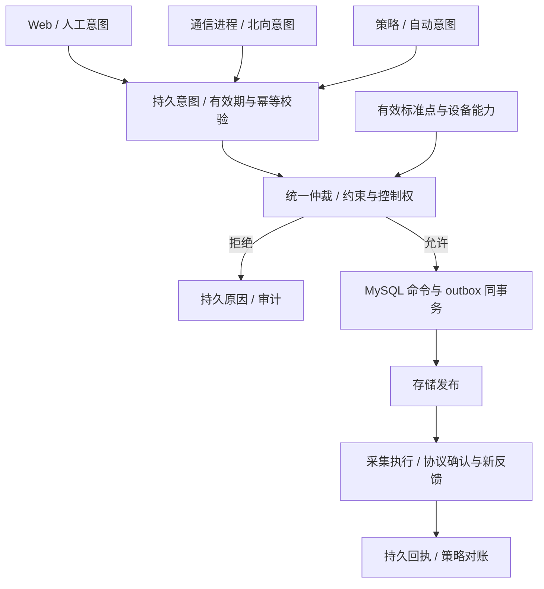

# 策略进程

> 进程：`ems-strategy`｜语言：C++17｜状态：目标设计。

防逆流、需量保护、计划曲线、手动模式、光伏协同和站级功率分配的参数、算法、冲突处理与验收场景见[策略进程详细设计](design.md)。

以标准逻辑点与设备能力为输入，完成聚合、告警、优化调度和控制仲裁。不依赖 Modbus 寄存器、IEC 104 IOA 或 MMS 地址，也不输出任意厂家写值。

## 模块与输出

| 模块 | 核心职责 | 输出 |
| --- | --- | --- |
| 质量评估 | 启用、配置、来源代次、时间窗口、覆盖率校验 | 可用输入及不可用原因 |
| 聚合 | 单元/站级状态、约束、共享设备去重 | 独立 derived 点和带输入版本的状态 |
| 告警引擎 | 去抖/迟滞、产生/恢复/确认生命周期 | 稳定 ID 的可靠告警事件 |
| 调度算法 | 计划、功率分配和设备约束 | 自动意图，不直接写设备 |
| 控制仲裁 | 人工、自动、北向上级统一优先级与所有权 | 拒绝理由或执行命令/outbox |
| 反馈管理 | 关联 command_id、协议确认与设备反馈 | 控制状态和未知结果处理 |

各来源遵循同一审计和仲裁规则，北向连接不自动提高优先级。

## 实时与执行边界

经 RealtimeService/IRealtimeStore 读取权威后端，算法不区分共享内存/Redis。批量读不是全局快照，计算须校验版本、时间与质量；协议、会话和厂家地址由采集按生效配置解析。

配置、计划、命令、告警及 outbox 通过[公共数据库访问层](../../common/database-design.md)的 ormpp Repository 持久化；公共工厂装配本进程上下文，策略不自建实体、SQL 或连接实现。

## 降级、恢复与验收

输入陈旧、控制权不明、配置未应用、能力缺失或反馈未知时，按明确规则限制/停发新的常规远程调度。脉冲、复位等不确定动作不自动补发。重启先恢复持久状态并对账，旧主未隔离不接管控制；设备本地快速保护独立运行。

验证坏质量、缺点/禁用、共享资产重复计量、多来源冲突、版本变化、过期/重复回执和未知执行结果。详见 [控制闭环](../../architecture/system-design.md#6-控制闭环与策略进程)、[设备能力与反馈](../../architecture/device-model.md)、[北向控制](../../architecture/channel-protocol.md#63-外部控制的闭环) 和 [公共访问契约](../../common/realtime/access-design.md)。
