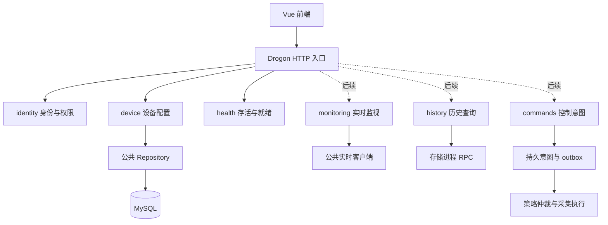
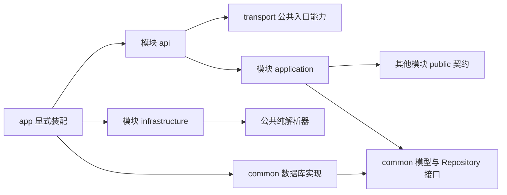
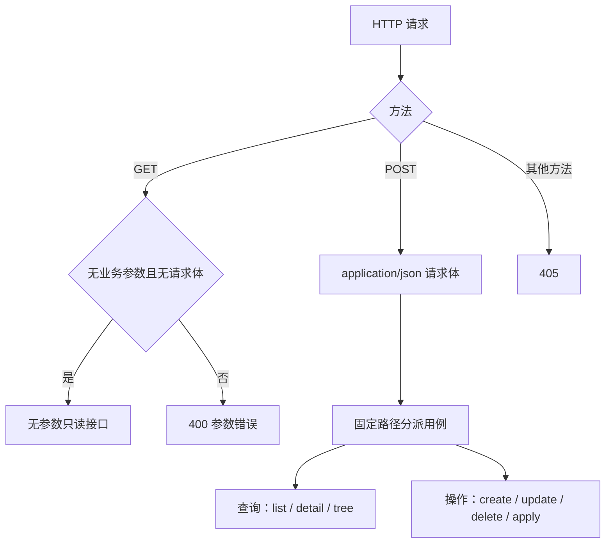
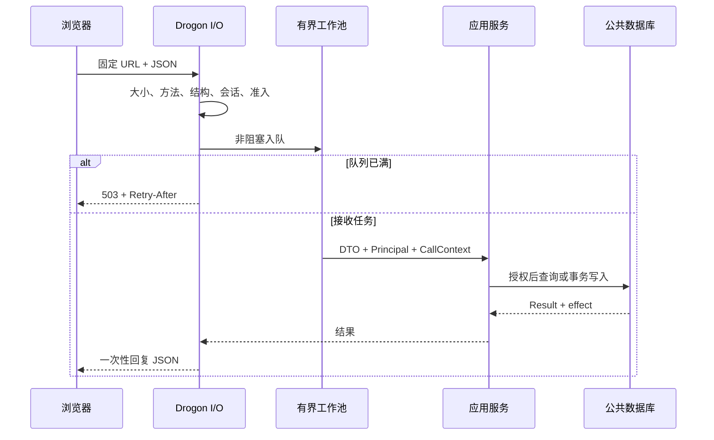
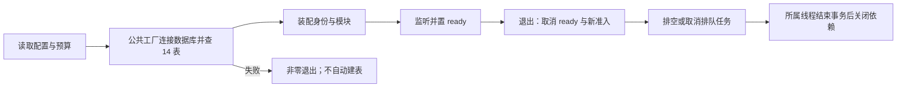
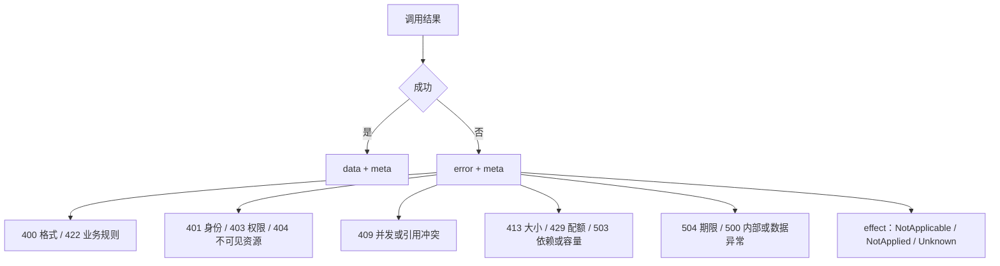

# Web 进程设计

> 日期：2026-10-24｜状态：首期 Web 与设备模块已实现；[构建运行](running.md)。[设备设计](device/index.md) · [API 契约](device/api.md)。

登录及用户管理的目标设计见[用户名、密码与加密登录](user/login.md)和[用户管理与角色权限](user/index.md)。当前仍为内存会话骨架；下文身份目标约定不表示持久账号已经实现。

## 1. 进程与业务模块



| 模块 | 所有权 | 依赖边界 |
| --- | --- | --- |
| identity | 登录、会话、主体与资源权限 | 对外提供 Principal / Authorization |
| device | 树、档案、绑定、四遥、模板、导入 | 复用公共模型和数据库层 |
| health | 进程存活、依赖就绪、指标 | 不探测现场设备 |
| channels（后续） | 通道连接与通信管理 | 首期由 device 承接，移交时复用规则与事务 |
| monitoring / history / commands（后续） | 实时、历史、人工意图 | 不通过配置接口执行设备命令 |

配置保存即生效，以站根 `config_revision` 触发热加载；不建立配置草稿、发布、历史或回滚。

## 2. 目录与依赖

按业务建目录，模块内再分层。以下为目标布局，仅创建本期实际使用的文件。

```text
backend/src/web/
  main.cpp
  CMakeLists.txt
  app/
    web_application.h/.cpp        # 启停与依赖装配
    web_options.h/.cpp            # 配置与预算
    module_registry.h/.cpp        # 显式注册模块
  transport/
    request_context.h/.cpp        # 主体、trace、期限、回复所有权
    json_reader.h/.cpp            # JSON 读取与字段白名单
    response_writer.h/.cpp        # 统一响应与错误
    filters/                      # 身份、CSRF、准入
  platform/
    executor/bounded_executor.h/.cpp
    database/database_factory.h/.cpp
    observability/                # 日志与指标
  modules/
    identity/
      module.h/.cpp
      api/                        # 登录与会话入口
      application/                # 会话服务
      public/authorization.h      # 跨模块契约
      infrastructure/             # 账号与会话实现
    device/
      module.h/.cpp
      api/                        # device/binding/point/import/catalog_controller
      application/                # 对应服务与 configuration_writer
      validation/                 # 请求与导入选项检查
      infrastructure/             # 文件工作区、纯解析器适配
      public/device_query.h       # 只读设备定位
    health/
      module.h/.cpp
      api/health_controller.h/.cpp
backend/conf/web.json
backend/tests/web/                # application / transport / integration
```



| 规则 | 落点 |
| --- | --- |
| Controller 只解析、调用、编码 | 不包含 ORM、SQL、协议插件 |
| Service 管用例、授权、事务 | 不依赖 Drogon 类型或全局容器 |
| 模块之间只调 public | 不包含其他模块私有头文件，不形成循环 |
| SQL、行结构、ORM 只有一份 | `include/common/database` + `src/common/db` |
| Web 内部头文件与实现相邻 | 不复制到 include/web；接口写 Doxygen，遵守 `.clang-format` |

构建：Drogon + C++17，目标显式指定标准；新增 `EMS_BUILD_WEB`（初始 OFF），开启缺依赖则失败。纯应用测试不链接 Drogon；设备配置不链接采集引擎。Windows/MSVC 与 Linux/ARM 分别验收。

## 3. HTTP 统一入口



| 约定 | 内容 |
| --- | --- |
| 路径 | 固定 `/api/模块/动作`，不嵌入 ID，不使用 URL 查询串 |
| 参数 | 有参数一律 POST + JSON；GET 只用于无参数读取 |
| 并发参数 | expected_config_revision、expected_preview_hash 均放 JSON |
| 上传例外 | multipart：file 为二进制文件，metadata 为 JSON 业务参数 |
| 身份 | cookie、认证/CSRF 等安全头保留，不承载业务筛选与 ID |
| 编码 | UTF-8、snake_case；对象/数组直接传 JSON，不传转义 JSON 字符串 |
| JSON 库 | 业务、配置、DTO 与序列化统一 nlohmann::json；JsonCpp 仅为 Drogon 内部依赖，不进入业务接口 |
| 类型 | 稳定 ID、revision、int64/uint64 为字符串；布尔为 boolean；缺失为 null |
| 响应 | 成功 `{data, meta}`；失败 `{error, meta}`；时间为 UTC RFC 3339 |

浏览器 Fetch 不允许 GET 请求体，因此需要参数的读取也使用 POST，见 [Fetch 规范](https://fetch.spec.whatwg.org/#dom-request)。POST 查询仍按只读权限授权，不增加 revision；响应使用 `Cache-Control: no-store`。API 未匹配返回 JSON 404，不能回退 SPA。

## 4. 请求与工作线程



| 资源 | 默认预算 | 触限 |
| --- | --- | --- |
| I/O 线程 / 普通线程 / 队列 | 2 / 4 / 128 | 满队列 503 |
| 导入线程 / 队列 / MySQL 连接 | 1 / 8 / 4 | 有界等待；解析不占连接 |
| 普通请求 / 导入 / 退出宽限期 | 5 s / 30 s / 15 s | 超时保留写入确定性 |
| 普通 JSON / 导入 metadata | 1 MiB / 64 KiB | 413，读取前限制 |
| 导入文件 / multipart 整体 / XLSX 解压累计 | 20 MiB / 21 MiB / 100 MiB | 超限拒绝，不截断 |
| 导入行 / 批量改点 | 50,000 / 200 | 超限 422 |
| 列表 / 树分页 | 默认 20/100，最大 200/500 | 非法值 400 |

上传分别限制 multipart 总体、metadata、文件与解压量；有效上限取解析器和存储能力的交集。文件名不作磁盘路径，服务端随机工作区不对外静态开放。

- 数据库、密码哈希、文件/解析、实时锁等待和长 RPC 在工作池执行；I/O 线程不做同步业务。
- 排队计入 deadline；事务由同一线程创建和结束；超时与完成路径只能回复一次。
- CallContext 现有字段为 deadline/trace_id，取消状态属于 Web 上下文；不强行销毁在途事务。

## 5. 启停、身份与异常



| 项目 | 约定 |
| --- | --- |
| 连接 | 沿用 EMS_DATABASE_CONFIG / EMS_MYSQL_*；Web 不复制数据库配置结构 |
| 身份 | 目标为本地用户名/密码、HTTPS、密码哈希、公共账号及三类角色和资源范围，见[登录设计](user/login.md)；运行配置不含账号清单 |
| 会话 | 当前内存会话重启失效；目标持久会话，浏览器持 HttpOnly/Secure/SameSite=Strict 的不透明 Cookie，后端读取当前权限 |
| 授权 | 按数据库实际关系校验站、设备子树、绑定和任务，过滤列表与 total |
| CSRF | POST 查询与写入统一检查；登录检查 Origin；后续 WebSocket 也检查来源 |
| 审计 | 同公共事务对接统一审计；不在 Web 建私有审计表 |
| 健康 | GET `/health/live`、`/health/ready`；依赖缺失返回 503，采集离线不阻断配置 |
| 身份就绪 | 当前未装配账号服务可启动但拒绝受保护请求；目标生产部署必须启用身份模块，身份表/密钥等依赖缺失时 ready 返回 503 |
| 部署 | 同源；Drogon 静态服务或 Nginx 唯一入口；只信任配置中的代理 |



`Unknown` 表示可能已提交，按原稳定 ID/任务查询；不自动更换 ID 重试。日志不记录凭据、cookie、完整文件或 DSN。

## 6. 实施顺序


验收重点：真实分页、资源越权、站根锁并发、整批回滚、重复导入、过载与退出。MySQL 锁/约束单独验证；后续实时/历史依赖不作为首期配置就绪条件。
