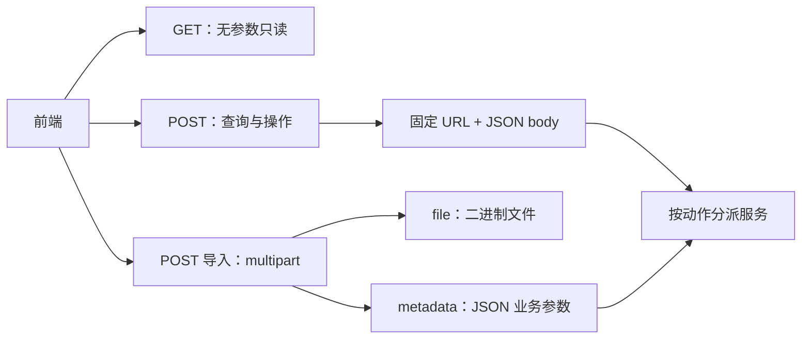
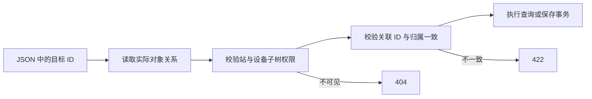
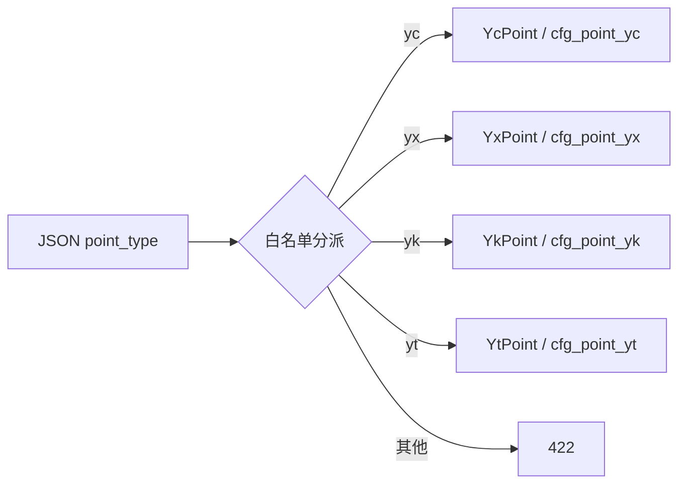
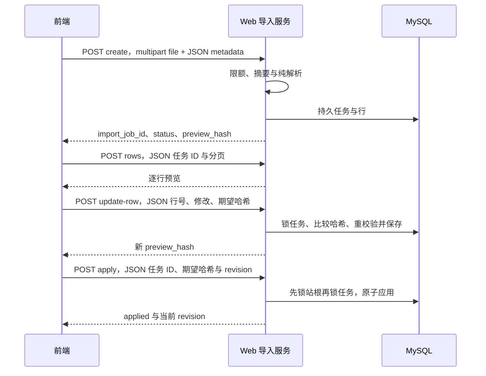
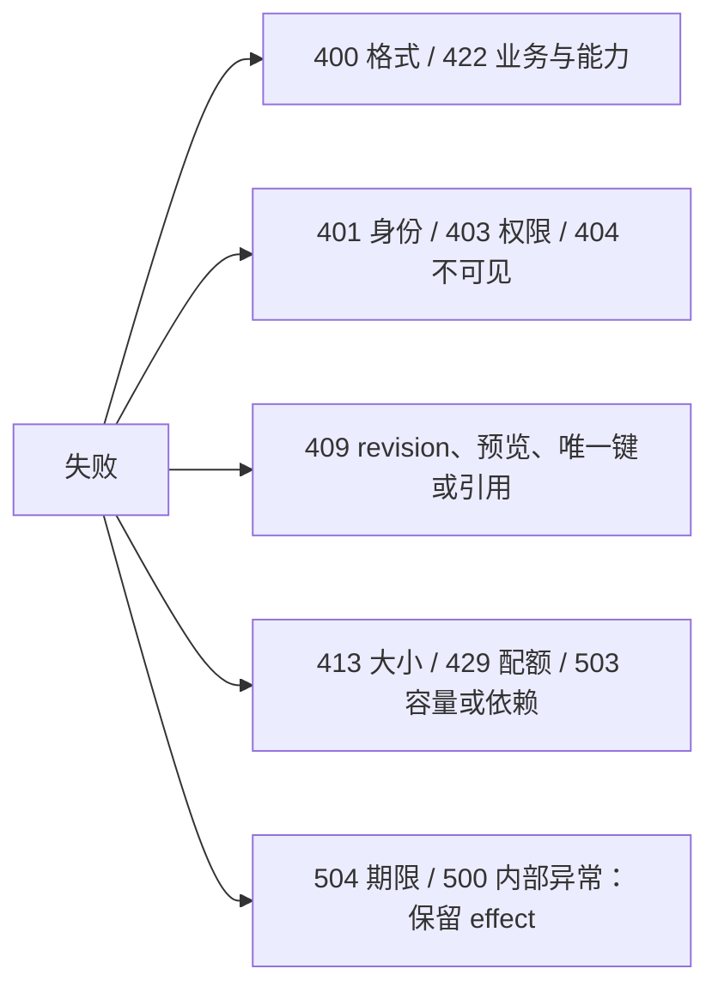

# 设备模块 API 契约

> 日期：2026-10-24｜状态：首期接口实现，运行限制见[构建运行](../running.md)。[进程设计](../design.md) · [设备业务设计](index.md) · [持久化字段](../../../common/database/device-management.md)。

## 1. 请求规则



| 项目 | 约定 |
| --- | --- |
| 方法 | 业务仅 GET / POST，其他方法 405 |
| URL | 固定模块/动作路径；不含设备 ID 等变量，不带查询串 |
| 普通参数 | POST `Content-Type: application/json`；即使查询也放 JSON body |
| GET | 不带业务参数和请求体，仅用于会话/能力/当前工程/健康等无参数读取 |
| 上传例外 | multipart/form-data：file + metadata；metadata 为 application/json |
| 并发 | expected_config_revision、expected_preview_hash 都在 JSON；不用业务请求头 |
| 身份安全 | cookie / CSRF / trace 头保留；所有关联 ID 仍需后端查关系并授权 |
| 类型 | snake_case；ID/revision/int64/uint64 是字符串；时间为 UTC RFC 3339 |
| 结构 | JSON 对象/数组直接传；未知字段、非法类型、超长值拒绝 |

有参数查询使用 POST，避免浏览器 GET 请求体限制，见 [Fetch 规范](https://fetch.spec.whatwg.org/#dom-request)。POST 查询按只读权限处理，不增加 revision；响应统一 `Cache-Control: no-store`。

### 响应

```json
{
  "data": {"items": [], "page": 1, "page_size": 20, "total": 0},
  "meta": {"request_id": "req-example", "config_revision": "37"}
}
```

```json
{
  "error": {
    "code": "Conflict",
    "reason": "config_revision_mismatch",
    "message": "配置已修改，请刷新后处理",
    "effect": "NotApplied",
    "details": [{"field": "expected_config_revision", "current": "38"}]
  },
  "meta": {"request_id": "req-example", "config_revision": "38"}
}
```

| 响应规则 | 约定 |
| --- | --- |
| 新建 / 其他成功 | 201 / 200；删除返回 removed_id；没有额外请求方法 |
| 精确创建重放 | 同稳定 ID + 同归一化内容返回 200、replayed=true；异内容 409 |
| 查询 revision | 来自本次一致读；写成功为提交计数；未知则省略 |
| 分页 | page/page_size/total 为有界 number，total 为真实授权筛选数量 |
| 失败 | code/reason 用于判断；message 仅显示；details 不包含 SQL 或凭据 |
| 写入确定性 | NotApplicable / NotApplied / Unknown；Unknown 按原 ID/任务查结果 |

## 2. 固定路由总表

表中所有参数均在 JSON body；导入创建的参数位于 multipart 的 JSON metadata。创建/修改/删除工程配置都必须提供 expected_config_revision。

### 设备

| 方法 | 固定路径 | JSON 业务参数 | 权限 |
| --- | --- | --- | --- |
| POST | /api/devices/tree | parent_device_id、page、page_size | device.read |
| POST | /api/devices/list | filters、page、page_size、sort、order | device.read |
| POST | /api/devices/detail | device_id | device.read |
| POST | /api/devices/create | device_id、expected_config_revision、fields | device.write |
| POST | /api/devices/update | device_id、expected_config_revision、fields | device.write |
| POST | /api/devices/delete | device_id、expected_config_revision | device.write |

### 类型与模板

| 方法 | 固定路径 | JSON 业务参数 | 权限 |
| --- | --- | --- | --- |
| POST | /api/device-types/list | filters、page、page_size | device.read |
| POST | /api/device-types/points | type_code、type_version、point_type、page、page_size | device.read |
| POST | /api/device-templates/list | filters、page、page_size | device.read |
| POST | /api/device-templates/detail | template_id、template_version | device.read |
| POST | /api/device-templates/apply | device_id、binding_id、template_id、template_version、mode、expected_config_revision | device.write + point.write |
| GET | /api/device-management/capabilities | 无 | device.read |

### 通道与绑定

| 方法 | 固定路径 | JSON 业务参数 | 权限 |
| --- | --- | --- | --- |
| POST | /api/channels/list | filters、page、page_size | channel.read |
| POST | /api/channels/detail | channel_id | channel.read |
| POST | /api/channels/create | channel_id、expected_config_revision、fields | channel.write |
| POST | /api/channels/update | channel_id、expected_config_revision、fields | channel.write |
| POST | /api/channels/delete | channel_id、expected_config_revision | channel.write |
| POST | /api/bindings/list | device_id、page、page_size | device.read |
| POST | /api/bindings/create | device_id、binding_id、expected_config_revision、fields | binding.write |
| POST | /api/bindings/update | device_id、binding_id、expected_config_revision、fields | binding.write |
| POST | /api/bindings/delete | device_id、binding_id、expected_config_revision | binding.write |

### 四遥与固有点

| 方法 | 固定路径 | JSON 业务参数 | 权限 |
| --- | --- | --- | --- |
| POST | /api/inherent-points/list | device_id、filters、page、page_size | device.read |
| POST | /api/points/list | device_id、point_type、filters、page、page_size | device.read |
| POST | /api/points/detail | device_id、point_type、point_id | device.read |
| POST | /api/points/create | device_id、point_type、point_id、expected_config_revision、fields | point.write |
| POST | /api/points/update | device_id、point_type、point_id、expected_config_revision、fields | point.write |
| POST | /api/points/delete | device_id、point_type、point_id、expected_config_revision | point.write |
| POST | /api/points/batch-change | device_id、expected_config_revision、changes | point.write |

### 导入与配置检查

| 方法 | 固定路径 | JSON 业务参数 | 权限 |
| --- | --- | --- | --- |
| POST | /api/point-imports/create | multipart：file + metadata | import.write |
| POST | /api/point-imports/list | device_id、page、page_size | device.read |
| POST | /api/point-imports/detail | import_job_id | device.read |
| POST | /api/point-imports/rows | import_job_id、filters、page、page_size | device.read |
| POST | /api/point-imports/update-row | import_job_id、line_no、expected_preview_hash、fields | import.write |
| POST | /api/point-imports/validate | import_job_id、expected_preview_hash | import.write |
| POST | /api/point-imports/apply | import_job_id、expected_preview_hash、expected_config_revision、mode | import.write + point.write |
| GET | /api/device-management/configuration | 无 | device.read |
| POST | /api/device-management/validate | device_id、expected_config_revision、changes | device.read；候选修改还需 point.write |

身份入口：POST `/api/auth/login`、POST `/api/auth/logout`、GET `/api/auth/session`；健康入口：GET `/health/live`、GET `/health/ready`。URL 均固定。

## 3. 查询参数与对象字段

### 查询示例：POST /api/devices/list

```json
{
  "filters": {"parent_device_id": "unit01", "recursive": false, "node_kind": "device", "enabled": false},
  "page": 1,
  "page_size": 20,
  "sort": "sort_order",
  "order": "asc"
}
```

| 查询 | filters / 返回补充 |
| --- | --- |
| 设备列表 | 父级、recursive、node_kind、device_type_code、keyword、enabled、config_completeness |
| 设备树 | parent_device_id 为空读站根；指定后读直接子节点；返回 has_children/child_count |
| 类型列表 / 模板列表 | 类型用 category/status；模板用 device_type_code/type_version/vendor/model/status |
| 通道列表 | protocol、enabled、keyword |
| 四遥列表 | keyword、enabled、semantic_code、binding_id、origin；YX 增加 soe |
| 固有点列表 | point_type、state、keyword；返回三态和分类 counts，未配置 point=null |
| 导入行 | parse_status、confirm_state、point_type；按 line_no 排序 |

列表默认 page=1、page_size=20（最大 200）；树默认 100（最大 500）。设备排序白名单 name/code/sort_order/updated_at，默认 sort_order，追加 device_id 作为稳定次序；order 仅 asc/desc。其他列表采用固定稳定主键次序；未知筛选字段拒绝。

| 对象 | 主要 fields / 返回 |
| --- | --- |
| device 创建 | parent_device_id、node_kind、code、name；device/component 必填类型与 type_version；component 必填 source_device_id |
| device 可编辑 | name/vendor/model/firmware_version/rated_power_kw/sort_order/description/enabled |
| station 可编辑 | name/timezone/default_stale_after_ms |
| channel 创建 | code/name/protocol/conn_mode/endpoint；serial 为对象；轮询、超时、重试、会话数与 enabled |
| channel 可编辑 | 创建字段中除 code/protocol/conn_mode 的配置 |
| binding 创建 | channel_id 或 new_channel 二选一；device_address、profile_version、角色、enabled、description |
| binding 可编辑 | device_address、profile_version、can_collect/control/forward、enabled、description；不直接重绑通道 |
| point 创建 | binding_id/code/name/address/wire_type/value_type；semantic_code/vendor_key/origin、单位、启用和分类专有字段 |
| point 可编辑 | 除 ID、归属、分类、code 的已支持配置字段 |

新设备/通道/绑定默认 enabled=false；新点默认 false 且需 disabled_reason。各稳定 ID 由创建请求提供；path/depth/revision/操作者/审计时间由后端生成。额定功率当前用 number，不传 null。结构字段和字符串长度以现有 DDL 为上限。

### 修改示例：POST /api/devices/update

```json
{
  "device_id": "pcs01",
  "expected_config_revision": "37",
  "fields": {"name": "储能变流器 01", "enabled": false}
}
```

### 删除示例：POST /api/devices/delete

```json
{"device_id": "pcs01", "expected_config_revision": "38"}
```



设备详情返回祖先、来源、静态能力；列表返回固有点 total/enabled/disabled/unconfigured 和 coverage_ratio（enabled/total，无目录为 null）。不返回草稿/发布态。

## 4. 四遥载荷



### 新建示例：POST /api/points/create

```json
{
  "device_id": "pcs01",
  "point_type": "yc",
  "point_id": "pt-pcs01-active-power",
  "expected_config_revision": "39",
  "fields": {
    "binding_id": "bnd-pcs01-main", "code": "active_power", "name": "实际有功功率",
    "semantic_code": "active_power", "vendor_key": "ac_active_power", "origin": "vendor",
    "address": {"space": "holding_register", "offset": 0, "bit_offset": 0, "register_count": 1},
    "wire_type": "i16", "byte_order": "ab", "value_type": "double", "unit": "kW",
    "scale_factor": 0.1, "offset_value": 0, "range_min": -125, "range_max": 125, "enabled": true
  }
}
```

| 分类 | 专有字段与限制 |
| --- | --- |
| yc | decimals、scale_factor、offset_value、range_min/max、deadband；倍率非零 |
| yx | soe、invert、enum_map、unknown_policy、feedback_of_point_id；SOE 不是第五类 |
| yk | write_mode、fixed_raw_value、pulse_width_ms、min_interval_ms、write_group_key、feedback 等；固定值为 int64 字符串 |
| yt | decimals、scale_factor、offset_value、range_min/max、min_interval_ms、write_group_key、feedback 等；不接受 YK write_mode |

address：寄存器用 space/offset/bit_offset/register_count，其他协议用 protocol_address 对象；offset 已规范化为零基，byte_order 仅实际支持的 ab/ba/null。serial/protocol_address/enum_map/feedback 均为 JSON 对象或数组。

feedback 项为 point_code/criterion/expected/tolerance/order/required；point_code 解析到同 owner 的 YC/YX，criterion 首期 equals/within_tolerance；expected 按点类型，数值容差非负。禁用需非空 disabled_reason。批量 changes 为 `{operation, point_type, point_id, fields}` 数组，operation=create/update/delete，delete 无 fields；最多 200 项，同事务校验候选全集。

## 5. 文件导入与预览并发



### multipart metadata 示例

`file` 为原始 CSV/XLSX 二进制；`metadata` part 的 Content-Type 为 application/json，内容如下：

```json
{"device_id": "pcs01", "binding_id": "bnd-pcs01-main", "source_kind": "vendor_csv", "address_base": "zero"}
```

### POST /api/point-imports/update-row

```json
{
  "import_job_id": "imp-example", "line_no": 6, "expected_preview_hash": "sha256-of-preview",
  "fields": {"confirm_state": "accepted", "confirm_note": "已核对读写共享语义"}
}
```

### POST /api/point-imports/apply

```json
{
  "import_job_id": "imp-example", "expected_preview_hash": "sha256-of-preview",
  "expected_config_revision": "40", "mode": "merge"
}
```

| 规则 | 返回与行为 |
| --- | --- |
| 任务详情 | 状态、文件摘要、行计数、preview_hash、allowed_operations |
| 行修正 | 仅支持可持久化列和确认字段；confirm_by/at 由服务端生成；修改后旧确认失效 |
| 哈希 | update-row/validate/apply 均在 JSON 带期望值；缺失 400、改变 409；不使用 If-Match |
| 幂等 | 同设备+绑定+文件摘要返回原任务；source_kind/address_base 不同 409 |
| 首次 apply | 校验未排除行、原子写点和任务；返回 created/updated/excluded 与 revision |
| applied 重放 | 不重写、不再递增；不伪造未存储的原计数或原更新统计 |
| failed/applied | 终态不可编辑；HTTP 201 仅表示任务创建，须检查 status 判断解析结果 |
| merge | 稳定厂家键复用 point_id，缺席旧点保留；不支持隐式 replace |

上传有效限额由 capabilities 返回；multipart 总体、JSON metadata、文件、XLSX 解压量和行数分别限制。预览不写工程表、不增加 revision，当前无法持久化的专有字段返回 Unsupported。

## 6. 模板、配置检查与错误

| 用例 | JSON / 行为 |
| --- | --- |
| template apply | device_id、binding_id、template_id、template_version、mode=merge_missing、expected_config_revision；有真实绑定才复制 |
| configuration GET | 返回唯一站根 ID、当前 config_revision 与功能标记 |
| validate POST | device_id、expected_config_revision、changes；空数组查已保存配置，候选沿用批量点结构 |
| validate 响应 | 200 + valid/issues/counts/affected_device_ids；不写表、不递增；保存仍重校验 |
| issues | severity、reason、field、point_id/行定位、related_ids |



前端联调：POST 树/列表/详情 → 创建档案 → 绑定 → 四遥/导入 → 校验并启用。每个表单使用自身读取的 revision；409 保留输入后重读，Unknown 先对账。接口无发布、回滚或配置历史资源。
