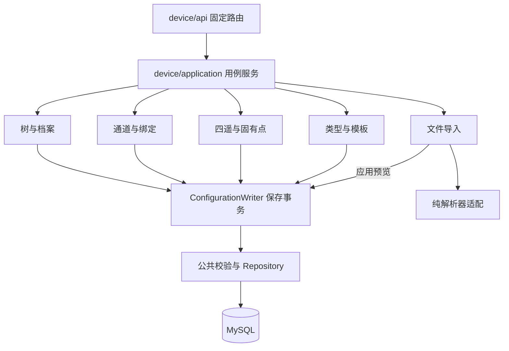
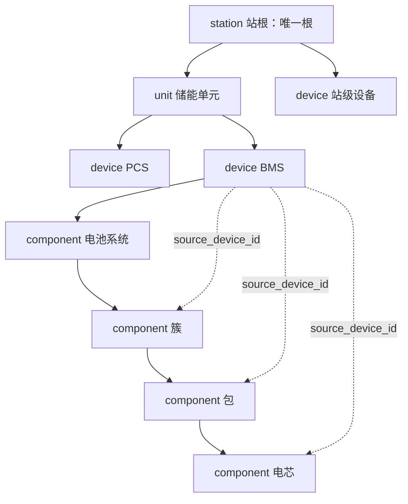
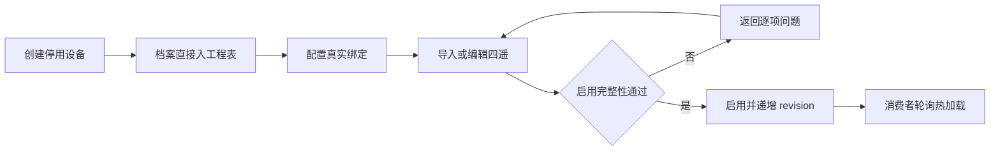
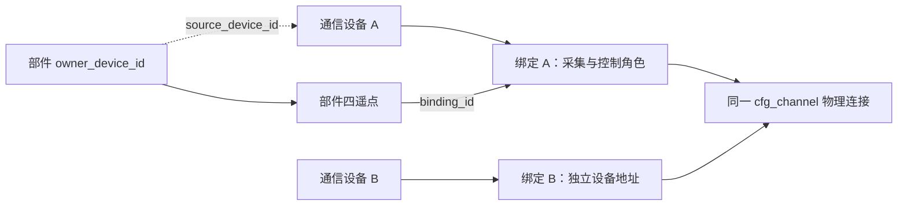
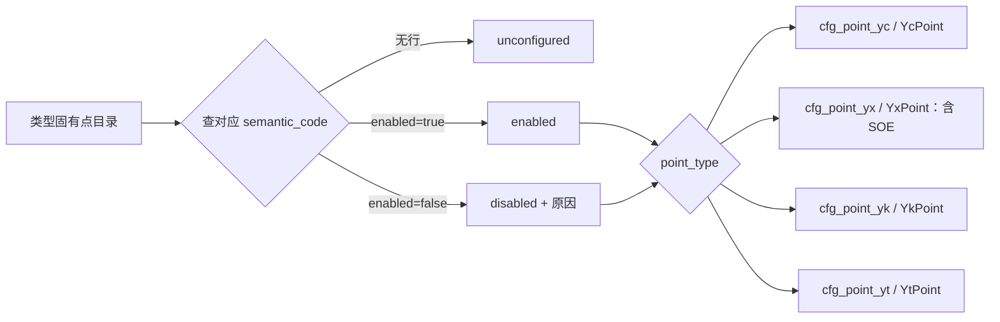
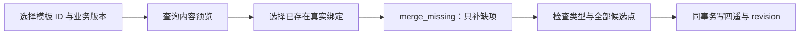
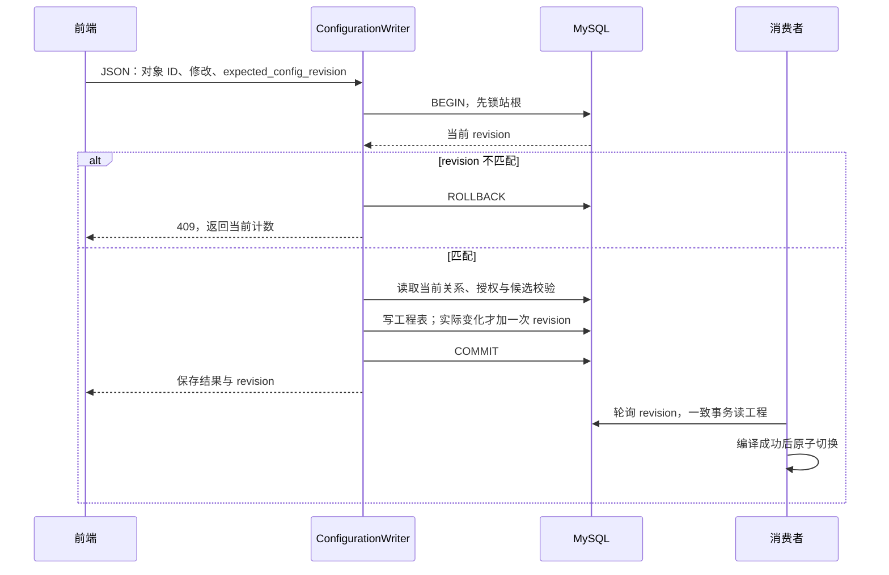
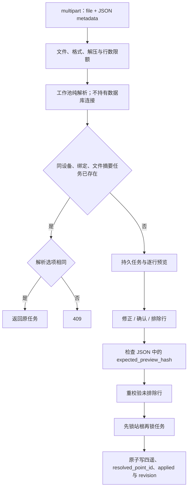
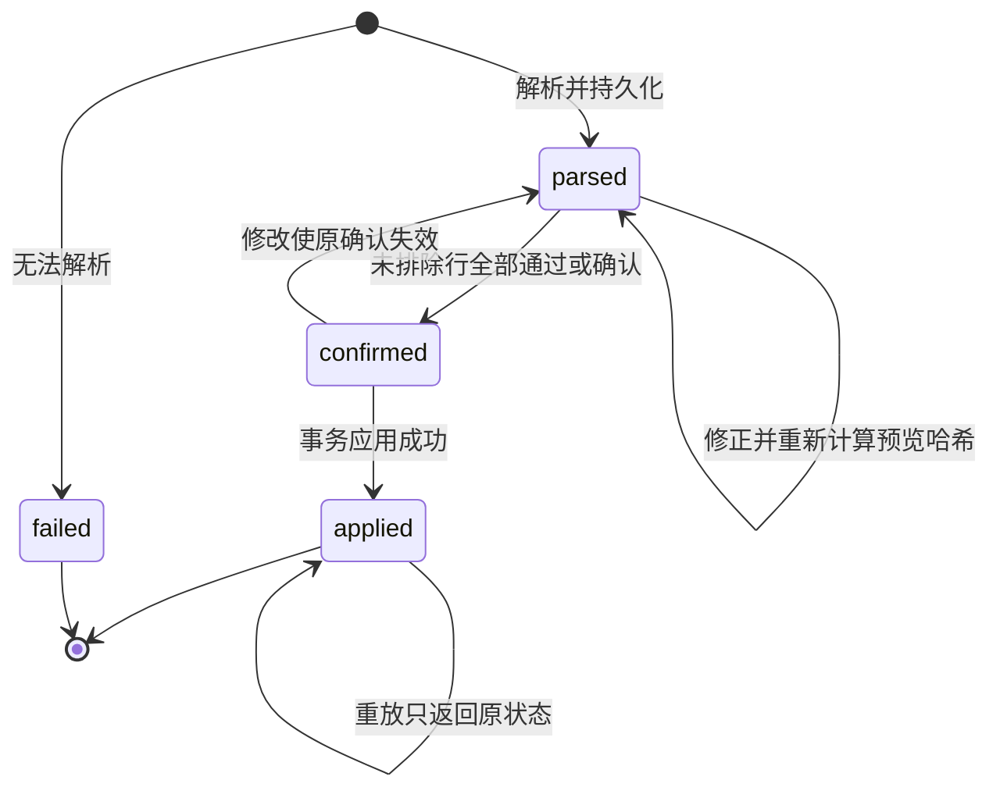

# 设备模块设计

> 日期：2026-10-24｜状态：首期实现，运行与限制见[构建运行](../running.md)。本文看业务图，[API 契约](api.md)看固定路由，[数据库设计](../../../common/database/device-management.md)看字段。

## 1. 模块职责

| 既有基础 | 本次补齐 |
| --- | --- |
| 14 表行结构、ORM 映射 | Web 入口、服务、身份和 JSON DTO |
| IDeviceConfigRepository 基础 CRUD、整份读取 | 真正分页与 total、前置站根锁、模板/导入仓储 |
| 公共数据库工厂、调用方事务 | 14 表完整 schema 检查、跨表一致性校验 |
| CSV/XLSX 解析基础 | 新四遥表适配、逐行确认、稳定身份与原子应用 |

公共入口位于 `include/common/database/configuration/`；持久化实现只放 `src/common/db/configuration/`。旧资产、配置快照和草稿接口不接入设备 Web。

## 2. 一棵设备树

| 节点 | 父级 | 通道 / 点 | 限制 |
| --- | --- | --- | --- |
| station | 无 | 都不能 | 种子建立，不开放创建/删除；path=/，depth=0 |
| unit | station | 都不能 | 组织节点 |
| device | station / unit | 可绑定、可挂点 | 必须指定类型与 type_version |
| component | device / component | 不绑定、可挂点 | 来源必须为所属通信设备子树的实际采集设备 |

- ID 稳定，code 同父唯一；不按 ID 前缀猜类型。path/depth 后端生成，最多 8 层。
- 创建后不直接改 code、父级、node_kind 或类型；移动/迁移留给专门用例。
- 树按父节点懒加载；列表服务端分页，total 和节点统计均按授权范围计算。

## 3. 从创建到启用

| 操作 | 强制检查 |
| --- | --- |
| 任意保存 | 类型、唯一性、层级、来源、已存在引用正确 |
| 启用 / 修改已启用路径 | 必需固有点已映射或明确禁用；来源、转换、反馈和绑定完整 |
| 停用 | 保留工程记录；排除设备、祖先、来源、通道、绑定或点任一停用路径 |
| 删除 | 拒绝站根及任何子节点、点、绑定、来源、反馈、任务引用；不隐式级联 |

停用设备仍是当前工程配置，没有额外草稿。后台能力仅表示 configuration_ready，运行许可由监视/控制侧另行判定。

## 4. 通道、绑定与部件来源

| 规则 | 行为 |
| --- | --- |
| 同设备 + 同通道 | 一条绑定，用 can_collect/control/forward 合并角色 |
| 复用连接 | 不自动复制通道；移除绑定不删除通道 |
| 新建连接并绑定 | 一个事务，失败全部撤销，只加一次 revision |
| 点来源 | YC/YX 要 can_collect；YK/YT 要 can_control |
| 共享通道修改 | 检查全部受影响资源权限并返回影响设备 |
| Profile | 仅用现有 profile_version 和真实能力目录，不新增配置发布流程 |

## 5. 四遥与固有点

| 检查 | 规则 |
| --- | --- |
| 分类 | DTO 的 point_type 白名单分派四表，不加单表分类列；运行 YK/YT 都是 Command |
| 唯一性 | point_id、节点 code、绑定 vendor_key 跨四表校验；固有点须匹配目录分类 |
| 扩展点 | semantic_code 为空也保留采集，不跳过 |
| 换算 | YC=raw×scale+offset；YT=(工程值-offset)/scale；非零倍率、范围和溢出检查 |
| 反馈 | 解析为同归属节点的稳定 YC/YX 点；检查类型、存在性及循环 |
| 地址 | 检查绑定内区间/位段及共享通道同设备地址；读读允许，读写重叠须确认 |
| 写冲突 | 仅允许明确同一非空写组且执行侧支持互斥的共享写；非法冲突不可确认绕过 |

### 当前模型限制

| 限制 | 首期处理 |
| --- | --- |
| 禁用点仍需真实 binding_id | 无绑定时只表示未配置，不造占位绑定 |
| byte_order 仅 ab/ba | 当前仅开放 bool/i16/u16；多寄存器布局返回 Unsupported，不截断 |
| rated_power_kw 可空性映射为 0 | 不从 0 推断缺失；需要区分时先改公共映射 |
| 导入行缺 YK 反馈等专有字段 | 只开放可无损持久化格式；其他返回 Unsupported |
| 设备只存 template_id | 不假造当初套用的 template_version |

扩展时原地修改 `003`、行结构、ORM 与数据库文档，不增加迁移代际或配置版本。

## 6. 模板实例化

模板不自动覆盖已有人工作业；无绑定时只保存模板来源。类型、模板、Profile 和固件业务版本保留。

## 7. 保存事务与热加载

| 情况 | 处理 |
| --- | --- |
| 任一步失败 | 整事务撤销，revision 不变 |
| 多行 / 模板 / 导入一次保存 | 只增加一次计数；无变化不增加 |
| 双窗口修改同一计数 | 先保存成功，后保存 409；保留本地输入后重读 |
| commit 返回 Unknown | 按原对象/任务查询，不盲目重放 |
| 消费者加载失败 | 保留旧运行目录并告警；缺真实诊断时显示 unknown |

锁站根必须先于读取前置条件和写入；所有工程写入者遵守同一顺序，不能只在末尾 bump。消费者不在线也可保存，不建立发布/回执表。

## 8. 文件导入

| 约束 | 规则 |
| --- | --- |
| 入参 | file 放原文件；metadata 放 device_id/binding_id/source_kind/address_base |
| 预览并发 | 动态 preview_hash，不加版本列；编辑/校验/应用都在 JSON 传期望哈希 |
| 应用并发 | 再核对 expected_config_revision；预览成功不代表可绕过保存校验 |
| 错误 | 未排除 error、未确认 warning、目标缺失阻止应用；rejected 明确计数 |
| 稳定点 | 按 binding_id+vendor_key 查四表，更新复用 point_id；目标按 path 精确命中 |
| 合并 | 仅 merge/upsert；文件缺席旧点保留，不默认删除 |
| 重放 | applied 不再写点、不再加计数；原提交 revision 未存则不假造 |
| 解析适配 | 复用纯解析，不调用旧表写入/删后重建 ID 的流程 |
| 格式能力 | 按实际解析/存储/运行能力交集开放；中文多表定位等缺持久字段时不开放 |

导入新点由规范列生成名称、地址、转换；code 优先 semantic_code，否则由 vendor_key 稳定生成并查碰撞。更新保留 point_id/code/enabled 及当前格式不表达的专有规则，禁止丢失命令语义。

## 9. 前端联调与验收

| 前端调整 | 验收 |
| --- | --- |
| 发布页改校验页，移除草稿筛选和模拟计时 | 保存直接写工程；加载未知如实展示 |
| 四遥独立页签；event 改 YX+SOE 筛选 | 分类正确，YK/YT 不进周期采集 |
| total、ID、来源、能力来自接口 | 不按前缀猜类型、不写死数量 |
| 创建成功后再关闭抽屉 | 刷新仍存在；失败不报成功 |
| 按 device_id/任务隔离编辑上下文 | 切换设备无串数据；409 不覆盖本地输入 |
| 公共权限与事务测试 | 越权不可见、引用删除失败、整批回滚、重复导入不重复应用 |
