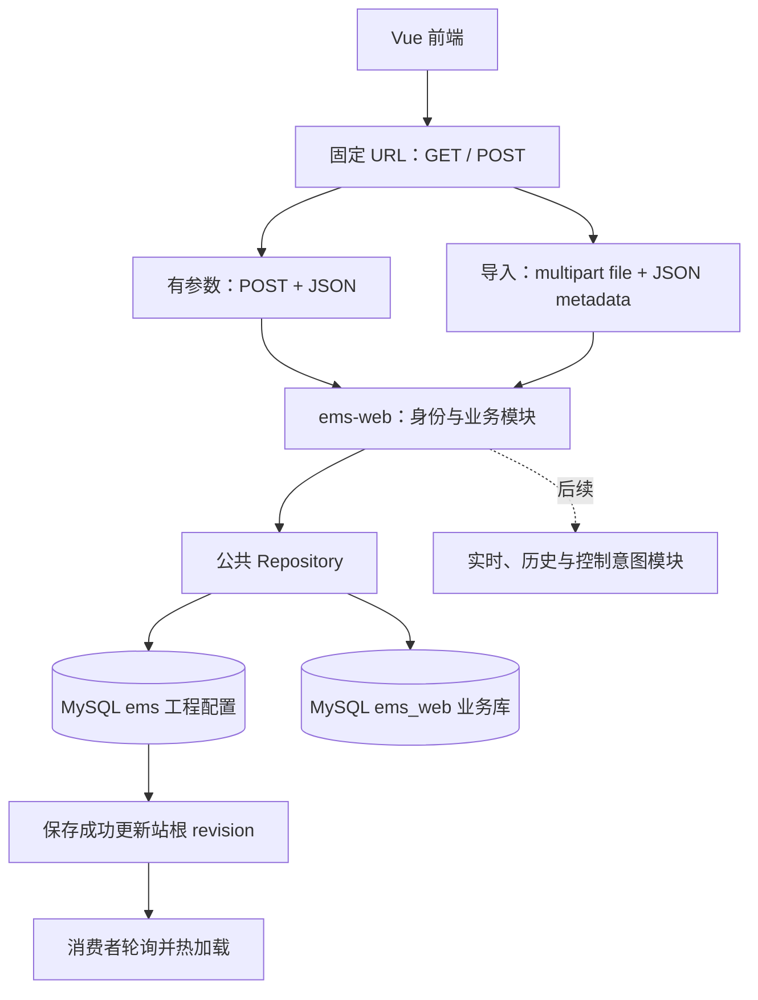

# Web 进程与前端协作

> 日期：2026-10-24｜状态：首期 Web 与设备接口已实现，当前前端数据仍使用 mock。

| 阅读入口 | 内容 |
| --- | --- |
| [构建与运行](running.md) | 构建依赖、账号、数据库配置、验证边界 |
| [Web 进程设计](design.md) | 模块目录、依赖、请求、线程、启停与身份 |
| [登录设计](user/login.md) | 用户名/密码、HTTPS 加密、密码哈希与登录会话（待实现） |
| [用户管理与角色权限](user/index.md) | 管理员/操作员/观察员、资源授权、账号生命周期及 API（待实现） |
| [EMS Web 数据库与表设计](../../common/database/ems-web.md) | 独立 ems_web 业务库，用户、授权、会话、登录策略和 Web 审计 5 表（待实现） |
| [设备模块设计](device/index.md) | 设备树、绑定、四遥、保存与导入流程图 |
| [设备模块 API](device/api.md) | 固定路由、JSON 参数、multipart 导入与响应 |
| [设备管理数据库](../../common/database/device-management.md) | 14 表及持久化字段 |

| 核心约定 | 内容 |
| --- | --- |
| 请求 | 仅 GET/POST；GET 无业务参数；URL 不放 ID 或查询串 |
| 配置 | 保存即生效；无配置草稿、发布、快照或回滚 |
| 设备 | 一张 cfg_device 表达站/单元/设备/部件；部件指向来源通信设备 |
| 四遥 | YC/YX/YK/YT 四表四类；SOE 属于 YX |
| 边界 | 数据库复用公共层；配置不依赖采集在线，不直接执行设备命令 |
