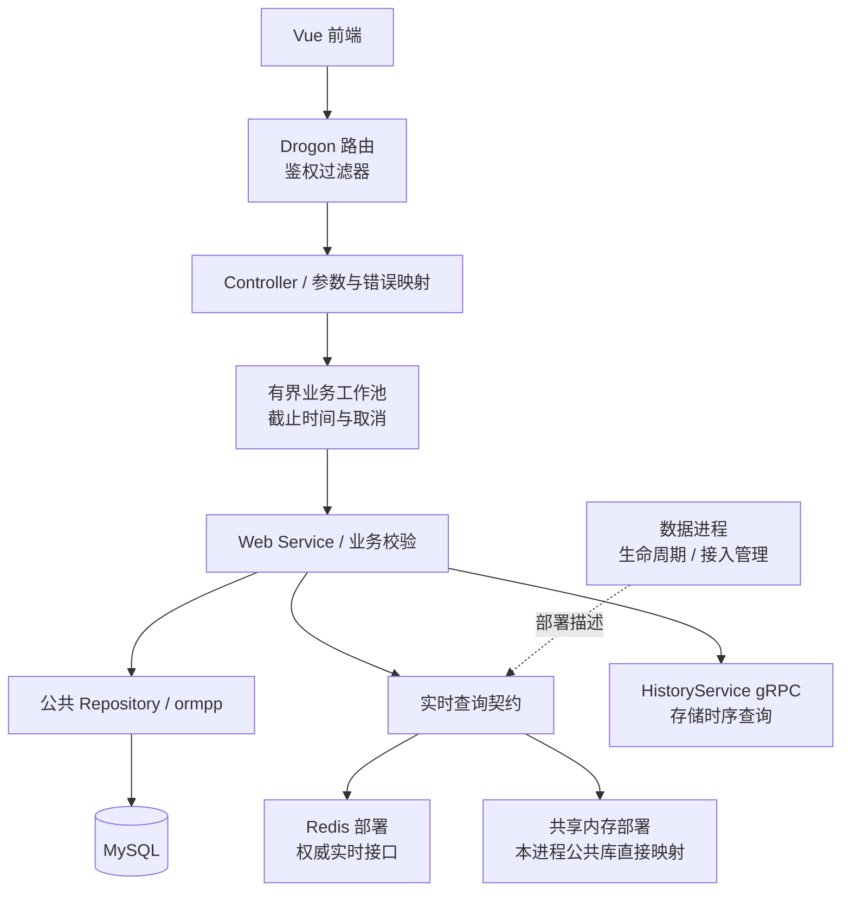
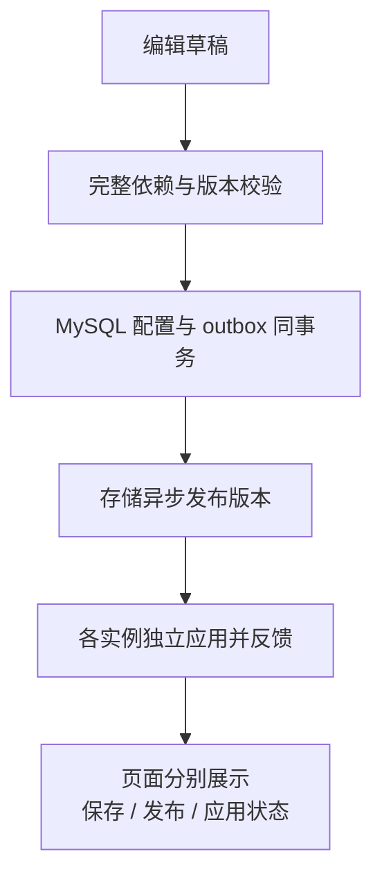
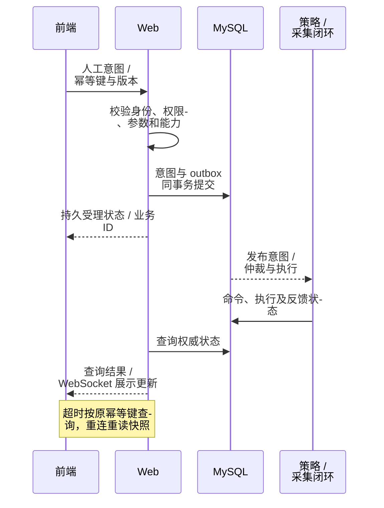

# Web 后端与前端协作

> 后端：`ems-web` / C++17 + Drogon｜前端：Vue 3 + TypeScript + Tailwind CSS｜更新日期：2026-10-23｜状态：目标设计，尚未实现。

负责认证授权、配置编辑/发布、业务 API 和展示编排。[Drogon](https://github.com/drogonframework/drogon) 提供 REST/WebSocket；MySQL 统一经[公共数据库访问层](../../common/database-design.md)的 ormpp Repository，不在 Web 维护实体、SQL 或另一套 ORM。前端统一经 Web 访问数据和提交意图。

## 进程内分层与资源边界

| 边界 | 规则 |
| --- | --- |
| Controller / Service | Controller 解析输入、传权限上下文、映射响应；Service/公共模型校验版本、能力和控制受理 |
| 工作池 | 同步 ormpp、导入和长查询进入有界工作池，不占网络 I/O 线程；报表与控制受理独立预算 |
| 连接与事务 | Web 入口用公共工厂创建本进程数据库上下文，Repository 共用其池/事务实现；RPC 客户端独立，业务与 outbox 同事务提交 |
| 权限 | Web 核验会话/令牌、角色、站点/资产/操作；策略与采集复核控制权、所有权和互锁 |
| 超时 | 请求超时可能已提交，客户端用原幂等键查结果 |
| 推送 | WebSocket 传展示数据/变化提示；重连重读权威快照，不代替审计持久化 |

Web 在同机受信任部署下通过公共门面直接读取共享段，或通过 RedisStore 连接权威 Redis；公共库隐藏布局，浏览器只访问 Web。管理接口不进入每次查询路径，存储不再承担默认实时代理。锁等待同样进入有界业务工作池；共享内存后端当前需要读写映射来维护锁，业务只读不是 OS 只读隔离。跨机实时访问首期选 Redis，接入与恢复见[数据进程设计](../data/design.md)。

## 页面与关系

| 页面 | 编辑/展示 | 关联 |
| --- | --- | --- |
| 设备 | 类型/型号、固有点、厂家表、禁用/反馈 | 资产、采集/上送绑定、能力 |
| 通道 | 用途、本端角色、profile、资源 | 设备、点映射、peer、会话 |
| 协议 | 版本/服务、schema、模型、限额 | 角色/传输、引用通道 |
| 上送点表 | 标准点、外部地址、编码/质量/权限 | 来源、通道、可见 peer |
| 发布/运行 | 差异、校验、回滚、错误 | 已保存/已发布/各实例已应用、会话状态 |

设备页与通道页编辑同一份绑定；设备可同时采集/上送，client/server 是通道角色。UI 能力选项来自后端目录。

## API 资源划分

以下为设计示例。更新带期望版本，列表分页并按 station/资产鉴权；JSON 的 64 位 ID、时间及计数器使用十进制文本，不经 JavaScript Number 比较版本。

| API | 职责 |
| --- | --- |
| `/api/v1/devices` 及标准点/导入子资源 | 设备、厂家表与标准绑定 |
| `/api/v1/protocols` | 只读能力目录 |
| `/api/v1/protocol-profiles` | 不可变参数版本 |
| `/api/v1/channels` | 通道及 bindings、forwarding-maps、peers |
| `/api/v1/channels/{channel_id}/sessions` | 只读会话诊断；session 不是设备 |
| `/api/v1/config-drafts/{draft_id}/validate`、`/publish` | 完整校验与发布 |
| `/api/v1/control-intents` | 人工意图，禁止任意寄存器/函数写目标 |
| `/api/v1/points/latest`、`/history` | 标准实时/历史值，保留质量、时间和版本 |

资源规则以[设备模型](../../architecture/device-model.md)和[通道协议](../../architecture/channel-protocol.md)为准；Web 不代填其他实例的 applied 状态。

## 查询、推送与验收

| 类别 | 验收重点 |
| --- | --- |
| 查询 | MySQL 本地 Repository、历史存储 gRPC；实时后端切换时页面字段一致，失效值不填零 |
| 控制状态 | 区分受理、仲裁、发送、协议确认、反馈成功、失败、过期、未知；北向共用审计视图 |
| 配置/权限 | 双向编辑一致、跨站越权、非法角色、地址冲突、依赖删除、版本冲突、部分发布 |
| 异常/资源 | 重复提交、超时查结果、WebSocket 重连；限制 RPC/工作池的并发、行数、时长、排队 |
| 部署 | 静态前端由 Drogon 或可选 Nginx 提供，选择一个对外入口；目标 Drogon 在 Linux/ARM 与 C++17 工具链验证 HTTP/WebSocket/TLS 及客户端依赖 |
