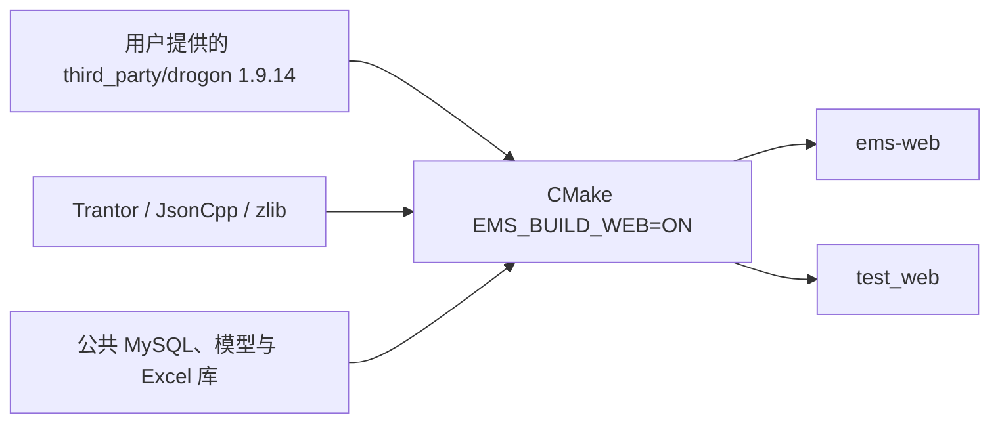

# Web 进程构建与运行

> 日期：2026-10-24｜源码：`backend/src/web`｜可执行文件：`ems-web`。

## 1. 构建链路



业务、配置、DTO 全部使用 **nlohmann::json**。JsonCpp 只作为 Drogon 内部依赖，不用于业务请求/响应。自有模块通过 `GLOB_RECURSE CONFIGURE_DEPENDS` 收集源码。

Windows 在 x64 MSVC 开发终端运行：

```powershell
chcp 65001
./scripts/setup_web_dependencies.ps1
cmake -S backend -B build/web -G "Ninja Multi-Config" `
  -DEMS_BUILD_WEB=ON -DBUILD_TESTS=ON -DBUILD_EXAMPLES=OFF `
  -DEMS_BUILD_LEGACY_MODBUS=OFF `
  -DCMAKE_PREFIX_PATH="工作区/build/web-deps/install;已有平台依赖前缀"
cmake --build build/web --config Release --target ems-web test_web --parallel 4
ctest --test-dir build/web -C Release -R "WebDevice|WebIdentity|WebExecutor" --output-on-failure
```

平台依赖沿用仓库现有构建配置：MySQL/MariaDB 客户端、SQLite 测试库、libmodbus、hiredis、Boost、OpenXLSX 依赖。`setup_web_dependencies.ps1` 不下载或替换用户提供的 Drogon。Trantor 锁定与 Drogon 1.9.14 配套的提交；Linux 可使用同版本依赖和现有平台脚本构建。

## 2. 首次运行


| 配置 | 来源 |
| --- | --- |
| 监听、工作池、期限、上传目录 | `backend/conf/web.json`；默认 `127.0.0.1:8080` |
| MySQL 连接 | 公共 `EMS_DATABASE_CONFIG` / `EMS_MYSQL_*`；不自动建库或迁移 |
| 账号 | `EMS_WEB_IDENTITY_FILE` 指定 JSON；样例默认无账号，必须自行配置 |
| 密码哈希 | `ems-web --hash-password`，从标准输入读取；PBKDF2-HMAC-SHA256 |
| 前端静态文件 | 可选 document_root；或同源 Nginx 转发 `/api` |

账号文件结构：

```json
{
  "users": [{
    "username": "你的账号",
    "password_hash": "替换为 --hash-password 输出",
    "permissions": ["device.read", "device.write", "channel.read", "channel.write", "binding.write", "point.write", "import.write"],
    "station_ids": ["station"],
    "device_roots": ["*"]
  }]
}
```

```powershell
$env:EMS_WEB_IDENTITY_FILE = '账号文件绝对路径'
$env:EMS_DATABASE_CONFIG = '公共数据库配置绝对路径'
./build/web/bin/Release/ems-web.exe --config backend/conf/web.json --check-config
./build/web/bin/Release/ems-web.exe --config backend/conf/web.json
```

默认站根由既有种子脚本在缺少站根时建立；已有站根不覆盖。账号授权中的站 ID 应与实际根一致。启动验证 14 表可读和唯一站根存在。

## 3. 登录与请求

| 请求 | 入参与响应 |
| --- | --- |
| POST `/api/auth/login` | JSON username/password，Origin 必须匹配 allowed_origin；返回 HttpOnly cookie 与 csrf_token |
| GET `/api/auth/session` | 携带 cookie，读取当前主体与 CSRF |
| POST 查询/操作 | JSON 参数 + cookie + X-CSRF-Token + Origin |
| POST `/api/point-imports/create` | multipart：file 原文件，metadata JSON；同样校验身份、CSRF 与 Origin |
| GET `/health/live`、`/health/ready` | 无业务参数；ready 检查本进程所需数据库与表 |
| GET `/api/system/metrics` | 需 system.read，返回脱敏计数与平均时延 |

所有业务 ID、分页、筛选和期望 revision 都在 JSON；GET 无请求体、URL 无业务参数。接口清单见 [API 契约](device/api.md)。

## 4. 当前实现与验证边界

| 能力 | 状态 |
| --- | --- |
| Windows/MSVC 编译、配置检查、真实 HTTP 会话和设备接口 | 本次 12 项 Web 测试通过，覆盖 Cookie、CSRF、multipart、CSV/XLSX、重放和事务回滚 |
| 公共仓储/事务/配置用例 | 本次 132 项回归通过；数据库测试使用 SQLite，生产入口使用 MySQL 公共工厂 |
| 文档 | 构建和类型检查通过，25 张 Mermaid 图通过语法解析 |
| CSV / 英文列 XLSX | 真实解析与持久预览，最多 2 MiB / 10,000 行；XLSX 校验解压预算 |
| 中文四遥 XLSX | 当前返回 Unsupported，不调用旧表写入流程 |
| 导入 YK / YT | 新点先停用，补齐写入及反馈规则后显式启用 |
| 共享写地址 | 执行侧互斥尚未接新工程表，当前明确拒绝；读写共享可逐行确认 |
| MySQL 生产库、Linux/ARM、现场热加载 | 需要对应环境验收；不由 SQLite 测试推断已通过 |
| 统一业务审计、前端 mock 替换、监视/历史/控制模块 | 独立后续接入；普通进程指标不充当持久审计 |

当前入口提供 HTTP；默认依赖脚本使用 Trantor 无 TLS 构建。本机开发直接监听，远程部署由 Nginx 终止 TLS，并配置 HTTPS allowed_origin 和 secure_cookie。脚本的 openssl 选项仅控制依赖编译，进程原生 TLS 配置尚未开放。

Windows 测试应在正常开发终端运行：受限沙箱的虚拟临时目录可能使 XLSX 库的原生文件接口报告文件不存在。
