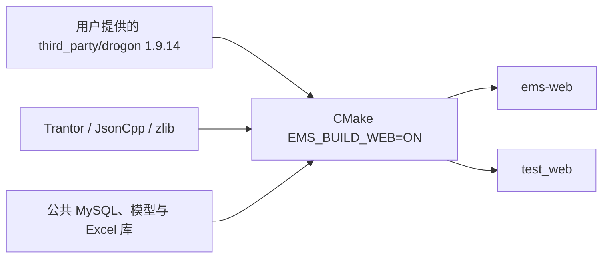

# Web 进程构建与运行

> 日期：2026-10-24｜源码：`backend/src/web`｜可执行文件：`ems-web`。

## 1. 构建链路



业务、配置、DTO 全部使用 **nlohmann::json**。JsonCpp 只作为 Drogon 内部依赖，不用于业务请求/响应。自有模块通过 `GLOB_RECURSE CONFIGURE_DEPENDS` 收集源码。

`EMS_BUILD_WEB` 现已默认开启，各平台预设也显式启用该进程，已有构建目录重新执行预设配置即可更新开关。
正式程序输出到构建目录的 `bin/`；MSVC 为 `bin/<配置>/`。测试仍输出到 `tests/bin/`，
可用 `-DEMS_BUILD_WEB=OFF` 单独关闭 Web，`BUILD_EXAMPLES=OFF` 不影响 Web。
Windows 运行依赖 DLL 与 EXE 放在同一目录，协议插件仍位于 `lib/`（MSVC 为 `lib/<配置>/`）。

Windows 在 x64 MSVC 开发终端运行：

```powershell
chcp 65001
./scripts/setup_web_dependencies.ps1 -Toolchain msvc
cmake -S backend -B build/web -G "Ninja Multi-Config" `
  -DEMS_BUILD_WEB=ON -DBUILD_TESTS=ON -DBUILD_EXAMPLES=OFF `
  -DEMS_BUILD_LEGACY_MODBUS=OFF `
  -DCMAKE_PREFIX_PATH="已有平台依赖前缀"
cmake --build build/web --config Release --target ems-web test_web test_web_mysql --parallel 4
ctest --test-dir build/web -C Release -R "WebDevice|WebIdentity|WebExecutor|PersistentIdentity|IdentityCodec|IdentityHost" --output-on-failure
```

平台依赖沿用仓库现有构建配置：MySQL/MariaDB 客户端、SQLite 测试库、libmodbus、hiredis、Boost、OpenXLSX 依赖。`setup_web_dependencies.ps1` 不下载或替换用户提供的 Drogon。Trantor 锁定与 Drogon 1.9.14 配套的提交；Linux 可使用同版本依赖和现有平台脚本构建。

Windows 依赖脚本默认使用 MSVC，安装到 `backend/build/web-deps-msvc/install`；
MinGW 在 GCC/G++ 环境中执行 `./scripts/setup_web_dependencies.ps1 -Toolchain mingw`，
安装到 `backend/build/web-deps-mingw/install`。CMake 根据当前工具链自动补充对应前缀，
因此普通预设配置和 VSCode CMake Tools 无需额外填写 Trantor 路径。
自定义 `-BuildDirectory` 时，通过 `-DEMS_WEB_DEPENDENCY_PREFIX=<该目录>/install` 指定位置；
显式设置的 `CMAKE_PREFIX_PATH` 仍然有效。

Windows 启用 Web 测试时，缺少 SQLite 安装库会自动准备固定的 3.50.2 amalgamation，
并使用当前工具链编译为 `tests/archive/` 下的静态库；正式 Web 进程仍使用公共 MySQL 驱动。
`EMS_FETCH_SQLITE=OFF` 可关闭自动准备，离线源码可用 `FETCHCONTENT_SOURCE_DIR_EMS_SQLITE` 指定。

密码使用固定归档和 SHA-256 校验的 Argon2 参考库，默认构建单线程可移植实现（不依赖本机 SIMD）。首次配置需要下载源码；离线构建使用 `-DFETCHCONTENT_SOURCE_DIR_EMS_ARGON2_SOURCE=<已解压源码目录>`。新密码为 Argon2id（64 MiB、3 轮、1 lane），进程内最多同时执行两次密码派生。合法旧 PBKDF2 编码仅用于校验，不用于新密码写入。

## 2. 首次运行


| 配置 | 来源 |
| --- | --- |
| 监听、工作池、期限、上传目录 | `backend/conf/web.json`；默认 `127.0.0.1:8080` |
| MySQL 连接 | 公共 `EMS_DATABASE_CONFIG` / `EMS_MYSQL_*`；不自动建库或迁移 |
| 前端静态文件 | 可选 document_root；或同源 Nginx 转发 `/api` |

```powershell
$env:EMS_DATABASE_CONFIG = '公共数据库配置绝对路径'
./build/web/bin/Release/ems-web.exe --config backend/conf/web.json --check-config
./build/web/bin/Release/ems-web.exe --config backend/conf/web.json
```

默认站根由既有种子脚本在缺少站根时建立；已有站根不覆盖。启动验证 14 表可读和唯一站根存在。

生产身份服务已接入独立的 `ems_web` 数据库，与工程库共用 MySQL 实例、公共连接池及事务，不读取账号文件，也不自动创建默认账号。先准备两个数据库和权限，再通过共用的 Python 配置初始化：

```bash
ems-db --database ems init
ems-db --database ems_web init
ems-db --database ems_web seed policy
ems-db --database ems_web check
```

Python 工具使用同一份 `backend/python/database.yaml`；C++ 继续使用公共 MySQL JSON/环境配置，默认库为 `ems`，身份仓储固定访问 `ems_web.表名`。运行账号需要工程表及 Web 五表的相应读写权限。两套配置的主机、端口和凭据应指向同一实例；详见 [数据库初始化说明](../../common/database/ems-web.md)。

所有 Web 实例必须加载同一份编辑摘要密钥。文件路径通过 Web JSON 的 `identity_key_file` 或 `EMS_WEB_EDIT_KEY_FILE` 提供；配置字段非空时优先。下面以仓库内已忽略的本地部署目录为例：

```powershell
New-Item -ItemType Directory -Force backend/.local | Out-Null
$env:EMS_WEB_EDIT_KEY_FILE = Join-Path (Resolve-Path backend/.local) 'web-edit.key'
$env:EMS_DATABASE_CONFIG = (Resolve-Path backend/conf/db.json).Path
./build/web/bin/Release/ems-web.exe --config backend/conf/web.json --create-identity-key
./build/web/bin/Release/ems-web.exe --config backend/conf/web.json --check-identity
./build/web/bin/Release/ems-web.exe --config backend/conf/web.json --init-admin
./build/web/bin/Release/ems-web.exe --config backend/conf/web.json
```

密钥命令独占创建文件，拒绝覆盖；Linux 使用 0600，Windows 设置不继承的私有 DACL。首管理员命令交互输入用户名、姓名及临时密码，密码不回显、不接受标准输入重定向，也不放入参数或种子。仅从未有过用户记录的库允许初始化。首次登录必须修改临时密码，再重新登录。

所有管理员不能登录时，在受控主机终端执行 `--recover-admin`，交互指定现有管理员及新临时密码。恢复启用该账号、清除登录锁定、撤销全部会话并写审计，下一次仍必须改密；不开放 HTTP 恢复入口。

启动和 ready 检查工程依赖、身份五表及唯一策略行；缺表或缺密钥拒绝启动，不静默退回内存身份。完整会话绝对期限 8 小时、首次改密会话 5 分钟；每个用户最多 3 个有效完整会话。空闲超时及密码规则由管理界面写入唯一策略行。`audit_retention_days` 默认 180、范围 1–3650；每分钟通过工作池各清理至多 200 条过期审计/会话，会话至少保留到绝对到期后 24 小时。

## 3. 已有接口与验证

生产接口使用持久账号、Cookie 会话、集中角色权限和真实设备范围；完整接口见[登录设计](user/login.md#6-接口契约)及[用户管理 API](user/index.md#6-用户与自助-api)。内存身份构造器只用于显式测试注入。

| 请求 | 入参与响应 |
| --- | --- |
| POST `/api/auth/login` | JSON username/password，Origin 必须匹配 allowed_origin；返回 HttpOnly cookie 与 csrf_token |
| GET `/api/auth/session` | 携带 cookie，读取当前主体与 CSRF |
| POST 查询/操作 | JSON 参数 + cookie + X-CSRF-Token + Origin |
| POST `/api/point-imports/create` | multipart：file 原文件，metadata JSON；同样校验身份、CSRF 与 Origin |
| GET `/health/live`、`/health/ready` | 无业务参数；ready 检查本进程所需数据库与表 |
| GET `/api/system/metrics` | 需 system.read，返回脱敏计数与平均时延 |

所有业务 ID、分页、筛选和期望 revision 都在 JSON；GET 无请求体、URL 无业务参数。接口清单见 [API 契约](device/api.md)。

## 4. 当前实现与验证边界

| 能力 | 状态 |
| --- | --- |
| Windows 编译、配置检查、真实 HTTP 会话和设备接口 | 测试覆盖无账号运行配置、显式注入身份的 Cookie/CSRF、multipart、CSV/XLSX、重放和事务回滚 |
| 公共仓储/事务/配置用例 | SQLite 覆盖基本约束、权限、会话与回滚；MySQL 使用独立测试程序，避免两种 ORM 方言宏混用 |
| 文档 | 构建和类型检查通过，25 张 Mermaid 图通过语法解析 |
| CSV / 英文列 XLSX | 真实解析与持久预览，最多 2 MiB / 10,000 行；XLSX 校验解压预算 |
| 中文四遥 XLSX | 当前返回 Unsupported，不调用旧表写入流程 |
| 导入 YK / YT | 新点先停用，补齐写入及反馈规则后显式启用 |
| 共享写地址 | 执行侧互斥尚未接新工程表，当前明确拒绝；读写共享可逐行确认 |
| MySQL 身份与事务 | 隔离真实实例验证并发初始化、撤权、互相停用及跨库审计回滚；生产库部署另行检查 |
| Linux/ARM、现场热加载 | 尚需目标环境验收 |
| 身份与设备写入审计 | 成功变更与审计同事务；拒绝事件单独提交；后台有界保留清理 |
| 监视/历史/告警/控制模块 | 业务能力仍按对应模块进度接入，权限名称不代表现场命令已执行 |

当前入口提供 HTTP；默认依赖脚本使用 Trantor 无 TLS 构建。本机开发直接监听，远程部署由 Nginx 终止 TLS，并配置 HTTPS allowed_origin 和 secure_cookie。脚本的 openssl 选项仅控制依赖编译，进程原生 TLS 配置尚未开放。

Windows 测试应在正常开发终端运行：受限沙箱的虚拟临时目录可能使 XLSX 库的原生文件接口报告文件不存在。

真实 MySQL 集成测试必须使用专门准备的空实例：工程库名为 `ems_identity_test`，同一实例另有空的 `ems_web` 五表及策略种子；不能指向现有业务实例。设置 `EMS_WEB_TEST_MYSQL_CONFIG` 为该实例的公共 JSON 配置，再运行 `test_web_mysql`。未设置时该测试跳过；重复运行前需重新准备隔离空库。测试不负责清空库。Windows 原生客户端使用系统 TLS，须在正常开发终端验证，沙箱可能无法获取 Schannel 凭据。

前后端联调时关闭 Vite 演示接口（`EMS_IDENTITY_MOCK=false`），将 `EMS_API_TARGET` 指向实际后端；前端页面 Origin 必须与 `allowed_origin` 完全一致。正式部署使用同源 HTTPS 代理及 `secure_cookie=true`，Cookie 为 `__Host-ems_session`；本机 HTTP 开发使用 `ems_session`。

来源 IP 以连接对端为准，不直接信任客户端自填的 X-Forwarded-For。反向代理部署时，网关按原始客户端地址实施来源限流，应用内的来源计数则针对网关连接地址。
