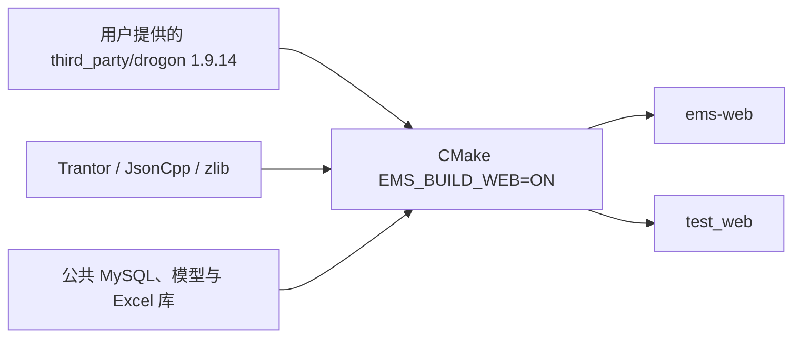

# Web 进程构建与运行

> 日期：2026-10-24｜源码：`backend/src/web`｜可执行文件：`ems-web`。

## 1. 构建链路



业务、配置、DTO 全部使用 **nlohmann::json**。JsonCpp 只作为 Drogon 内部依赖，不用于业务请求/响应。自有模块通过 `GLOB_RECURSE CONFIGURE_DEPENDS` 收集源码。

`EMS_BUILD_WEB` 现已默认开启，各平台预设也显式启用该进程，已有构建目录重新执行预设配置即可更新开关。
正式程序输出到构建目录的 `bin/`；MSVC 为 `bin/<配置>/`。测试仍输出到 `tests/bin/`，
可用 `-DEMS_BUILD_WEB=OFF` 单独关闭 Web，`BUILD_EXAMPLES=OFF` 不影响 Web。
Windows 运行依赖 DLL 与 EXE 放在同一目录，协议插件仍位于 `lib/`（MSVC 为 `lib/<配置>/`）。

Windows 在 x64 MSVC 开发终端运行：

```powershell
chcp 65001
./scripts/setup_web_dependencies.ps1 -Toolchain msvc
cmake -S backend -B build/web -G "Ninja Multi-Config" `
  -DEMS_BUILD_WEB=ON -DBUILD_TESTS=ON -DBUILD_EXAMPLES=OFF `
  -DEMS_BUILD_LEGACY_MODBUS=OFF `
  -DCMAKE_PREFIX_PATH="已有平台依赖前缀"
cmake --build build/web --config Release --target ems-web test_web --parallel 4
ctest --test-dir build/web -C Release -R "WebDevice|WebIdentity|WebExecutor" --output-on-failure
```

平台依赖沿用仓库现有构建配置：MySQL/MariaDB 客户端、SQLite 测试库、libmodbus、hiredis、Boost、OpenXLSX 依赖。`setup_web_dependencies.ps1` 不下载或替换用户提供的 Drogon。Trantor 锁定与 Drogon 1.9.14 配套的提交；Linux 可使用同版本依赖和现有平台脚本构建。

Windows 依赖脚本默认使用 MSVC，安装到 `backend/build/web-deps-msvc/install`；
MinGW 在 GCC/G++ 环境中执行 `./scripts/setup_web_dependencies.ps1 -Toolchain mingw`，
安装到 `backend/build/web-deps-mingw/install`。CMake 根据当前工具链自动补充对应前缀，
因此普通预设配置和 VSCode CMake Tools 无需额外填写 Trantor 路径。
自定义 `-BuildDirectory` 时，通过 `-DEMS_WEB_DEPENDENCY_PREFIX=<该目录>/install` 指定位置；
显式设置的 `CMAKE_PREFIX_PATH` 仍然有效。

Windows 启用 Web 测试时，缺少 SQLite 安装库会自动准备固定的 3.50.2 amalgamation，
并使用当前工具链编译为 `tests/archive/` 下的静态库；正式 Web 进程仍使用公共 MySQL 驱动。
`EMS_FETCH_SQLITE=OFF` 可关闭自动准备，离线源码可用 `FETCHCONTENT_SOURCE_DIR_EMS_SQLITE` 指定。

## 2. 首次运行


| 配置 | 来源 |
| --- | --- |
| 监听、工作池、期限、上传目录 | `backend/conf/web.json`；默认 `127.0.0.1:8080` |
| MySQL 连接 | 公共 `EMS_DATABASE_CONFIG` / `EMS_MYSQL_*`；不自动建库或迁移 |
| 前端静态文件 | 可选 document_root；或同源 Nginx 转发 `/api` |

```powershell
$env:EMS_DATABASE_CONFIG = '公共数据库配置绝对路径'
./build/web/bin/Release/ems-web.exe --config backend/conf/web.json --check-config
./build/web/bin/Release/ems-web.exe --config backend/conf/web.json
```

默认站根由既有种子脚本在缺少站根时建立；已有站根不覆盖。启动验证 14 表可读和唯一站根存在。

账号体系与数据来源待后续设计，不从 Web JSON 或环境变量读取账号文件，
也不作为配置检查和进程启动的前置条件。当前生产入口未装配账号服务，
登录接口返回 `503 identity_not_configured`，受保护接口仍要求有效身份。
健康检查可在数据库与表结构就绪后使用。

目标账号体系已在[登录设计](user/login.md)和[用户管理与角色权限](user/index.md)定义，
采用用户名/密码、HTTPS、密码哈希与持久会话，尚未实现；下节仍描述当前测试会话协议。

目标持久化方案使用独立的 `ems_web` 数据库，与现有工程库位于同一 MySQL 实例，共用公共连接池和事务。5 张业务表、策略行初始化、权限及就绪条件见 [EMS Web 数据库与表设计](../../common/database/ems-web.md)。当前启动逻辑尚未创建或检查这些身份表，不能仅修改数据库名称就启用目标账号体系。

## 3. 已有接口与验证

以下会话流程由集成测试显式注入内存账号验证，不表示当前已提供生产账号管理。

| 请求 | 入参与响应 |
| --- | --- |
| POST `/api/auth/login` | JSON username/password，Origin 必须匹配 allowed_origin；返回 HttpOnly cookie 与 csrf_token |
| GET `/api/auth/session` | 携带 cookie，读取当前主体与 CSRF |
| POST 查询/操作 | JSON 参数 + cookie + X-CSRF-Token + Origin |
| POST `/api/point-imports/create` | multipart：file 原文件，metadata JSON；同样校验身份、CSRF 与 Origin |
| GET `/health/live`、`/health/ready` | 无业务参数；ready 检查本进程所需数据库与表 |
| GET `/api/system/metrics` | 需 system.read，返回脱敏计数与平均时延 |

所有业务 ID、分页、筛选和期望 revision 都在 JSON；GET 无请求体、URL 无业务参数。接口清单见 [API 契约](device/api.md)。

## 4. 当前实现与验证边界

| 能力 | 状态 |
| --- | --- |
| Windows 编译、配置检查、真实 HTTP 会话和设备接口 | 测试覆盖无账号运行配置、显式注入身份的 Cookie/CSRF、multipart、CSV/XLSX、重放和事务回滚 |
| 公共仓储/事务/配置用例 | 本次 132 项回归通过；数据库测试使用 SQLite，生产入口使用 MySQL 公共工厂 |
| 文档 | 构建和类型检查通过，25 张 Mermaid 图通过语法解析 |
| CSV / 英文列 XLSX | 真实解析与持久预览，最多 2 MiB / 10,000 行；XLSX 校验解压预算 |
| 中文四遥 XLSX | 当前返回 Unsupported，不调用旧表写入流程 |
| 导入 YK / YT | 新点先停用，补齐写入及反馈规则后显式启用 |
| 共享写地址 | 执行侧互斥尚未接新工程表，当前明确拒绝；读写共享可逐行确认 |
| MySQL 生产库、Linux/ARM、现场热加载 | 需要对应环境验收；不由 SQLite 测试推断已通过 |
| 统一业务审计、前端 mock 替换、监视/历史/控制模块 | 独立后续接入；普通进程指标不充当持久审计 |

当前入口提供 HTTP；默认依赖脚本使用 Trantor 无 TLS 构建。本机开发直接监听，远程部署由 Nginx 终止 TLS，并配置 HTTPS allowed_origin 和 secure_cookie。脚本的 openssl 选项仅控制依赖编译，进程原生 TLS 配置尚未开放。

Windows 测试应在正常开发终端运行：受限沙箱的虚拟临时目录可能使 XLSX 库的原生文件接口报告文件不存在。
