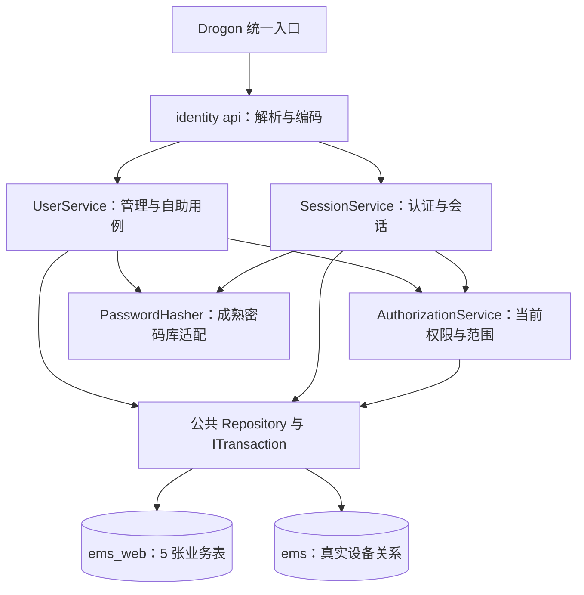
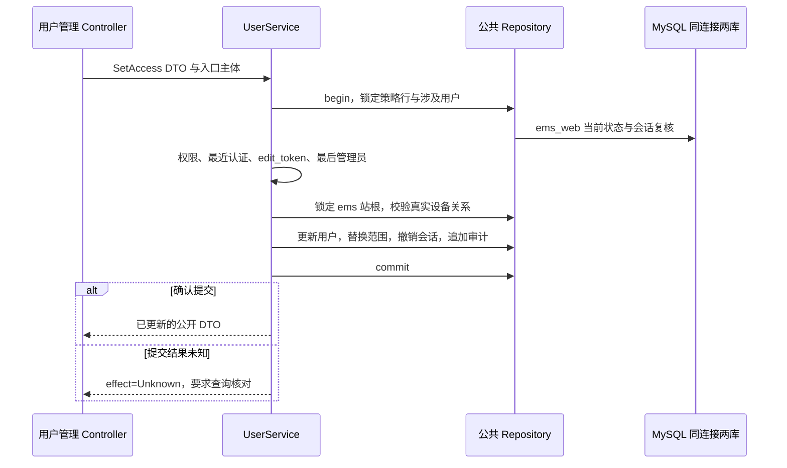

# Web 后端用户管理实现设计

> 日期：2026-10-30｜状态：待实现的 C++ 后端设计；Python Web 库模型和初始化迁移已实现，持久化身份服务及用户管理 API 尚未接入。
> 关联：[业务规则与权限矩阵](index.md) · [登录设计](login.md) · [Web 数据库与表设计](../../../common/database/ems-web.md) · [Web 进程设计](../design.md)。

本设计确定 `ems-web` 的 `identity` 模块如何落地：复用 Drogon HTTP 入口、现有工作池和公共数据库层，实现持久登录、用户管理、自助资料及密码维护、设备范围鉴权、会话撤销和审计。业务规则及字段以关联文档为准，本页不另建角色体系、数据库表或独立身份进程。

## 1. 现状与实施边界

| 部分 | 当前实现 | 需要完成 |
| --- | --- | --- |
| 数据库工具 | `web_db/models/` 独立定义 5 表，两库共用 database.yaml，通过 --database 选择 | 部署准备 ems_web，执行初始化和策略种子 |
| C++ 数据库 | 公共 MySqlDatabaseContext 已装配工程配置等仓储 | 增加用户/会话/策略及审计仓储，共用现有连接和事务 |
| SessionService | 账号由测试注入，内存保存会话；生产未配置时拒绝认证 | 改为读取 ems_web 持久数据，移除生产路径对内存账号、会话映射的依赖 |
| HTTP 分派 | 已注册 login、session、logout，主要在 web_application.cpp 分派 | 在 identity 模块集中注册 auth、users、profile 固定路由 |
| Principal | 当前含权限集合和分离的站/设备根集合，测试允许星号 | 使用当前固定角色和结构化范围，生产禁止星号权限放行 |
| 设备写入 | DeviceRequest 当前自行开启事务并先锁站根 | 接受调用方事务，先完成用户/会话锁定，再进入站根与配置写入 |

Python SQLAlchemy 负责结构定义、部署迁移和显式种子；C++ 请求通过公共 ormpp Repository 访问 MySQL，不在请求中调用 Python，也不启动时建表。前端演示接口不能作为生产账号来源。

## 2. 模块分层与目录



```text
backend/src/web/modules/identity/
  module.h/.cpp                     固定路由、服务装配
  api/
    auth_controller.h/.cpp          登录、首次改密、认证、退出
    user_controller.h/.cpp          用户、范围、策略与管理会话
    profile_controller.h/.cpp       个人资料、改密和自己的会话
    identity_codec.h/.cpp           字段白名单、DTO 与响应编码
  application/
    session_service.h/.cpp          改造现有认证与会话服务
    user_service.h/.cpp             管理员及自助用例
    authorization_service.h/.cpp    角色映射、范围和事务内复核
  public/
    authorization.h                跨模块主体与授权契约

backend/include/common/database/identity/
  types.h                          内部账号、范围、会话与策略记录
  repositories.h                   IUserRepository、IAuditRepository
backend/src/common/db/identity/
  identity_rows.h                   唯一 ormpp 行映射
  user_repository.h/.cpp            账号、范围、会话、策略查询与锁
  audit_repository.h/.cpp           审计追加与有界查询
```

以上为目标路径，只创建实施时实际需要的文件。模块仍只有三个应用服务，不按每张表、每个按钮再拆一层 Service。

| 层 | 职责 |
| --- | --- |
| 统一 HTTP 入口 | 方法、Origin、JSON 类型/体积、Cookie 提取、工作池准入、request_id 和一次性回复 |
| Controller / codec | 固定路由映射、字段白名单、类型与长度校验、DTO 编码；不写 SQL，不序列化数据库整行 |
| SessionService | 登录、会话读取、首次改密、重新认证、活动续期、自己会话的查询/撤销和退出 |
| UserService | 用户列表及管理、角色/范围替换、临时密码重置、策略维护、个人资料与个人改密 |
| AuthorizationService | 当前会话与账号校验、集中角色映射、资源判断、敏感操作最近认证、事务内权限复核 |
| 公共 Repository | 类型化数据库操作、固定库限定名、行锁和错误转换；由调用方提交事务 |

密码哈希适配复用 `platform/crypto` 的职责，补齐成熟 Argon2id 实现，保留明确算法标识的合法旧哈希校验入口。新密码不继续使用测试骨架的默认派生算法，不自实现密码算法。

## 3. 数据访问与服务契约

### 3.1 一套运行连接、两个业务库

运行进程沿用公共 MySQL 连接配置，默认库为工程库 `ems`，账号和审计使用公共适配器内固定的 `ems_web.表名`。公共上下文目标增加 `users`、`audit` 仓储成员，依赖同一 `IDatabase`；不为 Web 库再次初始化一套不同配置的 ormpp 池，不逐请求执行 `USE`。

Python 部署入口仍为同一份 `backend/python/database.yaml`：

```bash
ems-db --database ems init
ems-db --database ems_web init
ems-db --database ems_web seed policy
ems-db --database ems_web check
```

该 YAML 当前仅由 Python 工具读取，不能误认为 C++ 配置加载器已经支持读取它。C++ 继续使用现有公共加载方式；两者指向同一 MySQL 实例及对应库，不新增 Web 专用数据库连接配置文件。

### 3.2 公共 Repository

以下是目标操作分组，不表示这些 C++ 接口已经存在：

| 接口 | 操作分组 | 返回和限制 |
| --- | --- | --- |
| IUserRepository：用户 | 按用户名/用户 ID 读取；按筛选分页；新增/更新；按固定顺序锁用户；统计启用管理员 | 内部 UserRecord；读取无结果与依赖失败分开；不向 Controller 暴露哈希 |
| IUserRepository：范围 | 读取/整批替换用户范围 | 结构化 station_id/device_root_id；替换加入调用方事务，不自行提交 |
| IUserRepository：会话 | 按 Cookie 摘要定位；按用户分页；新增、交互时间更新、重新认证、单个/批量撤销 | 内部 SessionRecord；校验会话归属；撤销幂等 |
| IUserRepository：策略 | 读取唯一策略行；加管理锁；更新策略 | 仅 id=1，缺失不临时补行 |
| IAuditRepository | 追加脱敏事件、按条件有界查询 | event_id 唯一；没有业务编辑/删除接口 |
| 既有设备仓储 | 站根锁、真实父子关系及有界设备读取 | 复用 cfg_device，不把工程表复制到 Web 库 |

所有 I/O 接收公共 `CallContext`，返回公共 `Result` / `Status`；Repository 写入显式接收调用方的 `ITransaction&`，不传 ORM 连接、SQL 字符串或 Drogon 对象。MySQL 行映射只在公共实现维护一份，与 SQLAlchemy 字段保持一致。

### 3.3 主体与内部数据

生产 Principal 至少承载当前请求的 `user_id`、`session_id`、`kind`、`role_code`、明确权限集合、`scope_mode`、结构化 scopes 与最近认证时间。密码哈希、Cookie 原值和数据库凭据不属于 Principal。

- `permissions` 每次由当前 role_code 的集中映射生成，不信任客户端或会话行中的权限副本。
- `scopes` 保留站与设备根的配对关系；不通过分离的 station_ids × device_roots 生成错误组合。
- Principal 是请求快照；关键写入必须在事务内重新核验，不能把入口已通过检查当作提交时仍然有效。
- 登录 Cookie 使用至少 32 随机字节，数据库保存 32 字节 SHA-256 摘要；现有十六进制摘要文本需正确解码，不能把 64 字节 hex 文本写入 BINARY(32)。CSRF 使用 32 随机字节的无填充 base64url，固定 43 字符。
- 持久期限用 UTC 数据库时间值；请求 deadline 使用公共单调时钟语义，不把现有 steady_clock::time_point 存入会话表。

## 4. HTTP 接入与响应

完整路由、字段和权限以[用户管理 API](index.md#6-用户与自助-api)和[登录接口](login.md#6-接口契约)为准。所有接口显式注册方法与处理器，不增加动态路径 ID 或查询串。

| 路由组 | 应用服务 | 安全入口 |
| --- | --- | --- |
| GET login-options、POST login | SessionService | 匿名；登录校验精确 Origin、JSON 和来源限流 |
| GET session、POST password/complete、logout | SessionService | 允许完整或受限会话；受限会话仅可读取最小会话信息、完成首次改密或退出 |
| POST reauthenticate、activity、logout-all | SessionService | 仅完整会话；POST 检查 Origin + CSRF |
| /api/users/* | UserService；会话查询/撤销复用会话用例 | 完整会话 + 对应管理权限；敏感写入检查最近认证 |
| /api/profile/me、update、change-password | UserService | 完整会话；用户 ID 只取当前主体 |
| /api/profile/sessions/* | SessionService | 只能访问自己的会话 |

上表 auth 路径统一位于 `/api/auth/`。受限会话不允许重新认证来升级成完整会话；首次改密成功撤销会话，要求重新登录。退出接口对已退出状态幂等，但不把数据库不可用当作已撤销成功。

Controller 对每个用例使用独立字段白名单，不将 JSON 直接赋值给 ORM 行。用户 ID、内部自增 ID、时间戳、哈希、首次改密标记及失败计数不能由普通编辑请求修改。个人中心不接受目标 user_id、role_code、status 或 scopes。

现有 `text()` 工具按 UTF-8 字节限长，不能直接用它实现“64 个姓名字符”或“32 个密码字符”。需验证合法 UTF-8 并按 Unicode 字符计数，另设相应字节上限；用户名仅处理 ASCII，密码不去空格、不截断、不做隐式归一化。

### 4.1 查询与 DTO

| 响应 | 约定 |
| --- | --- |
| UserSummary / UserDetail | 稳定 user_id、账号、姓名、角色、状态、范围摘要、安全状态及时间；详情包含 scopes 和 edit_token，不含哈希或内部 id |
| UserList | items、total、page、page_size、stats；默认按 created_at/user_id 升序，同一查询事务计算列表与计数 |
| stats | total/enabled/disabled/locked；不受当前列表筛选影响，均排除 deleted，locked 按当前 UTC 是否小于 locked_until 计算，可与启用状态重叠 |
| Capabilities | 三种固定角色、范围模式、密码最小/最大长度、登录通知、供授权选择的 scope_tree；不得返回账户清单或连接密钥 |
| SessionSummary | session_id、脱敏 client/source_ip、创建/最近交互/到期时间、current；不返回 token_hash 或 csrf_token |
| Profile | 当前用户的公开资料、角色和范围；不需要全局 user.read 权限 |

列表分页默认 20、最大 200；用户名/姓名关键词最多 64 个字符，条件值绑定，排序字段采用白名单。管理员账号管理是实例级能力，不按管理员设备范围过滤用户列表。设备相关列表和 total 则必须先按资源权限过滤再分页。

scope_tree 通过既有设备仓储读取完整、可选的授权目录，遵循现有树预算；超限返回 `422 scope_tree_too_large`，不将截断结果冒充完整树。每用户最多 200 个规范化授权根。范围规范化只移除重复和被祖先覆盖的项，不补全无效站或根。

## 5. 核心用例

### 5.1 登录与会话恢复

1. 读取策略和账号，未知账号执行同成本假哈希校验；密码派生在数据库锁外完成。
2. 开启短事务，锁定用户，重读密码哈希、状态、角色、范围、锁定期限及首次改密状态。认证相关状态已变化则拒绝旧校验结果。
3. 错误认证按当前策略更新失败计数和锁定时间，记录脱敏失败事件；提交该失败处理事务后再返回 401，不创建会话。不能先抛认证异常而将失败计数一并回滚；数据库或审计不可用时拒绝登录并返回依赖错误。
4. 成功认证清理失败计数，按需要创建 full 或 password_change 会话；完整会话在用户锁内检查最多 3 个，撤销最早活动者。
5. 会话创建、最近登录时间和成功审计同事务提交；确认提交后才设置 Cookie、返回 CSRF 与公开会话 DTO。

恢复会话按 Cookie 摘要定位记录，再检查撤销状态、用户启用状态、绝对期限和当前空闲策略，并从当前用户生成权限。会话读取、列表轮询和健康请求不更新 last_interactive_at；只有明确交互调用 activity 才续期。

### 5.2 创建与维护用户

创建默认 observer、disabled、selected 空范围。Service 在进行哈希前完成字段、角色及明显权限检查；哈希完成后，事务内按当前策略重新检查密码规则和当前管理员权限，不能使用派生前的旧策略直接提交。

| 操作 | 事务内关键步骤 | 会话影响 |
| --- | --- | --- |
| 创建 | 锁策略行及管理员；确认账号唯一；校验范围；写用户、范围、审计 | 新用户必须首次改密，临时密码 24 小时有效 |
| 修改姓名 | 校验本人/他人入口边界及 edit_token；只更新 display_name、updated_at；记录审计 | 不撤销会话 |
| 替换角色/范围 | 锁策略行和用户；检查本人限制、最后管理员；锁相关站根并核验设备关系；整批替换并审计 | 撤销目标全部完整/受限会话 |
| 启停 | 锁策略行和用户；检查本人限制、最后管理员；更新状态并审计 | 停用撤销全部会话；启用不恢复旧会话 |
| 删除 | 同上，逻辑删除并清理范围，保留用户 ID 和用户名；审计 | 撤销全部会话 |
| 解锁 | 核验权限及最近认证；清理失败计数、locked_until；审计 | 不启用停用账号，不恢复撤销会话 |

唯一用户名冲突返回 409，不覆盖原用户。重复提交创建请求仍按用户名核对结果，不添加注册审批、邀请、组织或自定义角色流程。

### 5.3 密码与敏感操作

个人改密和首次改密需验证当前密码；管理重置要求管理员自己的最近密码认证，不接收目标用户旧密码。所有密码写入复用同一校验与哈希适配，事务中重读当前策略、凭据状态及当前会话后，更新哈希并撤销目标全部会话，与审计一起提交。

- 完成个人/首次改密时清理 must_change_password 及临时期限；管理重置则置标记为 true、设置 24 小时期限。
- 创建管理员或创建已启用用户、角色/范围变更、启停、删除、重置、解锁、撤销他人会话和修改登录策略，提交时要求 auth_time 距当前时间不超过 5 分钟。
- 普通管理员不能通过管理接口修改自己的角色、状态或范围，不能管理重置自己的密码；个人改密必须走旧密码校验。
- 会话撤销按 user_id + session_id 核对归属，重复撤销返回成功；自助接口不接受 all=true 扩大到他人，退出本人全部会话使用既有 logout-all。
- 修改登录策略只更新唯一行，缩短空闲期限后按新值鉴权；不批量重置密码、不无故撤销所有会话。

### 5.4 首管理员与离线恢复

首管理员通过受控主机命令交互创建，复用相同 UserService 和 Repository 事务能力；锁定策略行后确认 auth_user 从未有过记录，创建 enabled/all 管理员并要求首次改密。首次初始化不走 HTTP，不从 seed 或命令行参数携带密码。

离线恢复只用于有主机权限的受控维护，记录 request_id、恢复事件及目标账号，撤销目标全部会话并要求首次改密。不能因为当前无启用管理员就在服务启动时自动创建默认账号。两个主机命令并发执行仍由策略行锁串行化。

## 6. 统一鉴权与事务边界

### 6.1 每请求校验与写入复核

入口读取当前会话并检查 Origin/CSRF，应用服务检查角色和资源。所有受保护 POST，包括查询，均校验 CSRF；登录只检查 Origin，不要求已有 CSRF。GET 无业务参数、不用于状态变更。

关键写入在调用方事务内持有当前用户共享锁，重新核验会话、当前角色与实际范围；用户管理需要的目标用户使用写锁。撤权、停用及重置需要相应用户写锁，因此能与在途关键写入按提交顺序排序。

固定加锁顺序为：**策略行（管理用例需要时）→ 涉及用户按内部 id 升序 → 会话 → 涉及站根按稳定 ID 顺序**。锁定后重新取当前时间检查最近认证与会话期限，不能用哈希前的时间绕过超时。



### 6.2 接入现有设备写入

必须改造现有 DeviceRequest 的事务所有权和加锁顺序，不能只在 HTTP 入口检查一次身份，然后继续按原逻辑先锁站根。

```text
应用服务取得一个 ITransaction
  → AuthorizationService 在该事务锁定/复核当前用户与会话
  → DeviceRequest 接受该事务，校验设备范围并锁站根
  → 保存 ems 工程表，更新站根 config_revision
  → 通过公共审计仓储写 ems_web.audit_log
  → 调用方一次提交
```

DeviceRequest 与 Repository 均不再额外开启或提前提交另一个连接上的事务。只读请求使用鉴权时的当前状态；已鉴权的在途只读请求可完成。异步人工控制由控制执行用例在最终执行前重新授权，不依赖队列中的旧权限快照。

### 6.3 edit_token 与审计

edit_token 是对当前可编辑状态的服务端 HMAC 摘要，不增加数据库版本列。输入包含用户 ID、姓名、角色、状态、scope_mode、排序规范化的 scopes，以及首次改密/临时期限/凭据状态；密码哈希可作为内部摘要输入，但不能出现在响应或审计中。登录时间、失败计数等运行字段不参与摘要。

所有 Web 实例使用同一受限来源的摘要密钥和同一规范编码；锁行后重新计算 expected_edit_token。失配返回 409，不自动覆盖；策略 token 仅包含唯一行 ID 和五个可编辑策略字段。

成功变更、会话撤销和成功审计同事务提交；没有审计不能先返回变更成功。失败操作先回滚业务写入，再按需记录独立的脱敏失败事件；失败审计不可用也不能将拒绝结果变为放行。业务运行账号只追加/查询审计，保留期清理由维护身份执行。

## 7. 工作池、异常与就绪

复用现有有界工作池。密码派生不占 Drogon I/O 线程、不在等待派生期间占用数据库连接或行锁；首期限制同时派生最多 2 个，超限明确返回 503/Retry-After，不新增无界队列。哈希结束后重新检查 deadline 与身份，不能提交已过期排队请求。

| 场景 | HTTP / reason | 写入确定性与客户端行为 |
| --- | --- | --- |
| 非法字段、类型、分页 | 400 invalid_argument | NotApplied；修正输入 |
| 未知账号、密码错误、停用、锁定、临时密码过期 | 401 invalid_credentials | 不暴露账号存在性或精确锁定状态；可能已记录失败计数，不自动重放登录 |
| 会话缺失/失效 | 401 unauthenticated / session_expired | 不进入业务写入，重新登录 |
| 首次改密未完成 | 403 password_change_required | 仅进入首次改密页 |
| 权限、最近认证或 CSRF 不满足 | 403 permission_denied / reauthentication_required / csrf_mismatch | 业务未执行 |
| 不存在、越范围或会话不属于目标用户 | 404 user_not_found / session_not_found；设备复用现有不可见原因码 | 不泄露其他资源存在性 |
| 用户名或表单冲突、最后管理员 | 409 username_conflict / edit_conflict / last_admin_required | 回读最新状态并人工确认 |
| 密码、范围、授权目录容量或本人管理规则失败 | 422 password_policy_failed / invalid_scope / scope_tree_too_large / self_management_forbidden | 修正业务输入或明确处理目录容量限制 |
| 请求来源或认证尝试限流 | 429 rate_limited | Retry-After，不自动重放写入 |
| 身份、审计、工作池或密码派生容量不可用 | 503 identity_unavailable / audit_unavailable 或既有容量原因码 | 尚未执行时 NotApplied，提交不确定时保留 Unknown |
| 提交响应丢失/超时，无法确认提交 | 公共错误转换为既有失败状态 | effect=Unknown，使用原 ID/用户名/资源及审计事件核对结果 |

错误继续使用统一 `{error, meta}` 信封，不能根据底层异常文字分支，不能把数据库断连伪装成密码错误或空列表。数据库事务的 Unknown 不转为 NotApplied，不自动重放重置密码或配置写入。

生产就绪检查需包含工程库依赖、ems_web 五表、唯一策略行、固定角色映射、凭据与 edit_token 密钥来源以及密码库可用性。策略行缺失时拒绝就绪，不在启动时补默认值。存活接口只检查进程；单个设备离线不阻断身份管理。

现有 SessionService(Json users, ...) 只保留在显式测试装配边界，生产运行路径不允许从配置注入测试权限、内存账号或演示默认密码。日志与指标仅记录 request_id、动作、原因、耗时、容量等，不包含认证表单、Cookie、哈希或密钥。

## 8. 实施顺序与验收

| 阶段 | 完成条件 |
| --- | --- |
| 公共持久化 | 补齐行结构、ormpp 映射、IUserRepository/IAuditRepository、公共工厂装配与 schema 检查；同连接访问两库 |
| 持久认证 | 改造 SessionService，完成登录、恢复、首次改密、重新认证、活动续期和退出；重启及多 Web 实例有效 |
| 用户用例 | 完成用户 CRUD、角色/范围、策略、自助资料与密码、会话管理及 edit_token |
| 业务接入 | 注册固定路由，替换生产内存装配，改造 DeviceRequest 事务与鉴权，前端关闭演示接口联调 |

验收按实际用例覆盖：

1. 三角色、自己/他人、完整/受限会话矩阵；不得通过替换 user_id、未知字段或客户端权限提升身份。
2. 整站/子树并集、跨站根、仅导航祖先、component 来源、设备移动/删除、分页 total 与批量越权。
3. 失败锁定、临时密码到期、首次改密、空闲/绝对超时、并发完整会话上限、单个及全部撤销。
4. 创建/重置派生期间策略变化、账号停用或凭据变化；锁内重新检查，不生成旧身份会话。
5. 并发首管理员初始化、两管理员互相停用/降级、最后管理员保护、edit_token 过期。
6. 撤权与设备写入并发、站根锁顺序、两库单事务回滚、审计不可写和提交结果未知。
7. UTF-8 多字节姓名和密码边界、无效编码、超限 scope_tree、字段白名单、日志脱敏、池耗尽与退出。

SQLAlchemy/SQLite 测试验证结构与基本约束；C++ 应用测试验证权限、DTO 和用例分支；真实 MySQL 另行验证行锁、跨库事务、重启与多实例行为。文档站构建不代表后端用户管理已经实现。
