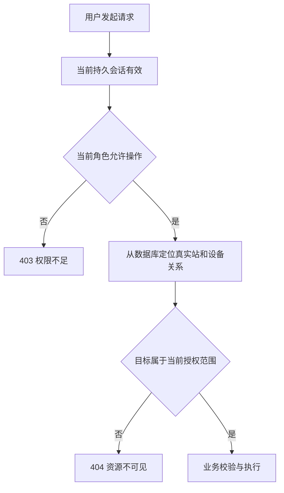

# 用户管理与角色权限设计

> 日期：2026-10-27｜状态：待实现的目标设计；角色、持久账号和用户管理接口尚未落地。
> 关联：[登录设计（用户名、密码与加密）](login.md) · [Web 数据库与表设计](../../../common/database/ems-web.md) · [Web 进程设计](../design.md) · [设备模块 API](../device/api.md)。

## 1. 范围与基本规则

用户管理属于 Web 的 `identity` 业务模块，对外提供账号生命周期、角色分配、资源范围、密码维护、会话撤销和安全审计。认证与授权统一由该模块实现，设备、监视、历史和控制模块消费 `Principal`。

- 内置三种固定角色：**管理员 `admin`、操作员 `operator`、观察员 `observer`**。每个用户恰好一个角色，首期不支持自定义角色、多角色合并和逐用户权限补丁。
- 默认拒绝；授权必须同时满足“操作权限”和“站/设备资源范围”。前端菜单或按钮隐藏不能代替后端授权。
- 用户、角色和授权保存后直接生效；不建立配置版本、发布、快照或回滚机制，也不递增设备站根 `config_revision`。
- 站、单元、设备、部件都引用 `cfg_device.device_id` 和实际父子关系，不能建立第二套资产或设备目录。
- 生产账号存入独立的 `ems_web` 数据库，通过公共数据库层访问，不从 Web JSON 或环境变量读取账号清单；环境配置仅提供连接、密钥来源和预算。

## 2. 三类角色与权限矩阵

管理员承担系统管理和工程维护；操作员承担值班运行；观察员读取运行数据。管理员拥有全部已定义业务权限，但同样受到资源范围、业务校验和控制安全联锁约束。以下为目标权限，监视/历史/告警/控制能力随对应模块实现后开放。

图例：<span className="permission-yes" aria-label="允许">✓</span> 允许；<span className="permission-no" aria-label="禁止">×</span> 禁止。文档与设计图统一采用该标识，同时保留可访问文本。

| 功能 / 后端权限 | 管理员 | 操作员 | 观察员 |
| --- | --- | --- | --- |
| 实时监视 `monitor.read`、历史/曲线 `history.read` | <span className="permission-yes" aria-label="允许">✓</span> | <span className="permission-yes" aria-label="允许">✓</span> | <span className="permission-yes" aria-label="允许">✓</span> |
| 告警列表与详情 `alarm.read` | <span className="permission-yes" aria-label="允许">✓</span> | <span className="permission-yes" aria-label="允许">✓</span> | <span className="permission-yes" aria-label="允许">✓</span> |
| 告警确认、处置备注 `alarm.ack` | <span className="permission-yes" aria-label="允许">✓</span> | <span className="permission-yes" aria-label="允许">✓</span> | <span className="permission-no" aria-label="禁止">×</span> |
| 遥控意图 `command.yk`、遥调意图 `command.yt` | <span className="permission-yes" aria-label="允许">✓</span> | <span className="permission-yes" aria-label="允许">✓</span> | <span className="permission-no" aria-label="禁止">×</span> |
| 设备树/档案/四遥定义 `device.read` | <span className="permission-yes" aria-label="允许">✓</span> | <span className="permission-yes" aria-label="允许">✓</span> | <span className="permission-yes" aria-label="允许">✓</span> |
| 通道与绑定只读 `channel.read` | <span className="permission-yes" aria-label="允许">✓</span> | <span className="permission-yes" aria-label="允许">✓</span> | <span className="permission-no" aria-label="禁止">×</span> |
| 设备增改删 `device.write` | <span className="permission-yes" aria-label="允许">✓</span> | <span className="permission-no" aria-label="禁止">×</span> | <span className="permission-no" aria-label="禁止">×</span> |
| 通道配置 `channel.write`、绑定配置 `binding.write` | <span className="permission-yes" aria-label="允许">✓</span> | <span className="permission-no" aria-label="禁止">×</span> | <span className="permission-no" aria-label="禁止">×</span> |
| 四遥配置 `point.write`、导入预览/应用 `import.write` | <span className="permission-yes" aria-label="允许">✓</span> | <span className="permission-no" aria-label="禁止">×</span> | <span className="permission-no" aria-label="禁止">×</span> |
| 用户列表/详情 `user.read` | <span className="permission-yes" aria-label="允许">✓</span> | <span className="permission-no" aria-label="禁止">×</span> | <span className="permission-no" aria-label="禁止">×</span> |
| 用户创建、编辑、启停、删除 `user.write` | <span className="permission-yes" aria-label="允许">✓</span> | <span className="permission-no" aria-label="禁止">×</span> | <span className="permission-no" aria-label="禁止">×</span> |
| 角色与资源范围分配 `user.grant` | <span className="permission-yes" aria-label="允许">✓</span> | <span className="permission-no" aria-label="禁止">×</span> | <span className="permission-no" aria-label="禁止">×</span> |
| 密码重置、解锁与登录保护 `user.security` | <span className="permission-yes" aria-label="允许">✓</span> | <span className="permission-no" aria-label="禁止">×</span> | <span className="permission-no" aria-label="禁止">×</span> |
| 查看及撤销他人会话 `session.manage` | <span className="permission-yes" aria-label="允许">✓</span> | <span className="permission-no" aria-label="禁止">×</span> | <span className="permission-no" aria-label="禁止">×</span> |
| 全局审计查询 `audit.read`、进程指标 `system.read` | <span className="permission-yes" aria-label="允许">✓</span> | <span className="permission-no" aria-label="禁止">×</span> | <span className="permission-no" aria-label="禁止">×</span> |
| 自己的资料、改密、会话查看/退出 | <span className="permission-yes" aria-label="允许">✓</span> | <span className="permission-yes" aria-label="允许">✓</span> | <span className="permission-yes" aria-label="允许">✓</span> |

“自己的操作”由登录主体匹配校验，不授予上述全局管理权限。用户不能通过传入别人的 `user_id` 将自助接口变成管理接口。三类角色均无公开注册、直接修改密码哈希、读取密钥或跳过控制联锁的能力。

角色在代码中集中映射为明确权限集合；数据库保存 `role_code`。生产主体不生成通配 `permissions={"*"}`，新增权限默认不自动授予任何角色，必须修改集中映射并验收。现有设备模块的 `device.read/device.write/channel.read/channel.write/binding.write/point.write/import.write` 名称保持一致。

有效操作权限直接取当前角色的集中映射，资源范围另行校验，不再增加协议授权范围。自助资料、改密和自己的会话管理要求完整认证会话；首次改密受限会话只能访问专用改密与退出接口。

### 2.1 读取与运行操作边界

设备只读 DTO 必须按角色裁剪：观察员可见设备名称、位置、四遥描述等业务信息，不能读取通道连接详情；任何角色的普通响应均不返回协议密码、私钥或数据库凭据。导出、附件、缓存、推送、统计 total 与详情遵循同一授权范围。

遥控/遥调权限只允许向控制模块提交人工意图；不能通过配置接口直接写现场设备。控制模块继续执行设备支持能力、点启用状态、运行模式、联锁、互斥、期限和幂等校验。YK、YT 在配置侧仍分别使用 `cfg_point_yk` / `cfg_point_yt`，实时记录均映射 `Command`，运行侧以 `point_type` 区分。

## 3. 站与设备资源范围

| 范围模式 | 语义 |
| --- | --- |
| `all` | 当前 EMS 实例管理的全部站和设备，仅管理员可分配/持有；仍需操作权限 |
| `selected` | 显式授权列表；每条为“整个站”或“站内某设备子树”，可包含多个根 |
| `selected` 且列表为空 | 无业务资源权限，可登录维护个人资料；用户管理能力仍由管理员角色决定 |

管理员的账号管理权限是实例级权限，与设备范围独立；资源范围只约束设备相关操作。具有 `user.grant` 的管理员可管理全实例用户和授予 `all`，这属于该角色的管理权。若将来需要“只能转授自己的设备范围”，应引入单独的受限管理用例，不能默默改变本期语义。

每条授权记录包含 `station_id` 与可空 `device_root_id`。根为空表示整个站；否则根必须通过实际父链属于该站，授权包含该根及其后代。多个范围取并集，操作权限再与该集合取交集；拒绝重复、跨站或失效 ID，整站授权存在时规范化掉同站冗余子树。



- 请求中的站 ID、设备路径和来源设备 ID 都不是授权证据；以数据库实际关系为准，不能用字符串前缀判断子树。
- 设备树可返回通向授权根的祖先作为导航节点，但只包含最小名称/标识，并标记 `navigation_only=true`；不能据此读取祖先完整档案或修改祖先。
- `component` 按自身在设备树中的位置授权；访问来源通信设备、通道或共享绑定信息时，还需对实际来源资源独立校验，不能通过 `source_device_id` 扩大范围。
- 批量请求逐项校验，任一项越权则整批拒绝；列表先授权筛选再分页和计数，不能先分页再丢弃越权项。
- 移动设备校验原位置、目标父节点及受影响子树；`all` 或同时覆盖两侧的范围才允许移动。删除授权根后对应范围不再命中，不自动提升到父设备。
- 授权的是“设备子树”：管理员改变设备父链会改变其继承可见性，移动前须显示影响并审计。每次请求按新父链计算，不能缓存旧路径继续授权。
- 跨设备绑定、整站导入、模板应用等复合用例必须覆盖所有受影响设备；不得以一个可见根替代整批授权。

适配现有 `Principal.station_ids/device_roots` 时，由服务端从结构化范围计算，不能接受前端直接填充这些集合。若延用 `*` 作为内部资源哨兵，只允许由明确的 `scope_mode=all` 生成；长期以结构化范围契约承载，避免把不同站的根做错误笛卡尔组合。

## 4. 账号生命周期与密码

### 4.1 账号字段及状态

| 字段 | 规则 |
| --- | --- |
| `user_id` | 稳定、服务端生成的字符串 ID，作为会话与审计主体，不能复用 |
| `username` | 4～64 位 ASCII 字母/数字/下划线/点/连字符，首位字母；统一小写后唯一，创建后不可改 |
| `display_name` | 1～64 个 Unicode 字符，去首尾空白；展示时转义 |
| `role_code` | `admin/operator/observer` 三选一 |
| `status` | `enabled/disabled/deleted`；创建默认 disabled，明确启用后才能登录 |
| `scope_mode` / `scopes` | all 或 selected 及其站/设备子树授权 |
| `must_change_password` | 首次创建、管理员重置后为 true |
| `locked_until` | UTC 时间，可空；临时密码错误锁定与人工停用分开 |
| `created_at/updated_at/last_login_at` | UTC 时间；登录失败不能刷新 last_login_at |

`enabled` 且未删除、临时锁定已到期才允许校验登录。管理员解锁仅清理失败计数/锁定期限，不把 disabled 自动改成 enabled。解锁不恢复任何已撤销会话。

删除采用逻辑删除并撤销会话；保留 `user_id/username` 和最小审计关联，用户名不能重新注册，避免历史操作归属歧义。界面默认不显示已删除用户；全局审计仍能解析其原主体。其他资料可按保留策略脱敏，不物理级联删除审计记录。

### 4.2 密码规则与重置

- 密码长度为 12～32 个 Unicode 字符，最小长度由管理员在 12～32 之间配置；大写字母、小写字母、数字、特殊符号至少三类。允许粘贴和密码管理器，不静默截断、去空格或隐式归一化；拒绝弱密码和与用户名相同的密码。以[登录设计](login.md)为统一认证规则。
- 默认使用成熟实现的 Argon2id，最低参数 `m=19 MiB/t=2/p=1`，每用户独立随机盐，编码存储算法及成本。上线前在目标 ARM/Windows 硬件压测有界并发及派生成本。
- 当前测试骨架的 PBKDF2 不是目标新账号默认值；已有合法 PBKDF2 哈希可在成功登录后重哈希，不能直接“转换”摘要。没有生产账号时无需构造兼容数据。
- 创建用户时管理员设置符合策略的临时密码，服务端只写哈希并置首次改密；请求/响应与审计均不回显密码。临时密码通过现场受控渠道告知，系统不自动发送邮件或消息。
- 临时密码有效期 24 小时；过期需管理员再次重置。首次改密不会自动启用 disabled 账号。
- 完整会话中用户修改自己的密码需提交旧密码；成功后清除首次改密标记、撤销全部会话并要求重新登录。禁止修改成当前密码，不要求周期性强制改密。
- 管理员重置密码需最近 5 分钟重新认证，提交目标用户及新临时密码；重置同事务撤销目标全部会话。管理员不能读取原密码，也不能通过重置接口绕过自己的旧密码校验。
- 首期不提供匿名短信/邮件找回入口。遗忘密码由管理员重置；所有管理员均无法登录时走受控主机离线恢复命令，并强制记录恢复事件、撤销目标会话和下次改密。

### 4.3 首个管理员与最后管理员保护

空库通过一次性主机初始化命令创建首个管理员；仅无任何用户记录时可执行，交互输入密码，不能放在命令行参数或仓库种子中。初始化创建 enabled、all 范围、必须改密的账号，同时写统一审计；并发执行只能成功一次。禁止默认 `admin/admin`、启动时自动补管理员或开放网络注册。

始终保留至少一个未删除且 `enabled` 的管理员。自助页面禁止修改自己的角色/状态/范围、删除自己或用管理重置接口重置自己；可修改展示名、按旧密码改密和退出会话。其他管理员不能停用、删除或降级最后一名 enabled 管理员。

管理员变更在公共事务中先锁定唯一登录策略行，再锁定涉及用户，检查变更后的管理员数量，写入账号/权限、撤销会话和审计后提交。策略行同时承担管理事务的串行锁，不单独建立安全守卫表。并发两名管理员互相停用/降级时不允许同时通过。临时密码锁定不计为人工停用，需结合管理员解锁/主机恢复处理，不能靠禁止锁定管理员绕过暴力破解防护。

## 5. 持久化与事务设计

账号与 Web 业务使用独立的 `ems_web` 数据库，与工程库 `ems` 位于同一个 MySQL 实例。共 5 张表，字段、类型、索引及初始化规则统一见 [Web 数据库与表设计](../../../common/database/ems-web.md)。独立 SQLAlchemy 模型与迁移入口已实现，两库共用 `backend/python/database.yaml`，通过 `ems-db --database ems_web` 选择；C++ 公共 Repository 与身份服务仍待落地。

| 表 | 职责 |
| --- | --- |
| `auth_user` | 账号、密码哈希、固定角色、状态和失败锁定 |
| `auth_user_scope` | 站或设备子树授权；只存稳定 ID，不复制设备目录 |
| `auth_session` | 完整/受限会话、Cookie 摘要、CSRF、活动期限与撤销状态 |
| `auth_login_policy` | 唯一登录策略行，同时串行首管理员初始化和管理员管理事务 |
| `audit_log` | Web 认证、安全管理和业务操作审计，复用公共审计契约 |

会话 Cookie 为高熵随机值，服务端只保存其摘要；密码使用专用哈希。会话原值仅通过 Set-Cookie 交给浏览器，不进入 JSON。每会话的随机 csrf_token 保存在服务端会话记录中，以便页面刷新后由受保护的 session 接口恢复，多标签使用同一值；CSRF 单独不能充当登录凭证。ID 对外都是字符串，密码哈希不得进入公共用户 DTO。资源范围属于设备授权数据。

API 的整站授权仍为 `device_root_id=null`；数据库以非空的空串表示，由 Repository 转换，唯一键 `(user_id, station_id, device_root_id)` 保证重复整站行无法写入。父子授权重叠仍在锁定用户的事务内规范化。详细索引只在数据库设计中维护。

### 5.1 原子性和即时撤销

账号写入、范围替换、会话撤销和成功审计使用同一个公共数据库事务；任一失败全部回滚，不能先返回成功再异步撤销。停用、删除、改密/重置和权限变更同时撤销完整及受限改密会话；登录完成前锁定用户，重新核验认证相关字段，不能使用撤权前的结果创建旧权限会话。统一审计不可写时拒绝安全管理变更；失败登录审计使用独立事务，写失败也不允许因此创建会话。

锁顺序固定为“登录策略行（管理用例需要时）→ 涉及用户按内部 id 升序 → 会话 → 业务站根”。账号管理事务和业务写事务遵循相同顺序，不能先锁站根后补锁账号造成反向等待。工程写入与 Web 审计使用同实例、同连接的两库事务，不能分别提交。

普通读取以鉴权时状态为准，已鉴权的在途只读请求可以完成。配置写入、用户管理和控制意图提交在同一事务持有当前用户共享锁，重新核验权限与范围；停用/降权事务需要独占锁，二者按提交先后排序。权限变更成功返回后，旧身份不能再提交新的关键写入。后续异步控制任务在最终执行前再次授权；已发到现场的命令不能通过撤销会话“收回”。

管理界面读详情获取 `edit_token`：服务端对当前可编辑字段生成不可伪造摘要，用于检测并发编辑，既不存配置版本也不提供历史。更新/启停/删除/授权/重置提交 `expected_edit_token`；服务端锁行后核对，过期返回 409，要求重新读取。`last_login_at`、失败计数等运行字段不参与摘要，避免正常登录使管理编辑频繁冲突。

过期或撤销会话至少保留到绝对期限后 24 小时用于诊断，再由有界任务分批删除；统一审计默认保留 180 天，具体部署可调整。账号逻辑删除不触发审计级联清理。清理任务分批运行，不持有全表长锁。

## 6. 用户与自助 API

业务接口遵循固定 URL、仅 GET/POST、有参 POST JSON、snake_case 和统一信封；所有 POST 校验 Origin + CSRF，响应 `Cache-Control: no-store`。用户 ID、会话 ID 等均放 JSON，不放路径或查询串。登录同样采用直接 POST JSON，不增加认证协议例外。

### 6.1 管理员接口

| 方法与路径 | 请求关键字段 | 权限 / 结果 |
| --- | --- | --- |
| GET `/api/users/capabilities` | 无 | `user.read`；三种角色、权限说明、密码规则及范围模式 |
| POST `/api/users/list` | `keyword/role_code/status/page/page_size`，筛选可省略 | `user.read`；脱敏列表、稳定排序和真实 total |
| POST `/api/users/detail` | `user_id` | `user.read`；用户、范围、edit_token，不含哈希/令牌 |
| POST `/api/users/create` | `username/display_name/role_code/status/scope_mode/scopes/temporary_password` | `user.write + user.grant`；201 用户摘要；status 省略为 disabled |
| POST `/api/users/update` | `user_id/display_name/expected_edit_token` | `user.write`；仅修改他人展示名，未知字段拒绝 |
| POST `/api/users/set-status` | `user_id/status/expected_edit_token` | `user.write`；status 仅 enabled/disabled，停用时撤销会话 |
| POST `/api/users/set-access` | `user_id/role_code/scope_mode/scopes/expected_edit_token` | `user.grant`；一次替换角色和完整范围，撤销全部会话 |
| POST `/api/users/reset-password` | `user_id/temporary_password/expected_edit_token` | `user.security`；临时密码、强制改密、撤销全部会话 |
| GET `/api/users/security-settings` | 无 | `user.security`；登录失败阈值、锁定时长、空闲超时、密码长度、登录通知及 edit_token |
| POST `/api/users/security-settings/update` | 上述五项策略及 expected_edit_token | `user.security` + 最近重新认证；锁定唯一策略行及当前管理员，校验范围并同事务写审计 |
| POST `/api/users/unlock` | `user_id/expected_edit_token` | `user.security`；清理锁定及失败窗口 |
| POST `/api/users/delete` | `user_id/expected_edit_token` | `user.write`；逻辑删除，撤销全部会话，返回 removed_id |
| POST `/api/users/sessions/list` | `user_id/page/page_size` | `session.manage`；脱敏设备/IP、最近活动、期限、当前会话标识 |
| POST `/api/users/sessions/revoke` | `user_id/session_id` 或 `user_id/all=true` | `session.manage`；校验会话归属，撤销幂等 |

创建管理员、授予/扩大范围、角色变更、重置/解锁、删除/启停和撤销他人会话均要求最近 5 分钟重新认证。`POST /api/auth/reauthenticate` 接收当前密码，在已登录 Cookie、Origin 和 CSRF 下校验并仅更新当前会话 `auth_time`；不接受目标用户 ID，不产生业务新权限。

创建流程返回的用户摘要含新 `user_id`；不返回临时密码。创建结果未知不能盲目重复提交，按唯一 username 查询确认；同名冲突返回 409，绝不能覆盖既有用户。管理接口修改当前本人受第 4 节限制，不能绕开自助规则。

### 6.2 自助接口

| 方法与路径 | 请求 / 行为 |
| --- | --- |
| GET `/api/profile/me` | 返回自己的 user_id、username、display_name、role_code、脱敏范围、last_login_at |
| POST `/api/profile/update` | `{display_name}`，仅修改自己展示名 |
| POST `/api/profile/change-password` | `{old_password,new_password}`，成功撤销全部会话并返回 reauthentication_required |
| POST `/api/profile/sessions/list` | `{page,page_size}`，服务端固定当前主体，返回脱敏会话摘要 |
| POST `/api/profile/sessions/revoke` | `{session_id}`，只能撤销自己会话；撤销当前会话同时清 Cookie |

当前身份/权限由 `/api/auth/session` 返回；普通退出和退出全部走登录文档中的接口。自助入口不接受 `role_code/status/scope_mode/user_id` 等字段，采用字段白名单，避免批量赋值越权。

### 6.3 请求示例与错误

```json
{
  "user_id": "usr-example-002",
  "role_code": "operator",
  "scope_mode": "selected",
  "scopes": [
    {"station_id": "station-example", "device_root_id": "unit-example"}
  ],
  "expected_edit_token": "opaque-edit-token"
}
```

以上用于 `/api/users/set-access`。授予整个站时 `device_root_id=null`；`all` 模式要求 scopes 为空且角色为 admin。列表 `page` 默认 1，`page_size` 默认 20、最大 200；keyword 最大 64 字符，筛选及排序采用服务端白名单。

| HTTP / reason | 语义 |
| --- | --- |
| 400 `invalid_argument` | 格式、未知字段、非法枚举或分页 |
| 401 `unauthenticated` | 会话无效，回登录页 |
| 403 `permission_denied` / `reauthentication_required` | 无权限或需要当前用户重新认证；不创建新角色权限 |
| 404 `user_not_found` / `session_not_found` | 目标不存在、已删除或不属于自助用户 |
| 409 `username_conflict` / `edit_conflict` / `last_admin_required` | 唯一名、并发编辑或最后管理员保护 |
| 422 `invalid_scope` / `password_policy_failed` / `self_management_forbidden` | 资源关系、密码策略或本人管理限制 |
| 429 `rate_limited` | 达到凭据或敏感管理操作限流 |
| 503 `identity_unavailable` / `audit_unavailable` | 身份或审计依赖不可用，拒绝变更 |

错误仍套现有 `error.code/reason/message/effect` 与 `meta.request_id`；reason 是本期目标稳定值，不能直接用 message 分支。写事务结果不确定时 `effect=Unknown`，先重新查询状态，禁止以新请求自动覆盖或重试重置密码。

## 7. 页面和交互

前端目标增加 `/admin/users` 用户管理页，普通用户从头像菜单进入 `/profile`。这些是页面路由，可使用前端路由状态；业务 API 仍使用固定路径和 JSON 参数。现有“管理区”名字不代表 admin 角色，不能仅以路径前缀决定所有读页面权限。

| 界面 | 主要内容与行为 |
| --- | --- |
| 用户列表 | 用户名/姓名搜索，角色/状态筛选，账号、姓名、角色、状态、范围摘要、最近登录；分页与空状态 |
| 创建/编辑抽屉 | 用户名、姓名、角色、状态；树形资源范围；临时密码仅创建时输入，既有用户不展示密码 |
| 资源授权 | 显示整站/子树及继承范围；切换为 all 必须是管理员；展示当前用户会话将失效的影响 |
| 安全操作 | 停用、删除、改角色、重置、踢人显示目标与影响并确认；有需要时先要求当前管理员重新认证 |
| 登录保护 | 管理员配置连续失败 3～6 次、锁定/空闲超时 10～30 分钟、密码最小长度 12～32 及纯文本登录通知 |
| 在线会话 | 展示当前/其他会话、脱敏来源、最近活动、绝对到期；支持单个或全部撤销 |
| 个人中心 | 只读用户名/角色/范围；可改展示名、按旧密码改密、退出其他会话 |
| 登录/首次改密 | 登录流程、密码可见切换、错误/锁定提示、首次改密与成功后重新登录 |

创建默认选择 observer、disabled、selected 空范围，管理员明确分配后启用。按钮使用服务端 session 的 permissions 控制，路由守卫检查相应权限；服务端始终重做检查。收到 409 时保留本地输入、展示最新数据并让用户重新确认，不能无提示覆盖。

## 8. 审计、实施与验收

统一审计记录登录成功/失败、锁定/解锁、密码修改/重置、用户创建/启停/删除、角色与范围差异、单会话/全会话撤销、登录策略变更、首次初始化及主机恢复。只记录事件类型和脱敏差异，密码类事件仅记“已变更”，不记录密码、哈希、Cookie 或令牌。审计访问本身需 `audit.read`，用户管理日志不提供编辑/删除接口。

实施顺序为公共账号/审计 Repository 与初始化 → 用户名密码登录、加密与持久会话 → 角色及资源授权 → 用户/自助 API → Vue 页面 → 各业务模块接入。未实现的运行权限不对应可用接口，不能用 mock 按钮声称设备命令已经执行。

| 验收组 | 必须验证 |
| --- | --- |
| 角色隔离 | 三角色逐项覆盖矩阵；operator 不能改配置/管理账号，observer 不能确认告警或发 YK/YT |
| 资源隔离 | 跨站、子树、仅导航祖先、component 来源、共享通道、分页 total、批量混入越权对象 |
| 生命周期 | 默认停用、启用、临时锁定、解锁不启用、临时密码过期、逻辑删除、用户名不复用 |
| 防提权 | 自助篡改 user_id/role/status/scope、伪造 Principal、伪造资源范围、未知字段、已撤销会话越权全部拒绝 |
| 管理员保护 | 空库并发初始化、最后管理员删除/停用/降级、两管理员互相降级与并发撤权 |
| 密码/会话 | 不回显凭据，首次改密无完整业务会话，改密/重置/停用/权限变更撤销全部会话 |
| 并发原子性 | edit_token 冲突、授权与关键业务写入竞态、审计失败整批回滚、登录与停用并发 |
| 控制边界 | 有 command 权限仍需安全联锁和范围；撤销后待执行任务重新授权，配置接口不直接控制 |
| 前端与部署 | 刷新恢复身份、路由/按钮权限、401/403/409/503 分流、无默认口令、离线恢复及密钥权限 |

真实 MySQL 验证锁顺序、事务原子性和最后管理员保护；文档站构建只验证页面、链接和图表，不代表上述账号功能已实现。
