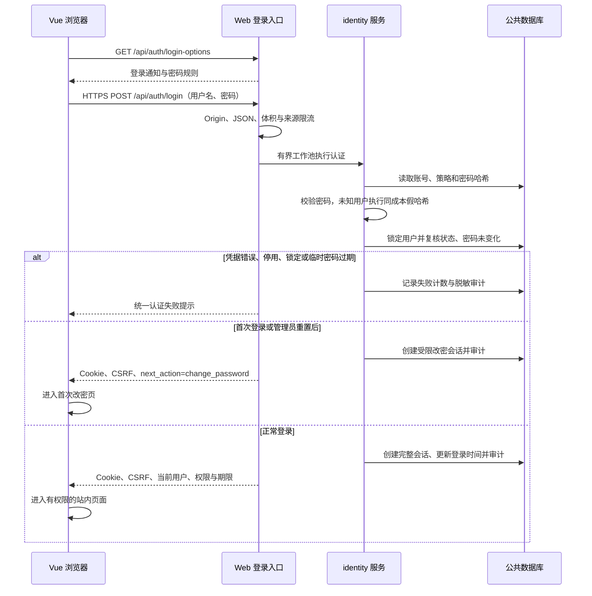

# 登录设计（用户名、密码与加密）

> 日期：2026-10-27｜状态：待实现的目标设计；当前仅有测试用内存账号与会话骨架。
> 关联：[用户管理与角色权限](index.md) · [后端实现设计](backend.md) · [Web 数据库与表设计](../../../common/database/ems-web.md) · [Web 进程设计](../design.md) · [当前运行边界](../running.md)。

## 1. 登录方案

采用 **站内用户名 + 密码登录，HTTPS 加密传输，服务端密码哈希校验和持久会话 Cookie**。浏览器直接向 EMS 提交账号凭据，登录成功进入工作台，无第三方登录跳转或授权服务器。

账号分为管理员、操作员、观察员三种角色。登录流程包含本地账号校验、首次改密、失败锁定和空闲超时，具体加密、凭证保护与会话契约见下文。

| 位置 | 设计 |
| --- | --- |
| 登录页 | 用户名、密码、显示/隐藏密码、登录按钮、联系管理员提示与站内通知 |
| identity 服务 | 本地校验账号和密码，创建完整或受限改密会话 |
| `ems_web` 数据库 | 账号、密码哈希、会话、登录保护策略和 Web 审计；通过公共数据库层访问，保存即生效 |
| 业务鉴权 | 当前会话 + 当前角色权限 + 当前站/设备范围 |
| 登录后导航 | 默认进入有权限的运行监视页面；空范围账号可进入个人中心 |

## 2. 加密与凭证保护

### 2.1 传输加密

生产全站使用 HTTPS，支持 TLS 1.2/1.3；登录、改密、重置以及登录后的所有页面和 API 均走加密连接。

- 沿用 Nginx 终止 TLS，EMS 仅监听本机或受控内网；跨主机的代理到后端链路同样加密。
- 前端以 HTTPS POST JSON 提交用户名、密码，不进入 URL、浏览器持久存储、日志或审计详情。
- 不额外引入浏览器端可逆密码密文、固定 AES 密钥或自制挑战协议；Base64 和密码框圆点不属于加密。
- 不把浏览器生成的 MD5/SHA256 摘要直接作为可反复提交的登录凭据，避免该摘要成为等价密码。
- 客户端正常校验证书；仅显式本机开发配置允许 HTTP，远程部署必须 HTTPS。

### 2.2 密码存储

数据库只保存**加盐密码哈希**，不保存明文或可解密密码。首期使用 Argon2id，最低参数 `m=19 MiB/t=2/p=1`，每个密码独立随机盐，编码包含算法与成本。

调用成熟库校验密码，不自写算法。当前测试骨架的合法 PBKDF2 哈希可在成功登录后重哈希，不能从旧摘要直接转换；目标 ARM/Windows 硬件先压测并限制并发派生，禁止阻塞 Drogon I/O 线程。

### 2.3 会话凭证

服务端生成至少 256 位熵的不透明随机会话凭证，以 HttpOnly Cookie 返回，数据库仅存摘要。浏览器携带 Cookie，后端读取当前会话与用户生成 `Principal`，不相信前端提供的角色或权限。CSRF Token 与会话绑定，前端仅在内存保存并通过安全头提交。具体期限见第 5 节。

## 3. 登录流程



密码派生可在用户锁外执行；创建会话前必须在事务内重读账号，确认哈希、角色、范围及首次改密等认证相关字段未变，账号仍 enabled。若管理员同时改密、停用或撤权，旧认证结果不能创建旧权限会话。成功审计与创建会话同事务提交。

用户登录时不选择角色，不允许提交 `role_code/permissions/scopes` 决定身份。成功登录总是生成新随机会话值，不能沿用登录前的临时凭证。

## 4. 改密、重置与退出

### 4.1 首次或重置后改密

初始化管理员和新用户的临时密码必须先修改。认证后只创建 `kind=password_change` 的 5 分钟受限会话，允许读取改密规则、提交改密和退出，其余业务接口由后端拒绝。临时密码 24 小时过期后由管理员再次重置。

页面显示当前用户名、当前临时密码、新密码与确认密码。确认密码在前端检查一致，服务端独立校验旧密码与新密码规则；用户名从会话获取，不能由前端改成其他人。

新密码 **12～32 个字符**，大写字母、小写字母、数字、特殊符号中至少三类；最小长度由管理员在 12～32 之间配置。拒绝与用户名、当前密码相同或命中弱密码名单的值。不截断、不自动去空格、不隐式归一化。公共规则见[用户管理设计](index.md)。

成功后同事务更新哈希、清除首次改密标记、撤销该用户全部完整/受限会话并审计；清 Cookie，提示“密码已修改，请重新登录”。不自动启用停用账号。管理员重置后旧受限会话立即失效。

### 4.2 正常改密与找回

完整会话通过个人中心提交旧密码、新密码。管理员可设置目标用户的临时密码，但不能读取原密码；敏感管理操作需最近 5 分钟重新认证。修改、重置均撤销全部会话。

遗忘密码联系管理员；不开放匿名短信/邮件或厂商云端找回。所有管理员无法登录时，通过受控主机恢复命令处理并审计，不提供公开通用动态口令或恢复后门。

### 4.3 退出和撤销

退出当前或全部会话，均先在数据库标记撤销，再返回成功并清 Cookie；重复退出幂等。停用、删除、改密/重置、角色或范围变更同事务撤销该用户全部会话，提交后新请求立即读取当前状态。

已鉴权的在途读取可完成；关键写入和异步控制执行前重新鉴权。锁顺序及竞态见[用户管理设计](index.md)。撤销会话不能收回已下发现场的命令。

## 5. 登录保护与会话策略

管理员可配置登录失败阈值、锁定时间、会话空闲超时、密码最小长度和登录通知。完整会话绝对期限、受限改密会话期限及并发上限按下表执行。

| 参数 | 默认值 / 范围 | 行为 |
| --- | --- | --- |
| 连续登录失败阈值 | 6 次 / 3～6 次 | 达到阈值锁定；成功登录或锁定到期后清零 |
| 账号锁定时间 | 10 分钟 / 10～30 分钟 | 限制新密码认证，不踢出此前合法会话；人工停用另行撤销 |
| 会话空闲超时 | 10 分钟 / 10～30 分钟 | 无交互超过期限重新登录 |
| 密码最小长度 | 12 / 12～32 个字符 | 最大固定 32；新增/修改密码按当前规则校验 |
| 登录通知 | 空 / 最多 500 字符纯文本 | 登录页展示，不接受 HTML/脚本 |
| 完整会话绝对期限 | 8 小时 | 活动不能突破 |
| 受限改密会话 | 5 分钟 | 固定到期，轮询不续期 |
| 并发完整会话 | 每用户最多 3 个 | 新登录事务内撤销最早活动会话并审计 |
| 来源限流 | 每 IP 每分钟最多 30 次凭据尝试 | 429 + Retry-After，有界维护来源计数 |

连续失败计数归账号持久化、多实例一致；未知用户使用同成本假哈希及有界同形计数。未知账号、密码错误、停用和锁定统一返回“账号或密码错误，或账号暂不可用”，不返回账号是否存在、剩余次数和精确解锁时间。

仅明确的用户交互续期，轮询、心跳和指标读取不续期；可使用 `POST /api/auth/activity`，服务端限频更新活动时间。每次请求读取当前策略，缩短空闲期限后下次请求即按新期限校验；改密码长度不会无故使现有合法密码失效，下一次改密执行新规则。

生产 Cookie 为 `__Host-ems_session; Path=/; Secure; HttpOnly; SameSite=Strict`，不设 Domain，不提供“记住密码”。本机 HTTP 开发使用独立、无 `__Host-` 前缀的名称。会话持久化，重启/多实例均能验证；数据库故障返回 503，不能从前端缓存或内存旧权限放行。

## 6. 接口契约

统一固定 URL、GET 无参数、POST JSON、snake_case 与响应信封；ID 为字符串，时间为 UTC RFC 3339。认证响应 `Cache-Control: no-store`，无需查询串或表单协议例外。

| 方法与路径 | 输入 | 响应 / 条件 |
| --- | --- | --- |
| GET `/api/auth/login-options` | 无 | 纯文本登录通知、密码长度及字符规则；无账号清单 |
| POST `/api/auth/login` | `{username,password}` | 完整或受限会话；匿名入口检查精确 Origin，拒绝非 JSON |
| GET `/api/auth/session` | Cookie，无参数 | kind、用户、完整会话的 permissions/scopes、CSRF 与期限；受限会话仅改密信息 |
| POST `/api/auth/password/complete` | `{old_password,new_password}` | 仅受限改密会话；成功返回 reauthentication_required 并清 Cookie |
| POST `/api/auth/reauthenticate` | `{password}` | 完整会话；验证当前用户，更新 auth_time，不改变权限 |
| POST `/api/auth/activity` | `{}` | 完整会话；按策略更新活动时间，不突破绝对期限 |
| POST `/api/auth/logout` | `{}` | 撤销当前会话；无会话仍返回 logged_out=true |
| POST `/api/auth/logout-all` | `{}` | 撤销当前主体全部会话，返回 logged_out=true |

正常登录成功示例（权限为节选，实际返回当前角色的完整集合）：

```json
{
  "data": {
    "kind": "full",
    "next_action": "enter_app",
    "user": {"user_id": "usr-example", "username": "chenxiao", "display_name": "陈晓", "role_code": "operator"},
    "permissions": ["device.read", "monitor.read", "command.yk"],
    "scopes": [{"station_id": "station-example", "device_root_id": "unit-example"}],
    "csrf_token": "opaque-csrf-value",
    "idle_expires_at": "2026-10-27T01:52:18Z",
    "absolute_expires_at": "2026-10-27T09:42:18Z"
  },
  "meta": {"request_id": "req-example"}
}
```

Cookie 经 Set-Cookie 设置，不在 JSON 返回其值。首次改密响应 kind=password_change、next_action=change_password，只返回当前账号、密码规则、CSRF 和受限期限，不含业务权限。

已登录 POST（包括查询）要求 Cookie + 精确 Origin + X-CSRF-Token；登录靠 Origin 与严格 JSON 入口保护。受限会话使用专属 CSRF，无会话退出仍检查 Origin。字段白名单拒绝 role 等多余身份参数。

| HTTP / reason | 行为 |
| --- | --- |
| 400 invalid_argument | 格式、字段、类型错误 |
| 401 invalid_credentials | 泛化凭据/账号不可用提示 |
| 401 session_expired / unauthenticated | 清前端身份状态，返回登录页 |
| 403 password_change_required / csrf_mismatch | 进入改密页或拒绝来源不合法请求 |
| 403 permission_denied / reauthentication_required | 无权操作或重新验证当前密码 |
| 422 password_policy_failed | 展示密码规则，不含密码值 |
| 429 rate_limited | 来源限流，使用 Retry-After |
| 503 identity_unavailable / audit_unavailable | 依赖不可用，停止登录或安全变更 |

## 7. 页面、持久化与部署

登录页保留站点身份和账号输入，不展示角色选择、技术令牌或算法。提交后禁用按钮并显示“正在登录”；按 next_action 进入站内页面。return_to 仅允许站内白名单，禁止外域跳转。失败清密码、保留用户名；会话过期提示重登，不自动重放失败业务写请求。

身份数据存入独立的 `ems_web` 数据库，5 张表的字段和索引见 [Web 数据库与表设计](../../../common/database/ems-web.md)。单行登录策略同时承担管理员管理事务的串行锁，不另建安全守卫表；Web 操作审计在该库集中保存并复用公共审计接口。密码修改与授权保存直接 UPDATE，不建立配置版本或账号文件。

TLS 私钥由受限部署路径提供。密码、Cookie、CSRF、哈希和完整认证请求体禁止进入代理/应用日志和审计差异。数据库、密码派生及审计使用有界工作池。生产启用身份后，账号表/策略/审计依赖缺失使 ready 返回 503，存活接口无须登录。

## 8. 实施与验收

顺序：公共账号/会话/策略 Repository → 本地登录和首次改密 → 角色/资源鉴权 → 管理接口与前端 → 真机部署。当前测试内存协议仍见[运行说明](../running.md)，不代表目标功能已落地。

- 登录：成功、错误/未知账号、停用、锁定、临时密码过期、首次改密；失败不枚举账号。
- 加密：远程仅 HTTPS、正常证书校验，数据库/日志无明文或可逆密码，不用摘要作可重放凭据。
- 会话：Cookie、CSRF、空闲/绝对期限、轮询不续期、重启/多实例、并发上限、退出幂等。
- 变更：停用/改密/授权变更后旧会话失效；认证和撤权并发不能产生新有效会话。
- 策略：范围校验、失败阈值与到期解锁、多实例计数、缩短超时生效、通知纯文本转义。
- 权限展示：绿色 ✓ 为允许，红色 × 为禁止，同时保留图例及可访问文本；后端独立鉴权。
- 原子性：会话创建/改密/撤销与审计同事务，故障拒绝放行，真实 MySQL 验证并发事务。
