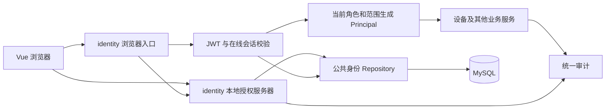
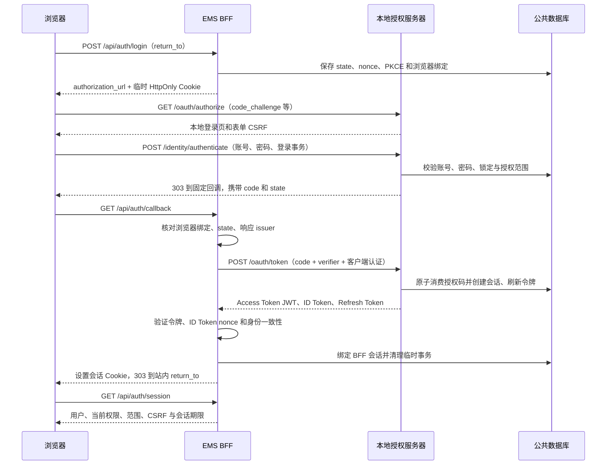

# 登录设计（OAuth2 + JWT）

> 日期：2026-10-27｜状态：待实现的目标设计；当前内存会话骨架不具备本文的 OAuth2、JWT 或持久账号能力。
> 关联：[用户管理与角色权限](index.md) · [Web 进程设计](../design.md) · [当前运行边界](../running.md)。

## 1. 目标与方案

登录采用 **OAuth2 授权码模式 + PKCE（S256）+ JWT Access Token**。用户身份确认补充 OpenID Connect（OIDC）的 ID Token 校验；OAuth2 负责授权，JWT 是访问令牌格式。OIDC 的身份层定义见 [OpenID Connect Core](https://openid.net/specs/openid-connect-core-1_0.html)。

默认使用 EMS 本地账号，支持无公网的站内部署。授权服务器、浏览器后端（BFF）和资源服务先部署在同一 `ems-web` 进程，按职责分层；不要求另建认证微服务。后续接企业身份源时另行定义外部身份绑定，不通过邮箱或同名用户名自动合并账号。

| 参与方 | 本期责任 |
| --- | --- |
| 浏览器 / Vue | 展示登录与业务页面；只保存不透明会话 Cookie，内存保存 CSRF Token |
| BFF（identity 的浏览器入口） | OAuth2 保密客户端，固定 `client_id=ems-web-bff`；保存 PKCE、交换及刷新令牌 |
| 本地授权服务器（identity） | 验证本地凭据，签发授权码、JWT Access Token、ID Token 和不透明 Refresh Token |
| 资源服务（device 等） | 验证访问令牌，并使用当前账号、角色及资源范围构造 `Principal` |
| 公共数据库 / 统一审计 | 持久账号、授权事务、会话与撤销状态；记录安全事件 |

浏览器脚本不读取 Access Token / Refresh Token，不把令牌写入 localStorage、sessionStorage 或 URL。BFF 用服务器端持有的 JWT 进入资源鉴权管线；同进程可直接调用该管线，无需为此发起 HTTP 回环。浏览器 Cookie 是 BFF 会话凭证，JWT 是资源服务的授权凭证。

授权码必须绑定 PKCE；不开放隐式模式、密码授权模式、动态客户端注册或第三方客户端自助授权。授权码安全规则依据 [OAuth2 安全最佳实践 RFC 9700](https://www.rfc-editor.org/rfc/rfc9700.html)，其余具体预算是本项目约定。

## 2. 模块落点与边界



| 层 | 设计职责 |
| --- | --- |
| `modules/identity/api` | 浏览器认证入口、OAuth2/OIDC 协议入口、回调与会话响应 |
| `modules/identity/application` | 登录用例、令牌签发/轮换、撤销、用户状态与权限解析 |
| `modules/identity/infrastructure` | 成熟密码/JWT 库适配、密钥读取；不私建数据库连接 |
| `modules/identity/public` | 扩展现有 `Principal`，提供认证与授权契约 |
| `transport/filters` | Cookie、Origin、CSRF、体积与频率准入；调用身份服务 |
| `common/database` 与 `common/db` | 身份记录、Repository 接口及唯一数据库实现 |

密码派生、JWT 签名和数据库访问进入有界工作池，禁止阻塞 Drogon I/O 线程。开发测试使用显式注入的测试身份；生产入口不得通过开关绕过鉴权。

## 3. 登录与回调



### 3.1 授权事务

- `return_to` 仅接受站内路由白名单中的相对路径，禁止外域、协议相对地址和认证入口循环；OAuth2 `redirect_uri` 固定登记为部署地址下的 `/api/auth/callback`，精确匹配。
- BFF 生成密码学安全随机 `state`、`nonce`、PKCE `code_verifier`，服务端保存；PKCE 仅允许 `S256`。临时 Cookie 绑定本次浏览器，不将 verifier 返回前端。
- 授权服务器再次检查 `client_id`、`redirect_uri`、`response_type=code`、scope 白名单及 challenge。校验客户端/回调地址失败直接显示错误，禁止重定向到未登记地址。
- 登录表单使用授权服务器生成的短期事务与 CSRF；检查 Origin 和浏览器绑定。密码只提交给 `/identity/authenticate`，不在 `/oauth/token` 接收用户名密码。
- 授权码有效期 60 秒、一次性使用，绑定用户、客户端、回调地址、PKCE 和已授予 scope。数据库原子消费，两个并发交换最多一个成功。
- 授权码交换在锁定当前用户后重新检查账号、首次改密与临时密码状态；停用、改密、重置和权限变更还必须作废该用户未完成的登录事务及授权码，不能让旧的凭据校验结果换出新会话。
- 回调 `state` 无效、事务过期、用户取消或 code 交换失败时销毁临时事务并返回登录页。禁止自动循环重试；对外不展示令牌或协议内部异常。
- 回调携带并校验授权服务器 `iss`，仅接受预配置 issuer；不由请求决定令牌端点。回调页使用 `Referrer-Policy: no-referrer`，不加载第三方资源，随后跳转清理查询串；代理访问日志屏蔽 code/state。

### 3.2 本地凭据与首次改密

账号、密码存储、首次管理员和找回流程由[用户管理设计](index.md)统一规定。未知用户、密码错误、停用和锁定统一展示“账号或密码错误，或账号暂不可用”；详细原因只写受控审计。

首次登录或管理员重置密码后，用户只能进入改密流程。此时仅创建 5 分钟的受限改密事务 Cookie，未签发业务 Access Token，不建立完整业务会话。改密成功后销毁该事务，要求用新密码重新登录；不得依赖前端路由限制阻止访问业务接口。

## 4. JWT、密钥和在线鉴权

### 4.1 访问令牌契约

Access Token 使用非对称签名，首期固定允许 `RS256`，Header 为 `typ=at+jwt` 并携带 `kid`。实现使用成熟库；拒绝 `none`、非白名单算法和令牌自带的远程密钥地址。JWT Access Token 的类型及基础声明规则见 [RFC 9068](https://www.rfc-editor.org/rfc/rfc9068.html)。

| 声明 | 示例 / 规则 |
| --- | --- |
| `iss` | 部署固定的 HTTPS issuer，精确比对 |
| `sub` | 稳定 `user_id` 字符串，不能使用可展示姓名或用户名替代 |
| `aud` | 固定资源服务标识 `ems-api` |
| `client_id` | `ems-web-bff` |
| `iat` / `nbf` / `exp` | UTC NumericDate 秒数，JSON number；允许最大 30 秒时钟偏差 |
| `jti` | 每次签发生成唯一随机令牌 ID |
| `sid` | 本项目扩展声明，指向授权会话；资源服务检查该会话是否仍有效 |
| `scope` | 空格分隔字符串，表示本次授权上限；不直接等同于角色 |

JWT 不携带密码、联系方式或完整设备树。`role_code` 和操作权限不作为 JWT 中长期可信的授权依据，每次按数据库当前记录计算。令牌有效期默认 5 分钟，不因用户操作延长已签发 JWT 的 `exp`。

OIDC ID Token 仅由 BFF 验证登录身份，使用单独的 Token 类型和验证路径；检查签名、issuer、`aud=ems-web-bff`、期限、nonce，以及 `sub` 与会话的一致性。禁止把 ID Token 当作 API Access Token；也禁止拿 `aud=ems-api` 的 Access Token 充当 ID Token。

### 4.2 scope 与有效权限

固定 OAuth2 scope：`openid` 用于登录身份，`ems.read` 对应业务读取，`ems.configure` 对应工程配置，`ems.operate` 对应运行操作，`ems.users` 对应用户管理，`ems.audit` 对应全局审计查询。具体操作映射以[权限矩阵](index.md)为准。

BFF 可请求上述预登记 scope；授权服务器只授予请求集合与当前角色允许集合的交集，并将实际 scope 返回客户端。`openid` 必须保留；角色缺少的业务 scope 不授予。角色提升不能扩大既有授权，用户须重新登录；角色降级则立即收缩有效权限。

```text
有效权限 = 令牌 scope 对应权限 ∩ 当前角色权限
允许请求 = 令牌校验通过 ∧ 会话有效 ∧ 账号可用
           ∧ 具备该操作的有效权限 ∧ 资源处于当前授权范围
```

资源鉴权依次检查签名/声明、在线会话撤销与期限、账号状态、角色权限、资源范围。浏览器入口只使用 Cookie，拒绝同时传入的 Bearer 凭证；外部 Bearer 客户端接入不在本期开放范围。身份存储不可用返回 503，不能仅凭 JWT 签名放行。

JWT 本身不能立即撤销。首期每次请求读取持久会话及当前账号权限，不设置跨请求权限缓存。停用、重置密码、撤销会话和资源授权变更提交后，新请求立即按新状态判定。已进入执行的请求与关键写事务的竞态规则见[用户管理设计](index.md)。

### 4.3 密钥管理

签名私钥和 BFF 客户端密钥由受限文件/部署密钥挂载提供，不能写进仓库、普通 Web JSON 或数据库明文。数据库只登记 `kid`、公钥和有效期等元数据；BFF 会话中的可恢复令牌使用独立的加密密钥进行带认证加密。

公钥通过固定 `/.well-known/jwks.json` 提供；OIDC 元数据通过 `/.well-known/openid-configuration` 提供固定 issuer、authorize/token/JWKS 地址及支持能力。新公钥先可读再用于签发；旧公钥至少保留到其最后签发令牌过期并超过时钟偏差。未知 `kid` 仅触发一次受限的可信密钥刷新，失败拒绝，禁止按令牌 URL 拉取。

## 5. 会话、刷新和退出

| 项目 | 默认值 / 行为 |
| --- | --- |
| 登录临时事务 | 5 分钟；成功、取消或失败后清理 |
| Access Token | 5 分钟，提前 30 秒由 BFF 刷新 |
| BFF / 授权会话 | 30 分钟无交互空闲失效，8 小时绝对失效，不提供长期“记住我” |
| Refresh Token | 不透明随机值，至少 256 位熵，一次使用即轮换；不超过会话绝对期限 |
| 并发会话 | 每用户最多 3 个完整会话；新登录事务内撤销最早活动会话并记录审计 |
| 生产 Cookie | `__Host-ems_session`，`Path=/; Secure; HttpOnly; SameSite=Lax`，不设置 Domain |
| 临时 Cookie | 同样限制并设置短 Max-Age；Lax 允许授权回调的顶层导航 |
| 开发 Cookie | 仅显式本机 HTTP 开发配置使用无 `__Host-` 前缀的独立名称；远程部署强制 HTTPS |

### 5.1 刷新一致性

授权服务器只保存 Refresh Token 的不可逆摘要及令牌族关系；BFF 为刷新所需保存加密后的当前令牌，二者职责不同。刷新需同时验证 BFF 客户端、会话状态、当前账号、scope 上限和期限。

轮换事务锁定会话和当前刷新记录：标记旧值已消费，插入新值并返回新令牌。同一 `sid` 的 BFF 请求跨线程/实例使用数据库租约串行刷新，不只依赖进程内互斥。等待者读取已更新的加密令牌；租约过期接管时也不得重放已发送但结果未知的旧令牌。

检测到已消费 Refresh Token 再用时，撤销整个令牌族及对应会话，记录重放事件并重新登录。刷新提交后响应丢失或 BFF 未保存新值时，按结果未知处理，结束会话重新认证；不通过放宽重放检测维持会话。轮换与重放防护原则见 [RFC 9700 的刷新令牌保护](https://www.rfc-editor.org/rfc/rfc9700.html#section-4.14)。

只有用户主动请求续期空闲期限；后台轮询、指标、自动刷新令牌不算用户活动。Vue 请求层区分用户动作和轮询，服务端仅对明确允许的交互入口更新活动时间。前端标志只能影响续期，不能突破服务端绝对期限。

### 5.2 退出和失效

- `POST /api/auth/logout` 撤销当前 BFF/授权会话和全部刷新后继，清除 Cookie、前端身份状态及权限导航；重复退出仍成功。
- `POST /api/auth/logout-all` 撤销当前用户所有会话；管理员踢人走用户管理接口。撤销事务完成后再返回成功。
- 账号停用、删除、密码重置/修改撤销全部会话。角色/范围变更默认撤销全部会话，避免旧页面继续操作；并仍按当前数据库权限核验每个请求。
- 浏览器多标签共享 Cookie，退出后其他标签收到广播并清理；广播只是体验优化，后端撤销状态是最终依据。
- Access Token 到期可由 BFF 刷新；Refresh Token 过期、撤销、重放或账号不可用统一结束会话。401 后回登录页，403 留在当前页提示权限，503 显示服务不可用，避免把依赖故障当作密码错误。
- 业务写请求不自动重放；只有确认尚未调用业务服务时，BFF 才能在内部刷新后继续本次鉴权。提交结果未知时按原业务 ID 查询。

## 6. 接口契约与协议例外

### 6.1 浏览器业务接口

除回调外，遵循现有固定 URL、POST JSON、`{data, meta}` / `{error, meta}` 约定；ID 为字符串，时间为 UTC RFC 3339。所有认证响应 `Cache-Control: no-store`。

| 方法与路径 | 请求 | 成功结果 / 前置条件 |
| --- | --- | --- |
| POST `/api/auth/login` | `{return_to}` | 200：`authorization_url`；未登录也检查 Origin，限制启动频率 |
| GET `/api/auth/callback` | OAuth2 `code/state/iss` 或协议错误查询参数 | 成功 303；由 state、PKCE 和临时 Cookie 保护 |
| GET `/api/auth/session` | 无参数，完整会话 Cookie | 200：`user_id/username/display_name/role_code/permissions/scopes/csrf_token/idle_expires_at/absolute_expires_at` |
| POST `/api/auth/logout` | `{}` | 200：`logged_out=true`；有会话时检查 CSRF；无会话仍检查 Origin |
| POST `/api/auth/logout-all` | `{}` | 200：`logged_out=true`；完整会话、Origin 和 CSRF |
| POST `/api/auth/password/complete` | `{new_password}` | 200：`reauthentication_required=true`；仅首次/重置改密事务、专用 CSRF |

目标中的 `/api/auth/login` 从旧的 username/password 入口改为授权流程启动；旧内存登录协议不作为生产备用路径，实施时同步替换测试与前端。有效会话的密码修改入口见用户管理文档。

### 6.2 标准协议入口

OAuth2/OIDC 是现有业务 HTTP 约定的显式例外：授权请求与回调允许标准查询参数，令牌/撤销端点使用 `application/x-www-form-urlencoded`，协议响应不套业务 `data/meta`。接口格式依据 [RFC 6749](https://www.rfc-editor.org/rfc/rfc6749.html)。本地授权页的凭据表单也使用此表单编码，以浏览器原生表单提交和 303 顶层跳转衔接流程；这些例外不能扩散到设备、用户列表等业务 API。

| 方法与路径 | 输入 / 结果 | 保护方式 |
| --- | --- | --- |
| GET `/oauth/authorize` | 标准 code 授权参数，scope 含 openid | 精确回调白名单、PKCE、短期登录事务 |
| POST `/identity/authenticate` | 表单：`login_transaction_id/username/password/csrf_token` | 授权页 Cookie、表单 CSRF、Origin、限流；成功返回 303 |
| POST `/oauth/token` | `grant_type=authorization_code` 或 `refresh_token`；标准令牌 JSON | 仅预登记 BFF；TLS + `client_secret_basic`，不向浏览器开放 CORS |
| POST `/oauth/revoke` | 标准 `token/token_type_hint`；有效客户端请求返回 200 | BFF 客户端认证；实施遵循 [RFC 7009](https://www.rfc-editor.org/rfc/rfc7009.html) |
| GET `/.well-known/openid-configuration` | OIDC 元数据 | 公开只读，无敏感信息 |
| GET `/.well-known/jwks.json` | 当前及有效过渡公钥 | 公开只读，不返回私钥 |

令牌成功响应包括 `access_token/token_type=Bearer/expires_in/refresh_token/scope`；首次 code 交换另含 `id_token`。错误用标准 `invalid_request/invalid_client/invalid_grant/invalid_scope/unsupported_grant_type`，通常 400，客户端认证失败按协议 401；不用业务错误信封。

## 7. 安全、故障和前端状态

| 场景 | 约定 |
| --- | --- |
| CSRF | 浏览器所有业务 POST（包括查询）校验精确 Origin + 会话 CSRF；登录页有独立 CSRF。回调使用 OAuth2 事务校验 |
| 会话固定 | 登录成功生成全新随机会话 Cookie，不能沿用登录前临时值；只在服务器保存 Cookie 摘要 |
| 频率 | 单账号 15 分钟内密码失败 5 次后锁定 15 分钟；来源 IP 每分钟最多 30 次凭据尝试；账号/IP 组合及事务创建另设有界桶 |
| 错误与限流 | 泛化凭据失败，429 携带 Retry-After；未知用户执行同成本假哈希，限流记录数量有上限 |
| 敏感信息 | 日志、审计、代理日志屏蔽密码、Cookie、code、state、verifier、令牌及客户端密钥 |
| XSS 与传输 | 登录页不嵌第三方脚本，配置 CSP、禁止被嵌帧；生产 HTTPS，同源部署，代理来源只信任显式配置 |
| 故障 | 密钥/身份表/审计写入不可用时拒绝签发；业务身份依赖故障返回 503；健康存活接口不需登录 |
| 重启 | 持久会话与共享密钥允许重启后继续校验；短期临时事务过期清理，不恢复进程内测试会话 |
| 配置检查 | 只检查来源、密钥可读性与协议配置，不打印密钥；身份模块启用但配置不完整时 readiness 为 503 |

前端状态按“未登录 → 跳转认证 → 首次改密或完整会话 → 过期/退出”处理。应用启动先调用 session，避免展示越权菜单；只在内存维护身份和权限，刷新后重新获取。`return_to` 由服务端白名单控制，登录失败保留用户名可选，密码输入始终清空。

未启用身份模块的现有开发模式仍可提供健康检查，受保护接口保持拒绝；正式生产部署必须启用完整身份模块，以 readiness 阻止缺账号/密钥的服务接收业务流量。

## 8. 实施与验收

1. 按用户管理设计落地公共身份 Repository、账号初始化及密码存储，再替换内存身份实现。
2. 落地授权事务、PKCE、客户端认证、标准协议端点、JWT/OIDC 校验与密钥轮换。
3. 接入 BFF 持久会话、刷新串行化、撤销、CSRF 与前端登录状态；同步运行文档及当前集成测试。
4. 真实 MySQL 验证并发消费授权码、Refresh Token 重放、跨实例刷新与撤销事务；SQLite 不能代替行锁验收。

| 验收组 | 必须验证 |
| --- | --- |
| 登录 | 成功、未知账号、错误密码、锁定、停用、首次/重置改密；错误提示不枚举账号 |
| 协议 | 缺/错 state、nonce、PKCE，code 过期/重用、redirect_uri 不匹配、issuer 混淆、客户端认证失败 |
| JWT | 错签名、错算法/kid/typ/iss/aud、过期/未来 nbf；ID Token 冒充访问令牌被拒绝 |
| 浏览器 | Cookie 属性、CSRF/跨源拒绝、刷新恢复、退出多标签、开放重定向及凭据泄漏检查 |
| 刷新 | 并发仅轮换一次，重放撤销令牌族，网络结果未知要求重登，不重复提交业务写入 |
| 即时失效 | 停用、改密、降权、范围收缩、踢出后旧 JWT/Cookie 不能发起新业务请求 |
| 运维 | 重启、多实例、公钥过渡、密钥或身份库不可用、审计失败、空闲与绝对期限边界 |
