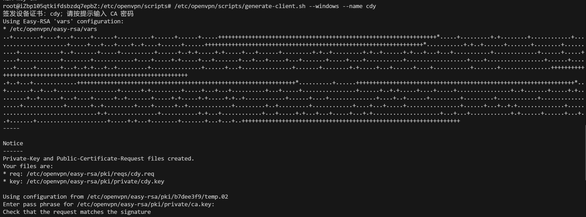
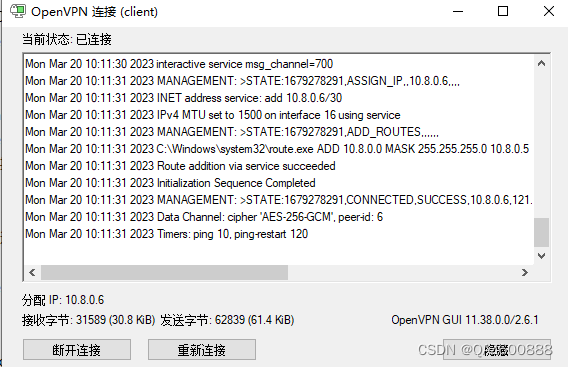

# OpenVPN 客户端配置生成与部署

先完成 [服务端部署](server.md)。本页使用脚本签发证书、生成配置并打成 ZIP，
然后将 ZIP 传到实际客户机，解压后启动 OpenVPN。证书 CN 为 `server`；
脚本读取 `/etc/openvpn/server/server.conf`，自动匹配 `proto` 传输协议、
`tls-auth` / `tls-crypt` 模式及 `auth` 摘要，客户端与服务端始终保持一致。

操作分为三段：**服务端安装脚本 → 生成并下载 ZIP → 在 Windows / Linux 上部署**。
除完整脚本外，其余命令逐条复制执行。

## 1. 脚本和生成结果

| 项目 | 约定 |
| --- | --- |
| 服务端脚本 | `/etc/openvpn/scripts/generate-client.sh` |
| 服务端输出目录 | `/etc/openvpn/clients/` |
| Linux 客户机配置 | `/etc/openvpn/client.conf`，证书和密钥同样放在 `/etc/openvpn/` |
| 选择 Windows | `--windows`，包内配置为 `client.ovpn` |
| 选择 Linux | `--linux`，包内配置为 `client.conf` |
| 设备身份 | `--name client01`，用于证书 CN 和 ZIP 文件名 |
| 公网入口 | 固定为 `121.40.72.224`，直接写入配置，不提供地址参数 |
| 端口 | `--port`，默认 `1194`；传输协议自动跟随服务端 `proto` |

包内名称固定，不需要另外指定配置文件名或密钥文件名：

```text
client01-linux.zip                  client02-windows.zip
  ca.crt                             ca.crt
  client.crt                         client.crt
  client.key                         client.key
  ta.key                             ta.key
  client.conf                        client.ovpn
  install.sh
```

Linux 包额外包含一键安装脚本 `install.sh`：ZIP 解压到任意目录后执行它，
即可完成安装、后台启动和开机自启，无需手动搬运文件或编写 systemd 服务。

**名称相同不表示不同设备共用同一份客户端私钥。** `client01`、`client02` 分别签发自己的证书和私钥，
导出时统一命名为 `client.crt`、`client.key`。同一个 `--name` 重新导出时复用原有证书，`--force` 只覆盖 ZIP。

## 2. 在服务端安装脚本

### 2.1 准备工具和目录

**位置：OpenVPN 服务端终端。** 切换 root，后续服务端操作都在此会话执行。

```bash
sudo -i
```

安装 `zip` 打包工具、`unzip` 查看工具和 `lrzsz` 文件传输工具。OpenSSL、Easy-RSA 应已在服务端部署时安装。

```bash
apt install -y zip unzip lrzsz
```

创建脚本目录，只有 root 可以访问。

```bash
install -d -m 700 /etc/openvpn/scripts
```

### 2.2 保存完整脚本

可先 <a href="./generate-client.sh" download="generate-client.sh" target="_blank" rel="noopener noreferrer">下载 generate-client.sh</a>，再上传到上述目录。
也可以打开编辑器，将下方完整脚本一次复制进去。

```bash
vim /etc/openvpn/scripts/generate-client.sh
```

<details>
<summary>展开完整脚本（整体保存为 generate-client.sh）</summary>

```bash file="../../public/remote-access/openvpn/generate-client.sh"
```

</details>

在 vim 中按 `i` 进入插入模式；编辑完成后按 `Esc`，输入 `:wq` 并回车保存退出。
文件使用 **UTF-8、LF 换行**，不要保存成 `.sh.txt`。
脚本从实际文件引用到此页面，下载文件与页面展示的内容保持一致。

设置脚本权限，限制其他用户读取和修改。

```bash
chmod 700 /etc/openvpn/scripts/generate-client.sh
```

先查看帮助，确认脚本保存正确；设置执行权限后直接运行，不要求切换到脚本目录。

```bash
/etc/openvpn/scripts/generate-client.sh --help
```

### 2.3 脚本自动完成的操作

1. 检查参数、依赖和现有 CA、PKI、`ta.key`、`server.conf`，不会重新初始化 PKI。
2. 设备证书不存在时调用 Easy-RSA 签发，按提示输入 **CA 密码**；已存在则复用。
3. 检查证书用途、有效期、签发者、吊销记录，以及证书和私钥是否匹配。
4. 生成带注释的客户端配置，按系统选择 `.ovpn` 或 `.conf`，控制通道设置与服务端一致。
5. 只将所需文件打包到 ZIP（Windows 五个，Linux 另含一键安装脚本 `install.sh`），成功或失败后均清理临时文件。

输出目录权限为 `700`，ZIP 为 `600`。包内不包含 CA 私钥和服务端私钥。
脚本不会修改服务端配置或 CCD 地址规则，也不会将 CA 密码写入文件。

### 2.4 匹配已有的服务端配置

例如服务端使用以下配置：

```ini
tls-auth ta.key 0
auth SHA256
```

脚本生成的 Windows 客户端会自动使用：

```ini
# 客户端方向为 1，与服务端的 0 配对
tls-auth ta.key 1
auth SHA256
```

Linux 使用同样的模式和摘要，密钥路径为 `/etc/openvpn/ta.key`。
服务端使用 `tls-crypt` 时，脚本会生成对应指令，不添加方向参数。
读取的密钥始终来自 `/etc/openvpn/server/ta.key`，不会误用 Easy-RSA 工作目录中的另一份同名文件。

## 3. 在服务端生成 ZIP

### 3.1 生成 Linux 客户端包

**位置：服务端 root 终端。** 公网入口已在脚本中固定为 `121.40.72.224`，运行时只需指定系统和设备身份。

```bash
/etc/openvpn/scripts/generate-client.sh --linux --name client01
```

首次生成会提示输入 CA 密码；完成后输出路径：

```text
/etc/openvpn/clients/client01-linux.zip
```

### 3.2 生成 Windows 客户端包

使用另一个设备身份 `client02`，生成的配置同样连接 `121.40.72.224`。

```bash
/etc/openvpn/scripts/generate-client.sh --windows --name client02
```



*截图使用 `--name cdy`，展示证书签发过程，对应的 ZIP 文件名为 `cdy-windows.zip`。
本文示例使用 `client02`；等待脚本输出“生成完成”后，再下载对应的 ZIP。*

预期生成：

```text
/etc/openvpn/clients/client02-windows.zip
```

服务端文档已为 `client01`、`client02` 配置固定 IP，因此两台连接后分别得到 `10.8.0.10`、`10.8.0.11`。
其他名称也可直接生成，会从动态池分配地址；需要固定地址时，按 [服务端 CCD 步骤](server.md#62-给客户端指定固定-ip) 添加同名规则。
已有服务端若使用默认动态地址池且没有 CCD 规则，`client01`、`client02` 同样按实际连接分配地址，不能直接认定为 `.10`、`.11`。

### 3.3 修改端口或重新导出

服务端改用其他端口或传输协议时，先修改服务端 `server.conf` 并重启，再用 `--port` 重新生成；
协议无需参数，脚本自动跟随服务端 `proto`。

```bash
/etc/openvpn/scripts/generate-client.sh --linux --name client03 --port 1195
```

同名 ZIP 已存在时默认停止，避免误覆盖。确需更新端口或重新打包时，加 `--force`，已有证书不会重新签发。

```bash
/etc/openvpn/scripts/generate-client.sh --linux --name client01 --force
```

检查 ZIP 内容，预期只有前面列出的文件，不应出现 `ca.key`、`server.key` 或 PKI 目录。

```bash
unzip -l /etc/openvpn/clients/client01-linux.zip
```

## 4. 把 ZIP 传到实际客户机

### 4.1 下载到操作电脑

**位置：连接服务端的 Xshell root 会话。** 通过 `sz` 下载 Linux ZIP，保存到本地下载目录。

```bash
sz -b /etc/openvpn/clients/client01-linux.zip
```

需要部署 Windows 时，下载该设备自己的 ZIP。

```bash
sz -b /etc/openvpn/clients/client02-windows.zip
```

没有 ZMODEM 支持时，也可使用具有源文件读取权限的 SFTP 会话下载。压缩包含无口令的客户端私钥，
只发给对应设备的维护人员，不上传公开网盘或提交到 Git。

### 4.2 选择客户机部署分支

- **Linux 客户机**：ZIP 先保存在操作电脑，再通过连接客户机的 Xshell 上传，按第 5 节安装。
- **Windows 客户机**：将 ZIP 放到这台 Windows 电脑，按第 6 节解压到 OpenVPN GUI 的配置目录。

本方案在一台客户机上安装一套固定名称的配置。已有其他 VPN 配置时，先停止相应服务并备份文件，避免覆盖或同时重复连接。

## 5. Linux 客户机安装与启动

### 5.1 准备工具

**位置：实际 Linux 客户机终端。** 以下以 Ubuntu / Debian 为例，只需要解压和文件传输工具；
`openvpn` 由安装脚本自动安装，不需要手动装。

```bash
sudo apt update
sudo apt install -y unzip lrzsz
```

### 5.2 接收并解压 ZIP

切换 root 并建一个接收目录，避免压缩包落到公共目录。

```bash
sudo -i
install -d -m 700 /root/openvpn-import
cd /root/openvpn-import
```

在 Xshell 中执行接收命令，选择操作电脑上下载的 `client01-linux.zip`。

```bash
rz -b
```

解压到任意目录都可以，脚本按自身所在位置查找文件。

```bash
unzip client01-linux.zip -d ems-vpn
cd ems-vpn
```

确认目录中有全部六个文件：`install.sh`、`client.conf`、`ca.crt`、`client.crt`、`client.key`、`ta.key`。

```bash
ls -l
```

### 5.3 一键安装并启动

```bash
sudo ./install.sh
```

脚本自动完成四件事，重复执行安全（先停旧服务，覆盖文件后重启）：

1. 自动安装 `openvpn`（支持 `apt-get` / `dnf` / `yum`，已装则跳过）；
2. 把配置和四个证书密钥文件安装到固定位置 `/etc/openvpn`，密钥权限 `600`；
3. 创建 systemd 服务 `ems-openvpn-client`：后台运行、断线 10 秒后自动重连；
4. 设置开机自启并立即启动。

看到 `安装完成：服务已在后台运行` 即成功。

### 5.4 验证

```bash
systemctl status ems-openvpn-client --no-pager
```

状态应为 `active (running)`，日志出现 `Initialization Sequence Completed`。

```bash
journalctl -u ems-openvpn-client -n 50 --no-pager
```

查看虚拟网卡地址，使用 `client01` 和服务端固定规则时应为 `10.8.0.10/24`。

```bash
ip -brief address
```

测试到 VPN 服务端的连通性。

```bash
ping -c 4 10.8.0.1
```

需要实时排错时持续查看日志，按 `Ctrl+C` 退出：

```bash
journalctl -u ems-openvpn-client -f
```

## 6. Windows 客户机安装与启动

### 6.1 安装 OpenVPN GUI

**位置：实际 Windows 客户机。** 从 [OpenVPN 社区版下载页](https://openvpn.net/community/) 安装匹配系统架构的 OpenVPN GUI 及网络驱动。
将该设备的 `client02-windows.zip` 放到这台电脑上，以下假定位于当前用户的“下载”目录。

### 6.2 解压全部文件到配置目录

在 Windows PowerShell 中执行。下载位置不同时，修改 `-LiteralPath` 后的路径。

```powershell
Expand-Archive -LiteralPath "$HOME\Downloads\client02-windows.zip" -DestinationPath "$HOME\OpenVPN\config\ems"
```

解压后的目录应该是：

```text
%USERPROFILE%\OpenVPN\config\ems\
  client.ovpn
  ca.crt
  client.crt
  client.key
  ta.key
```

Windows 配置使用相对文件名，五个文件必须位于同一目录。
确认其他 OpenVPN 配置目录中没有另一份同名 `client.ovpn`，避免 GUI 识别冲突。

### 6.3 从托盘启动连接

1. 启动 **OpenVPN GUI**。若先前已经启动，退出后重新打开，让它重新扫描配置目录。
2. 右键任务栏托盘图标，找到 **client**，选择 **Connect / 连接**。GUI 名称来自 `client.ovpn`。
3. 等待日志出现 `Initialization Sequence Completed`，状态显示 **Connected / 已连接**。
4. 使用 `client02` 证书时，按服务端规则应获得 `10.8.0.11`。



*截图中的历史 IP 不作为本文分配结果，以当前连接窗口为准。*

### 6.4 验证服务端和另一台客户机

在 Windows PowerShell 中先测试 VPN 服务端。

```powershell
ping 10.8.0.1
```

Linux `client01` 同时在线时，测试其 VPN 地址。

```powershell
ping 10.8.0.10
```

若 Linux 已开启 SSH，可继续验证实际业务端口。

```powershell
Test-NetConnection 10.8.0.10 -Port 22
```

需要断开时，在 GUI 中选择 **Disconnect / 断开连接**。
启动和目录规则参考 [OpenVPN GUI 官方说明](https://github.com/OpenVPN/openvpn-gui#readme)。

## 7. 更新配置与常见问题

服务端端口或协议变化后，使用对应的 `--port` 重新生成同一设备的 ZIP 并加 `--force`。
在客户机上先断开连接：Linux 重新解压新 ZIP，再执行一次 `install.sh`，服务会自动以新配置重启；
Windows 用新文件替换配置目录中的五个文件后重连。

```bash
systemctl restart ems-openvpn-client
```

Linux 需要停止连接时使用：

```bash
systemctl stop ems-openvpn-client
```

| 现象 | 处理方式 |
| --- | --- |
| 同名 ZIP 已存在 | 确认要重新导出后加 `--force`，不会换发证书 |
| 提示输入密码 | 新签发时输入 CA 密码；脚本不会保存它 |
| 证书失效、已吊销或私钥不匹配 | 先处理 PKI 状态，不通过删除校验项绕过 |
| `.generate-client.lock` 已存在 | 等其他生成任务结束；确认没有运行任务后，才用 `rmdir` 删除报错中给出的残留锁目录 |
| 客户端提示找不到密钥 | Linux 重新完整解压（应为六个文件）并再次执行 `install.sh`；安装位置固定为 `/etc/openvpn` |
| `install.sh` 报"缺少文件" | ZIP 没有完整解压或文件被单独移动；确认目录内 `install.sh` 和四个证书密钥文件、配置在同一目录 |
| Windows 没有出现 client | 检查 `.ovpn` 扩展名、是否有同名配置冲突，重启 GUI |
| 一直连接超时 | 核对公网入口、两端协议（proto）、端口、安全组和服务端状态 |
| TLS 认证失败 | 核对 ZIP 是否由最新版脚本生成，确认密钥来自 `server/ta.key`，两端的保护模式、方向和 `auth` 摘要匹配 |
| 一连上 VPN 其他网站就断 | 服务端推送了 `redirect-gateway` 且未配 NAT；让服务端按[服务端文档](server.md)删除该推送、改回分流模式后重连 |

设备停用或 ZIP 泄露时，应在 [服务端](server.md) 吊销对应证书；删除 ZIP 不会让已分发的证书自动失效。
