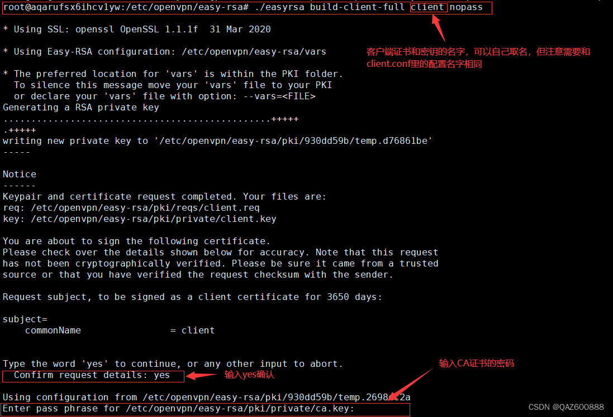
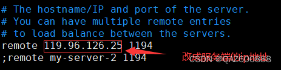
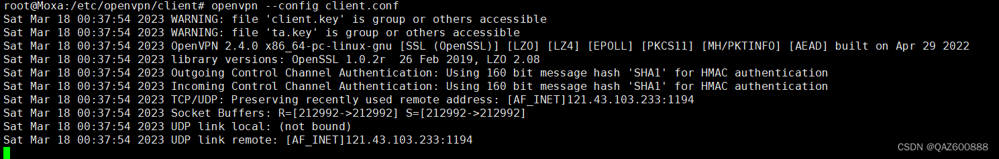
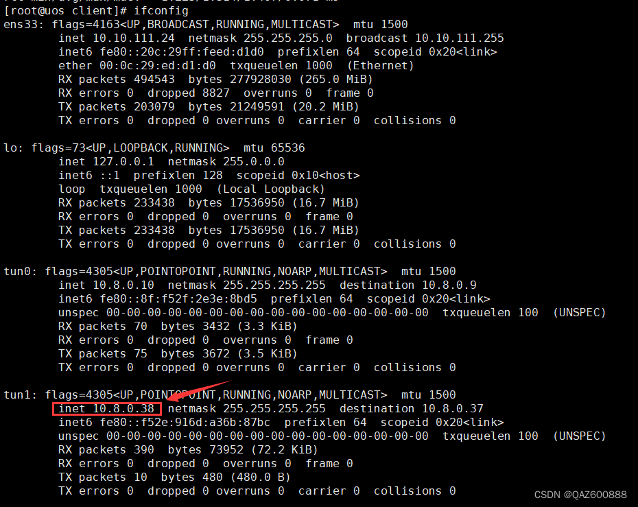
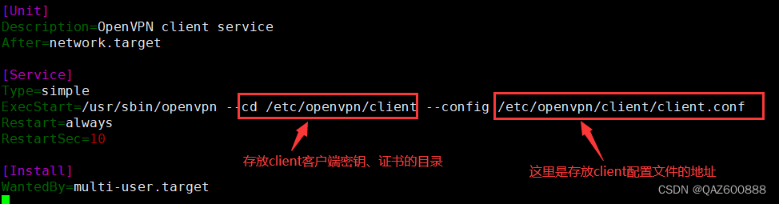
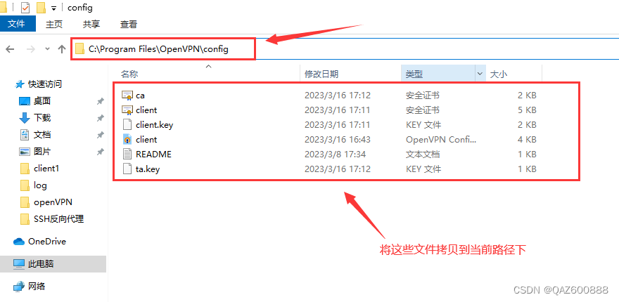
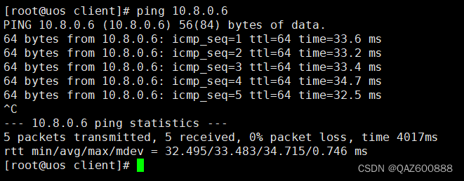
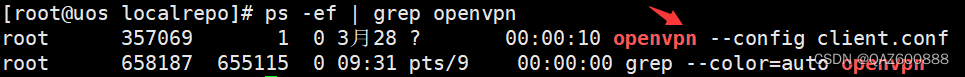

# OpenVPN 客户端部署

先完成 [服务端部署](server.md)。本页按“签发证书 → 传输文件 → 编写配置 → 前台测试 → 开机启动”的顺序操作。
Linux 以 `client01` 为例，Windows 以 `client02` 为例，每台设备使用独立证书。

希望由脚本完成签发、配置生成和 ZIP 打包时，使用单独的 [脚本生成客户端配置与部署](client-package.md)。

:::tip 执行位置
标题会注明是在服务端、Linux 客户端还是 Windows 操作。
命令逐条复制；完整配置粘贴到指定文件中，不要在终端执行配置内容。
截图中的旧文件名、地址和软件界面仅供对照，以正文为准。
:::

## 1. 在服务端签发客户端证书

### 1.1 回到证书工作目录

**位置：服务端终端。** 切换 root，确保有权读取签发用的 CA 私钥。

```bash
sudo -i
```

进入此前已经初始化的 Easy-RSA 目录。**不要再执行 `init-pki` 或 `clean-all`。**

```bash
cd /etc/openvpn/easy-rsa
```

### 1.2 为 Linux 客户端签发证书

`client01` 是这台设备的证书名称，要与服务端的 `ccd/client01` 地址规则一致。
`nopass` 让设备私钥无需人工解锁，便于无人值守启动，因此更要保护好私钥文件。

```bash
./easyrsa build-client-full client01 nopass
```

出现确认提示时输入 `yes`，再输入创建 CA 时设置的密码。
成功后得到 `pki/issued/client01.crt` 和 `pki/private/client01.key`。



*截图证书名为 `client`，本文第一台使用 `client01`。*

### 1.3 为 Windows 客户端另签一份

第二台设备使用 `client02`，不要把 `client01` 的证书和私钥复制给两台设备同时使用。

```bash
./easyrsa build-client-full client02 nopass
```

同样确认签名并输入 CA 密码。成功后得到 `pki/issued/client02.crt` 和 `pki/private/client02.key`，
服务端已预留 `ccd/client02`，连接时分配 `10.8.0.11`。

## 2. 明确需要传输哪些文件

**位置：服务端准备，客户端接收。** 每台设备只需要以下四个文件，再在客户端创建自己的配置文件。

| 文件 | 服务端来源 | 用途 |
| --- | --- | --- |
| `ca.crt` | `/etc/openvpn/easy-rsa/pki/ca.crt` | 验证服务端证书的签发者 |
| `client01.crt` | `/etc/openvpn/easy-rsa/pki/issued/client01.crt` | 证明客户端身份 |
| `client01.key` | `/etc/openvpn/easy-rsa/pki/private/client01.key` | 客户端私钥，必须保密 |
| `ta.key` | `/etc/openvpn/server/ta.key` | 与服务端配套的控制通道密钥 |

Windows 使用自己的 `client02.crt`、`client02.key`，另外两份文件相同。
**不传 `ca.key`、`server.key` 或整个 PKI 目录。**

与原文一样，可通过 Xshell 的 `sz` / `rz` 传输，也可使用已有的 SFTP 工具。
下面把 Xshell 传输展开说明；终端不支持 ZMODEM 时，改用 SFTP 并将四个文件放入对应目录。

### 2.1 在服务端安装传输工具

`lrzsz` 提供 `sz`（发送）和 `rz`（接收），这一步只在需要使用该传输方式时执行。

```bash
apt install -y lrzsz
```

### 2.2 将 client01 文件下载到本地

在服务端的 `/etc/openvpn/easy-rsa` 目录执行。Xshell 会提示本地保存位置，
将四个文件放进独立的 `client01` 文件夹，避免与其他设备的文件混淆。

```bash
sz -b pki/ca.crt pki/issued/client01.crt pki/private/client01.key /etc/openvpn/server/ta.key
```

下载完成后，用于 Linux 的四个文件已经在操作电脑上，稍后上传到 Linux 客户端。

### 2.3 将 client02 文件另存一份

准备 Windows 客户端时执行以下命令，将文件保存到独立的 `client02` 文件夹。

```bash
sz -b pki/ca.crt pki/issued/client02.crt pki/private/client02.key /etc/openvpn/server/ta.key
```

不要把这些私钥提交到 Git、放入公开网盘或发给无关人员。

## 3. 安装 Linux 客户端

### 3.1 安装程序

**位置：Linux 客户端终端。** 根据实际发行版选择安装方式，不要把命令执行到服务端上。

Ubuntu / Debian 先更新软件索引。

```bash
sudo apt update
```

安装 OpenVPN、编辑器及上面用到的文件接收工具。

```bash
sudo apt install -y openvpn vim lrzsz
```

RHEL / Rocky Linux / AlmaLinux 则使用下面的安装命令；需软件源已提供 OpenVPN，通常由管理员启用 EPEL。

```bash
sudo dnf install -y openvpn vim lrzsz
```

检查安装结果，本文以 OpenVPN 2.6 为基准。

```bash
openvpn --version | head -n 1
```

原文中的旧 MOXA / Debian / RedHat 系统可能使用 OpenVPN 2.4，不能直接套用本文所有参数，
应先升级或按设备系统适配。

### 3.2 创建客户端文件目录

切换 root，后续 Linux 文件配置步骤均在此会话中执行。

```bash
sudo -i
```

目录权限设为 `700`，限制其他本机用户读取其中的证书和密钥。

```bash
install -d -m 700 /etc/openvpn/client
```

进入目录，让接收到的文件直接落到正确位置。

```bash
cd /etc/openvpn/client
```

### 3.3 上传并检查四个文件

在连接这台 Linux 的 Xshell 会话中执行接收命令，选择前面下载的 `client01` 文件夹内的四个文件。

```bash
rz -b
```

若使用 SFTP，目标同样是 `/etc/openvpn/client/`，操作账号需要对该目录有写入权限。
检查是否存在 `ca.crt`、`client01.crt`、`client01.key` 和 `ta.key`。

```bash
ls -l /etc/openvpn/client
```


*截图中的设备证书名为 `client`；本文使用 `client01.crt`、`client01.key`，控制通道密钥统一命名为 `ta.key`。
截图中已有的 `client.conf` 将在下一节创建。*

单独收紧客户端私钥权限，避免启动时出现权限过宽警告。

```bash
chmod 600 /etc/openvpn/client/client01.key
```

同样限制控制通道密钥权限。

```bash
chmod 600 /etc/openvpn/client/ta.key
```

## 4. 编写 Linux 客户端配置

### 4.1 创建 client01.conf

**位置：Linux 客户端终端。** 配置文件把公网入口和刚传入的四个文件关联起来。

```bash
vim /etc/openvpn/client/client01.conf
```

粘贴以下完整内容并保存。服务端地址已固定为 `121.40.72.224`。

```text
client
dev tun
proto udp
remote 121.40.72.224 1194
resolv-retry infinite
nobind
persist-key
persist-tun

ca /etc/openvpn/client/ca.crt
cert /etc/openvpn/client/client01.crt
key /etc/openvpn/client/client01.key
tls-crypt /etc/openvpn/client/ta.key
remote-cert-tls server
verify-x509-name server name
tls-version-min 1.2
data-ciphers AES-256-GCM:AES-128-GCM
allow-compression no
verb 3
```

在 vim 中按 `i` 进入插入模式；编辑完成后按 `Esc`，输入 `:wq` 并回车保存退出。



*截图中的旧地址仅供示意，本文统一使用 `121.40.72.224`，协议与端口必须与服务端一致。*

| 配置 | 作用与检查点 |
| --- | --- |
| `client`、`dev tun` | 以客户端身份建立三层隧道 |
| `proto udp`、`remote ... 1194` | 与服务端和防火墙规则保持一致 |
| `ca`、`cert`、`key` | 分别对应 CA 证书、当前设备证书与私钥 |
| `tls-crypt` | 与服务端使用同一份控制通道密钥 |
| `remote-cert-tls server` | 验证对端证书的服务端用途 |
| `verify-x509-name server name` | 校验对端证书 CN 为 `server`，来自服务端签发名称，与公网域名无关 |
| `resolv-retry infinite` | DNS 暂时失败后继续尝试解析 |

不要删除证书校验项来绕过错误。参数含义见
[OpenVPN 手册](https://openvpn.net/community-docs/community-articles/openvpn-2-6-manual/)。

### 4.2 首次前台连接

第一次在前台运行，能直接看到连接过程和报错。此时尚未启动 systemd 服务。

```bash
openvpn --config /etc/openvpn/client/client01.conf
```



*截图停留在连接初期，出现 `UDP link remote` 只说明已准备向远端发包。
应继续等待 `Initialization Sequence Completed` 才能确认连接成功；图中的密钥权限警告已通过前面的 `chmod` 处理。*

该终端会持续运行，不要关闭它。在另一个 Linux 终端中查看地址。

```bash
ip -brief address
```

预期出现 `10.8.0.10/24` 的 TUN 接口。



*原文是旧拓扑，显示多个 TUN 接口及不同地址；本文用 `ip -brief address`，以 `10.8.0.10/24` 为准。*

先测试到 VPN 服务端的连通性，避免一开始就混入另一台客户端的问题。

```bash
ping -c 4 10.8.0.1
```

若成功，回到前台 OpenVPN 窗口按 `Ctrl+C` 断开，再按下一节部署后台服务，避免同一配置重复连接。

## 5. 配置 Linux 开机启动

### 5.1 检查发行版的模板服务

**位置：Linux 客户端 root 终端。** 优先使用系统自带的服务模板，查看命令应能显示 unit 内容。

```bash
systemctl cat openvpn-client@.service
```

若提示未找到模板，使用本节后面的“手工创建服务”分支，**不要两种方式一起启用**。

### 5.2 启用并启动模板实例

实例名 `client01` 对应 `/etc/openvpn/client/client01.conf`。先设置开机自动启动。

```bash
systemctl enable openvpn-client@client01
```

再立即启动，无需重启整台设备。

```bash
systemctl start openvpn-client@client01
```

检查状态，正常应显示 `active (running)`。

```bash
systemctl status openvpn-client@client01 --no-pager
```

检查最近的连接日志，确认出现 `Initialization Sequence Completed`。

```bash
journalctl -u openvpn-client@client01 -n 50 --no-pager
```

<details>
<summary>设备没有模板服务时：像原文一样手工创建 systemd 服务</summary>

仅在模板不存在、系统支持 systemd 且 OpenVPN 已安装时使用。先确认可执行文件路径。

```bash
command -v openvpn
```

以下按输出 `/usr/sbin/openvpn` 编写，若路径不同，同步修改 `ExecStart`。
创建独立的 unit 文件，避免与发行版模板重名。

```bash
vim /etc/systemd/system/openvpn-client01.service
```

粘贴以下完整内容并保存。

```ini
[Unit]
Description=OpenVPN client01
Wants=network-online.target
After=network-online.target

[Service]
Type=simple
ExecStart=/usr/sbin/openvpn --cd /etc/openvpn/client --config /etc/openvpn/client/client01.conf
Restart=on-failure
RestartSec=10

[Install]
WantedBy=multi-user.target
```

`--cd` 明确运行目录；`Restart=on-failure` 在异常退出后重试；`RestartSec=10` 避免连续快速重启。



*本文使用独立服务名和 `client01.conf`，并补充网络启动顺序；路径以正文为准。*

重新加载 systemd，使它识别刚创建的 unit。

```bash
systemctl daemon-reload
```

设置开机启动。

```bash
systemctl enable openvpn-client01.service
```

立即启动。

```bash
systemctl start openvpn-client01.service
```

确认状态为 `active (running)`，并在日志中检查连接结果。

```bash
systemctl status openvpn-client01.service --no-pager
```

查看最近的启动日志。

```bash
journalctl -u openvpn-client01.service -n 50 --no-pager
```

使用此分支时，后面的停止、重启命令中服务名也改成 `openvpn-client01.service`。

</details>

## 6. 配置 Windows 客户端

### 6.1 安装 OpenVPN GUI

**位置：Windows 操作电脑。** 从 [OpenVPN 社区版官方下载页](https://openvpn.net/community/) 获取匹配系统架构的安装包，
安装 OpenVPN GUI 及其网络驱动。本文使用社区版 GUI，菜单和路径可参考
[OpenVPN GUI 官方说明](https://github.com/OpenVPN/openvpn-gui#readme)。

### 6.2 放入这台设备的证书文件

打开资源管理器，新建当前用户的配置子目录。
将下面的路径粘贴到资源管理器地址栏，进入后创建 `client02` 文件夹。

```text
%USERPROFILE%\OpenVPN\config
```

将第 2 节下载的 `ca.crt`、`client02.crt`、`client02.key`、`ta.key` 放入 `client02` 文件夹。



*原文使用 `C:\Program Files\OpenVPN\config`，本文使用当前用户目录，避免写入程序目录需要管理员权限。
文件名以本文 `client02` 为准，控制通道文件为 `ta.key`。*

### 6.3 创建 client02.ovpn

在同一文件夹中新建 `client02.ovpn`。Windows GUI 使用 `.ovpn` 扩展名；Linux 模板使用 `.conf`。
用记事本编辑并粘贴以下配置，服务端地址已固定为 `121.40.72.224`，保存即可。

```text
client
dev tun
proto udp
remote 121.40.72.224 1194
resolv-retry infinite
nobind
persist-key
persist-tun

ca ca.crt
cert client02.crt
key client02.key
tls-crypt ta.key
remote-cert-tls server
verify-x509-name server name
tls-version-min 1.2
data-ciphers AES-256-GCM:AES-128-GCM
allow-compression no
verb 3
```

这里使用相对文件名，因此四个证书 / 密钥文件必须与 `.ovpn` 放在同一目录。
记事本“另存为”时选择“所有文件”，避免实际保存成 `client02.ovpn.txt`。
最终应有以下五个文件：

```text
client02/
  ca.crt
  client02.crt
  client02.key
  ta.key
  client02.ovpn
```

### 6.4 连接并查看结果

启动 **OpenVPN GUI**，在任务栏托盘图标上右键，找到 `client02`，点击 **Connect / 连接**。
若已经启动 GUI 后才放入文件，可退出后重新启动，使它重新扫描配置目录。

看到 **Connected / 已连接**，日志出现 `Initialization Sequence Completed`，并分配到 `10.8.0.11` 才算成功。


*原文分配的是 `10.8.0.6`，本文 `client02` 的地址应为 `10.8.0.11`，界面随安装版本略有差异。*

## 7. 验证客户端之间互通

### 7.1 先确认两端都能到服务端

Linux 已在前面测试 `10.8.0.1`。在 Windows 的 PowerShell 中执行同样的测试。

```powershell
ping 10.8.0.1
```

### 7.2 使用对方的 VPN 地址互测

两台客户端都保持在线。在 Linux `client01` 上测试 Windows `client02`。

```bash
ping -c 4 10.8.0.11
```

在 Windows `client02` 上反向测试 Linux `client01`。

```powershell
ping 10.8.0.10
```



*原文目标 `10.8.0.6` 为历史示例，本文使用固定的 `.10` 和 `.11`，不使用对方现场 LAN 地址。*

Windows 防火墙可能不允许入站 ping。需要测试时，在 **Windows 管理员 PowerShell** 中仅放行 VPN 网段的 ICMP。

```powershell
New-NetFirewallRule -DisplayName 'OpenVPN ICMPv4' -Direction Inbound -Protocol ICMPv4 -IcmpType 8 -RemoteAddress 10.8.0.0/24 -Action Allow
```

### 7.3 验证实际业务端口

Linux 已运行 SSH 服务时，从 Windows 测试 22 端口；其他服务替换为真实端口。

```powershell
Test-NetConnection 10.8.0.10 -Port 22
```

`TcpTestSucceeded : True` 表示 TCP 端口可达。ping 不通但业务端口可通时，应先检查 ICMP 规则。
本页只接通 VPN 主机，其背后的 PCS / BMS 等现场 LAN 仍需单独配置路由、回程和访问控制。

## 8. 查看进程、停止和重连

**位置：Linux 客户端 root 终端。** 除了 systemd 状态，也可以查看进程命令行，确认加载了哪份配置。

```bash
ps -ef | grep '[o]penvpn'
```



*本文写成 `[o]penvpn`，避免将 grep 自己也列入结果。*

需要断开连接时，停止模板实例。

```bash
systemctl stop openvpn-client@client01
```


*图中的 `kill -9` 是强制结束，本文使用 systemd 正常停止；前台启动的进程按 `Ctrl+C` 退出。
若使用手工服务分支，服务名改为 `openvpn-client01.service`。*

修改配置后重启，使新配置生效。

```bash
systemctl restart openvpn-client@client01
```

停用开机自启时，先停止服务，再取消启用。

```bash
systemctl disable openvpn-client@client01
```

Windows 在 GUI 托盘中选择对应连接的 **Disconnect / 断开连接**，需要时再点 **Connect / 连接**。

## 常见问题

| 现象 | 优先检查 |
| --- | --- |
| TLS 超时、一直重连 | 公网地址、UDP 1194、安全组、主机防火墙及服务端日志 |
| `tls-crypt` 解包 / 认证失败 | 两端密钥是否一致，是否混用了原文 `tls-auth` 配置 |
| 私钥文件找不到 | 文件名、配置路径及读取权限；Windows 是否与 `.ovpn` 同目录 |
| 证书校验失败 | 系统时间、有效期、CA 和服务端 CN，不要通过删除校验项解决 |
| 分到 `.100–.200` 而非固定 IP | CCD 文件名是否等于证书 CN，修正后重新连接 |
| 服务端能通，另一客户端不通 | 对方在线状态、VPN IP、客户端入站防火墙 |
| 前台可用，后台启动失败 | 服务实际加载的配置、路径权限、是否已存在重复连接 |
| VPN 通了，现场 LAN 不通 | 另行配置现场路由、回程、转发与访问控制 |

配置泄露或设备停用后，到 [服务端](server.md) 吊销对应证书；仅删除本地文件不能阻止已复制的证书继续使用。

