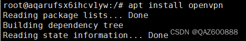
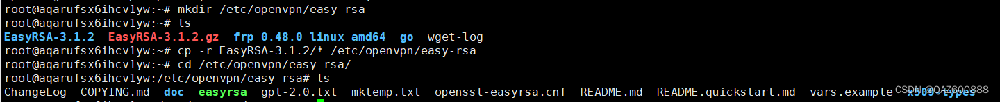
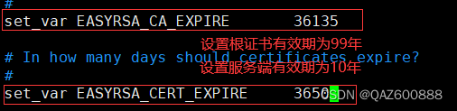
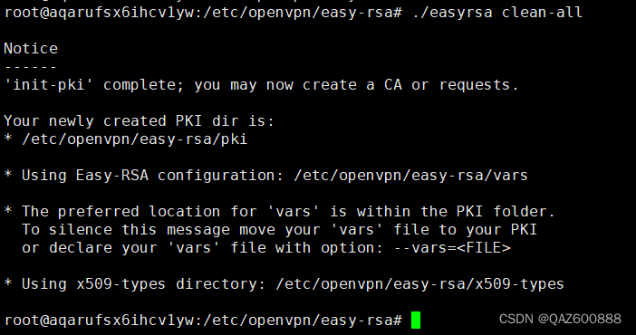
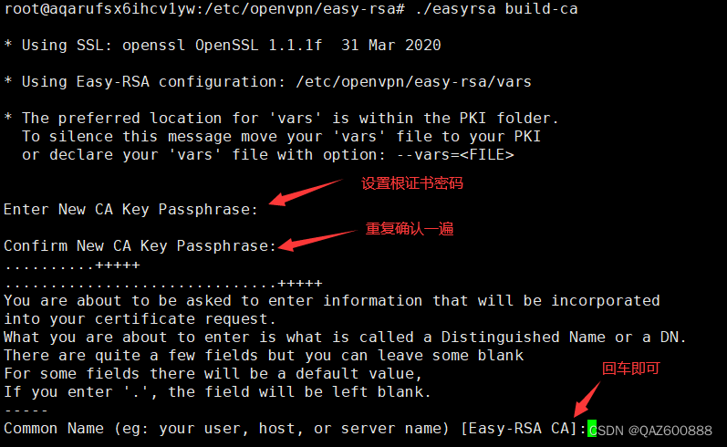
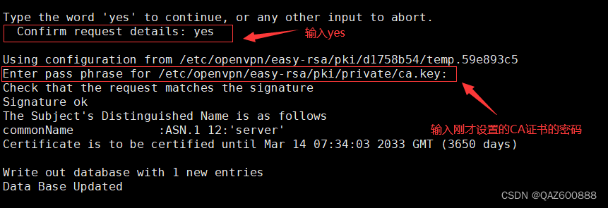
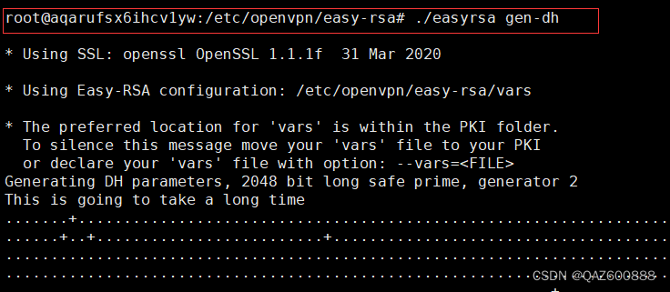
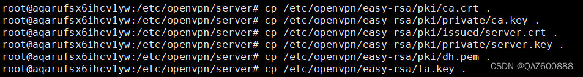
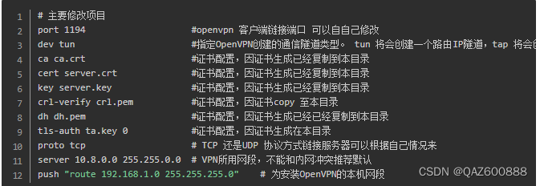
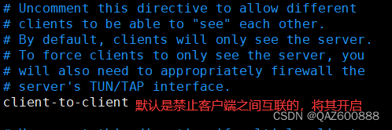

# OpenVPN 服务端部署

本文在 Ubuntu 24.04 LTS 上部署 OpenVPN 2.6 社区版，让异地 Linux、Windows 客户端通过 VPN 地址互访。
先完成本页，再阅读 [客户端部署](client.md)；地址规划见 [部署说明](index.md)。

:::tip 阅读与复制
本页命令在**服务端终端**执行，每个命令单独复制、确认结果后再进行下一步。
配置文件内容单独展示，需要粘贴到编辑器中，不是在终端直接执行。
截图沿用原文，旧版界面、文件名和地址与正文不一致时，以正文为准。
:::

## 1. 安装 OpenVPN

### 1.1 安装服务程序

先刷新软件源信息，避免安装时使用过期的包地址。

```bash
sudo apt update
```

安装 OpenVPN；`vim` 用于后续编辑配置文件。

```bash
sudo apt install -y openvpn vim
```



检查第一行是否显示 OpenVPN 2.6。其他版本需先确认配置兼容性，尤其是后文的 `disable-dco`。

```bash
openvpn --version | head -n 1
```

### 1.2 切换管理员会话

后面需要在 `/etc/openvpn` 下写文件，统一使用 root 会话；本页后续命令无需再加 `sudo`。

```bash
sudo -i
```

将后续新建文件的默认权限限制为仅当前用户可读写，避免私钥被其他用户读取。

```bash
umask 077
```

检查系统是否提供 VPN 所需的 TUN 设备，正常会输出 `TUN ready`。

```bash
test -c /dev/net/tun && echo 'TUN ready'
```

若没有输出，先解决 TUN 设备问题；容器需要由宿主机提供该设备及相应网络权限。

## 2. 准备 Easy-RSA

### 2.1 安装证书管理工具

Easy-RSA 用于创建 CA、签发服务端和客户端证书；只需安装在签发证书的机器上。

```bash
apt install -y easy-rsa
```

创建独立工作目录，避免将证书和签发记录写入系统软件包目录。

```bash
install -d -m 700 /etc/openvpn/easy-rsa
```

复制系统提供的 Easy-RSA 文件，保留原有目录结构。

```bash
cp -a /usr/share/easy-rsa/. /etc/openvpn/easy-rsa/
```

进入工作目录，后续 `./easyrsa` 命令均从这里执行。

```bash
cd /etc/openvpn/easy-rsa
```

检查是否已有 `easyrsa`、`openssl-easyrsa.cnf` 和 `x509-types` 等文件。

```bash
ls -l
```



*原文通过下载压缩包准备文件，本文优先使用发行版软件包，最终工作目录的用途相同。*

<details>
<summary>需要沿用原文的下载、解压方式时</summary>

此方式与上面的软件包复制方式**二选一**，仅用于尚未初始化 PKI 的新工作目录。
从 [Easy-RSA 官方发布页](https://github.com/OpenVPN/easy-rsa/releases) 下载稳定版 Linux 压缩包，
上传到服务端 `/root/EasyRSA.tgz`。不要继续使用截图中的旧安装包作为固定下载地址。

先确认压缩包内容，正常应看到一个顶层 EasyRSA 目录。

```bash
tar -tzf /root/EasyRSA.tgz | head
```

创建工作目录。

```bash
install -d -m 700 /etc/openvpn/easy-rsa
```

解压时去掉压缩包最外层目录，让 `easyrsa` 直接位于工作目录中。

```bash
tar -xzf /root/EasyRSA.tgz --strip-components=1 -C /etc/openvpn/easy-rsa
```

进入解压后的目录。

```bash
cd /etc/openvpn/easy-rsa
```

若压缩包带有 `vars.example`，先复制成 `vars`，再按下一节修改；未提供该文件时直接新建即可。

```bash
cp vars.example vars
```

</details>

### 2.2 设置证书有效期

`vars` 是 Easy-RSA 的参数文件。这里明确有效期，便于安排续期，不需要修改一长串无关参数。

```bash
vim /etc/openvpn/easy-rsa/vars
```

写入以下内容。单位都是“天”：CA 为 36135 天，设备证书为 36135 天，吊销列表为 3650 天。

```text
set_var EASYRSA_CA_EXPIRE 36135
set_var EASYRSA_CERT_EXPIRE 36135
set_var EASYRSA_CRL_DAYS 3650
```

在 vim 中按 `i` 进入插入模式；编辑完成后按 `Esc`，输入 `:wq` 并回车保存退出。后文编辑文件均采用相同方式。
这些参数影响后续新生成的证书和 CRL，不会自动延长已签发证书的有效期。



*图中 CA 为 99 年、设备证书为 10 年；本文使用上面的值，并在到期前续期。*

## 3. 初始化证书目录并创建 CA

### 3.1 初始化 PKI

PKI 保存证书、私钥、请求和签发记录。**仅首次搭建时执行**；新增客户端时直接使用现有 PKI。

```bash
./easyrsa init-pki
```

完成后会生成 `/etc/openvpn/easy-rsa/pki/`。



*截图使用 `clean-all` 清理后初始化；本文只在新目录执行 `init-pki`，已有证书时不要照图清空。*

### 3.2 创建 CA 根证书

CA 负责签发并证明服务端、客户端的身份。

```bash
./easyrsa build-ca
```

按顺序处理交互：

1. `Enter New CA Key Passphrase`：设置 CA 私钥密码。
2. `Confirm New CA Key Passphrase`：再次输入相同密码，输入时不会回显。
3. `Common Name`：填写 `EMS-VPN-CA`，这是 CA 的显示名称。



生成的 `pki/ca.crt` 是可分发的 CA 证书；`pki/private/ca.key` 是签发用的 CA 私钥，必须保密。
保存 CA 密码并备份整个 PKI 目录，后续签发和吊销都依赖它们。相关概念见
[Easy-RSA 官方文档](https://easy-rsa.readthedocs.io/en/latest/)。

## 4. 生成服务端证书与密钥

### 4.1 签发服务端证书

`server` 是服务端证书名称，后文客户端会校验这个名称；`nopass` 让服务启动时无需人工输入设备私钥密码。

```bash
./easyrsa build-server-full server nopass
```

出现签名确认时输入 `yes`，再输入刚才设置的 **CA 密码**。
不同 Easy-RSA 小版本的提示可能不同，以实际交互为准。



成功后得到 `pki/issued/server.crt` 和 `pki/private/server.key`。
`nopass` 只影响服务端私钥，不会取消 CA 私钥的密码。

### 4.2 生成 DH 参数

本例配置使用 `dh.pem`，因此需先生成对应参数文件。

```bash
./easyrsa gen-dh
```



此过程可能持续数分钟，等待返回命令提示符即可，结果为 `pki/dh.pem`。

### 4.3 生成控制通道密钥

先创建运行目录，供服务端配置、密钥和客户端地址规则使用。

```bash
install -d -m 700 /etc/openvpn/server/ccd
```

`tls-crypt` 密钥用于加密并认证控制通道，需同时配置在服务端和客户端。

```bash
openvpn --genkey tls-crypt /etc/openvpn/server/ta.key
```


*截图为 `tls-auth` 的旧写法；本文两端使用 `tls-crypt`，密钥文件统一命名为 `ta.key`，无需设置 `key-direction`。*

### 4.4 生成吊销列表

CRL 记录被吊销的证书。即使暂时没有吊销设备，也先生成它，避免配置引用不存在的文件。

```bash
./easyrsa gen-crl
```

按提示输入 CA 密码，结果为 `pki/crl.pem`。

## 5. 整理服务端运行文件

签发目录用于管理证书；运行目录只放 OpenVPN 启动所需的文件。仍在 Easy-RSA 工作目录执行下列步骤。

**复制 CA 证书**，用于验证客户端是否由本 CA 签发。

```bash
install -m 644 pki/ca.crt /etc/openvpn/server/ca.crt
```

**复制服务端证书**，用于向客户端证明服务端身份。

```bash
install -m 644 pki/issued/server.crt /etc/openvpn/server/server.crt
```

**复制服务端私钥**，权限设为 `600`，仅 root 可读写。

```bash
install -m 600 pki/private/server.key /etc/openvpn/server/server.key
```

**复制 DH 参数**，对应后文配置中的 `dh`。

```bash
install -m 644 pki/dh.pem /etc/openvpn/server/dh.pem
```

**复制吊销列表**，对应后文配置中的 `crl-verify`。

```bash
install -m 644 pki/crl.pem /etc/openvpn/server/crl.pem
```

限制控制通道密钥的读取权限。该文件已在运行目录生成，不用再复制。

```bash
chmod 600 /etc/openvpn/server/ta.key
```



*图中复制了 `ca.key`，这一步无需执行。CA 私钥只用于签发，不能放入运行目录或发给客户端。*

检查文件是否齐全，预期有 `ca.crt`、`server.crt`、`server.key`、`dh.pem`、`crl.pem`、`ta.key` 和 `ccd/`。

```bash
ls -l /etc/openvpn/server
```

## 6. 配置服务端与固定地址

### 6.1 创建 server.conf

配置文件把监听端口、VPN 网段和证书文件关联起来。已有同名配置时先备份。

```bash
vim /etc/openvpn/server/server.conf
```

将以下**完整配置**粘贴到编辑器并保存：

```ini
# 监听端口；客户端 remote 和防火墙放行端口必须与此一致
port 1194
# 使用 UDP 传输；客户端也必须设置 proto udp
proto udp
# 创建三层 IP 隧道，虚拟网卡通常名为 tun0
dev tun
# 客户端使用同一子网及掩码，便于分配固定 IP
topology subnet
# VPN 网段，不能与现有网络冲突；服务端地址为 10.8.0.1
# nopool 禁用自动生成的地址池，改用下面显式指定的范围
server 10.8.0.0 255.255.255.0 nopool
# 动态地址范围，避开 CCD 中给 client01、client02 预留的 .10、.11
ifconfig-pool 10.8.0.100 10.8.0.200 255.255.255.0

# CA 证书：验证客户端证书的签发者，不是 CA 私钥 ca.key
ca /etc/openvpn/server/ca.crt
# 服务端身份证书，与下面的私钥配套
cert /etc/openvpn/server/server.crt
# 服务端私钥，仅服务端保管，文件权限应为 600
key /etc/openvpn/server/server.key
# Diffie-Hellman 密钥交换参数，由 easyrsa gen-dh 生成
dh /etc/openvpn/server/dh.pem
# 检查证书吊销列表；吊销设备后需更新此文件
crl-verify /etc/openvpn/server/crl.pem
# 加密并认证控制通道；客户端使用同一份密钥，无需 key-direction
tls-crypt /etc/openvpn/server/ta.key
# 控制通道最低允许 TLS 1.2
tls-version-min 1.2
# 要求对端证书具备客户端用途
remote-cert-tls client
# 允许协商的数据通道加密算法，客户端需支持其中至少一种
data-ciphers AES-256-GCM:AES-128-GCM
# 禁止压缩，避免引入压缩相关的安全风险
allow-compression no

# 客户端专属配置目录，文件名匹配证书 CN，可在其中分配固定 IP
client-config-dir /etc/openvpn/server/ccd
# 允许已认证客户端通过 VPN 互访，适用于相互信任的设备
client-to-client
# 关闭数据通道卸载，让上述互访通过 OpenVPN 进程内部转发
disable-dco
# 每 10 秒保活；客户端超时为 120 秒，服务端使用两倍超时（240 秒）
keepalive 10 120
# 软重启时保留已加载的密钥，无需重新读取密钥文件
persist-key
# 软重启时保留 TUN 设备，减少虚拟网卡反复创建
persist-tun
# 服务退出或重启时通知 UDP 客户端，促使其尽快重连
explicit-exit-notify 1
# 日志详细程度：3 为常规运行级别
verb 3
```



*原文截图出现 `proto tcp` 和现场 LAN 路由；本文统一为 UDP，只接通 VPN 主机，不直接推送现场网段。*

| 配置 | 为什么这样设置 |
| --- | --- |
| `port 1194`、`proto udp` | 服务端、客户端和防火墙使用同一协议与端口 |
| `dev tun`、`topology subnet` | 建立三层隧道，客户端使用同一 `/24` 网段 |
| `server ... nopool`、`ifconfig-pool` | 动态地址只用 `.100–.200`，给固定地址留出空间 |
| `ca`、`cert`、`key`、`dh`、`crl-verify` | 引用前面准备的文件，绝对路径避免启动目录不同引起错误 |
| `client-to-client`、`disable-dco` | 通过 OpenVPN 内部转发实现客户端互访 |
| `keepalive 10 120` | 检测断线并触发重连 |
| 不推送 `redirect-gateway` | 客户端只把 `10.8.0.0/24` 的流量送进隧道，上网、DNS 等其余流量照常走本地网络，互不影响 |

:::warning 不要添加全局代理推送
从其他模板拼装 `server.conf` 时，容易带入
`push "redirect-gateway def1 bypass-dhcp"` 和 `push "dhcp-option DNS ..."`。
它们会把客户端**全部**流量和 DNS 接管进隧道；本方案的服务端只做客户端互访转发，
没有配置内核 IP 转发和 NAT，接管后的流量在服务端无处可去，
表现为**客户端一连上 VPN，普通上网全部中断**。
保持分流模式：不要推送这些指令；确需全局代理时，需另行配置
`net.ipv4.ip_forward=1` 和 NAT（MASQUERADE），不属于本文范围。
:::



本例客户端互访在 OpenVPN 进程内部转发，无需为此额外配置公网 NAT 或内核 IP 转发。
内部互访不经过服务端内核的逐客户端防火墙规则，只适用于相互信任的设备。
参数说明见 [OpenVPN 手册](https://openvpn.net/community-docs/community-articles/openvpn-2-6-manual/)。

### 6.2 给客户端指定固定 IP

CCD 文件名必须等于客户端证书 CN。后文签发 `client01` 后，它将获得 `10.8.0.10`。

```bash
printf 'ifconfig-push 10.8.0.10 255.255.255.0\n' > /etc/openvpn/server/ccd/client01
```

给第二台客户端 `client02` 分配 `10.8.0.11`，用于 Windows 接入和互通测试。

```bash
printf 'ifconfig-push 10.8.0.11 255.255.255.0\n' > /etc/openvpn/server/ccd/client02
```

这里只创建地址规则，**客户端证书还需要在客户端文档中单独签发**。

## 7. 放行公网端口

### 7.1 配置云安全组

在云控制台打开该实例的“安全组 / 防火墙”，新增入站规则：协议 **UDP**、目标端口 **1194**。
有固定出口时，来源限制为客户端出口 IP；动态出口按实际接入范围设置。


*截图放行了全部 UDP 端口，本文只需放行 1194。不要照图开放 `1–65535`。*

### 7.2 配置主机防火墙

云安全组和主机防火墙是两道独立规则。先查看是否启用了 UFW。

```bash
ufw status
```

若显示 `active`，放行 VPN 的 UDP 端口；使用其他防火墙时在其现有规则中添加同等规则。

```bash
ufw allow 1194/udp
```

若服务端在路由器后，还需将公网 `UDP 1194` 转发到该主机的 `UDP 1194`。

## 8. 启动服务并确认结果

### 8.1 首次前台启动

先在前台启动，便于直接看到配置错误。此时不要同时启动 systemd 实例。

```bash
openvpn --config /etc/openvpn/server/server.conf
```

看到 `Initialization Sequence Completed` 表示初始化完成。终端会一直占用，这是前台运行的正常现象。
确认后按 `Ctrl+C` 正常退出，再进行下面的后台部署。

### 8.2 设置开机启动

发行版已提供模板服务，实例名 `server` 对应 `/etc/openvpn/server/server.conf`。

```bash
systemctl enable openvpn-server@server
```

启动服务，让它在后台运行，不再依赖 SSH 窗口。

```bash
systemctl start openvpn-server@server
```

### 8.3 检查运行状态

状态应为 `active (running)`。

```bash
systemctl status openvpn-server@server --no-pager
```

查看最近 50 行日志，确认初始化完成，失败时根据具体报错处理。

```bash
journalctl -u openvpn-server@server -n 50 --no-pager
```

确认进程已监听 UDP 1194。

```bash
ss -lunp | grep ':1194'
```

确认出现地址为 `10.8.0.1/24` 的 TUN 接口；若已有其他隧道，接口不一定叫 `tun0`。

```bash
ip -brief address
```

完成后进入 [客户端部署](client.md)。服务安装和管理方式参考
[Ubuntu 官方指南](https://ubuntu.com/server/docs/how-to/security/install-openvpn/)。

## 9. 日常管理与证书吊销

修改 `server.conf` 后重启服务，使新配置生效。

```bash
systemctl restart openvpn-server@server
```

持续查看日志时使用下面的命令，按 `Ctrl+C` 退出日志查看。

```bash
journalctl -u openvpn-server@server -f
```

需要停服时正常停止，不使用强制结束进程的方式。

```bash
systemctl stop openvpn-server@server
```

设备丢失或配置泄露时，以 `client01` 为例，先返回签发目录。

```bash
cd /etc/openvpn/easy-rsa
```

吊销该证书，按提示确认并输入 CA 密码。

```bash
./easyrsa revoke client01
```

重新生成 CRL，将本次吊销写入列表。

```bash
./easyrsa gen-crl
```

将新列表安装到服务实际读取的位置。

```bash
install -m 644 pki/crl.pem /etc/openvpn/server/crl.pem
```

检查 CRL 的下次更新时间，在此日期前重新生成并安装。

```bash
openssl crl -in /etc/openvpn/server/crl.pem -noout -nextupdate
```

重启以立即断开当前连接。其他有效客户端随后重连，被吊销的设备无法重新接入。

```bash
systemctl restart openvpn-server@server
```

检查服务端证书到期时间，便于提前续期。

```bash
openssl x509 -in /etc/openvpn/server/server.crt -noout -enddate
```

| 现象 | 优先检查 |
| --- | --- |
| 启动立即失败 | 日志中的报错、配置文件与证书路径、权限和 OpenVPN 版本 |
| 客户端 TLS 超时 | 公网入口、UDP/TCP、安全组、主机防火墙和端口转发 |
| `VERIFY ERROR` | 系统时间、证书有效期、两端使用的 CA |
| `CRL has expired` | 重新生成并安装 CRL |
| 已连接但客户端无法互访 | 对方是否在线、虚拟 IP 与客户端防火墙规则 |
| 客户端一连上 VPN，其他网站全断 | 服务端是否推送了 `redirect-gateway`；未配置 NAT 时删除该推送，改回分流模式 |

